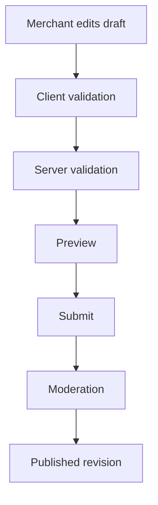

# External Voxel Repository Adoption and Implementation Plan

**Date:** 2026-10-17  
**Status:** Proposed implementation plan. **Track B (realtime protocol contracts) is implemented** ([ADR 0004](adr/0004-presence-protocol-contracts.md)); the other tracks are proposals.  
**Repository baseline:** `main` at `699cdb3f2ca4016bb224c4c8e9348493acd2bdad`  
**Related roadmap:** [Tasks](../roadmap/tasks.md), [alignment status](../roadmap/alignment_status.md), [world-expansion freeze](../roadmap/world_freeze.md)  
**Related architecture:** [Modular monorepo migration plan](modular_monorepo_migration_plan.md), [ADR 0001](adr/0001-shared-package-boundaries.md)

## 1. Purpose

This document explains how VoxelVenture can selectively use ideas from:

- [boona13/mykonos-island-voxels](https://github.com/boona13/mykonos-island-voxels)
- [voxelize/voxelize](https://github.com/voxelize/voxelize)
- [jasonkneen/tiny-world-builder](https://github.com/jasonkneen/tiny-world-builder)

The goal is not to replace VoxelVenture's current product or engine. The goal is to extract a small number of techniques that improve:

- mobile usability;
- 3D performance;
- automated test coverage;
- realtime protocol safety;
- merchant customization;
- repeatable demonstrations and performance tests.

VoxelVenture is already a business-discovery product with a mature 3D city, public non-WebGL pages, conversion measurement, paid products, pilot tooling, and a Node-based realtime service. Any adoption must preserve that business-first focus.

## 2. Executive recommendation

Proceed in three controlled tracks:

1. **Before and during the Phase 6 pilot:** implement only testing, performance, accessibility, contract, and observability improvements. These comply with the world-expansion freeze.
2. **After the pilot meets the freeze-lift criteria:** build a constrained merchant storefront customizer and adjacency-aware storefront presentation.
3. **Only after measured scale requires it:** evaluate deeper authoritative-world or engine work inspired by Voxelize.

Do not perform a wholesale engine migration. Do not copy Tiny World Builder code into VoxelVenture. Do not add general-purpose world building before pilot evidence demonstrates that merchant customization improves activation, conversion, or renewal.

## 3. What the current project already has

The external repositories should not be treated as if VoxelVenture were starting from scratch.

### 3.1 Existing rendering and mobile capabilities

The current code already includes:

- React Three Fiber and Three.js.
- An orthographic isometric camera and a follow camera.
- Touch-aware pixel-ratio limits.
- Disabled shadows on touch devices.
- Safe-area-aware on-screen controls.
- Static mesh batching.
- GPU failure detection and a non-WebGL product path.
- Runtime draw-call, triangle, geometry, texture, and frame-rate diagnostics.
- An experimental streamed road-network path.
- A world map with culling and caching.
- Device telemetry through the multiplayer monitor.

Relevant current files include:

- `apps/web/components/city/CityCanvas.jsx`
- `apps/web/components/city/StaticBatch.jsx`
- `apps/web/components/city/StreamedNetwork.jsx`
- `apps/web/components/city/GpuGuard.jsx`
- `apps/web/components/city/PerfProbe.jsx`
- `apps/web/components/ui/TouchControls.jsx`
- `lib/dev/perfStats.js`

### 3.2 Existing realtime scale controls

The presence server already provides several capabilities comparable to the most immediately useful Voxelize ideas:

- rooms separated by city seed;
- proximity-based interest management;
- a maximum number of visible players;
- compact delta snapshots;
- distance-sensitive update frequency;
- message-size and rate limits;
- backpressure handling;
- authenticated chat identity;
- error and performance telemetry;
- load metrics;
- a configurable multi-server client list;
- a synthetic load test supporting hundreds of clients.

Relevant files include:

- `services/multiplayer/server.mjs`
- `lib/net/multiplayer.js`
- `scripts/load-test-presence.mjs`
- `tests/multiplayer.test.mjs`
- `tests/messaging.test.mjs`
- `docs/architecture/presence_scale.md`

This means the next realtime step is not replacing Node with Rust. It is formalizing contracts, expanding journey agents, and adding authority only where a concrete business or abuse case requires it.

### 3.3 Existing business-journey testing

`tests/live-browser.test.mjs` already exercises a meaningful end-to-end path:

- create and link a business;
- render it in Discover;
- record a profile visit;
- record a qualified visit;
- track a CTA and click ID;
- enter the corresponding 3D storefront;
- verify city-originated CTA tracking;
- exercise multiple browser sessions and messaging.

This is already the foundation of the proposed headless-agent strategy. The gap is breadth, repeatability, load composition, and reusable agent abstractions—not the absence of browser testing.

### 3.4 Existing asset and customization foundations

The project already has:

- a generated prop catalog with dimensions, triangle counts, size, class, and model URL;
- a development-only reserved-site designer;
- building and logo generation;
- plot/business customization;
- saved local state;
- interiors;
- merchant management surfaces;
- shared packages and versioned contracts.

These foundations substantially reduce the work needed for a constrained merchant customizer.

## 4. Source-repository assessment

## 4.1 Mykonos Island Voxels

### Useful concepts

Mykonos provides a lightweight isometric builder with:

- explicit touch gestures;
- brush placement and deletion;
- high-DPI asset preprocessing;
- layered rendering caches;
- dirty-flag rendering;
- constant-time cell occupancy;
- centralized asset manifests;
- autosave;
- debounced placement audio;
- a procedural visual fallback.

### Fit with VoxelVenture

The interaction, asset-management, and rendering principles fit well. The Canvas 2D renderer does not.

VoxelVenture should translate these ideas into React Three Fiber and Three.js equivalents rather than copying the renderer.

### License

The project and its asset pack are published under the MIT license. Any reused code or assets must retain the required copyright and permission notice and must be recorded in `CREDITS.md` and the in-product credit source.

### Adoption decision

| Idea | Decision | Reason |
| --- | --- | --- |
| Touch gesture semantics | Adapt | Improves mobile usability with little architectural risk |
| Dirty/demand rendering | Adapt | Can reduce battery and GPU load |
| Asset-manifest metadata | Extend current catalog | Current catalog already has a strong base |
| Cached Canvas renderer | Do not adopt | Incompatible with the existing Three.js world |
| Full PNG asset pack | Optional, only after visual/license review | Existing visual style and freeze take precedence |
| Local autosave pattern | No immediate action | VoxelVenture already has local saves |

## 4.2 Voxelize

### Useful concepts

Voxelize provides:

- an authoritative Rust server;
- a TypeScript/Three.js client;
- WebSocket synchronization;
- Protocol Buffer contracts;
- proximity-oriented multiplayer;
- entity synchronization;
- custom blocks and metadata;
- physics and raycasting packages;
- WASM meshing;
- deterministic world generation;
- headless browser agents;
- performance benchmarks.

### Fit with VoxelVenture

Voxelize solves the problem of a persistent, editable multiplayer voxel world. VoxelVenture's present problem is different: validate merchant value and commercial conversion around a mostly generated city.

Several architecture patterns fit, but a full engine migration does not.

### License

Voxelize is MIT-licensed. Individual third-party assets listed by the repository may have different licenses and must be reviewed separately.

### Adoption decision

| Idea | Decision | Reason |
| --- | --- | --- |
| Reusable headless agents | Adapt now | Builds on existing browser and load tests |
| Versioned realtime contracts | Implement in `shared-types` | Prevents client/server protocol drift |
| Interest management | Keep current implementation | VoxelVenture already has it |
| Compact delta updates | Keep current implementation | Protocol v2 already does this |
| Server-authoritative movement | Conditional | Needed only for abuse-sensitive mechanics |
| Rust server migration | Defer | High cost without current business value |
| WASM meshing | Defer | No measured meshing bottleneck |
| Infinite editable chunks | Reject for current roadmap | Conflicts with product scope and freeze |
| Physics/raycast packages | Evaluate only against a measured defect | Current movement is adequate for pilot |

## 4.3 Tiny World Builder

### Useful concepts

Tiny World Builder demonstrates:

- terrain and object placement;
- raising and lowering terrain;
- several camera modes;
- named saves;
- deterministic seed URLs;
- sharing, remixing, and export;
- adjacency-aware paths, fences, shorelines, bridges, and structures;
- road-constrained vehicles;
- collision-aware rerouting;
- command-palette actions;
- environment layers;
- schema-validated generated worlds.

### Fit with VoxelVenture

The strongest fit is a restricted merchant storefront customizer. General terrain editing and unrestricted world creation do not fit the current product.

### License and implementation risk

Tiny World Builder is AGPL-3.0-licensed and describes its central implementation as a very large single JavaScript block. Directly incorporating or modifying that implementation would create both maintainability and licensing concerns for a commercial VoxelVenture deployment.

Use the repository as a product and interaction reference. Implement selected concepts independently against VoxelVenture's existing data model and rendering system. Obtain legal review before any direct reuse.

### Adoption decision

| Idea | Decision | Reason |
| --- | --- | --- |
| Restricted storefront customizer | Implement after pilot gate | Strong potential Pro/lease value |
| Adjacency-aware storefront details | Implement selectively | Improves coherence with bounded complexity |
| Seeded demonstrations and tours | Implement now in tests; expose later | Supports repeatable QA and sales demonstrations |
| Named merchant drafts | Implement with customizer | Fits moderation and publication workflow |
| Road/delivery simulation | Defer | World feature; frozen and commercially unproven |
| Terrain sculpting | Reject | Conflicts with controlled commercial inventory |
| Code or asset copying | Do not proceed | AGPL and maintainability risk |

## 5. Implementation principles

Every implementation slice should follow these rules:

1. **Business value first.** A change must improve merchant acquisition, visitor conversion, measurable results, renewal, reliability, accessibility, or operating cost.
2. **Preserve the public web funnel.** No 3D feature may become required to discover or contact a business.
3. **Do not weaken server authority.** Paid inventory, claims, conversions, moderation, and publication remain server-controlled.
4. **Keep customization declarative.** Store data, not executable code or arbitrary models.
5. **Use current packages.** Cross-boundary shapes belong in `packages/shared-types`; pure stable rules move into a package only when the boundary is clear.
6. **Measure before migrating.** Rust, WASM, chunking, or a new engine requires profiling evidence and a written ADR.
7. **Respect the freeze.** Before the pilot qualifies, new city/simulation features remain deferred.
8. **Keep structural and feature changes separate.** Do not combine an `apps/web` move, service relocation, and customizer implementation in one PR.

## 6. Implementation Track A — Headless journeys and deterministic scenarios

**Priority:** P0  
**Freeze status:** Allowed; testing and commercial validation  
**Recommended timing:** Before the Phase 6 pilot

### 6.1 Objective

Turn the existing one-off browser and socket harnesses into reusable agents that can exercise the most important user and merchant journeys.

### 6.2 Proposed journeys

#### Visitor agent

- Open Discover.
- Filter by category or district.
- Open a business profile.
- Remain long enough for a qualified visit.
- Press the primary CTA.
- Follow the deep link into the 3D city.
- Focus the correct plot.
- Enter the storefront.
- Confirm conversion attribution is not duplicated.

#### Merchant agent

- Create an account.
- Create a free business profile.
- Link or claim a plot.
- Configure the primary CTA.
- Publish permitted fields.
- Review statistics.
- Create a coupon or campaign.
- Submit pilot feedback.

#### Realtime visitor agents

- Connect to the same city.
- Authenticate using one-use messaging tickets.
- Enter and exit view radius.
- Exchange nearby chat.
- Reconnect after a forced disconnect.
- Confirm snapshots do not duplicate players or messages.

#### Abuse and resilience agents

- Send malformed messages.
- Exceed rate limits.
- Reuse expired tickets.
- Move beyond valid coordinate ranges.
- Simulate a slow receiver.
- Reconnect with stale protocol versions.
- Verify that paid or verified outcomes cannot be created through presence messages.

### 6.3 Proposed files

Initial implementation should remain compatible with the current root layout:

```text
tests/
├── agents/
│   ├── browser-agent.mjs
│   ├── merchant-agent.mjs
│   ├── presence-agent.mjs
│   └── scenario.mjs
├── journeys/
│   ├── visitor-discovery-to-storefront.test.mjs
│   ├── merchant-onboarding.test.mjs
│   ├── reconnect-and-recovery.test.mjs
│   └── attribution-deduplication.test.mjs
└── fixtures/
    └── deterministic-pilot-city.mjs

scripts/
└── load-test-presence.mjs       # retained; may import the shared presence agent later
```

Do not move the current tests during the first slice. Extract shared helpers behind compatibility imports, then migrate individual journeys.

### 6.4 Deterministic scenario contract

Add a versioned contract in:

`packages/shared-types/src/contracts/test-scenario.js`

Suggested shape:

- scenario ID and schema version;
- city seed;
- viewport/device profile;
- participant roles;
- starting accounts and businesses;
- expected milestones;
- timeout budget;
- allowed external links;
- performance budgets.

The scenario format must not contain production credentials or real customer data.

### 6.5 Acceptance criteria

- The existing live-browser test continues to pass.
- At least three journey tests use the shared agent primitives.
- Runs are repeatable with the same seed.
- Each failure states the failed business milestone, not only a CSS selector.
- Artifacts contain sanitized logs and screenshots.
- CI distinguishes product regression, rendering failure, and environment/GPU limitation.
- A pilot release can run the same journey suite against staging.

## 7. Implementation Track B — Realtime protocol contracts

**Status:** implemented, 2026-10-17 ([ADR 0004](adr/0004-presence-protocol-contracts.md)); see 7.7.  
**Priority:** P0/P1  
**Freeze status:** Allowed; security and reliability  
**Recommended timing:** Before broader public multiplayer

### 7.1 Objective

Move the documented protocol-v2 message shapes into versioned, executable contracts shared by the browser tests and server tests.

### 7.2 Scope

Define contracts for:

- `hello`;
- `welcome`;
- `state`;
- `snapshot`;
- `online`;
- `auth`;
- `auth.ok`, `auth.failed`, and `auth.revoked`;
- `chat.send`, `chat.accepted`, and `chat.rejected`;
- `perf`;
- `error`;
- `world`.

### 7.3 Proposed location

```text
packages/shared-types/src/
├── contracts/
│   ├── multiplayer-client-v2.js
│   ├── multiplayer-server-v2.js
│   └── test-scenario.js
└── enums.js
```

Keep JSON transport for now. Protocol Buffers are not necessary to gain schema validation and drift protection.

### 7.4 Validation strategy

- Validate the initial client `hello` and authentication messages strictly.
- Continue manual clamping on high-frequency movement messages where full schema validation would add unnecessary cost.
- Validate fixture messages in tests.
- Add golden protocol examples.
- Test forward-compatible optional fields.
- Reject unsupported major protocol versions with an explicit response.

### 7.5 Authority boundary

Do not turn presence coordinates into proof of visits, rewards, coupon redemption, or billable attention.

If an abuse-sensitive action is introduced later:

1. define the threat model;
2. decide what the server can independently verify;
3. add server authority for that action only;
4. keep the business API as the authority for commercial records.

### 7.6 Acceptance criteria

- Client and server fixtures validate against the same contracts.
- An incompatible message-shape change fails CI.
- Protocol version changes are recorded in a changelog.
- Current protocol-v2 clients retain compatibility.
- No measurable regression occurs in the presence load test.

### 7.7 What was implemented

| Acceptance criterion | How it is met |
| --- | --- |
| Client and server fixtures validate against the same contracts | `packages/shared-types/src/contracts/multiplayer-client-v2.js` and `multiplayer-server-v2.js` cover all 25 message types (10 from the game, 15 from the server). `tests/fixtures/presence-v2.json` holds golden examples, at least one per type, plus broken ones that must fail. `tests/presence-contracts.test.mjs` checks them all |
| An incompatible message-shape change fails CI | `tests/presence-contracts.test.mjs` starts a real presence server and holds every message it sends to its contract. `tests/messaging.test.mjs` does the same with signed-in players and the API (113 messages). Both tests also check, from the source, that the client sends and handles exactly the protocol's types |
| Protocol version changes are recorded in a changelog | `packages/shared-types/CHANGELOG.md` (0.4.0). The server's `PROTOCOL` comes from `PRESENCE_PROTOCOL` in the same package |
| Current protocol-v2 clients retain compatibility | No message shape changed. A `hello` without a `v` is still taken to be protocol 2, and fields a contract does not list are allowed |
| No measurable regression in the presence load test | 500 clients, 20 s, before and after: average tick 22.28 ms and 21.65 ms, processor 31.3% and 32.7% of a core, no connections lost |

Per 7.4:

- `hello` and `auth` are checked strictly when they arrive. A `hello` that does not fit is answered `invalid`, with what is wrong; an `auth` without a ticket gets `auth.failed` / `bad_request`, and the API is not asked.
- A `hello` in another protocol version is answered `protocol.unsupported` and closed with code 4002. The game then stops reconnecting and tells the player to reload.
- The many-times-a-second messages keep the server's existing clamping.

The shared validator gained `prefixItems` (fixed-position arrays, for the compact snapshot entries) and `anyOf`. Both are standard JSON Schema 2020-12.

## 8. Implementation Track C — Mobile interaction and rendering efficiency

**Priority:** P0/P1  
**Freeze status:** Allowed; performance and accessibility  
**Recommended timing:** Before and during pilot

### 8.1 Mobile interaction improvements

Current touch controls primarily support avatar movement and interaction. Add a documented interaction-state model for:

- world navigation;
- plot selection;
- panel interaction;
- optional customization mode.

Recommended rules:

| Gesture | Navigation mode | Customization mode |
| --- | --- | --- |
| Tap | Select/activate | Select or place in an allowed slot |
| One-finger drag | Camera or existing control behavior | Drag selected decoration only after a short hold |
| Two-finger drag | Pan camera | Pan camera |
| Pinch | Zoom | Zoom |
| Long press | Context details | Remove or edit selected decoration |
| Cancel/Escape | Clear selection | Return to selection tool |

Customization gestures must not be added until that feature is approved after the pilot. The navigation improvements and device testing can proceed now.

### 8.2 Demand-rendering feasibility spike

The current world contains continuous animations and simulations, so switching the entire Canvas immediately to `frameloop="demand"` is unsafe.

Proceed in stages:

1. Inventory every `useFrame` callback and classify it:
   - continuous and visible;
   - continuous but pausable;
   - event-driven;
   - diagnostics only.
2. Pause nonessential animation when:
   - the document is hidden;
   - the panel covers the world;
   - reduced motion is enabled;
   - the device enters a low-performance tier.
3. Reduce update frequency for distant or decorative systems.
4. Measure frame time, draw calls, battery-sensitive behavior, and visual regressions.
5. Only then test demand rendering in a bounded route such as the model preview or customization preview.

### 8.3 Performance tiers

Introduce a central capability decision instead of scattered touch checks:

```text
lib/performance/
├── capabilityProfile.js
├── qualityPolicy.js
└── visibilityPolicy.js
```

A profile may consider:

- coarse pointer;
- device pixel ratio;
- GPU availability;
- WebGL context details;
- viewport;
- measured FPS;
- reduced-motion preference;
- memory hints where supported.

The policy returns declarative settings such as:

- DPR range;
- shadows on/off;
- animation level;
- vegetation density;
- distant entity update frequency;
- texture resolution tier;
- diagnostic sampling rate.

Do not use user-agent model lists as the primary decision mechanism.

### 8.4 Acceptance criteria

- No regression to keyboard or screen-reader behavior.
- Touch interactions have automated pointer tests.
- Low-performance mode is deterministic and inspectable.
- Pilot devices meet an agreed frame-time budget.
- Decorative reductions never affect business selection, CTA access, attribution, or the non-WebGL funnel.

## 9. Implementation Track D — Asset metadata and placement contracts

**Priority:** P1  
**Freeze status:** Metadata work allowed; new visual content deferred  
**Recommended timing:** Schema now, feature use after pilot

### 9.1 Objective

Extend the current generated prop catalog into a safe, auditable asset contract for rendering and future merchant customization.

### 9.2 Current strength

`lib/content/propCatalog.js` already records:

- ID;
- source kit;
- asset class;
- URL;
- textured status;
- dimensions and center offsets;
- triangle count;
- file size.

This is a strong technical catalog. It should remain generated.

### 9.3 Additional metadata

Add generated or curated metadata through a separate overlay so regeneration does not destroy manual information:

```text
packages/world-core/src/assets/
├── generated-catalog.js
├── asset-overrides.js
├── asset-policy.js
└── resolve-asset.js
```

Until `world-core` is approved, keep the implementation under `lib/content/` and define only the cross-boundary shape in `shared-types`.

Additional fields:

- license identifier;
- attribution reference;
- commercial-use approval;
- allowed contexts;
- allowed plot/building types;
- placement footprint;
- approved attachment slots;
- collision behavior;
- mobile fallback;
- low/medium/high quality variants;
- preview thumbnail;
- maximum instances per plot;
- moderation category;
- retirement/replacement mapping.

### 9.4 Asset admission process

Every asset used by merchant customization must pass:

1. license and provenance review;
2. malware/file validation;
3. geometry and texture budget checks;
4. visual-style review;
5. mobile rendering check;
6. collision/placement validation;
7. accessibility review for related controls;
8. addition to credits and automated license tests.

Initially permit only operator-approved built-in assets. Do not accept arbitrary merchant GLB uploads.

### 9.5 Acceptance criteria

- Every selectable asset has license and performance metadata.
- Invalid or retired asset IDs resolve safely.
- A saved configuration survives asset replacement through an explicit migration.
- Server validation rejects unapproved assets and excessive instance counts.
- Credits remain synchronized with the approved catalog.

## 10. Implementation Track E — Constrained merchant storefront customizer

**Priority:** P1 after pilot  
**Freeze status:** Deferred until the freeze lifts or an explicit commercially justified exception is approved  
**Recommended timing:** After pilot evidence

### 10.1 Product objective

Give participating businesses a bounded way to personalize their building without creating a general-purpose world editor.

This should support Pro retention and lease value, not create a separate construction game.

### 10.2 Initial feature boundary

Allow merchants to choose from:

- approved building shells;
- approved exterior palettes;
- a small sign layout set;
- uploaded logo through the existing validated logo pipeline;
- fixed landscaping and decoration slots;
- storefront lighting presets;
- approved awning or banner options;
- preview and draft saving.

Do not initially allow:

- terrain editing;
- moving roads or plot boundaries;
- arbitrary meshes;
- scripts;
- arbitrary textures;
- physics objects;
- unbounded prop placement;
- changes to collision/navigation;
- edits outside the leased or owned plot.

### 10.3 Declarative customization record

Create a versioned record similar to:

```json
{
  "schemaVersion": 1,
  "businessId": "business_123",
  "plotId": 42,
  "buildingPreset": "corner-store-02",
  "palette": "harbor-blue",
  "sign": {
    "layout": "wide",
    "logoAssetId": "business-logo-123"
  },
  "attachments": [
    {
      "slot": "entrance-left",
      "assetId": "nature/plant_bush"
    }
  ],
  "lighting": "warm-evening",
  "revision": 3,
  "status": "draft"
}
```

Store only IDs and bounded parameters. Resolve them through approved catalogs.

### 10.4 Workflow



Required states:

- draft;
- submitted;
- changes requested;
- approved;
- published;
- superseded;
- revoked.

### 10.5 Server responsibilities

The API must verify:

- merchant ownership or permission;
- active entitlement or qualifying lease;
- approved asset IDs;
- allowed slots;
- instance and complexity budgets;
- valid color/preset selections;
- revision concurrency;
- moderation state;
- audit history.

The client must never be able to publish by changing local state.

### 10.6 Rendering strategy

Add one bounded renderer that consumes the validated record:

- no renderer-specific objects in the stored record;
- memoize resolved customization;
- instance repeated props where practical;
- provide fallbacks for missing assets;
- keep the default building visible if the customization fails;
- expose the active revision to diagnostics.

### 10.7 Measurement

Instrument the commercial effect:

- customizer opened;
- draft saved;
- preview completed;
- submitted;
- approved;
- published;
- profile views before/after;
- 3D entries before/after;
- CTA conversions before/after;
- subscription or lease renewal.

Do not count editor interactions as customer conversion results.

### 10.8 Acceptance criteria

- A merchant can customize only its own eligible building.
- Every saved record passes the shared contract.
- Invalid asset IDs and stale revisions fail safely.
- Publication requires server approval.
- Default buildings render when customization is missing or invalid.
- The feature meets mobile and accessibility requirements.
- Pilot or follow-up cohort data indicates that customization improves a commercial metric.

## 11. Implementation Track F — Adjacency-aware storefront presentation

**Priority:** P2  
**Freeze status:** Deferred  
**Recommended timing:** After the customizer proves value

### 11.1 Bounded scope

Use Tiny World Builder's adjacency idea only for commercial presentation:

- continuous awnings across compatible mall units;
- connected market-stall rows;
- joined fences or hedges within one plot;
- corner-store facade variants;
- connected sidewalk decoration;
- coordinated district lighting.

Do not recalculate the full city or expose general terrain adjacency editing.

### 11.2 Pure rule extraction

Place deterministic adjacency rules in `packages/world-core` after that package is approved:

```text
packages/world-core/src/
├── customization/
│   ├── validate.js
│   ├── entitlements.js
│   └── slots.js
└── adjacency/
    ├── neighbours.js
    ├── facade-rules.js
    └── attachment-rules.js
```

The rules must be pure and renderer-independent. React components consume their output.

### 11.3 Acceptance criteria

- Same inputs always generate the same presentation.
- Rules operate only within authorized commercial boundaries.
- Neighbor changes do not mutate another merchant's data.
- Visual joins degrade to independent storefronts when incompatible.
- Snapshot tests cover corner, row, isolated, and invalid configurations.

## 12. Implementation Track G — Conditional authoritative-world evolution

**Priority:** P3  
**Freeze status:** Deferred  
**Trigger:** Measured requirement, not preference

### 12.1 Decision triggers

Open an architecture decision only if at least one is demonstrated:

- client movement manipulation creates material abuse;
- a reward depends on server-verifiable movement;
- one presence server misses its certified concurrency target;
- geometry generation or meshing is a measured bottleneck;
- user-authored structures become an approved core product;
- current JSON protocol bandwidth is a material operating cost.

### 12.2 Options in increasing cost

1. Harden selected Node server actions.
2. Add server-side validation for abuse-sensitive movement transitions.
3. Partition by city or district using the current multi-URL capability.
4. Add a dedicated authoritative simulation service.
5. Evaluate Voxelize packages or a Voxelize submodule.
6. Consider a Rust/WASM migration only after a prototype and ADR.

### 12.3 Required evidence

Any Voxelize adoption proposal must include:

- current profiling results;
- target concurrency;
- measured bottleneck;
- compatibility map;
- operational skill requirements;
- deployment and rollback plan;
- license and asset review;
- migration estimate;
- proof that merchant-facing delivery will not be delayed unacceptably.

## 13. Recommended PR sequence

| PR | Scope | Risk | Timing |
| --- | --- | --- | --- |
| 1 | Document plan and decisions | Low | Now |
| 2 | ✅ Realtime protocol-v2 contracts and fixture validation (done, ADR 0004) | Low–medium | Before pilot |
| 3 | Extract reusable browser/presence agents from existing tests | Medium | Before pilot |
| 4 | Add deterministic pilot journeys and sanitized artifacts | Medium | Before pilot |
| 5 | Central performance capability profile and measurements | Medium | During pilot preparation |
| 6 | Asset-contract schema and metadata overlay, no new assets | Low–medium | During pilot |
| 7 | Merchant-customizer ADR and UX prototype | Low | After pilot signal |
| 8 | Customizer draft/validation API | Medium | After freeze lift |
| 9 | Customizer UI and bounded renderer | Medium–high | After API |
| 10 | Moderation, publication, analytics, and certification | High | Before customer release |
| 11 | Adjacency rules | Medium | Only after customizer validation |
| 12 | Authoritative-world/engine spike | High | Only after a scale trigger |

Each implementation PR should have one concern. Do not combine structural relocation with a new runtime feature.

## 14. Verification plan

### Required checks for pre-pilot work

- `npm run check:freeze`
- `npm run lint`
- `npm test`
- production build
- selected browser journeys
- presence load test at the certified target
- mobile-device or GPU-capable browser evidence
- documentation link validation

### Required checks for customization work

- authorization tests;
- contract tests;
- invalid-asset tests;
- revision-conflict tests;
- moderation tests;
- visual regression tests;
- low-power-device test;
- non-WebGL fallback test;
- accessibility checks;
- audit-record verification;
- rollback to the default building;
- pilot analytics verification.

## 15. Licensing and provenance controls

### Mykonos Island Voxels

- MIT license.
- Preserve required notices for any copied code or assets.
- Record asset provenance and license evidence.
- Do not assume audio has identical attribution requirements without checking its metadata.

### Voxelize

- MIT license for the engine repository.
- Review separately licensed fonts, demonstration assets, textures, or modified third-party resources before reuse.
- Prefer package or concept reuse over copying production showcase assets.

### Tiny World Builder

- AGPL-3.0.
- Use as a reference for behavior and product design.
- Do not copy code or assets into the commercial repository without an explicit licensing decision and legal review.
- Keep independent implementation records for selected concepts.

### Repository controls

For every third-party-derived addition:

- update `CREDITS.md`;
- update the in-product credits source;
- store license evidence under the existing documentation/licence structure;
- add an automated credits/catalog consistency test;
- have `CODEOWNERS` review relevant asset and security paths.

## 16. Proposed code-folder evolution

The modular-monorepo plan's Phase C has since moved the runtime into its target layout ([ADR 0003](adr/0003-apps-and-services.md), 2026-10-17):

| Path | What is there |
| --- | --- |
| `apps/web/` | The Next.js app |
| `services/api/` | The Node API |
| `services/multiplayer/` | The presence server |
| `lib/`, `packages/`, `styles/` | Shared code, at the root |

The trees below are drawn in that layout. The tracks of this document add folders to it; none of them moves an existing one.

### 16.1 Near-term structure: before and during pilot

```text
VoxelVenture/
├── apps/web/
│   ├── app/                          # unchanged Next.js routes
│   └── components/
│       ├── city/                     # existing world renderer; performance edits only
│       └── ui/                       # existing UI and touch controls
├── lib/
│   ├── content/
│   │   ├── propCatalog.js            # existing generated catalog
│   │   └── assetPolicy.js            # proposed curated metadata overlay
│   ├── performance/
│   │   ├── capabilityProfile.js      # proposed device/runtime profile
│   │   ├── qualityPolicy.js          # proposed rendering decisions
│   │   └── visibilityPolicy.js       # proposed pause/throttle rules
│   └── net/
│       └── multiplayer.js            # current client, speaking the shared protocol contracts
├── packages/
│   ├── shared-types/
│   │   └── src/contracts/
│   │       ├── multiplayer-client-v2.js   # done (Track B)
│   │       ├── multiplayer-server-v2.js   # done (Track B)
│   │       ├── test-scenario.js
│   │       └── world-customization-v1.js
│   ├── analytics/                    # unchanged
│   └── business-core/                # unchanged
├── services/
│   └── multiplayer/
│       └── server.mjs                # current service, no rewrite (checks hello and auth against the contracts)
├── tests/
│   ├── agents/                       # reusable headless actors
│   ├── journeys/                     # business-oriented scenarios
│   └── fixtures/                     # deterministic, sanitized fixtures (presence-v2.json: the golden protocol examples)
├── scripts/
│   └── load-test-presence.mjs        # retained
└── docs/
    └── architecture/
```

The customization contract may be defined before the feature is enabled, but no new city component should be added while the freeze remains active unless an approved exception is recorded.

### 16.2 Post-pilot structure: after freeze lift and customizer approval

```text
VoxelVenture/
├── apps/web/
│   ├── app/
│   │   └── (owner)/...               # owner-facing customization route
│   └── components/
│       ├── customization/
│       │   ├── CustomizerShell.jsx
│       │   ├── AssetPalette.jsx
│       │   ├── SlotInspector.jsx
│       │   ├── BuildingPreview.jsx
│       │   └── PublishStatus.jsx
│       └── city/
│           └── CustomizationRenderer.jsx
├── packages/
│   ├── shared-types/
│   ├── business-core/
│   ├── analytics/
│   └── world-core/
│       └── src/
│           ├── assets/
│           ├── customization/
│           └── adjacency/
├── services/
│   └── api/
│       └── ...                       # existing API modules gain draft/review routes
└── tests/
    ├── customization/
    ├── authorization/
    └── visual/
```

### 16.3 The Phase C layout (done)

The layout the modular-monorepo plan aimed for, now in place:

```text
VoxelVenture/
├── apps/
│   └── web/
├── services/
│   ├── api/
│   ├── multiplayer/
│   └── messaging/
├── packages/
│   ├── shared-types/
│   ├── business-core/
│   ├── analytics/
│   └── world-core/                   # still P2: not created yet
├── lib/                              # shared by the app, the servers and the tests
├── tests/
├── scripts/
├── deploy/
└── docs/
```

The relocation was done in its own pull requests (ADR 0002 and ADR 0003), apart from this document's feature work, as section 5 asks. Keep it that way: no track here moves folders.

## 17. GAP analysis

The following analysis compares the recommended target with the current project at the assessed baseline.

| Capability | Recommended target | Current VoxelVenture state | Gap | Priority | Proposed closure |
| --- | --- | --- | --- | --- | --- |
| Mobile navigation | Explicit, tested gesture state model | Joystick, interaction button, safe-area support, map controls, touch DPR/shadow tuning | Editing/navigation gesture rules are not centralized or broadly pointer-tested | P1 | Add interaction-state specification and automated touch tests |
| Idle rendering efficiency | Visibility-aware pausing and measured quality tiers | Static batching, touch limits, culling, diagnostics; many continuous `useFrame` systems | No central capability policy; demand rendering not assessed systematically | P0/P1 | Inventory frame loops, add capability/visibility policies, benchmark |
| Asset manifest | Technical, legal, placement, moderation, and fallback metadata | Generated catalog has geometry, dimensions, size, class, URL | Missing normalized license, slot, LOD/fallback, usage-policy, moderation fields | P1 | Add metadata overlay and shared asset contract |
| Browser agents | Reusable visitor, merchant, resilience, and realtime actors | Strong live-browser journey plus socket tests | Helpers are not a general scenario/agent framework; limited staged journey matrix | P0 | Extract reusable agents and deterministic scenarios |
| Multiplayer load agents | Protocol-aware, reusable agents tied to acceptance budgets | Synthetic 500-client presence load test exists | Load test focuses on presence throughput, not full auth/reconnect/business journeys | P0/P1 | Reuse presence actor, add auth/reconnect/slow-client scenarios |
| Realtime schemas | Executable, versioned client/server contracts | **Done (Track B):** every protocol-2 message has a contract in `shared-types`. The server checks `hello` and `auth` against them and answers another protocol version. Tests hold golden examples and the real traffic to them | None for protocol 2 | Done | Keep the contracts and the CHANGELOG in step with every protocol change |
| Interest management | Proximity/district scoped updates | Grid-based proximity, maximum visible, compact deltas already implemented | No material pre-pilot gap | Maintain | Keep and certify with load budgets |
| Server authority | Authority for abuse-sensitive and commercial actions | Commercial data authoritative in API; positions remain client-reported by design | Movement cannot prove location; acceptable while no rewards depend on it | Conditional | Add scoped authority only when a protected action requires it |
| Deterministic demos | Repeatable seeds and milestone assertions | Seeded city, deep links, diagnostic routes, browser fixtures | No formal reusable scenario contract or sales/pilot tour manifest | P1 | Add versioned scenario fixtures and pilot tour definitions |
| Merchant customization | Bounded draft/preview/review/publish workflow | Business fields, logos, building rendering, development-only site designer | No merchant-facing slot-based customization record or moderation lifecycle | Post-pilot P1 | Implement declarative customizer after freeze gate |
| Adjacency presentation | Pure rules for bounded storefront joins | City generation and road systems already derive connected layouts | No merchant-level facade/awning/stall adjacency package | P2 | Add pure `world-core` rules after customizer validates |
| Arbitrary world editor | Not recommended | Development-only reserved-site tools; no public editor | No gap by product design | None | Keep unavailable |
| Infinite voxel/chunk engine | Only if required by approved product direction | Generated bounded city; experimental road streaming | No current commercial need | Deferred | Reassess only after measured scale/product trigger |
| WASM meshing | Only if profiling proves geometry bottleneck | Three.js/React Three Fiber with static batches | No evidence of a meshing bottleneck | Deferred | Profile first; write ADR before any spike |
| Rust authoritative server | Only if Node cannot meet certified requirements | Node server with interest management, limits, telemetry, and load testing | No demonstrated gap | Deferred | Keep Node until evidence justifies migration |
| Third-party licensing | Automated provenance, credits, policy checks | Credits system and license tests already exist | External additions need source-specific review; Tiny is AGPL | P0 governance | Extend admission checklist and prohibit unreviewed copies |
| Folder boundaries | Shared contracts now; world-core later; runtime relocation separately | `shared-types`, `analytics` and `business-core` exist. The runtime moved to its target layout in separate PRs (`apps/web/`, `services/api/`, `services/multiplayer/`; ADR 0002, ADR 0003) | `world-core`, agent/journey folders and performance policy modules are not present | Incremental | Add only as each approved slice begins |
| Commercial validation | Customization and scaling decisions supported by customer data | Phase 6 pilot tooling exists; external-feature demand unvalidated | No customer evidence that a builder increases payment or renewal | Highest product gap | Run pilot before customizer/engine expansion |

## 18. Gap conclusions

### Gaps that should be closed before the pilot

1. ✅ Realtime message contracts (Track B).
2. Reusable deterministic visitor and merchant journeys.
3. Staging-capable browser and reconnect evidence.
4. A documented performance budget and centralized capability policy.
5. Third-party admission and provenance controls for any borrowed material.

### Gaps that should be closed only after the pilot

1. Merchant-facing storefront customization.
2. Moderated draft/review/publish lifecycle.
3. Asset placement slots and entitlement rules.
4. Adjacency-aware storefront presentation.

### Items that are not currently gaps

1. A Rust backend.
2. Infinite chunks.
3. A general world editor.
4. Terrain sculpting.
5. A replacement Three.js engine.
6. New traffic or delivery simulation.
7. Unrestricted asset uploads.

These may be technically interesting, but the current product does not need them to validate merchant value.

## 19. Immediate next actions

1. Approve or revise the adoption boundaries in this document.
2. ✅ Create an ADR for executable multiplayer protocol contracts ([ADR 0004](adr/0004-presence-protocol-contracts.md)).
3. ✅ Implement protocol-v2 contracts under `packages/shared-types`.
4. Extract reusable agent helpers from existing browser and presence tests.
5. Add deterministic pilot journey fixtures.
6. Establish mobile and desktop performance budgets from real-device evidence.
7. Define the asset metadata overlay without adding new world content.
8. Complete the Phase 6 pilot.
9. Use pilot evidence to decide whether the customizer enters development.
10. Keep Voxelize migration work closed unless a measured trigger is reached.

## 20. Final recommendation

Proceed with selective adoption, not repository integration.

The highest-value immediate work is:

- executable realtime contracts;
- reusable headless business-journey agents;
- deterministic pilot scenarios;
- centralized device/performance policy;
- richer asset governance metadata.

The highest-value post-pilot feature is a constrained merchant storefront customizer with server validation, moderation, and measurable commercial outcomes.

The project should not adopt a general world editor, Rust server, WASM meshing system, or new voxel engine at this stage. VoxelVenture already contains much of the necessary rendering, multiplayer, and testing foundation. The remaining work is to formalize it, measure it, and extend it only where the pilot proves customer value.
