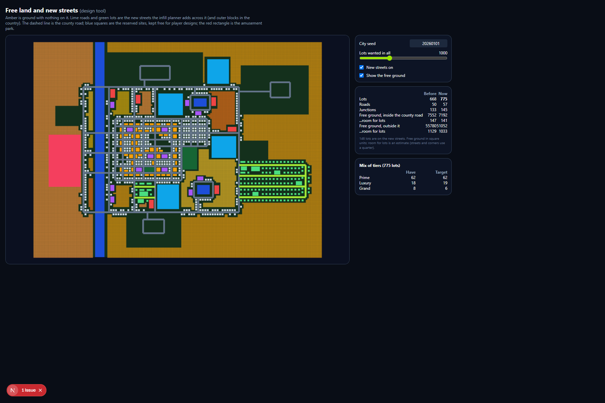
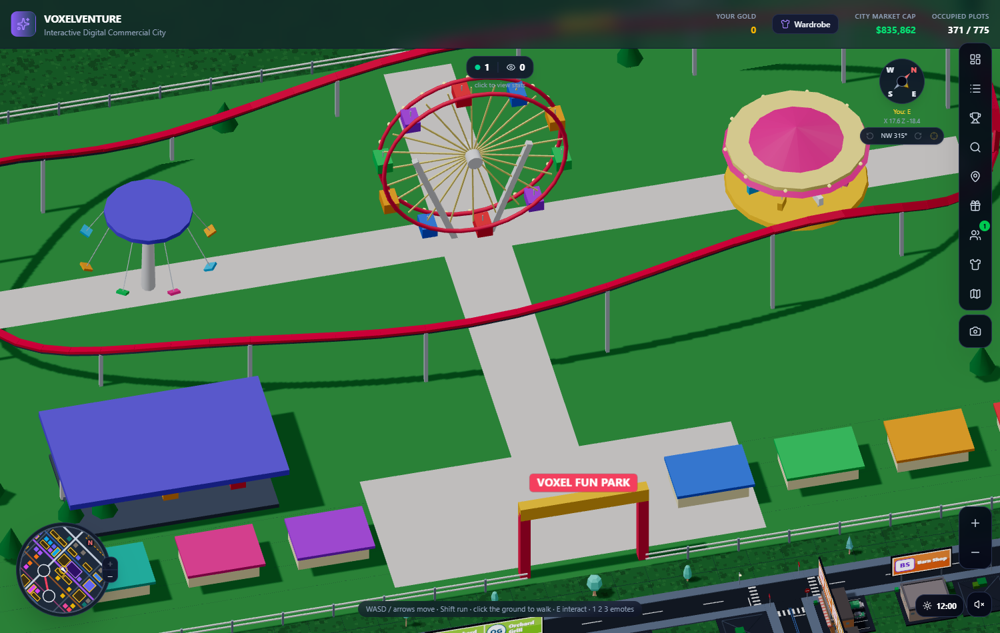
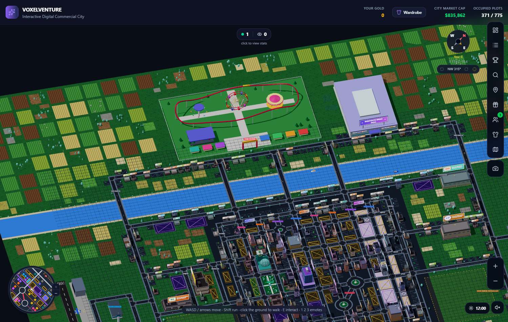
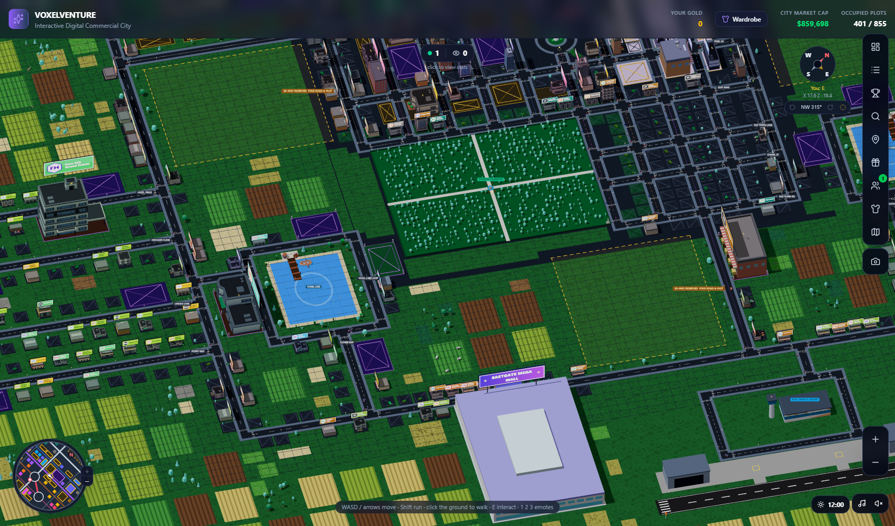

# Free land, new streets and the amusement park

Written for: you, deciding how the city grows past 1,000 lots and what that costs, before the island and the extra cities are planned. Everything here is design-time: the generator is only a tool that produces a starting point; the shipped world will be hand-authored ([study_world_streaming.md](study_world_streaming.md)). The numbers were measured on the default city (seed 20260101); the scripts are `scripts/study/infill.mjs` and the `/land` page.

## 1. What was built

| Piece | Where | What it does |
| :--- | :--- | :--- |
| **Free-land finder** | `lib/city/freeLand.js`, page `/land` (development only) | Finds ground with nothing on it (no road, lot, billboard, park, water, airport, hills, mall, reserved site) and estimates how many lots it could hold. `/land` shows it on a map, with a slider for the number of lots wanted, a switch for the new streets, and the mix of tiers against its target. |
| **Infill planner** | `lib/city/infill.js` | Plans new local streets across the free ground. **Inside** the county road: a street between two roads that are already there (`planInfill`). **Outside** it, in the country: an *outer block*, a far road parallel to the county road joined to it by legs about 15 apart, like a comb (`planBands`). Every new road ends in a junction at both ends (the traffic system needs that), and the planner keeps junctions 6.5 or more apart and off the frontage of reserved sites, malls and the park. |
| **Lots on the new streets** | `LOTS` in `infill.js` | Set back 1.5 from the street, 5 apart along it, and 3 between rows that back onto each other, so the roofs and their billboards can be seen and an owner has room for parking or other things in front or behind. |
| **Tier mix** | `TIER_SHARES` in `lib/game/landPrice.js` | Luxury and grand estates are placed on the new streets, and neighbouring pairs of lots near the middle become prime lots, so the city keeps its 8% / 2.5% / 0.8% mix. |
| **Amusement park** | `lib/city/amusement.js`, `apps/web/components/city/AmusementPark.jsx` | A 72 x 44 park (60 x 38 where the land is tight) with its gate on the county road: a ferris wheel, carousel, swing ride, a roller coaster with a moving train, bumper cars, stalls, a gate arch, a fence and paths. Its ground is reserved first, so the streets go round it. |

How to switch them off: `generateCity(seed, { infill: false })`, `generateCity(seed, { amusement: false })`, or build with `NEXT_PUBLIC_INFILL=0` / `NEXT_PUBLIC_AMUSEMENT=0`. `generateCity(seed, { infill: { target: 1300 } })` asks for more lots.

## 2. How many lots, and why not more

| City (default seed) | Lots |
| :--- | :-: |
| Before | 682 |
| With the new streets | 925 |
| With the new streets and the amusement park | 775 |

Across 8 cities the new streets give 830 to 1,150 lots (about a thousand is the target). The land is the limit, not the planner: on the west side the park, the Westgate mall and the reserved sites use up the whole county road, and on the north and south the airports (and the corridors the planes fly along) use it, so the outer blocks end up on the east side only. The planner can say why (`infillWhy` option: it counts the reasons each place was turned down).

What would add lots, in order of cost:
1. **Tighter lot spacing** (`LOTS` in `infill.js`): at the main grid's spacing (3.4 apart, 0.6 between rows) the same land holds about 2.3 times as many lots. You asked for the airy spacing, so this is the default; it is a setting.
2. A second tier of outer blocks on the far roads of the first (an outer ring).
3. Letting planes fly higher near the airports (today the new streets keep out of their flight corridors, so the banners clear the roofs).
4. Moving the reserved sites or a mall.

## 3. What it costs (measured)

Node (generator, collision, traffic), default seed:

| | Old city | + new streets | + new streets + park |
| :--- | :-: | :-: | :-: |
| Lots | 682 | 925 | 775 |
| Roads / junctions | 50 / 133 | 62 / 153 | 57 / 145 |
| Generate the city | 51 ms | 85 ms | 64 ms |
| Save file (lots + ads) | 376 KB | 507 KB | 426 KB |
| Collision rectangles | 1,810 | 1,843 | 1,641 |
| One traffic step (60 cars) | 0.12 ms | 0.09 ms | 0.06 ms |
| Roads that end without a junction | 0 | 0 | 0 |

In the browser (headless Edge, software drawing, so only the comparison means anything):

| | Old city | + new streets | + new streets + park |
| :--- | :-: | :-: | :-: |
| First frame | 3.9 s | 4.0 s | 4.0 s |
| Draw calls | 999 | 1,033 (+3%) | 1,049 (+5%) |
| Triangles | 2.41 M | 2.85 M (+18%) | 2.53 M (+5%) |
| Objects in the scene (meshes) | 6,574 | 8,227 (+25%) | 7,894 (+20%) |
| JS heap | 106 MB | 157 MB (+48%) | 140 MB (+32%) |
| Console errors | 0 | 0 | 0 |

What it means:
- **Time and draw calls barely move.** The roads, lots and the park are merged or instanced, so more lots do not mean more draw calls. The traffic simulation costs the same at any size (it only simulates its 60 cars).
- **Memory is what grows**, in proportion to the number of lots and objects (each lamp and road marking is still its own object before it is merged): about +0.2 MB for every extra lot. At 1,000 lots that is about 160 MB, the same order as the earlier study's "up to 2x the area is fine on a desktop" ([study_world_streaming.md](study_world_streaming.md) section 1). A phone should stay at about the old size: use fewer shadows and, when the world is streamed, mount only the chunks near the player.
- **The park is cheap**: its static parts (ground, fence, stalls, track, trees, about 700 pieces) are baked into a few meshes; only the wheel, carousel, swings and the train move each frame. It adds 16 draw calls and 2,000 or so objects.
- **The save grows with lots**: 0.5 MB at about 900 lots. The browser's storage holds about 5 MB, so the save must hold only what the player changed before the city passes ~8,000 lots (this is already in the plan).

## 4. What this means for the island and the other cities
- **Treat the generator's output as a draft.** The free-land finder and the planner give you a street plan you can edit by hand; the final world needs the same data (roads with ends in junctions, lots with their attributes), so nothing here is thrown away.
- **Memory per lot (about 0.2 MB) and the 4-second first frame set the budget**: about 1,000 lots a city on a desktop is fine without streaming; ten cities of that size need the chunked world in the study.
- **The park is a landmark type** (`layout.amusement`): a block with a site rule, a design, solids and a drawing. The island can reuse it: a harbour, a stadium or a zoo are the same kind of thing.
- **Region tools**: a "free land" report per city (the `/land` page has it). A street-plan editor that starts from the generated city (planner's streets included) is now built: the city editor at `/editor` ([city_editor.md](city_editor.md)), whose Issues list flags any road that ends in nothing (`validate` in `lib/city/cityEdit.js`). Still to build: a check that every road in a whole world (not one city) ends in a junction.

## 5. The amusement park
- **Where**: flush against the county road (2.5 from its pavement), outside it, away from the city. The planner tries the west side first, then east, south and north; the gate (7 wide) faces the road, in the middle of the park, and is never opposite a junction. In the default city it is on the west side. 30 of 30 test cities get one (a smaller 60 x 38 park where the land is cut up).
- **Inside** (`amusementDesign`): a gate arch and plaza, seven food stalls, a bumper-car pavilion, a carousel (turns, its horses bob), a swing ride (turns), a ferris wheel (turns, the cabins hang level, rim lights), and a roller coaster that runs in a loop round the middle with hills, a rail underneath, supports every few units and a three-car train that follows the track. The rim lights and the carousel's lights come on at dusk with the street lamps ([day_night_sound.md](day_night_sound.md)).
- **Solid and walkable**: the fence (the gate is open), the rides, the stalls and the coaster's supports are solid; the plaza, the paths and the lawn are walkable (tested).
- **On the maps**: the world map and the minimap draw it; the Places list has it.
- **Sound**: built since. Near the park you hear a carousel organ waltz, a crowd and the coaster's rush (the `funfair` zone in `lib/game/soundZones.js`; see [day_night_sound.md](day_night_sound.md)).
- **Not built yet**: riding the rides, tickets or Gold prizes, a visitor count on the card, and a nicer coaster (real track banking).

## 6. Files
`lib/city/freeLand.js`, `lib/city/infill.js`, `lib/city/amusement.js`, the generator's infill and park steps in `lib/city/cityGenerator.js` (search "infill"), `apps/web/components/city/AmusementPark.jsx`, `apps/web/components/dev/LandMap.jsx` (page `/land`), tests `tests/infill.test.mjs` and `tests/amusement.test.mjs`, the study script `scripts/study/infill.mjs`.

## 7. Bigger Riverside Commons, and free ground that looks free
The built-up area stands on a slate base, so any ground inside it with nothing on it looked like dead black ground (the block beside Riverside Commons).
- **The big park grows over the free ground beside it.** It is still sited as before (28 x 20 beside an arterial), then grows a unit at a time on its three free sides up to 44 x 32 (the biggest size that leaves no sliver of ground between the lawn and a cross street). In the default city Riverside Commons is **33 x 45 units, about 1,500 square units, up from 20 x 31**, with about 600 trees (thinner than the small park's, so it is not four times the trees). Its trees and its name come from streams of their own and the main random stream is spent exactly as before, so nothing else in the city moves when the park grows (`growPark`, `planBigPark` in the generator).
- **Free ground is drawn as lawn** (`layout.lawns`, from `lawnRects` in `lib/city/freeLand.js`): the free ground inside the built-up area, merged into rectangles (13 in the default city), drawn as one mesh of grass in `apps/web/components/city/Land.jsx`. Lawn keeps clear of roads, lots, parks, water, the riverwalk, piers and the amusement park (`tests/lawns.test.mjs`).
- **New streets may join lake loop roads**, so more of the inner free ground can take streets and lots.
- To fill what is left with real lots, raise the target (`generateCity(seed, { infill: { target: 1300 } })`) or tighten the lot spacing (`LOTS` in `lib/city/infill.js`).

