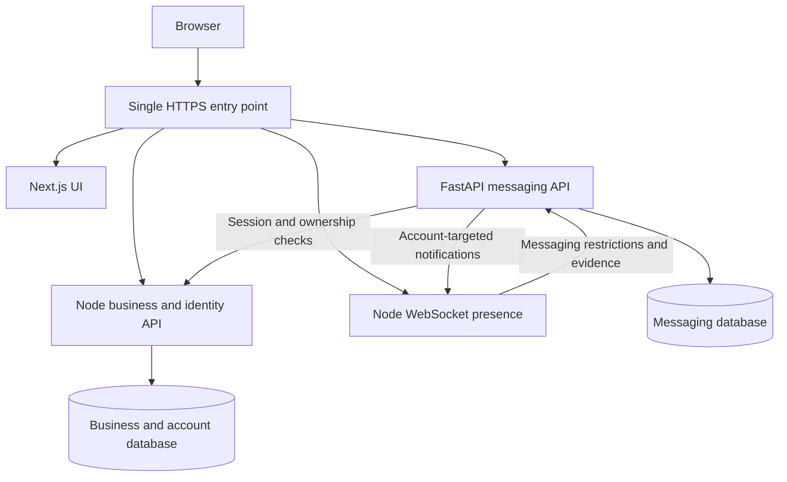

# VoxelVenture: Node and FastAPI working as one system

Date: October 15, 2026
Status: steps 1 to 5 done on October 15, 2026: the Python messaging service exists, matches the Node messaging contract, and the data move is rehearsed. The switch-over (steps 6 and 7) has not been done: the Node API still serves messaging. See "Implementation status" below.

## Implementation status

| Step | State | What and where |
| --- | --- | --- |
| 1. Inventory and freeze contracts | Done | `tests/messaging.test.mjs` is the contract: about 70 checks of routes, bodies, error codes, limits, idempotency, requests, reads, blocks, reports, bans, inquiries and the presence path. It runs against the Node API, or with `MESSAGING_IMPL=fastapi` against the service (`tests/messaging-fastapi.test.mjs`); both pass unchanged. |
| 2. Internal boundaries | Done | Node stays the authority: `POST /internal/identity/session` (bearer token, in the body, to account or 401), `/internal/identity/binding` (a presence binding to its account), `/internal/identity/accounts` (by ids or name, with `banned` and `emailVerified`), `/internal/identity/accounts/{id}/ban`, `GET /internal/plots/{id}/owner` (owner and an ownership **version**: the plot's latest ledger id). All need `INTERNAL_SECRET`. **Tickets stay with Node** (part of signing in); the presence server keeps talking to Node, which forwards `/internal/messaging/nearby`. Failures are explicit `503 unavailable`. |
| 3. FastAPI alongside Node | Done | `services/messaging` (Python 3.13, FastAPI, its own SQLite database): the whole messaging domain, ported from `server/api/messaging.mjs` with the same answers. Node forwards the public messaging routes to it when `MESSAGING_SERVICE_URL` is set, and then runs none of its own messaging jobs (one sender of notices, one pruner). The text checks are compared with the JavaScript ones on awkward inputs (`services/messaging/tests`). |
| 4. Rehearse data extraction | Done (rehearsed) | `python -m app.migrate_from_node` copies conversations, members, messages, blocks, request settings, nearby evidence, chat reports, pending notices and names, keeping ids; refuses a non-empty target; reconciles counts, id ranges and read positions. `tests/messaging-migrate.test.mjs`: history made on Node, the pause (`MESSAGING_READONLY=1`), the copy, then every player sees exactly the same through the service, and retries, new ids, reports and tickets carry on. |
| 5. Combined system | Done locally | `tests/live-browser.test.mjs` with `MESSAGING_IMPL=fastapi`: real browsers sign up, claim, use a storefront, chat nearby, message privately, get the live badge, reply, and ask a building's owner, with messaging on the service. |
| 6. Cut over | Not done | The runbook is in `deploy/README.md` ("Moving messaging to the Python service"); the systemd unit and `messaging.env.example` are ready and `setup.sh` installs the service without enabling it. |
| 7. Observe | Not started | `/health` reports the outbox counts; nothing else is measured yet. |
| 8. Optional Python work | Not started | |

Decisions taken while building (each can be revisited):
- **Business inquiries and the takeover race:** the owner and version are read, everything is checked, then read again just before saving; a change refuses with `owner_changed` ("try again"). The conversation records the owner and version it went to. This narrows the race but, as this plan says, does not close it: a takeover in the last milliseconds can still land after the check. A Node-held reservation would close it, and is not built.
- **Routing:** production keeps one public API address and the Node API forwards the messaging routes (one extra local hop). Routing them straight to the service in the Caddyfile is a later option; `/internal/*` is refused from outside either way.
- **Identity is checked on every request** (no cache), so sign-out and bans apply at once, at the cost of one local call per request.
- **Rollback after new writes** needs a copy from the service back to Node; there is no script for that direction yet.

Still open: the presence load benchmark with the messaging calls on (acceptance check), metrics, the reverse copy for rollback, a restore rehearsal of both databases, and the switch-over itself.

## Objective

Keep the existing Node game, business API, identity system, and presence server. Introduce Python FastAPI as the owner of persistent messaging and selected supporting services. Present both backends through the same website and account experience.

This is a service split, not a complete migration to Python. The initial Python scope is messaging; additional Python services are optional.

## Recommended ownership

| System or feature | Owner | Reason |
| --- | --- | --- |
| Next.js website, pages and UI | Node | Preserve the existing frontend and build system |
| City generation and plot identifiers | Node | Reuse JavaScript rules shared with the browser |
| Claims, takeovers and land pricing | Node | Keep ownership and pricing transactions together |
| Business details and storefront settings | Node | Closely connected to plots and ownership |
| Leases and renewals | Node | Preserve the existing shared lease rules |
| Coupons, quests and reward balances | Node | Keep rewards and ledgers with their transactions |
| Advertising and billboard purchases | Node | Preserve existing ownership and purchase integration |
| Market bookings and stall management | Node | Keep booking rules and transactions together |
| Accounts, login and sessions | Node | Maintain one authoritative identity system |
| Multiplayer connections and movement | Node | Preserve the existing presence implementation |
| Nearby chat audience selection and delivery | Node | Uses live player positions and city membership |
| Persistent Inbox and direct messages | FastAPI | Establish a distinct messaging domain |
| Message requests and conversation history | FastAPI | Belongs with persistent messages |
| Read/unread state and conversation notification preferences | FastAPI | Belongs with conversation state |
| Messaging blocks, restrictions and reports | FastAPI | Enforce messaging rules at acceptance and delivery boundaries |
| Business inquiries | FastAPI, with Node ownership checks | Add messaging without moving business ownership |
| Nearby message authorization and report evidence | FastAPI, called internally by Node | Reuse messaging restrictions and evidence rules across chat surfaces |
| Messaging retention and cleanup | FastAPI | Operates on messaging-owned data |
| Messaging notification jobs | FastAPI | Retry account notifications and optionally add future digests |
| Analytics reports and exports | Optional FastAPI service | Work over copied events or reporting data without changing authoritative business records |
| Automated content analysis | Optional FastAPI service | Support moderation while preserving clear decision ownership |
| Existing business moderation and transactional email | Node initially | Avoid expanding the first extraction into unrelated systems |

The Node API currently includes a messaging module and routes. The first implementation task is to inventory and extract those behaviors, not assume the Inbox is entirely unbuilt. Their existence does not establish that every planned feature is complete or tested.

## Unified public entry point

Use the existing reverse proxy as the single HTTPS entry point. The browser should experience one application and one login.

Illustrative routing:

| Public path | Destination |
| --- | --- |
| `/` and application assets | Next.js |
| `/api/business/*` | Node business API |
| `/api/messaging/*` | FastAPI |
| `/ws` | Node presence |

These paths are proposals. Preserve existing client URLs where practical by routing current messaging endpoints, such as `/conversations` and `/messaging/*`, to FastAPI. Explicitly route `/plots/:id/inquiries` to the messaging service if retaining that existing endpoint. Inventory route precedence before changing the proxy.

Internal authentication, notification and ownership-check endpoints must not be publicly exposed merely because other routes are public.

## Identity and authorization

Node remains the authority for account IDs, passwords, login, sessions, logout and global bans. FastAPI does not create a second account system.

For the initial implementation, FastAPI forwards the existing bearer session to a protected Node session-validation endpoint over an authenticated internal connection. Node returns the account ID and relevant restrictions; FastAPI independently checks conversation membership and messaging permissions.

- Do not trust browser-supplied account IDs or identity headers.
- Do not log bearer tokens or place them in URLs.
- Define bounded internal request timeouts and return explicit failures when identity cannot be verified.
- Recheck identity on durable operations. If validation caching is introduced later, define a maximum revocation delay and invalidate it on logout and bans.
- Preserve or deliberately adapt the existing short-lived WebSocket messaging ticket flow. Assign ticket issuance/redemption ownership explicitly during extraction and test that the resulting binding uses the Node-verified account and session.
- Authenticate service-to-service calls using dedicated internal credentials. Keep internal endpoints on private listeners or restrict them at the proxy.

A shared domain simplifies routing but does not itself authenticate a request. Preserve the current authentication behavior first; any later switch to cookies or another credential mechanism is a separate change.

## Data ownership

Use separate business and messaging databases initially. Both can remain SQLite for the first service split; a database-engine migration is not required at the same time.

### Node-owned data

Accounts, sessions, plots, businesses, leases, advertising, market bookings, rewards, business ledgers, existing business analytics events, and business moderation records.

### FastAPI-owned data

Conversations, members, requests, messages, client idempotency keys, read cursors, conversation preferences, messaging blocks, nearby evidence, messaging reports, restrictions, notification outbox entries, and retention state.

FastAPI stores Node account IDs and plot IDs as external references. They are not cross-database foreign keys. Define how account removal, bans, ownership changes, and missing references are handled.

Neither service should directly update the other service's tables. Fetch authoritative data through internal APIs, or consume versioned events when a reporting/read model is justified. Do not run both implementations as active writers for messaging during cutover.

## Main workflows

### Direct message

1. Browser submits a message to FastAPI using the existing authenticated account session and a client message ID.
2. FastAPI validates identity through Node, then verifies membership, request status, blocks, restrictions, text limits, and rate limits.
3. In one messaging-database transaction, FastAPI saves the message and a recipient notification-outbox record.
4. The browser receives the authoritative saved result.
5. A worker sends an account-targeted change event to Node presence.
6. Node sends the event only to authenticated connections for the intended account. The recipient fetches history from FastAPI.

The notification is a hint; stored history is the source of truth. Duplicate requests return the original message rather than creating another one.

### Business inquiry

1. Browser selects Contact owner on a building card.
2. FastAPI resolves the current owner through Node.
3. Create a conversation for the sender and that owner, recording the plot and ownership context.
4. Existing conversations remain private to their original participants after a takeover.

There is no cross-service database transaction. Use an ownership version supplied by Node and define the acceptance boundary. Initially, label the inquiry as addressed to the owner resolved at creation, and revalidate immediately before writing. If strict exclusion of concurrent takeovers is required, add a Node-coordinated reservation/creation handshake; do not claim that a simple HTTP lookup eliminates that race.

### Nearby chat

1. Node derives the sender's authenticated account and city from the connection.
2. Node determines the audience using the existing proximity rules.
3. Node calls FastAPI to apply messaging restrictions, text screening, block filtering, and evidence acceptance.
4. Node delivers only to the authorized audience and returns an explicit accepted or failed result.

The internal contract must specify recipient account IDs and connection handling, including guests and multiple tabs. Browser-supplied position is not proof of physical proximity against a modified client.

### Logout or ban

Node revokes the session or account access. FastAPI rejects subsequent authenticated operations, and presence clears or expires account bindings. Messaging restrictions remain FastAPI-owned; global account bans remain Node-owned.

## Reliability and failure behavior

| Failure | Expected behavior |
| --- | --- |
| FastAPI unavailable | City and Node business features continue; Inbox and authenticated Nearby sends show an explicit temporary failure |
| Node presence unavailable | Inbox HTTP reads/writes continue; live notifications fall back to polling/focus refresh |
| Node identity API unavailable | FastAPI refuses operations requiring fresh identity validation; drafts remain available |
| Notification lost | Outbox retries and recipient synchronization recover state |
| Duplicate notification | Client deduplicates events and refreshes authoritative state |
| Slow recipient socket | Node applies bounded queues/backpressure; other players remain responsive |
| Retried message request | Idempotency key prevents duplicate persisted messages |

Use a transaction-backed outbox for messaging notifications. Do not promise exactly-once network delivery. Keep event IDs, bounded retry/backoff behavior, and observable dead-letter handling.

Avoid introducing Redis or a general event broker for the initial single-instance deployment unless measurements show a need. If services are later replicated, add explicit coordination for presence routing, shared rate limits, job ownership, and notification delivery.

## Existing code affected

| Area | Action |
| --- | --- |
| `server/api/messaging.mjs` | Inventory behavior and port the messaging domain into FastAPI |
| `server/api/server.mjs` | Remove or temporarily proxy migrated routes after compatibility validation; add protected identity/ownership interfaces |
| `server/api/schema.sql`, `server/api/db.mjs` | Preserve Node tables; plan messaging-table extraction and disable duplicate messaging migrations/jobs at cutover |
| `server/multiplayer.mjs` | Retain presence; update internal messaging URLs/contracts and targeted notification integration |
| `lib/data/` messaging client | Preserve public contracts or add a small base-path adapter |
| `lib/net/multiplayer.js` | Preserve movement protocol; adapt messaging authentication/events only where needed |
| Chat/Inbox UI and state | Keep React implementation; verify compatibility with the FastAPI responses |
| `deploy/` and development scripts | Add Python process, environment configuration, health checks, proxy routes and supervision |
| Tests | Separate transport contracts from Node-specific test fixtures; add cross-service tests |

Read relevant local Next.js guides before any frontend/framework code changes, as required by AGENTS.md.

## Implementation sequence

1. **Inventory and freeze contracts.** List current messaging routes, schema, jobs, validation, limits, authentication, reports and error shapes. Capture successful and rejected responses in reusable tests.
2. **Define internal boundaries.** Agree on identity validation, ownership lookup/versioning, ticket ownership, Nearby authorization, account notifications and failure behavior.
3. **Build FastAPI alongside Node.** Use isolated test databases and configuration. Match existing messaging behavior before adding features.
4. **Rehearse data extraction.** Copy conversations, messages, memberships, requests, blocks, read state, reports, tickets where appropriate, and pending outbox data into the messaging database. Preserve identifiers and ordering; decide which transient tickets must be invalidated.
5. **Test the combined system.** Exercise real browser login, movement, business actions, messages, offline recovery and moderation against both services.
6. **Cut over messaging only.** Temporarily pause messaging writes, drain or transfer outbox work, take backups, run final data transfer, disable Node messaging jobs/writes, and switch route ownership. Preserve idempotency records and redirect internal callers.
7. **Observe and stabilize.** Check error rates, notification delay, authorization failures, retention jobs and database growth.
8. **Consider optional Python work.** Add reporting exports, analysis or notification channels only when a specific need justifies them.

## Acceptance checks

- One login works for business actions and messaging; logout/account switching does not expose private state.
- Account IDs, plot IDs, message IDs, timestamps, error formats and pagination remain compatible.
- Node claims, takeovers, leases, bookings and rewards behave as before.
- Conversation membership, blocking, requests, bans and message reports work across both HTTP and WebSocket paths.
- Private events never appear in city-wide broadcasts or diagnostic endpoints.
- An ownership change cannot transfer access to historical private messages.
- Retry, reconnect, multiple tabs, notification loss and partial service outages do not lose saved messages or create duplicates.
- Background workers run once per intended owner; Node and Python do not both send the same notices or prune the same data.
- Migrated record counts, references, read cursors and pending outbox entries reconcile against the source snapshot.
- Existing presence load benchmarks are rerun with the internal messaging calls enabled; compare latency and memory against the same-machine baseline.

## Operations and rollback

Run Next.js, Node API, Node presence and FastAPI as separately supervised processes. Give each service its own health/readiness check, configuration, logs and resource limits. Use request/event IDs to trace interactions without logging private message bodies or credentials.

Keep independent feature flags for Inbox writes, Nearby sending and business inquiries. Back up both databases and test restore procedures.

Before cutover, retain Node messaging code in a disabled state. A rollback after new Python writes must reconcile or transfer that new data before re-enabling Node; simply switching back to the old database would lose messages. Prefer disabling messaging writes temporarily while keeping city/business features available rather than creating two active message stores.

## Recommended first delivery

Extract persistent messaging into FastAPI while preserving Node accounts, business transactions, city generation and presence. Include Inbox, requests, read state, blocks/reports, messaging evidence, retention and account-targeted notifications in that bounded scope.

Keep existing business analytics and email in Node initially. This gives Python a clear responsibility and avoids turning the introduction of FastAPI into a complete backend rewrite.
