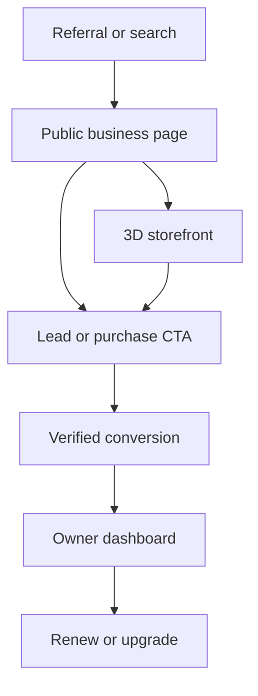

# VoxelVenture Competitive Alignment Review

**Repository:** [devartblake/VoxelVenture](https://github.com/devartblake/VoxelVenture)  
**Branch reviewed:** `main`  
**Commit reviewed:** [`9301b4c`](https://github.com/devartblake/VoxelVenture/commit/9301b4c945c62827a442cc1e4805e7fff18a4cc7)  
**Review date:** October 16, 2026  
**Comparison basis:** The Claim Avenue competitive-differentiation recommendations developed in the associated strategy session.

---

## Executive verdict

VoxelVenture's core concept aligns strongly with the recommended differentiation strategy, but its implementation order does not.

| Dimension | Assessment |
| --- | ---: |
| Concept alignment | 8/10 |
| Current MVP alignment | 5/10 |
| Technical and product ambition | 9/10 |
| Commercial launch readiness | 3/10 |

VoxelVenture already contains several stronger competitive ideas than Claim Avenue:

- Verified-human engagement metrics.
- Recurring discovery and retention loops.
- Interactive storefronts.
- Searchable business discovery.
- Owner analytics.
- Persistent business placements.
- Lease protection.
- A populated multiplayer world.

The primary weakness is sequencing. The project built the expensive 3D and game layer before completing the simpler commercial engine recommended for validation:

- Real payments.
- Referral attribution.
- Public, indexable business profiles.
- Conversion tools.
- Production-authoritative data.
- Operational moderation.
- Subscription packaging.
- Paid-renewal validation.

The experience is substantially more developed than the business it is intended to support.

---

## Recommendations used for comparison

The strategy session recommended that VoxelVenture differentiate through gamified discovery and promotion for SMBs, creators and digital projects while emphasizing:

1. Measurable engagement.
2. Predictable placement rights.
3. Recurring customer utility.
4. Tangible business outcomes rather than digital-space scarcity.
5. A simple commercial MVP before deep investment in 3D, multiplayer, auctions or virtual currency.

The recommended MVP included:

- Free shareable business profiles.
- A searchable discovery directory.
- Stripe purchases.
- Referral links and attribution.
- An owner analytics dashboard.
- Moderation and reporting.
- A $9 Launch Pack.
- A $19/month Pro plan.
- $29–$99 clearly labeled sponsored placements.

The central validation targets were repeat usage, paid renewal and measurable customer value.

---

## Alignment matrix

| Session recommendation | Repository evidence | Alignment |
| --- | --- | --- |
| Gamified discovery for SMBs, creators and digital projects | Playable commercial city, thematic districts, interiors, quests and market stalls | Strong |
| Searchable discovery directory | Search by business, owner, district or plot; sorting and website links | Strong |
| Shareable business presence | `/b/[id]` deep links, building links and HTML/Markdown website badges | Strong |
| Measurable engagement | Views, visitors, clicks, CTR, time inside, activity charts and CSV export | Strong |
| Recurring utility rather than one-time scarcity | Daily chest, scavenger hunt, Plot of the Day, Building of the Week, quests, leases and markets | Strong |
| Predictable placement rights | 30-, 90- and 365-day leases, renewal window, grace period and fixed takeover rules | Partial |
| In-world conversion tools | Coupons, visit rewards, video and game embeds exist; checkout, scheduling and signup tools remain unfinished | Partial |
| Trustworthy server-authoritative ownership | Backend routes and schema exist, but authoritative deployment remains incomplete | Partial |
| Moderation | Reports, text filtering, account controls and moderation backend exist | Partial–strong |
| Free business/profile entry | Product currently centers on paid land rather than a complete free-profile funnel | Weak |
| $9 Launch Pack | Not implemented | Missing |
| $19/month Pro plan | Analytics exist, but there is no subscription or feature gating | Missing |
| $29–$99 sponsored placement | Billboard and banner mechanics exist, but there is no real sponsored-placement checkout | Missing |
| Stripe purchases | Explicitly documented as unfinished | Missing |
| Referral attribution | Share links exist, but codes, attribution and reward rules do not | Missing |
| Paid renewal and value validation | Instrumentation exists, but live payments and production data are missing | Not yet possible |
| Defer 3D, multiplayer and virtual currency during validation | Considerable investment has already gone into all three | Strategically misaligned |

---

## Strongest competitive advantages already present

### 1. Recurring engagement

VoxelVenture directly addresses the “visit once and leave” weakness of visual directories through:

- Daily chest rewards.
- Three-star scavenger hunts.
- Plot of the Day.
- Building of the Week voting.
- Brand visit quests.
- Fishing and cosmetic rewards.
- Pop-up market rotations.
- Multiplayer presence.
- Nearby chat.

These features give visitors reasons to return even when they are not buying land.

### 2. Advertiser evidence

The **My businesses** dashboard tracks:

- Views.
- Unique visitors.
- Website clicks.
- Click-through rate.
- Time spent inside.
- Offers.
- Lease status.
- Setup completion.
- Fourteen-day activity.
- CSV exports.

The backend also distinguishes verified-human activity from raw events through presence checks, user-agent screening and network-level caps. This is more defensible than an unqualified view counter.

**Important production rule:** simulated statistics must never be presented as advertiser evidence. Production owner dashboards should display only authoritative, verified data.

### 3. Placement predictability

The lease system provides:

- 30-, 90- and 365-day terms.
- A renewal window.
- A grace period.
- Takeover protection during an active lease.
- Archival presence in Old Town for displaced owners.

For serious SMB customers, leases should become the primary product. Forced takeover should be optional or restricted to clearly designated speculative areas.

### 4. Interactive business utility

VoxelVenture already supports or partially supports:

- Coupons.
- Visit rewards.
- Product or game embeds.
- Business descriptions.
- Interactive interiors.
- Owner messaging.
- Offers.
- Merchandise displays.
- In-world website visits.

This direction is consistent with making the platform useful for lead generation rather than merely selling visual pixels.

---

## Principal strategic mismatch

The strategy recommended validating the commercial proposition before significant investment in:

- 3D.
- Multiplayer.
- Forced buyouts.
- Virtual currency.
- Elaborate world simulation.

VoxelVenture currently includes airports, traffic, boats, fishing, malls, estates, procedural roads, day/night effects, spatial chat, vehicles, interiors and a large 3D environment, but no operational payment flow.

The 3D world is not inherently a mistake. It may become the product's strongest moat. However, it should serve as the engagement layer behind a simpler, accessible and measurable promotion platform rather than being the only path into the product.

---

## Critical gaps

### 1. No operational revenue path

The repository defines prices but does not collect them:

- Plot claims are not charged.
- Takeovers do not move real funds.
- Former owners are not paid.
- Market bookings record prices but collect nothing.
- Ad placements have no production checkout.
- Customization prices remain unfinished.
- Refunds and receipts are not operational.

Without payment collection, the product cannot validate willingness to pay or renewal.

### 2. Missing subscription ladder

The current model emphasizes:

- $5 basic plots.
- Premium and luxury land.
- 1.25× takeovers.
- Leases.
- $2–$5 market stalls.
- Billboard and aerial advertising.
- Gold.

A lower-risk, service-oriented structure should be introduced:

| Tier | Recommended offer |
| --- | --- |
| Free | Searchable business profile, basic directory listing and share link |
| $9 Launch Pack | Enhanced card, branded share image, launch-week placement and campaign summary |
| $19/month Pro | Verified analytics, offers, lead tools, CTA integrations, campaign history and CSV export |
| $29–$99 campaign | Clearly labeled homepage, district, billboard, plane-banner or featured-building placement |
| Optional world placement | Lease-based 3D building or market stall as an enhancement rather than the only product |

The existing directory, dashboard, deep links, ad inventory and leases provide much of the necessary product surface. Packaging and billing are the main missing pieces.

### 3. Share links lack referral attribution

Current deep links and website badges do not appear to provide:

- Referral identifiers.
- Referrer attribution.
- Signup or purchase conversion attribution.
- Campaign-source reporting.
- Fraud-resistant reward rules.
- Affiliate or customer rewards.

Signed referral identifiers and first-party attribution should be added. Owners should eventually see visits, signups, qualified leads and purchases generated—not only clicks.

### 4. Public discovery needs strengthening

The product needs fast, indexable public pages in addition to the 3D experience:

- `/discover`
- `/business/[slug]`
- `/district/[slug]`
- `/category/[slug]`
- Open Graph preview images.
- Structured business metadata.
- Accessible non-WebGL fallback.
- Fast mobile landing pages.

The existing `/b/[id]` route focuses the 3D city on a building. It is useful for engagement but insufficient as the primary acquisition page.

### 5. Conversion kiosks remain unfinished

The most valuable differentiation from Claim Avenue is the ability to produce outcomes inside the platform:

- Newsletter signup.
- Meeting booking.
- Single-product checkout.
- Coupon redemption.
- Lead capture.
- Demo requests.

These capabilities should take priority over further simulation work. Businesses will renew because VoxelVenture produced leads, meetings or purchases, not because another environmental animation was added.

### 6. Repository governance is not launch-ready

At the time of review, the repository had:

- One initial commit.
- No GitHub Actions workflow runs.
- An unprotected `main` branch.
- An unsigned initial commit.

The repository documentation reports extensive local test coverage, but there is not yet an independent GitHub CI record.

Before accounts or payments go live, add:

- Build, lint and test workflows.
- Required status checks.
- Protected `main`.
- Dependency and secret scanning.
- Payment-webhook contract tests.
- Database migration tests.
- Preview deployments.
- Environment validation.
- Production smoke tests.

---

## Recommended implementation sequence

### Phase 1 — Freeze world expansion

Temporarily stop adding roads, vehicles, landmarks, simulation systems and large visual features. Continue critical accessibility, stability and performance work, but defer world expansion until the commercial loop is validated.

### Phase 2 — Build the business-first funnel

Implement:

1. Free business profile.
2. Public SEO-compatible business page.
3. Category and district discovery pages.
4. Clear CTA selection.
5. Share and referral attribution.
6. Owner onboarding checklist.
7. Upgrade prompts connected to measurable value.

The 3D building should become an optional interactive destination linked from the public profile.

### Phase 3 — Make production data authoritative

Deploy and verify:

- Authentication.
- Server-owned claims and leases.
- Business configuration.
- Verified statistics.
- Ad inventory.
- Market bookings.
- Moderation actions.
- Audit records.

Simulated metrics must be removed from production advertiser interfaces.

### Phase 4 — Implement the low-risk monetization ladder

Start with:

- $9 Launch Pack.
- $19/month Pro plan.
- Fixed-term sponsored placements.
- Fixed-price market bookings.
- Conventional leases.

Defer real-money forced-buyout payouts until legal, tax, fraud, refund and payment-provider implications have been reviewed. A fixed 1.25× profit mechanic can resemble an investment or resale promise rather than conventional advertising inventory.

### Phase 5 — Complete conversion measurement

The target customer journey should be:

Measure:

- Profile impressions.
- Qualified visits.
- Store entries.
- CTA interactions.
- Newsletter signups.
- Meeting requests.
- Coupon claims and redemptions.
- Purchases.
- Cost per result.
- Renewal rate.

### Phase 6 — Run a constrained pilot

Recruit 10–20 businesses across two districts. Give them free profiles, then test:

- A $9 one-time upgrade.
- A $19 Pro renewal.
- One fixed-price sponsored campaign.
- One CTA per business.
- Four weeks of verified reporting.

Suggested success criteria:

- At least 30% of participating businesses return weekly.
- At least 20% receive a meaningful CTA interaction.
- At least three businesses pay.
- At least two renew or request another campaign.
- No simulated advertiser metrics are shown.

---

## Immediate engineering backlog

### P0 — Required before a paid pilot

- Add GitHub Actions for build, lint and tests.
- Protect `main` and require passing checks.
- Deploy the API and authoritative data store.
- Add Stripe Checkout for fixed-price products.
- Add payment-webhook idempotency and reconciliation.
- Build public business pages and the discovery landing page.
- Remove simulated advertiser data from production.
- Implement referral and campaign attribution.
- Complete production moderation and audit tooling.
- Add privacy, refund, advertising and placement terms.

### P1 — Required for differentiation

- Add newsletter, meeting-booking and lead-request CTAs.
- Add conversion events to the dashboard.
- Package the Launch and Pro tiers.
- Add sponsored-placement inventory and labels.
- Complete owner onboarding and campaign reporting.
- Make 3D optional with a fast non-WebGL experience.

### P2 — Resume after validation

- Expand authored world content.
- Add more vehicles, destinations and environmental systems.
- Add the creator asset marketplace.
- Scale multiplayer beyond the initial production target.
- Revisit advanced resale or takeover mechanics after review.

---

## Product decision

VoxelVenture contains the right core concepts to become meaningfully different from Claim Avenue. It is already stronger in retention, verified engagement, analytics, interactive storefronts and lease predictability.

It does not yet satisfy the recommended commercial MVP because the following remain incomplete:

- Real checkout.
- Subscription packaging.
- Referral attribution.
- Public business profiles.
- Conversion integrations.
- Production-authoritative data.
- Deployment evidence.
- Paid-renewal testing.

The strongest next move is to turn the existing directory, dashboard, leases, deep links and engagement systems into a production-ready promotion platform that can prove business results and collect recurring revenue. Additional game-world expansion should follow successful commercial validation.
