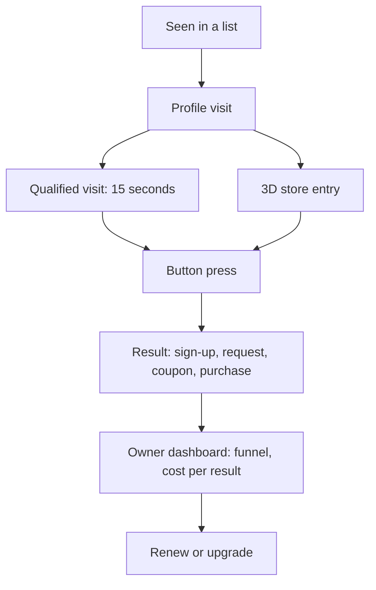

# Conversions: phase 5, measuring what a profile brings

This is phase 5 of the [competitive alignment review](claimavenue_competitive_alignment_review.md#phase-5--complete-conversion-measurement). Every step from a business being seen to a verified result is counted, and the owner sees it on `/business/manage`.



The code is in:

- `server/api/conversions.mjs`: impressions, requests, purchases, coupon redemptions and renewals.
- `server/api/business.mjs`: profile events and the figures.
- `lib/business/conversions.js`: the funnel, click ids and cost per result.

The tests are in `tests/conversions.test.mjs`.

## What is measured

| Measure (from the review) | How it is counted | Verified when |
| --- | --- | --- |
| Profile impressions | A card at least half on screen for a second on Discover, a category or a district page. Sent in batches. | Not a bot and not the owner. One per visitor and profile an hour, and 10 a day per network and profile. |
| Profile visits | The profile page has been visible for 2 seconds (as in phase 2) | Not a bot or the owner, within the per-network cap |
| Qualified visits | The page has been visible for 15 seconds in all | As a visit, and only after a visit by the same visitor |
| Store entries | Walking into the building the profile is linked to, in the 3D city | Not a bot or the owner, within the cap |
| Button presses | Pressing the call to action. A link button also carries a click id. | As in phase 2: after a visit, within the cap |
| Newsletter sign-ups | Confirmed sign-ups (double opt-in) | Confirmed by email |
| Meeting requests, quote requests | The profile's own request form | Not a bot or the owner, after a visit, within 3 a day per network and profile. One that the owner marks as spam stops counting. |
| Coupons claimed and redeemed | Each claim gets a ticket. The owner marks it used at the till. | One claim per visitor; never the owner's own |
| Purchases | The business's site reports the sale with the click id | The click id belongs to a verified press of the button in the 30 days before |
| Cost per result | Paid orders for the profile in 30 days (Launch Pack, Pro, placements), divided by its results | |
| Renewal rate | Pro plans that renewed at least once, and owners who bought the Launch Pack or a placement again | For the admin |

Results are the sum of:

- newsletter sign-ups
- meeting requests
- quote requests
- coupons claimed
- coupons redeemed
- purchases

Results are never simulated: a profile nobody has visited shows zeros.

## Calls to action that collect a request

There are two new kinds of call to action, alongside the website, newsletter, booking, order and demo buttons:

- **Request a meeting:** name, email, phone (optional), when suits the visitor, and what it is about.
- **Request a quote:** name, email, phone (optional), and what the quote is for.

How a request is handled:

- **Delivery.** The request is kept and emailed to the owner, at their verified address with notices on, with the visitor's address to reply to. It is also listed on the Manage page, where the owner can mark it answered or spam.
- **Privacy.** The visitor's details go only to that business.
- **Spam defences:**
  - A hidden field catches robots.
  - Links in the text are refused.
  - The usual word filter runs.
  - A network can send at most 10 requests a day across every profile (`INQUIRY_LIMIT`).

## Counting purchases on the owner's site

1. A link button (website, order, booking, demo) opens the owner's link with `vv_click=<id>` added. The press is recorded with the same id.
2. The owner's site keeps that id with the order, for example from the landing page's address. When the order is paid, the site reports it in one of two ways:
   - **Postback**, from their server:
     ```sh
     curl -X POST https://<api host>/conversions -H 'Content-Type: application/json' \
       -d '{"business":"<slug>","key":"<key>","click":"<vv_click>","value":<cents>,"order":"<order number>"}'
     ```
   - **Pixel**, on their thank-you page:
     ```html
     /conversions/pixel.gif?business=<slug>&key=<key>&click=<vv_click>&value=<cents>&order=<order number>" width="1" height="1" alt="">
     ```
3. The key comes from the owner's **Count purchases on your own site** box on `/business/manage`, or from `GET /businesses/<slug>/tracking`. It is derived from `REFERRAL_SECRET`, so changing that secret changes every key.

Each order number counts once. Without an order number, each click counts once. The pixel always answers with a transparent image, so the thank-you page never shows a broken image. A sale that does not match a verified press is kept, but it is not counted as a result.

## What the plans see

- **Free:** the funnel and the results, including spend and cost per result.
- **Pro:** adds sources and campaigns (each now with its results), the 30-day chart (now with results per day), and the CSV export (now with the funnel and the results).

## Endpoints

| Endpoint | Who | What |
| --- | --- | --- |
| `POST /businesses/impressions` `{ slugs, visitor }` | anyone | Cards seen in a list |
| `POST /businesses/<slug>/events` `{ kind: view, engaged, store or cta, visitor, clickId? }` | anyone | Profile events |
| `POST /businesses/<slug>/inquiries` | anyone | A meeting or quote request |
| `GET /businesses/<slug>/inquiries`, `PATCH .../inquiries/<id>` `{ status }` | the owner | List the requests; mark one new, handled or spam |
| `GET /businesses/<slug>/tracking` | the owner | The conversion key, the postback address and the pixel |
| `POST /conversions`, `GET /conversions/pixel.gif` | the owner's site | Report a purchase |
| `POST /plots/<id>/coupon/redeem` `{ ticket }` | the plot's owner | Mark a claimed coupon used (audited) |
| `GET /admin/metrics/renewals` | admin | The renewal rate. Also `npm run moderate -- renewals`. |
