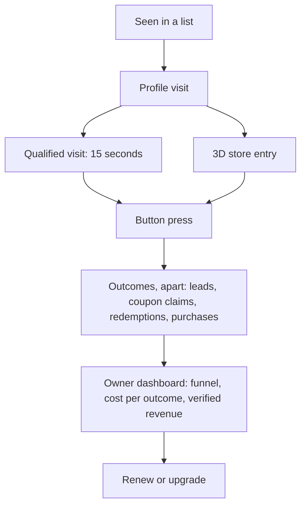

# Conversions: phase 5, measuring what a profile brings

This is phase 5 of the [competitive alignment review](claimavenue_competitive_alignment_review.md#phase-5--complete-conversion-measurement). Every step from a business being seen to a verified result is counted, and the owner sees it on `/business/manage`.



The code is in:

- `server/api/conversions.mjs`: impressions, requests, purchases, coupon redemptions and renewals.
- `server/api/business.mjs`: profile events and the figures.
- `lib/business/conversions.js`: the funnel, the outcome families and their costs, return on spend, and click ids.

The tests are in `tests/conversions.test.mjs`.

## What is measured

| Measure (from the review) | How it is counted | Verified when |
| --- | --- | --- |
| Profile impressions | A card at least half on screen for a second on Discover, a category or a district page. Sent in batches. | Not a bot and not the owner. One per visitor and profile an hour, and 10 a day per network and profile. |
| Profile visits | The profile page has been visible for 2 seconds (as in phase 2) | Not a bot or the owner, within the per-network cap |
| Qualified visits | The page has been visible for 15 seconds in all | As a visit, and only after a visit by the same visitor |
| Store entries | Walking into the building the profile is linked to, in the 3D city | Not a bot or the owner, within the cap |
| Button presses | Pressing the call to action. A link button also carries a click id. In the 3D city, pressing the website link of a building linked to the profile counts too: on its card, in the directory or inside its storefront. | After a visit, within the cap. A press in the city counts after a visit or after walking into the storefront. |
| Newsletter sign-ups | Confirmed sign-ups (double opt-in) | Confirmed by email |
| Meeting requests, quote requests | The profile's own request form | Not a bot or the owner, after a visit, within 3 a day per network and profile. One that the owner marks as spam stops counting. |
| Coupons claimed and redeemed | Each claim gets a ticket. The owner marks it used at the till. | One claim per visitor; never the owner's own |
| Purchases | The business's **server** reports the sale with its conversion key and the click id | The click id belongs to a verified press of the button in the 30 days before |
| Revenue | The value of reported sales, in three parts: **verified** (server report, credited to a press), **unattributed** (server report, no press found) and **browser-reported** (the pixel, which cannot be verified) | Only verified revenue counts towards the return on spend |
| Cost per outcome | Paid orders for the profile in 30 days (Launch Pack, Pro, placements), divided by the count of each family on its own | |
| Renewal rate | Pro plans that renewed at least once, and owners who bought the Launch Pack or a placement again | For the admin |

Outcomes are reported in separate families, each with its own cost, and are **never added into one total**: one customer can sign up, ask for a quote, claim a coupon and buy, so a single "results" count would count them several times and make its cost meaningless (the 2026-10-17 reassessment asked for this).

| Family | Counts | Cost |
| --- | --- | --- |
| Leads | newsletter sign-ups, meeting requests, quote requests | cost per lead |
| Intent | coupons claimed | cost per claim |
| Offline sales | coupons redeemed | cost per redeemed coupon |
| Online sales | verified purchases | cost per acquisition |
| Revenue | verified purchase value | return on spend (verified revenue / spend) |

Nothing is ever simulated: a profile nobody has visited shows zeros.

## Calls to action that collect a request

There are two new kinds of call to action, alongside the website, newsletter, booking, order and demo buttons:

- **Request a meeting:** name, email, phone (optional), when suits the visitor, and what it is about.
- **Request a quote:** name, email, phone (optional), and what the quote is for.

How a request is handled:

- **Delivery.** The request is kept and emailed to the owner, at their verified address with notices on, with the visitor's address to reply to. It is also listed on the Manage page, where the owner can mark it answered or spam.
- **Privacy.** The visitor's details go only to that business.
- **Spam defences:**
  - A hidden field catches robots.
  - Links in the text are refused.
  - The usual word filter runs.
  - A network can send at most 10 requests a day across every profile (`INQUIRY_LIMIT`).
- **Retention.** After 180 days (`INQUIRY_DAYS`), a request's contact details and message are wiped, along with the email that told the owner. The record itself stays, so past figures don't change. Owners who want to keep a contact should reply or copy it before then. The privacy notice should say this.

## Counting purchases on the owner's site

1. A link button (website, order, booking, demo) opens the owner's link with `vv_click=<id>` added. The press is recorded with the same id.
2. The owner's site keeps that id with the order, for example from the landing page's address. When the order is paid, the site reports it in one of two ways:
   - **Postback, from their server** (the only way to verified revenue). The key goes in the `Authorization` header, never in the body or an address:
     ```sh
     curl -X POST https://<api host>/conversions \
       -H 'Authorization: Bearer <conversion key>' -H 'Content-Type: application/json' \
       -d '{"business":"<slug>","click":"<vv_click>","value":<cents>,"order":"<order number>"}'
     ```
   - **Pixel, on their thank-you page** (no key; counted apart as browser-reported, never verified):
     ```html
     /conversions/pixel.gif?business=<slug>&click=<vv_click>&value=<cents>&order=<order number>" width="1" height="1" alt="">
     ```
3. **The conversion key.** Each business has its own random key, made with **Make my conversion key** in the **Count purchases on your own site** box on `/business/manage` (`POST /businesses/<slug>/tracking/key`). It is shown once; only its hash is stored. **Make a new key** replaces it, and the old one stops working at once (audited as `conversion_key.rotate`). It has nothing to do with `REFERRAL_SECRET`.

Why: a credential in a URL leaks through browser history, server and proxy logs, analytics, referrer headers and screenshots, and the old key (derived from the global referral secret and printed in the pixel's address) would have let anyone who saw it report false sales (the 2026-10-17 reassessment). A key sent in the body is now refused (`key_in_body`), so old integrations get a clear message to move to the header.

Each order number counts once. Without an order number, each click counts once. If the pixel reported an order first, the server's report of the same order **replaces** it (its value counts, and it moves from browser-reported to verified or unattributed). The pixel always answers with a transparent image, so the thank-you page never shows a broken image; it needs an order number or a click id and is capped at 30 reports a day per network for each business. A server report that does not match a verified press is kept as unattributed revenue, not as a purchase.

## What the plans see

- **Free:** the funnel, the four outcome families with their costs, revenue in its three parts, spend and the return on it.
- **Pro:** adds sources and campaigns (each with leads and purchases apart), the 30-day chart (leads and purchases per day), and the CSV export (the funnel, each family with its cost, and revenue by trust).

## Endpoints

| Endpoint | Who | What |
| --- | --- | --- |
| `POST /businesses/impressions` `{ slugs, visitor }` | anyone | Cards seen in a list |
| `POST /businesses/<slug>/events` `{ kind: view, engaged, store or cta, visitor, clickId? }` | anyone | Profile events |
| `POST /businesses/<slug>/inquiries` | anyone | A meeting or quote request |
| `GET /businesses/<slug>/inquiries`, `PATCH .../inquiries/<id>` `{ status }` | the owner | List the requests; mark one new, handled or spam |
| `GET /businesses/<slug>/tracking` | the owner | Whether there is a conversion key (never the key), the postback address and the pixel |
| `POST /businesses/<slug>/tracking/key` | the owner | Make a new conversion key (shown once; the old one stops working; audited) |
| `POST /conversions` with `Authorization: Bearer <key>` | the owner's server | Report a purchase (verified when credited to a press) |
| `GET /conversions/pixel.gif` | the owner's thank-you page | Report a purchase as browser-reported (no key) |
| `POST /plots/<id>/coupon/redeem` `{ ticket }` | the plot's owner | Mark a claimed coupon used (audited) |
| `GET /admin/metrics/renewals` | admin | The renewal rate. Also `npm run moderate -- renewals`. |
