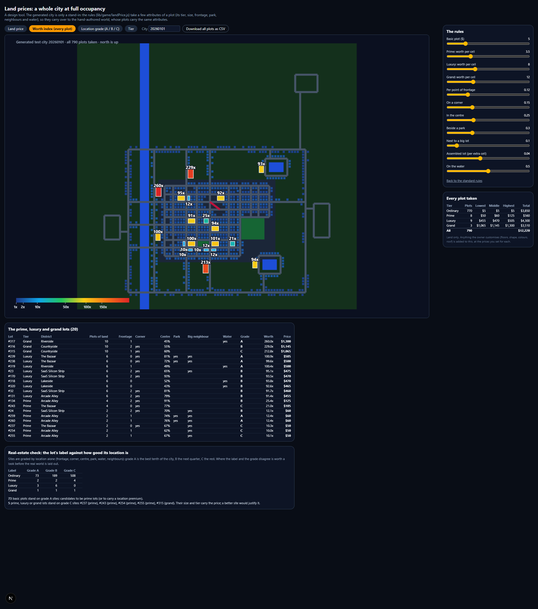
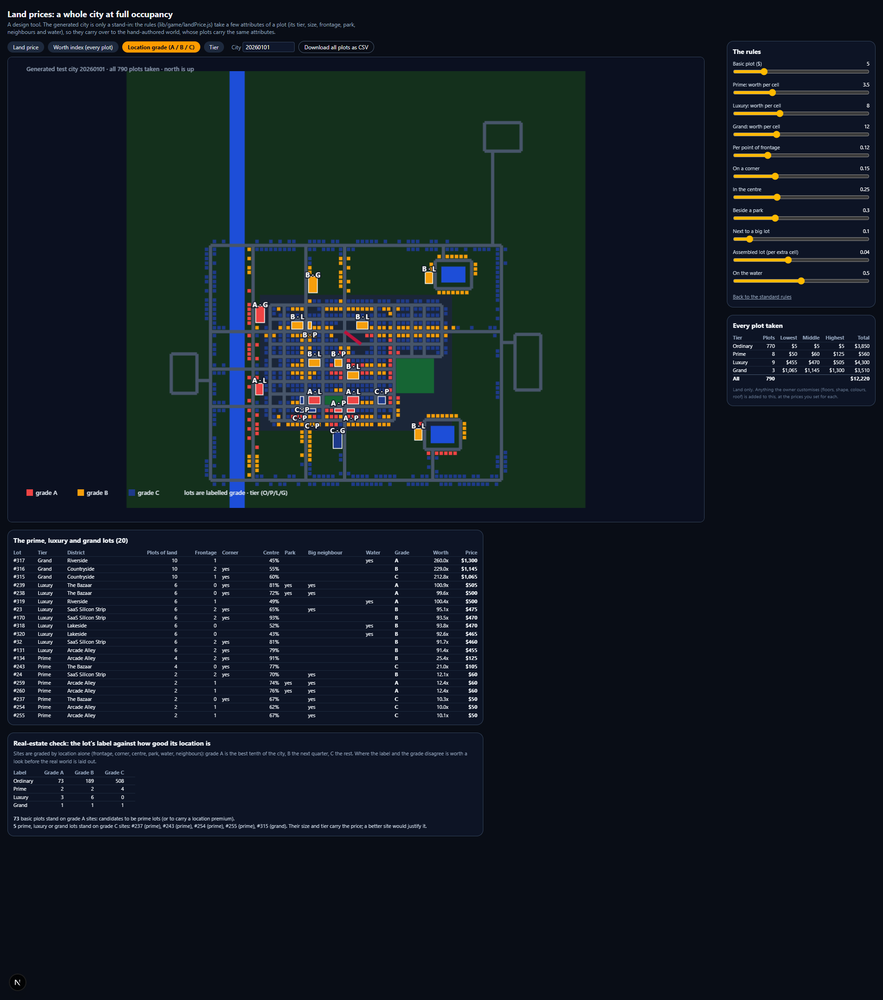

# Land prices: an analysis of a whole city at full occupancy

Written for: you, to settle the price of land before the real world is laid out. The generated city is only a stand-in for the hand-authored one ([study_world_streaming.md](../world/study_world_streaming.md) section 7), so this document gives **rules** that depend on a few attributes of a plot, plus the numbers they produce on the live city (seed 20260101, all 855 lots taken). The tool that made the pictures is `/pricing` in the development server (not in release builds): it has every number below on a slider.

## The decisions it follows (the real price levels, decided 2026-10-18: [plot pricing](plot_pricing_scenarios.md))
- **Every plot is priced by what it is worth**, ordinary ones too, **for 30 days**. A basic plot with no advantage costs **$5 for 30 days**; one on a main road, a corner, near the centre, by a park or on the water costs more (on the live city $5 to $8.50, the middle one $5.50).
- **Prime, luxury and grand lots cost more**, by their worth to the power 0.7: compressed, so the top does not run away (a grand lot worth about 240 basic plots costs about 46 times as much).
- **The basic outside is free; an elaborate one costs a share of the plot's land price** (`lib/content/exteriorPrices.js`): see [The outside](#the-outside-basic-is-free-elaborate-is-priced) below.
- **A lease is 7, 14 or 30 days** (`lib/game/leases.js`): see [Lease terms](#lease-terms). An account with Pro pays 15% less for a lease.
- You have **three minutes to claim and pay** once you start setting a plot up (a "held for you" countdown on the claim form).

## How a lot's worth is worked out (real-estate grounds)
Commercial real estate values a site on a handful of well-known grounds. Each one is an attribute of the plot (`lib/game/landPrice.js`):

| Ground | In real estate | Attribute here | Adds to the worth |
| :--- | :--- | :--- | :--- |
| Visibility and traffic | "Location, location, location": a main-road frontage | `frontage` 0 to 3: a main road in front, a main cross street beside it, a ring road | 12% for each point |
| Corner | A corner lot has two frontages and sells at a premium | `corner` | 15% |
| Centrality | Class A locations are in the core | `centrality` 0 to 1 | up to 25% |
| Amenity | A park or a water view is the biggest amenity premium | `park`, `waterfront` | 30% and 50% |
| Co-tenancy | An anchor tenant lifts its neighbours | `anchor`: next to another big lot | 10% |
| Plottage | An assembled parcel is worth more than the same area in small lots | `cells` (area in standard plots) | 4% per extra cell, up to 25% |
| Highest and best use | The tier of the lot | `tier`: premium per cell of 1 (ordinary), 3.5 (prime), 8 (luxury), 12 (grand), the generator's own value ratios | multiplies the area |

    worth = cells x tier premium x (1 + location bonuses) x (1 + plottage)
    land price (30 days) = $5 x worth ^ 0.7, to the nearest $0.25 below $20 and the nearest dollar from $20 up;
                           never below $5

A **location grade** is also worked out for every site, whatever is built on it, the way agents grade retail sites: **A** is the best tenth of the city by location bonus, **B** the next quarter, **C** the rest.

## The result: all 855 lots taken

What the live city's plots cost for 30 days (seed 20260101, every lot, Old Town's houses and the admin headquarters too; `tests/land-price.test.mjs` checks the figures of the 805 lots that can be leased, [plot pricing](plot_pricing_scenarios.md) has them by term):

| Tier | Lots | Lowest | Middle | Highest | All together |
| :--- | :-: | :-: | :-: | :-: | :-: |
| Ordinary | 752 | $5 | $5.50 | $8.50 | $4,399.75 |
| Prime | 70 | $23 | $27 | $51 | $2,094 |
| Luxury | 25 | $85 | $111 | $135 | $2,746 |
| Grand | 8 | $202 | $231 | $260 | $1,847 |
| **The whole city** | **855** | | | | **$11,086.75** |

That is the land alone, for 30-day leases. A luxury estate is worth about 80 basic plots and a grand estate about 240, but the 0.7 power makes them cost about 22 and 46 times a basic plot. Prime lots are 2 to 4 plots of land with a modest premium, so they start at $23.

The **worth index** view shows the same thing for every plot: a basic plot with no advantages is 1x, and the best ordinary sites reach about 2x, so they cost about $8.50:

(The pictures are from the first city, before the tier mix was updated; the tool draws today's.)

Until 2026-10-18 the generator worked out every plot's centrality without the city's centre, so the game and the server priced every plot as if it stood at the edge of the city. It now passes the centre and the land (`lib/city/cityGenerator.js`), so the live prices are the figures above; the server brings the stored plots up to date when it starts.

## Is the prime and luxury labelling right? (the location grades)

| Label | Grade A | Grade B | Grade C |
| :--- | :-: | :-: | :-: |
| Ordinary (770) | 73 | 189 | 508 |
| Prime (8) | 2 | 2 | 4 |
| Luxury (9) | 3 | 6 | 0 |
| Grand (3) | 1 | 1 | 1 |

- **Luxury estates are well placed**: all nine are on grade A or B sites.
- **73 basic plots are on grade A sites.** 49 of them are riverside and lakeside plots, 23 are on the outskirts' ring roads and 10 are on the main strip. A real-estate agent would call every waterfront plot a prime site: consider making all of them prime lots (or giving the waterfront a location surcharge on a basic plot).
- **Five special lots are on grade C sites**: prime lots 237, 243, 254 and 255 (in The Bazaar and Arcade Alley, away from main roads) and the grand estate 315 in the countryside. Their size and tier carry the price; a better site would justify it. These are the lots to look at when you place the real ones.

## What I would do with it
1. Price **every plot by its worth, from $5**, and let the real world's plots carry the attributes above (`tier`, `cells`, `frontage`, `corner`, `centrality`, `park`, `anchor`, `waterfront`). The price then comes from the rules, or you type a `price` on a plot to override.
2. Use the **location grade** to decide which plots become prime when the real world is laid out: every grade A site that is not already prime or luxury is a candidate. (Real-estate practice often defines luxury as the top 5 to 10% by price, which is about what this gives.)
3. The **luxury and grand prices** ($111 and $231 in the middle, for 30 days) are what the generator's own value ratios imply when a basic plot is $5, compressed by the 0.7 power. They are set in `LAND_PRICING`; `/pricing` still has every weight on a slider for a later review.
4. The **outside prices** are shares of the land price (below). Change a share in `lib/content/exteriorPrices.js` and the claim form, the owner's editor and the server all follow.

## The outside: basic is free, elaborate is priced
The outside of a building is part of what the plot is worth, so its price is a **share of the plot's land price for 30 days** (`lib/content/exteriorPrices.js`, priced by `outsideCost` in `lib/game/claimPrice.js`, to the cent). The same choice costs more on a better plot.

| | Choice | For 30 days |
| :--- | :--- | :-: |
| **Free** (the basic outside) | the plot's usual number of floors, or fewer | free |
| | every colour style, your own wall colour (also from inside the building) | free |
| | any building shape, what stands behind the building | free |
| | no roof feature, a beacon or a dish | free |
| **Priced** (the elaborate outside) | each floor above the usual number | 10% of the land |
| | each floor from the tenth up (a skyscraper) | another 15% |
| | a roof garden | 10% |
| | a glass dome | 20% |
| | a spire | 25% |

On the live city:

| Plot | Land for 30 days | One extra floor | Roof garden | Glass dome | Spire |
| :--- | :-: | :-: | :-: | :-: | :-: |
| Ordinary (the middle one) | $5.50 | $0.55 | $0.55 | $1.10 | $1.38 |
| Prime (the middle one) | $27 | $2.70 | $2.70 | $5.40 | $6.75 |
| Luxury (the middle one) | $111 | $11.10 | $11.10 | $22.20 | $27.75 |
| Grand (the middle one) | $231 | $23.10 | $23.10 | $46.20 | $57.75 |

The claim form and the outside editor say "free" beside each free choice and "+$1.38 / 30 days" beside a priced one, from the same function the server charges with, and the claim form itemises each priced choice above the total. A claim's 30-day price (the plot's value) is the land plus the outside.

### Changing the outside later
Without a rule, an owner could claim with the basic outside and add a spire for nothing afterwards. So (`exteriorChangeQuote` in `lib/game/claimPrice.js`, `services/api/core.mjs`):
- A change that costs **the same or less** for 30 days (colours, the shape, fewer floors, taking a feature off) applies at once. The plot's value (its 30-day price) goes down by the difference, never below the land.
- A change that costs **more** is paid for the rest of the lease: the 30-day difference, at the lease term's factor, times the share of the lease still to run, and at least **$0.50** (Stripe's smallest charge, which also stops a run of small upgrades each rounding to nothing). There is no Pro discount on it. The plot's value goes up by the 30-day difference. `PATCH /plots/:id` refuses it with 402 `exterior_payment_required` and the quote; `POST /plots/:id/exterior` pays it (through Stripe when payments are on). The owner's editor shows "These changes cost $X for the rest of your lease" with **Pay $X and apply** and **Undo**.
- Once the lease has ended (its 3 grace days, or open to a buyout) the outside can't be built onto until the lease is renewed, like the inside.
- A renewal is priced from the plot with the outside it has, so an upgrade is in every renewal after it.

Examples, on a fresh 30-day lease: a spire on the middle ordinary plot costs **$1.38** ($0.69 half way through the lease, $0.50 near its end); two extra floors and a spire **$2.48**. On the middle prime plot a spire costs **$6.75** ($3.38 half way through); two extra floors and a spire **$12.15**.

## Lease terms
A plot is leased for **7, 14 or 30 days** (30 if the claim does not say). The price is the 30-day price (land and outside) times the term's factor: **7 days 0.3, 14 days 0.55, 30 days 1**, so a shorter lease costs a little more per day. A renewal costs **10% less** than a new lease of the same plot and term. An account with **Pro** pays **15% less** for a claim, a take-over or a renewal. No lease, take-over or renewal is charged less than $0.50. The 90-, 182- and 365-day terms of the first real levels are gone: a lease made with one renews for 30 days unless the tenant picks another term.

| Plot (the middle one of those that can be leased) | 7 days | 14 days | 30 days | 30 days with Pro |
| :--- | :-: | :-: | :-: | :-: |
| Ordinary, $5.50 | $1.65 | $3.03 | $5.50 | $4.67 |
| Prime, $27 | $8.10 | $14.85 | $27 | $22.95 |
| Luxury, $110 | $33 | $60.50 | $110 | $93.50 |
| Grand, $231 | $69.30 | $127.05 | $231 | $196.35 |

The renewal window is the last 7 days of a 14- or 30-day lease and the last 3 days of a 7-day one; then come 3 grace days. Ranges, take-overs, renewals and the revenue at full occupancy are in [plot pricing](plot_pricing_scenarios.md).

## Floors and skyscrapers (the question about the four-floor limit)
The first version capped buildings at four floors, which was too low: a skyscraper shape can stand about 12 units (ten floors) even on an ordinary plot and 25 or more on an estate. The limit is now set by the plot's tier, and by what the shapes can reach on that footprint, whichever is lower:

| Plot | Most floors | Tallest |
| :--- | :-: | :-: |
| Ordinary | 10 | about 12 units |
| Prime | 12 | about 14 units |
| Luxury | 16 | about 19 units |
| Grand | 20 | about 24 units |

Each shape in the picker says how many floors it can have ("Skyscraper C (commercial, 5 to 10 floors)"), and only shapes that can stand at the chosen height are listed. From ten floors the shapes are skyscrapers. A building the owner designs takes the whole plot (the car park some generated buildings keep behind is dropped), so a skyscraper can use its full footprint.

## The claim form
- A plot's price is the land price plus each priced outside choice, itemised above a **Total** for the chosen lease term. The builder marks each free choice "free" and each priced one with what it adds for 30 days. With Pro, the Pro discount is its own line ("Pro: 15% off"); without it, a line says Pro members get 15% off plots.
- **Plot held for you: 3:00** starts when the player starts setting the plot up (a name, or any choice) and counts down; in the last 30 seconds it turns red. When it ends, the form is cleared, the draft building leaves the lot and a message says the plot is open again.
- With a game server the hold is kept on the server too (`POST /plots/:id/hold`, since 2026-10-19): another account can't hold, claim or take the plot over meanwhile, and a player signs in before setting a plot up ([plot_economy_data.md](plot_economy_data.md)).

## Using the tool
Open `http://localhost:3000/pricing` in development. Buttons switch between the price, the worth index, the location grade and the tier; the city can be changed (any number is a city); every weight is a slider; **Download all plots as CSV** gives every plot's attributes, grade, worth and price. The numbers that finally matter are in `LAND_PRICING` at the top of `lib/game/landPrice.js`; `tests/land-price.test.mjs` checks the rules and runs them over eight cities.

## The mix of tiers (update)
The first city had too few special lots (8 prime, 9 luxury, 3 grand: 2.5% together). The target is set as **shares of all lots**, so it holds as the city grows past 1000 lots (`TIER_SHARES` and `tierTargets()` in `lib/game/landPrice.js`):

| Tier | Share | 677 lots (the test city now) | 1,000 lots | 1,500 lots |
| :--- | :-: | :-: | :-: | :-: |
| Prime | 8% | 60 | 80 | 120 |
| Luxury | 2.5% | 19 | 25 | 38 |
| Grand | 0.8% | 6 | 8 | 12 |

The generated test city now reaches these (60, 19 and 6; the lots are merged, so the count of lots is lower than the old 790 plots). `tests/land-price.test.mjs` checks the shares on eight cities and the 1,000-lot arithmetic. In the hand-made world, pick the lots by location grade up to these counts, and re-check the shares after each new road. `/pricing` shows each tier's share beside its target.
