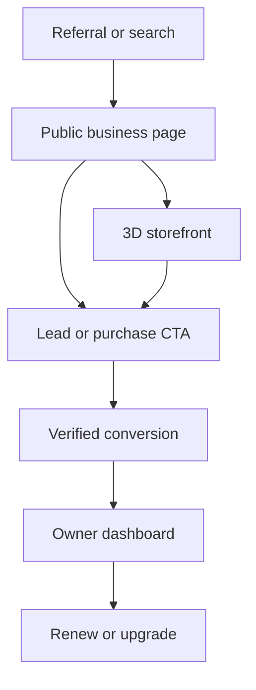
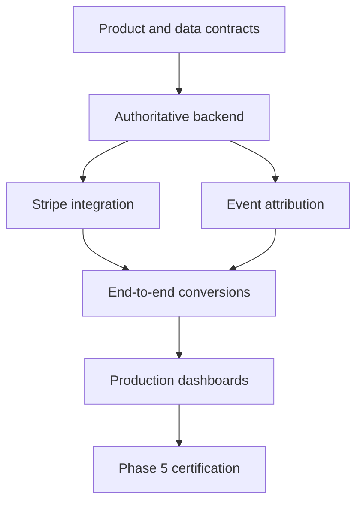

# Phase 5 Delivery Estimate with an AI-Agent Team

> **Historical estimate.** By 2026-10-17, phases 1 to 5 were done in code, well ahead of this estimate ([alignment_status.md](alignment_status.md)). What it lists as outside the code still applies: hosting, the Stripe account, the terms, real mail delivery and the pilot.

**Project:** VoxelVenture  
**Prepared:** October 16, 2026  
**Planning horizon:** Phase 1 through Phase 5 of the Claim Avenue competitive-alignment roadmap  
**Baseline:** VoxelVenture `main` after merge of the competitive-alignment review

---

## Executive estimate

With **one human technical lead coordinating four to six capable AI coding agents**, the recommended estimate to complete Phase 5 is:

> **9–12 weeks**

Starting October 16, 2026, the expected completion window is approximately:

> **December 18, 2026–January 8, 2027**

The lower end assumes rapid product decisions, available provider accounts, stable requirements and parallel execution. Holiday availability, payment-provider review, deployment issues or security remediation could move final certification farther into January.

The estimate is for a production-oriented Phase 5 implementation, not merely completed user-interface screens.

---

## Delivery scenarios

| Scenario | Time to Phase 5 | Expected result |
| --- | ---: | --- |
| Aggressive prototype | 6–8 weeks | Stripe test mode, one CTA provider, basic attribution and limited production hardening |
| Recommended production-ready path | **9–12 weeks** | Real payments, authoritative analytics, secure deployment, end-to-end tests and release-candidate verification |
| Conservative launch | 13–16 weeks | Allows for provider delays, data-model changes, security remediation and extensive device/accessibility work |

### Recommended planning commitment

Use **12 weeks as the external planning commitment** and treat a 9-week delivery as an internal stretch target. This protects quality and reduces pressure to label unverified payments or simulated analytics as production-ready.

---

## Phase schedule

| Stage | Estimated duration | Target window |
| --- | ---: | --- |
| Foundation: CI, branch protection, environments and architecture decisions | 1 week | Oct 16–23 |
| Phase 2: Business-first funnel and public profiles | 2–3 weeks | Oct 23–Nov 13 |
| Phase 3: Authoritative backend and production data | 3–5 weeks, partially parallel | Oct 23–Nov 27 |
| Phase 4: Payments and monetization | 2–4 weeks | Nov 13–Dec 11 |
| Phase 5: Attribution, conversion measurement and dashboards | 2–3 weeks | Nov 27–Dec 18 |
| Integration, security and release-candidate hardening | 1–2 weeks | Dec 11–Jan 8 |

The schedule overlaps workstreams. Adding the row durations sequentially would overstate the total calendar duration.

---

## Assumed team structure

### Human technical/product lead

The human lead owns decisions and approvals that should not be delegated entirely to AI:

- Product scope and acceptance criteria.
- Data-model and architecture approval.
- Payment-account configuration.
- Credentials and production access.
- Legal, tax, refund and policy decisions.
- Provider contracts and account verification.
- Final security and release acceptance.
- Prioritization when parallel work conflicts.

### Agent 1 — Public discovery and frontend

Responsibilities:

- Public business profiles.
- Discovery landing page.
- Category and district pages.
- SEO and structured metadata.
- Open Graph share images.
- Fast mobile experience.
- Accessible non-WebGL fallback.
- Owner onboarding and upgrade surfaces.

### Agent 2 — Backend authority and data

Responsibilities:

- Server-owned businesses, claims and leases.
- Campaign and advertising inventory.
- Database schemas and migrations.
- Authentication and authorization.
- Audit records.
- Idempotent mutation APIs.
- Removal of local-only authority from production flows.

### Agent 3 — Commerce and billing

Responsibilities:

- Stripe Checkout.
- Products and pricing.
- Subscription lifecycle.
- Payment-webhook verification and idempotency.
- Receipts and reconciliation.
- Cancellations and refunds.
- Failed-payment handling.
- Commerce contract and integration tests.

### Agent 4 — Analytics and attribution

Responsibilities:

- Referral identifiers.
- Campaign-source attribution.
- Conversion events.
- CTA-provider integrations.
- Verified analytics.
- Owner and campaign dashboards.
- Funnel and renewal reporting.
- Separation of simulated, raw and verified data.

### Agent 5 — Platform, security and QA

Responsibilities:

- GitHub Actions.
- Branch protections and required checks.
- Deployment environments.
- Configuration validation.
- Dependency and secret scanning.
- Browser and device coverage.
- Integration and production smoke tests.
- Release evidence.

### Optional Agent 6 — Integration and documentation

Responsibilities:

- Cross-workstream contract verification.
- API and event-schema documentation.
- Migration and deployment runbooks.
- Test fixtures.
- Release checklists.
- User-facing documentation.
- Pull-request integration support.

---

## Phase-by-phase plan

## Foundation — Week 1

The first week establishes the controls required for multiple agents to work safely in parallel.

### Deliverables

- GitHub Actions for build, lint and tests.
- Protected `main` with required checks.
- Preview, staging and production environment definitions.
- Shared API and event contracts.
- Migration conventions.
- Environment-variable validation.
- Feature flags for payments and production analytics.
- Ownership boundaries for each agent.
- Pull-request and integration rules.
- Initial security and threat-model review.

### Exit criteria

- Every pull request runs the same required checks.
- Agents can work on isolated branches without editing the same core files unnecessarily.
- Staging deployment is reproducible.
- Database migrations can be applied and rolled back safely.
- Payment and analytics contracts are approved before implementation.

---

## Phase 2 — Business-first funnel

**Estimated duration:** 2–3 weeks

### Deliverables

- Free business-profile creation.
- Public `/discover` experience.
- Public `/business/[slug]` pages.
- Public category and district pages.
- Search-friendly metadata and canonical URLs.
- Open Graph preview images.
- Business CTA selection.
- Share and referral entry points.
- Owner setup checklist.
- Upgrade prompts.
- Optional link into the existing 3D building experience.

### Important product rule

The public business profile must work quickly on mobile and must not require WebGL or loading the full city. The 3D world remains a differentiated engagement destination rather than a prerequisite for basic discovery.

### Exit criteria

- A new business can create a free profile.
- The profile has a stable public URL.
- Visitors can discover it through public search and category pages.
- The page can generate and record meaningful CTA interactions.
- The 3D storefront is optional and linked from the public page.

---

## Phase 3 — Authoritative backend and production data

**Estimated duration:** 3–5 weeks, overlapping Phase 2

### Deliverables

- Server-authoritative businesses.
- Server-authoritative claims and leases.
- Server-authoritative campaigns and ad inventory.
- Production authentication and authorization.
- Verified event collection.
- Moderation actions and audit logs.
- Authoritative owner statistics.
- Server-backed market bookings.
- Production-safe data retention rules.
- Migration of relevant local-only state.

### Exit criteria

- The client cannot independently grant ownership, leases or paid inventory.
- Every commercial mutation is authenticated, authorized and auditable.
- Production owner dashboards never substitute simulated activity.
- Raw and verified events are distinguishable.
- Administrative changes are recorded.
- Staging survives migration, restart and replay tests.

---

## Phase 4 — Payments and monetization

**Estimated duration:** 2–4 weeks

### Initial product ladder

| Tier | Offer |
| --- | --- |
| Free | Searchable profile, directory listing and share link |
| $9 Launch Pack | Enhanced card, branded share image, launch-week placement and campaign summary |
| $19/month Pro | Verified analytics, offers, lead tools, CTA integrations, campaign history and CSV export |
| $29–$99 campaign | Labeled homepage, district, billboard, plane-banner or featured-building placement |
| Optional world placement | Fixed-term lease for a 3D building or market stall |

### Deliverables

- Stripe products and prices.
- Checkout sessions created only by the server.
- Subscription creation and lifecycle handling.
- Signed webhook verification.
- Webhook idempotency.
- Internal ledger or transaction records.
- Payment reconciliation.
- Cancellation and refund handling.
- Failed-payment and retry handling.
- Receipts and customer communications.
- Access changes tied to authoritative payment state.
- Payment contract and end-to-end tests.

### Scope recommendation

Begin with conventional products, subscriptions, sponsored placements and leases. Defer real-money forced-buyout payouts until legal, tax, fraud, refund and payment-provider implications have been reviewed.

### Exit criteria

- Test-mode and live-mode certification paths are documented.
- Replayed webhooks cannot duplicate entitlements.
- Refunds and cancellations update access and reporting correctly.
- A failed payment cannot accidentally grant or preserve paid inventory.
- Payments reconcile against internal orders.
- No client-provided amount is trusted.

---

## Phase 5 — Attribution, conversion measurement and dashboards

**Estimated duration:** 2–3 weeks

### Target customer journey

### Events to measure

- Profile impressions.
- Qualified profile visits.
- 3D storefront entries.
- CTA interactions.
- Newsletter signups.
- Meeting requests.
- Demo requests.
- Coupon claims.
- Coupon redemptions when measurable.
- Purchases.
- Referral conversions.
- Campaign source and placement.
- Cost per result.
- Subscription and campaign renewal.

### Deliverables

- Signed referral identifiers.
- First-party attribution records.
- Campaign-source persistence.
- Conversion-event ingestion.
- CTA-provider adapters.
- Verified conversion reporting.
- Owner funnel dashboard.
- Campaign reporting.
- CSV export.
- Refund and cancellation adjustments.
- Data-quality indicators.
- Retention and renewal reporting.

### Exit criteria

- A referral source survives the full signup and checkout journey.
- Duplicate or replayed events do not inflate results.
- Owners can distinguish impressions, visits, clicks and conversions.
- Refunds and cancellations are reflected correctly.
- Production reporting contains no simulated advertiser metrics.
- The complete journey passes automated and staged end-to-end verification.

---

## Critical path

The longest dependency chain is:

Additional agents can accelerate public pages, testing and documentation, but they cannot remove the dependency between backend authority, commerce and verified conversion reporting.

---

## Parallelization plan

| Workstream | Can begin | Primary dependencies |
| --- | --- | --- |
| CI and environments | Immediately | Repository access and hosting decision |
| Public profiles and discovery | Immediately after route/data contract | Approved profile schema |
| Backend authority | Immediately after schema approval | Database and deployment decision |
| Stripe products and checkout UI | Week 2 | Pricing decisions |
| Stripe entitlement integration | After authoritative order model | Backend authority |
| Referral capture | Alongside public profiles | Attribution contract |
| Conversion reporting | After event schema | Event ingestion and authoritative identity |
| Production dashboard | After verified metrics and commerce states | Backend, analytics and payments |
| Release certification | After all paths integrate | Completed staging environment |

---

## What AI agents accelerate

AI agents are especially effective for:

- Implementing defined APIs and user interfaces.
- Generating unit and integration tests.
- Applying repetitive schema and type changes.
- Building adapters from approved contracts.
- Producing fixtures and migration tests.
- Reviewing code across multiple workstreams.
- Maintaining documentation and release checklists.
- Running and diagnosing continuous-integration failures.

AI agents do not eliminate the need for:

- Product decisions.
- Provider-account approval.
- Legal and policy review.
- Secure credential handling.
- Real-device validation.
- Production observability.
- Human release acceptance.
- Customer and pilot feedback.

---

## Principal schedule risks

| Risk | Likely impact | Mitigation |
| --- | --- | --- |
| Product scope continues expanding | 2–6 weeks | Freeze world expansion and maintain a Phase 5 change-control list |
| Local and server state disagree | 1–3 weeks | Define authority boundaries before payments |
| Stripe account or Connect review delays | 1–4+ weeks | Start provider setup in Week 1; launch fixed-price products before payouts |
| Existing schema requires redesign | 1–3 weeks | Complete data-contract review before parallel implementation |
| Metrics are not trustworthy | 1–3 weeks | Separate raw, verified and simulated events; prohibit simulation in production |
| Agents edit shared core files | Rework and merge delays | Assign ownership boundaries and sequence contract changes |
| Mobile/WebGL performance issues | 1–2 weeks | Make public profiles non-WebGL and run device tests early |
| Security findings appear late | 1–3 weeks | Threat-model in Week 1 and continuously scan |
| Legal concerns around forced buyouts | Unbounded | Defer real-money buyout payouts; use conventional leases and ads |
| Holiday availability | 1–2 weeks | Use the January 8 date for external commitment |

---

## Definition of Phase 5 completion

Phase 5 is complete only when all of the following are true:

- Public business pages work without the 3D world.
- Claims, leases, campaigns and paid inventory are server-authoritative.
- Stripe test and live-mode paths are certified.
- Webhooks are signed, idempotent and reconciled.
- Referral sources persist through signup and checkout.
- CTA activity reaches authoritative analytics.
- Advertiser dashboards contain no simulated production data.
- Refunds and cancellations update reporting and entitlements.
- Moderation and audit records are operational.
- Required CI and security checks pass.
- Production smoke tests pass.
- A release candidate completes the full acquisition-to-conversion journey.
- Human release approval is recorded.

---

## Expected output by the end of Phase 5

VoxelVenture should be capable of:

1. Onboarding a business into a free public profile.
2. Making that business discoverable without loading the 3D experience.
3. Upgrading the business through a real checkout.
4. Placing the business into a paid campaign or optional 3D lease.
5. Attributing visitors and conversions to referrals and placements.
6. Reporting verified business outcomes.
7. Processing cancellations and refunds correctly.
8. Presenting renewal or upgrade options based on measurable value.

At this point the product is ready for a constrained Phase 6 commercial pilot.

---

## Phase 6 timing after Phase 5

Phase 6 should run for at least four weeks so that repeat usage and renewal behavior can be observed.

If Phase 5 completes within the recommended window, the first meaningful commercial-validation results should be available approximately:

> **Mid-January to early February 2027**

### Suggested pilot

- Recruit 10–20 businesses.
- Limit the pilot to two districts.
- Provide free profiles.
- Test the $9 Launch Pack.
- Test the $19 Pro plan.
- Test one fixed-price sponsored campaign.
- Configure one measurable CTA per business.
- Deliver four weeks of verified reporting.

### Suggested success criteria

- At least 30% of participating businesses return weekly.
- At least 20% receive a meaningful CTA interaction.
- At least three businesses pay.
- At least two renew or request another campaign.
- No simulated metrics appear in advertiser reporting.

---

## Final recommendation

Plan on **9–12 weeks** to achieve a production-oriented Phase 5 with one human lead and four to six AI agents. Use **12 weeks** as the committed delivery target, keep 9 weeks as the internal stretch goal, and reserve 13–16 weeks as the risk-adjusted range.

The schedule remains achievable only if the team freezes additional world expansion, establishes backend authority early, begins payment-provider setup immediately and defines Phase 5 using verified end-to-end outcomes rather than completed interface screens.
