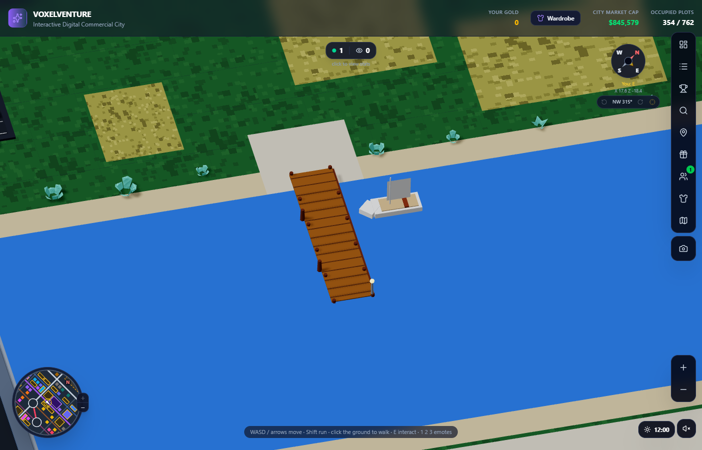
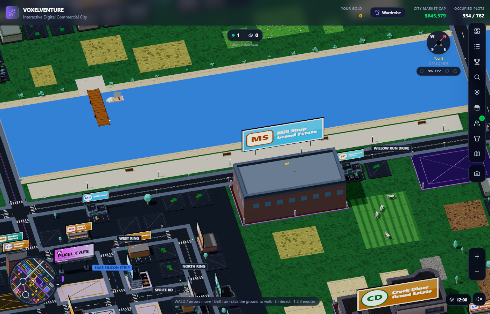
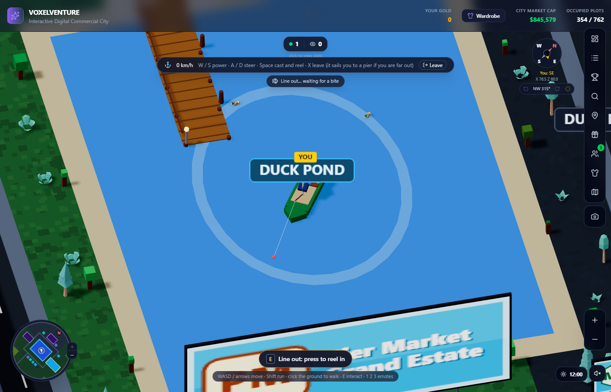

# Boats, piers, fishing and the riverwalk

Written for: you, after the boat could not be left and the fishing line looked wrong. What was wrong, what changed, and what is new beside the river.

## What was wrong
- **Leaving a boat only worked within 3.4 units of the shore.** Out on a lake or the river the "Leave" button and X said "steer closer to the shore" and nothing else, so it looked like the boat could not be left.
- **The fishing line was drawn in the wrong direction.** The line and rod were turned with `lookAt` inside a group that is offset from the world origin, which turns them about the wrong point: a long line pointing away from the bobber. They are now turned with a quaternion (`aim` in `apps/web/components/city/Vehicles.jsx`) and run from the rod to the bobber.
- **The prompt said "Reel in the line" while you waited for a bite**, so pressing it pulled the empty line up ("Nothing on the line yet"). It now says "Line out: press to reel in", and a bite lasts 2.2 s (it was 1.3 s).
- **The boat panel sat on top of the visitor count** at the top of the screen. It is moved down.

## What happens now when you get out of a boat
1. **Shore or pier within reach**: you step out at once, as before (and a pier's deck counts as dry land).
2. **Too far out**: the boat **sails itself to the nearest pier on the same water** (a lake has its own pier; the river's nearest one), goes round the end of the pier if it is in the way, comes in sideways, stops alongside, and you step onto the deck. The boat stays tied up beside the pier. The panel says "Sailing to the nearest pier: steer to take the wheel"; any steering key takes the wheel back.
3. **No pier on that water** (not in the generated cities, which give every lake and the river one): it says so and you stay in.

The rules are in `lib/sim/docking.js` (pure, tested): `nearestPier`, `routeToPier`, `autopilot`. In the tests the boat docks from every place tried on every lake and on the river (78 of 78 runs from 3 headings each), never touches the deck, stops within 1.2 of the dock and lies along the pier.

## Piers (`lib/city/piers.js`, `apps/web/components/city/Piers.jsx`)
- A wooden pier beside every moored boat: 6 long into the water, 1.6 wide, 0.8 onto the land, on posts, with mooring posts on the dock side, a rail and a lantern at the end (lit at dusk like the street lamps), and a paved landing where it meets the bank.
- **You can walk on it**: the collision map cuts the deck out of the water. Boats cannot sail through it.
- **Fishing from a pier on foot**: stand at the end and the prompt says "Fish from the pier". Same line, bite, Gold and daily cap as from a boat; walking away reels the line in.
- Every lake and the river has at least one pier; the river has two or three.

## The riverwalk (`lib/city/promenade.js`, `apps/web/components/city/Promenade.jsx`)
- A paved walking area (2 to 4 wide) between the river drive and the water, along most of the drive, with **benches facing the river** every 13 units and **lamp posts** every 9.5 (lit at night). It is broken where a road or a bridge crosses it, and where a billboard stands. Cars never come here.
- The river drive **no longer has lots on the river side**: that ground is the riverwalk. Lots stay on the city side.
- The benches and lamp posts are solid; the paving is walkable (tested end to end).

## Luxury and grand estates by the river
Along the river drive, on the land side (the riverwalk is on the other side), two **grand** and three **luxury** estates are placed first, before the lake ones (`RIVER_GRAND`, `RIVER_LUXURY` in the generator). In the default city: 3 luxury and 2 grand. In 18 of 20 test cities there is at least one; in the others the river runs right beside the city's ring road and there is no room.

## Files and tests
`lib/city/piers.js`, `lib/city/promenade.js`, `lib/sim/docking.js`, `lib/state/fleetStore.js` (exit, finishDock, cancelDock, pierFish), `apps/web/components/city/Vehicles.jsx`, `apps/web/components/city/Piers.jsx`, `apps/web/components/city/Promenade.jsx`, `apps/web/components/ui/VehicleHud.jsx`, the pier prompt in `apps/web/components/city/Avatar.jsx`; tests `tests/piers.test.mjs` (geometry, collision, riverwalk, docking runs, the exit flow, pier fishing) and the "piers" block of `tests/browser.test.mjs` (a boat sails to a pier, you step onto it, and you catch a fish from it).

## Not built yet
Boat and pier sounds beyond the water (water lapping at a lake, the river and each pier is now built: the `water` zone in `lib/game/soundZones.js`, see [day_night_sound.md](../world/day_night_sound.md); the creak of the deck or a boat is not), a ferry or taxi between piers, renting a boat, fishing competitions, a promenade round the lakes (they only have the pier landings), and other players seeing your boat dock.
