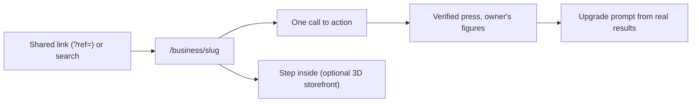

# The business-first funnel

Status: **phase 2 built (2026-10-16).** Phase 2 of the [competitive alignment review](../competitive-research/claimavenue_competitive_alignment_review.md#phase-2--build-the-business-first-funnel). Not yet deployed or tried with real businesses.

Until now, the only way for a business to get into VoxelVenture was to claim a plot in the 3D city. Now any business can make a free public page in a minute. A 3D building is an optional extra that can be linked to the page later.



## What a business gets

| Review item | What was built | Where |
| --- | --- | --- |
| 1. Free business profile | Name, category, optional district, tagline, description, website and one call to action. No plot or payment needed. Up to 5 per account. | `POST /businesses`, `/business/new` |
| 2. Public SEO page | `/business/<slug>`: server-rendered HTML that works without WebGL. It has a canonical link, Open Graph and Twitter tags, a generated share image (`opengraph-image.jsx`, gold during a launch week), and schema.org JSON-LD: the business type with its running offer, plus a breadcrumb. | `app/(public)/business/[slug]` |
| 3. Category and district pages | `/discover` (search, categories, districts, sponsored, new this week, newest), `/category/<id>` (8 categories) and `/district/<id>` (the 4 themed districts). Each list page has its own share image and a `CollectionPage` with an `ItemList` of its businesses in JSON-LD. There is also a `sitemap.xml` and a `robots.txt`. | `app/(public)`, `app/sitemap.js`, `app/robots.js` |
| 4. Clear CTA selection | Each page has exactly one primary button. Links: Visit website, Book a meeting, Order online and Request a demo. Answered on the page: Join the newsletter (double opt-in) and Request a meeting or a quote (phase 5, [conversions.md](../monetization/conversions.md)). | `CTA_KINDS` in `lib/business/profile.js` |
| 5. Share and referral attribution | Every account has a signed referral code (`?ref=`). Views, CTA presses, sign-ups and new profiles that come through it are credited to that account. | `server/api/business.mjs` |
| 6. Owner onboarding checklist | Name and category, district, description, CTA, share. Linking a 3D building is listed as optional. | `onboardingSteps`, `/business/manage` |
| 7. Value-linked upgrade prompts | The Launch Pack, Pro and sponsored placements are offered only on the strength of the owner's own **verified** figures. With Stripe set up they lead to checkout ([billing.md](../monetization/billing.md)); without it, "Tell me when it is ready" records the demand. | `upgradePrompts`, `upgrade_interest` table |

Owners can also add their X handle and opt in to a welcome post on VoxelVenture's X account that tags them; see [social_posts.md](../operations/social_posts.md).

The 3D city stays one link away, and the other way round: the game's header has **Businesses** and **List your business free**, a building's card links to its **Business page** (its owner's profile with a server; its demo page without one), and a browser that cannot draw the city (no WebGL) gets a plain page instead of a broken canvas (`components/ui/NoWebGL.jsx`; try `/?webgl=0`). That page points to Discover, and to the business's page when the link was to a building that has one. The business pages load no game code, so they stay light on a phone: about 178 KB of compressed JavaScript, against 689 KB for the city. A building linked to a business page shares that page. The header has "Explore the 3D city", and a profile with a linked building shows "Step inside the 3D storefront", which goes to `/b/<plot>`.

**The menu of the business pages** (`components/business/PublicNav.jsx`, in `app/(public)/layout.jsx`) has four entries: **Discover**, **Explore the 3D city**, **My profiles** and **List your business**.

- **On a phone:** the name and *List your business* share the first row. The three places sit under it as a full-width row of equal tabs with icons and short labels (*3D city*). Every target is at least 44 px high.
- **From a tablet up:** everything is on one row.
- **The current page:** it is marked with `aria-current`. Discover stays marked on category, district and business pages.

## Verified figures only

Owners see 30 days of profile views, unique visitors, CTA presses, press rate, visits through their link, newsletter sign-ups and where visitors came from. The categories are direct, search, social, referral and the 3D city. **Nothing is simulated.** A new profile shows zeros, and `upgradePrompts` returns nothing when its figures are simulated or missing (this is tested).

An event is **verified** only if all of the following hold:

- It is not from a known bot or headless browser.
- The visitor id is well formed.
- It is not the owner's own visit.
- The network is under its daily cap per profile: 3 views and 1 press by default (`PROFILE_VIEW_CAP`, `PROFILE_CTA_CAP`). Phase 5 adds impressions, qualified visits, store entries, requests and purchases, verified the same way: see [conversions.md](../monetization/conversions.md).
- For a press, the same visitor viewed the profile in the last day.

A view is sent only after the page has been visible for 2 seconds. Every event is stored, but only verified ones are counted.

## Campaigns

A link tagged `?utm_campaign=<name>` (letters, digits, `-` and `_`, up to 40) has its views and presses counted per campaign; the owner's page lists the ten campaigns with the most views. Links in VoxelVenture's own X posts carry `utm_source=x` and count as their own source ([social_posts.md](../operations/social_posts.md)).

## Referral links

- **The code.** It is `<account id in base 36>.<10 hex characters of HMAC-SHA256>`, signed with `REFERRAL_SECRET`. A forged code is ignored and the visit still counts, just without credit to anyone.
- **Where it is kept.** The visitor's browser keeps the code for 30 days, and the most recent link wins (`lib/business/referral.js`). It is first-party only: no cookie leaves the site, and nothing is sent anywhere except the code itself.
- **What gets credited.**
  - Profile views and presses that come through the link.
  - A sign-up made with the code (`accounts.referred_by`).
  - Any profile later made by that new account (`businesses.referred_by`).
- **No self-referral.** A signed-in visitor's own link is never credited to them.
- **Rewards:** none yet. Attribution is recorded so that reward rules (and fraud checks on them) can be decided later; payments (phase 4) did not need them.

## Demo mode

Without an API server (`API_URL` / `NEXT_PUBLIC_LIVE_API_URL` unset), the public pages list the generated city's own businesses as a demo:

- A banner on every page says they are sample businesses.
- Every page is `noindex`, and the sitemap is empty.
- The generator's placeholder `example.com` websites are not shown as links.

Creating and managing profiles needs the API.

## Running it

```bash
npm run api                                    # the API on :3002 (set REFERRAL_SECRET in production)
NEXT_PUBLIC_LIVE_API_URL=http://localhost:3002 NEXT_PUBLIC_SITE_URL=http://localhost:3000 npm run dev
# then open /discover, /business/new and /business/manage
```

Settings:

- `NEXT_PUBLIC_SITE_URL`: the site's own address. It is used for canonical links, share images and the sitemap.
- `API_URL`: optional. The web server's own route to the API.
- `REFERRAL_SECRET`: in the API's settings. All three are in `deploy/env/*.example`.

## Moderation

Profiles are screened like every other text a player writes: the word filter, plus the optional outside moderation service. Signed-in visitors can report a profile (kind `business`, by slug). An admin who chooses `remove` takes the page and its listing down, and its slug is never reused.

## Tests

- `tests/business-profile.test.mjs` covers the pure rules: slugs, validation, the districts matching the city's, onboarding, prompts never coming from simulated figures, referral link shapes, JSON-LD escaping, traffic sources and the demo profiles.
- `tests/business-api.test.mjs` covers the API: creating, editing, listing and filters, linking a building, verified events and their caps, referral attribution (including forged codes and self-referral), newsletter sign-ups, upgrade interest, reports and removal, and the profile limit.

## Not done yet

- **The 3D game's own card** shows simulated figures only without an API. With one, its figures are the server's verified ones (phase 3). The business pages never show simulated figures.
- **Rewards** for referrals. (Checkout, the Launch Pack's share image and summary, and Pro's CSV export and campaign history were done in phases 4 and 5: [billing.md](../monetization/billing.md), [conversions.md](../monetization/conversions.md).)
- **Logos and photos** on profiles, and a "claimed by the business" verification badge.
- **Sitemap refresh:** the sitemap is rebuilt at most every 10 minutes, and list pages refresh their data at most once a minute.
