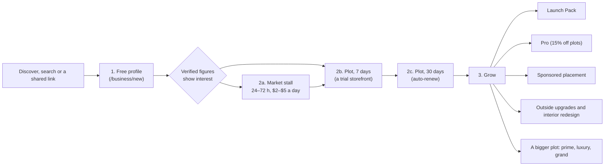

# Sales funnel, cart and plot economy: a proposal

[Product](README.md) | [The business-first funnel (built)](business_funnel.md) | [Plot pricing: the real price levels](../monetization/plot_pricing_scenarios.md) | [Billing](../monetization/billing.md)

Status: **decided 2026-10-18; terms and the Pro discount built in pricing/short-terms; the plot economy's data built; the cart built in billing/cart ([billing.md](../monetization/billing.md#the-cart)).** Written for: the owner, to decide the lease terms, the plan tie-in and the cart before any of it is built. The decisions taken are marked in [section 6](#6-decisions-for-the-owner); the built price levels are in [plot pricing](../monetization/plot_pricing_scenarios.md).

## 1. Why the lease terms need a rethink

Today a business makes a free profile, can pay for the plans, and has to lease a plot for its 3D storefront. The two don't fit together:

| What a business pays today | Price |
| :--- | :--- |
| Profile | free |
| Launch Pack | $9 once (a week) |
| Pro | $19 a month |
| Sponsored placement | $29 – $99 a week |
| Market stall | $2 – $5 a day (24 – 72 hours) |
| Ordinary plot, 12 months (median) | $5.90 a year, about **$0.49 a month** |
| Grand plot, 12 months (median) | $1,195 a year, paid up front |

- **For Voxel Venture:** the storefront, which is the product's centrepiece, is priced far below everything around it. An ordinary plot costs about a fortieth of Pro.
- **For a business:** 3 to 12 months paid up front is a big commitment before it knows whether the city brings it customers. A grand plot is $598 for the shortest term.

Short terms with a monthly price fix both: a business can try a storefront for a week, and the price sits on the same ladder as the plans.

## 2. Proposed terms: 7, 14 and 30 days

- **The price is set per 30 days**, from the plot's worth (the same location model as today: `lib/game/landPrice.js`).
- **The worth is compressed** so the top doesn't run away: 30-day price = $5 × worth^0.7. A grand plot is worth 240× an ordinary one, but costs about 40× as much.
- **Shorter terms cost a little more per day:** 7 days = 0.3 × the 30-day price, 14 days = 0.55 ×.

| Tier | Plots | 30 days (range) | 7 days (median) | 14 days (median) | 30 days (median) |
| :--- | ---: | :--- | ---: | ---: | ---: |
| Ordinary | 704 | $5 – $8.50 | $1.65 | $3.03 | $5.50 |
| Prime | 70 | $23 – $51 | $8.10 | $14.85 | $27 |
| Luxury | 23 | $85 – $135 | $33 | $60.50 | $110 |
| Grand | 8 | $202 – $260 | $69.30 | $127.05 | $231 |

- **Revenue at full occupancy:** about **$10,550 every 30 days, or about $128,000 a year**. The 3/6/12-month levels bring in about $28,000 a year on 12-month leases.
- **Renewals:**
  - **Discount:** the half-price renewal no longer makes sense with short terms, since it would halve the revenue of every business that stays. A loyalty discount of 10% is enough.
  - **Auto-renew:** one tick box, so a storefront never lapses by accident. **Not built yet:** it needs saved payment methods (a Stripe customer with a stored card, charged off-session), which the checkout doesn't keep today. Until then the lease emails remind the tenant to renew.
- **Take-over:** stays at 1.25 × the business's worth, priced per term like a lease.
- **Outside upgrades:** they stay a share of the land price, on the 30-day price, and are charged for the time left as now.
- **Stripe's fee:** 30¢ + 2.9% is about 21% of a 7-day ordinary lease. The cart (section 4) fixes this, because one payment covers several items.

**Relation to the 3/6/12-month work (#51):** that is merged but not deployed. These terms would replace it before it goes live; its parts that stay are the value pricing, the priced outside and the paid upgrades.

## 3. The funnel: profile → 3D storefront → next business options

| Stage | What the business gets | What moves them on (from their own verified figures, as `upgradePrompts` does today) | What we measure |
| :--- | :--- | :--- | :--- |
| **1. Profile** (free) | A public page, one call to action, referral link, 30-day figures | "Your page had N verified visitors this week. A storefront in the city puts you on the street they walk." | Profiles made, profiles with a first verified visitor |
| **2a. Market stall** | A stall for a day or three, at a weekly market | "Your stall had N visitors. A storefront keeps them all week." | Bookings, visitors per stall, stall → plot |
| **2b. Plot, 7 days** | A building of their own, linked to the profile, with an inside to design | Shown the day before it ends, with the week's store entries | Trial starts, trial → 30 days |
| **2c. Plot, 30 days** | The same, on auto-renew | Renewal reminders already exist (the lease emails) | Renewal rate, months kept |
| **3. Grow** | Launch Pack, Pro, sponsored weeks, outside upgrades, interior, a bigger plot | Each offered only when the figures justify it | Revenue per business, upgrade take-up |

**Tying the plans to the storefront.** A business on Pro is the one most likely to keep a storefront, so the plan should include one (**decided:** none of the three as written, but **15% off plots**; see [section 6](#6-decisions-for-the-owner)):
- **Option A (recommended):** Pro includes a **$6 plot credit every 30 days**. That covers any ordinary plot outright and goes toward a bigger one. Pro becomes the obvious choice for a business with a storefront, and Voxel Venture gets a $19 subscription in place of a $5.50 lease.
- **Option B:** Pro gives **20% off** plots and upgrades.
- **Option C:** keep them separate.

**The Launch Pack** fits naturally at stage 2b: "Launch your storefront" = a 7-day plot + the Launch Pack week in Discover, sold together in the cart.

## 4. A cart in the sales flow

**Built** (billing/cart, `services/api/cart.mjs`, [billing.md](../monetization/billing.md#the-cart)). As decided below, with two changes the owner made: **up to 3 plots** per cart (not one), and **Pro in the same checkout** gives the cart's plot lines the Pro price at once.

Today every purchase is its own Stripe checkout. A cart lets a business take the whole step at once, for example a 30-day plot, a spire, the Launch Pack and a week on a category page, and pay once.

**What can go in it:**
- plot leases, take-overs and renewals;
- outside upgrades;
- the Launch Pack;
- sponsored weeks;
- market stalls;
- Pro, the only subscription.

**How it works:**
- **Server-side cart, one per account** (tables `carts` and `cart_items`). The browser never sends a price; the server prices every line from the catalogue and the pricing code, as it does now.
- **Holds:**
  - **Adding an item holds nothing.** It just remembers the request.
  - **Starting checkout checks and holds everything at once** (plots, stall slots and sponsored slots, for 30 minutes as today). If an item is no longer available, the cart says which and checkout doesn't open.
- **One Stripe Checkout session** with a line item per cart item. With Pro in the cart, the session is in subscription mode, which Stripe allows to include one-time items.
- **Fulfilment:**
  - **Line by line,** when the payment arrives, using the actions that already exist (`payLease`, the stall booking, the placements).
  - **A failed line is refunded on its own,** for example a plot someone else took after the hold ran out; the rest still goes through.
- **Rules:**
  - ~~one plot per cart (a business has one storefront at a time)~~ **decided: up to 3 plot lines** (a lease, take-over, renewal or outside upgrade each count as one; each plot once);
  - a minimum total of $4 (decided; this proposal said $2), so the fee never takes more than about 10%;
  - the cart is emptied when checkout completes.
- **Where it shows:** a cart button in the game's header and on the business pages, and "Add to cart" next to today's buy buttons. "Buy now" stays for a single item.

### Promo codes as a lever

**Built** (billing/promo-codes, [billing.md](../monetization/billing.md#promo-codes)). The owner makes discount codes in `/admin/promos` and hands them out: one code, or a batch for a campaign. A code works at every step of the funnel above, so it can push the step where people stall:

| Stage | A code that helps | For example |
| :--- | :--- | :--- |
| 2a. Market stall | 100% off a first stall, new customers only | A free first day at the market for a business that has only a profile |
| 2b. Plot, 7 days | 50% off plots, new customers only, one use | The trial storefront at half price |
| 2c. Plot, 30 days | 10% off renewals | A thank-you at the first renewal |
| 3. Grow | 100% off Pro (its first month), or $5 off the Launch Pack | Try Pro free for a month; the card is saved and it renews at $19 |
| Events, partners | A batch of single-use codes, one per attendee | A meetup or a partner's newsletter |

Each code's usage (uses paid, in checkout, what was taken off and what those orders brought in) is on the admin page and in its CSV, so a campaign can be judged on revenue, not just on uses. The rules that keep it from leaking money: one code per checkout, uses per account and in all, an end date, a minimum total, new customers only, codes for chosen products only, Pro's first month only, and a limit on guessing.

## 5. A plot economy like the real estate market

**The aim:** a plot's price follows real demand, not just where it is.
- Busy streets get dearer.
- Quiet ones get cheaper, so it's easier to start there.
- A business pays more only when its location demonstrably brings more customers.

**The mechanism:**
- **Price = land worth × a demand index,** where the demand index is 1 for an average plot.
- **Recalculated every 30 days,** and moved at most ±10% each time, so nobody is surprised.
- **Published as a price index** per district and tier, like a property index.
- **Applied to new leases;** a running lease keeps its price until it renews.

### The data it needs

| Data | Why | Recorded today? |
| :--- | :--- | :--- |
| Verified visits and store entries per building | Demand for a location | **Yes**: `events`, `business_events` (verified, capped per network) |
| Foot traffic per street and district (players passing, not entering) | Demand for an empty plot, which has no visits of its own | **Partly**: `presence` and `arrivals`. Needs a per-street count kept over time. |
| Occupancy, and how long each plot stays empty | Supply and demand per tier and district | **Yes**: derivable from `plots` and the `ledger` |
| Claim intent: plot card opened, claim started, abandoned, and at what price | Demand that didn't convert, and price sensitivity | **No**: the 3-minute hold is client-only. Needs a server-side hold and an event per step. |
| Checkouts started, completed and expired, with the price | Willingness to pay | **Yes**: `orders` |
| Renewals and lapses | Whether a location keeps its business | **Yes**: `ledger` (renew), `/admin/metrics/renewals` |
| Take-overs, and take-over attempts | Competition for a location | **Partly**: completed ones in the `ledger`; attempts aren't recorded |
| "Watch this plot" (a waitlist on an occupied plot) | Excess demand for a location | **No**: a new feature |
| Business outcomes: CTA presses, inquiries, purchases per storefront | Whether a location brings customers, the fair basis for charging more | **Yes**: `business_events`, `business_inquiries` |
| Outside benchmarks: commercial rent ratios by location class, virtual-land rents on other platforms, competitors' listing prices | A sanity check on the ratios between tiers and on the overall level | **No**: desk research (I can gather it) |

**How to get there:**
1. **Record the missing data now:**
   - the server-side claim hold and claim-intent events;
   - per-street traffic counts;
   - take-over attempts;
   - "watch this plot".
2. **Collect 4 to 8 weeks of the pilot,** with the fixed 7/14/30-day prices.
3. **Fit the demand index on that data,** show it to the owner as an admin report first, and only then let it set prices.

## 6. Decisions for the owner

1. **Terms:** **decided, built.**
   - 7 / 14 / 30 days at 0.3 / 0.55 / 1 × the 30-day price: **yes.** A stored lease of an old term (90, 182 or 365 days) renews for 30 days.
   - $5 × worth^0.7 per 30 days: **yes**, never below $5, rounded to the nearest $0.25 under $20 and to the nearest dollar from $20.
   - The renewal window is the last 7 days of a 14- or 30-day lease and the last 3 days of a 7-day lease; the grace after the end is 3 days (it was 7).
2. **Renewal discount:** **decided, built: 10%** (in place of 50%). **Auto-renew: not now.** It needs saved payment methods, so it waits for them.
3. **Pro and the storefront:** **decided, built: 15% off plots.** An account with at least one business profile on Pro pays 15% less for a claim, a take-over and a renewal. Outside upgrades and the other products are not discounted. The forms show the discount as its own line, or a "Pro members get 15% off plots" hint that links to the upgrade. (Not A, B or C as written.)
4. **Cart:** **decided, built.** A **$4 minimum** total, which keeps Stripe's fee at about 10% or less; one payment saves 30¢ for each extra item. Up to **3 plot lines** a cart, each plot once. **Pro in the same checkout:** one subscription-mode session, Pro recurring and the rest one-time; the plot lines get the Pro price at once, and keep it if the Pro line fails or is refunded (not clawed back). A line that can no longer be done once paid is refunded on its own.
5. **Deploy:** **decided:** #51's 3/6/12-month terms never go live; the 7/14/30-day terms replace them. All the server's prices so far are demo data.
6. **Plot economy:** open.

**Also built with the terms:** no lease, take-over or renewal is charged under $0.50 (Stripe's minimum). The cheapest real charge is a 7-day renewal of a $5 plot with Pro, $1.15, so the floor is a safety net.

## 7. Build order once decided

1. **Terms and prices:** 7/14/30 days, the 30-day price formula, the renewal discount and the Pro discount. **Built** (pricing/short-terms), except auto-renew, which waits for saved payment methods.
2. **The cart:** tables, API, one checkout, line-by-line fulfilment and refunds, plus the header button and "Add to cart". **Built** (billing/cart).
3. **The funnel:**
   - the prompts at each stage, from verified figures;
   - the "Launch your storefront" bundle.
4. **Plot economy data:**
   - server-side claim hold and intent events;
   - street traffic;
   - take-over attempts;
   - "watch this plot".
5. **After the pilot:** the demand index, first as a report, then setting prices.
