# Bridges

<!-- order: 60 -->

The City Kit bridge, then the two styled bridges ([suspension_bridge.md](../suspension_bridge.md), [arch_bridge.md](../arch_bridge.md)).

## bridge_models

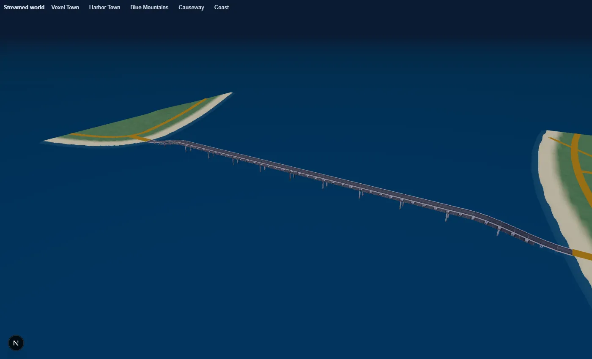

The City Kit (Roads) bridge models.

## sus_a

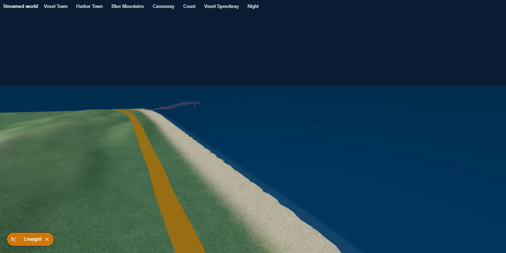

The first suspension bridge from the shore.

## sus_b

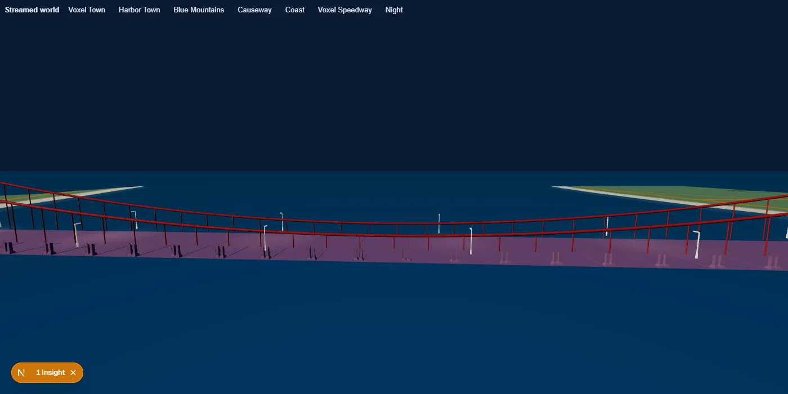

The main cables and suspenders, with stray pieces under the deck.

## sus_c

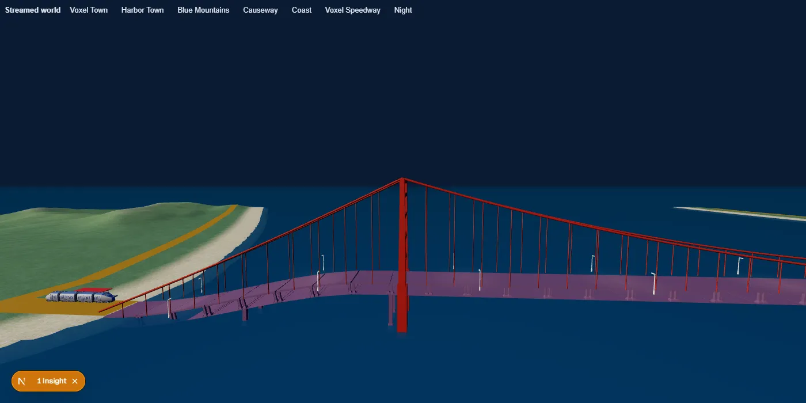

A tower, the cables and the kit deck.

## sus_d

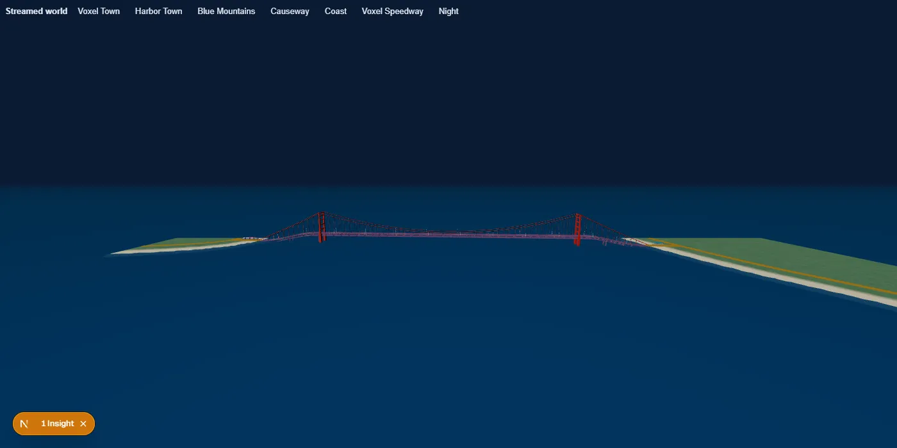

The whole bridge from far off.

## sus_e

The deck tinted orange.

## sus_f

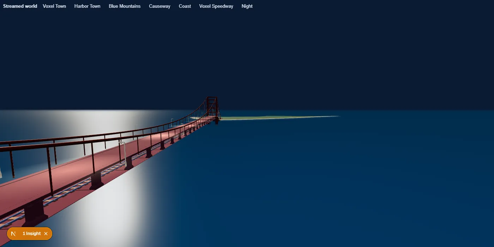

The rail on the deck, with the kit deck's sockets.

## sus_g

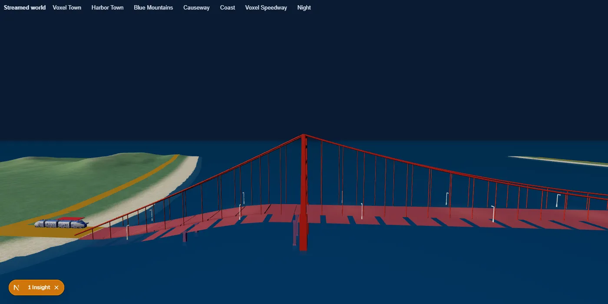

An attempt to cut the sockets out of the deck, which left holes.

## sus_h

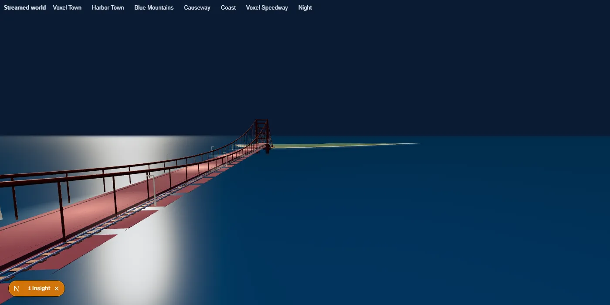

The same attempt from above.

## sus_i

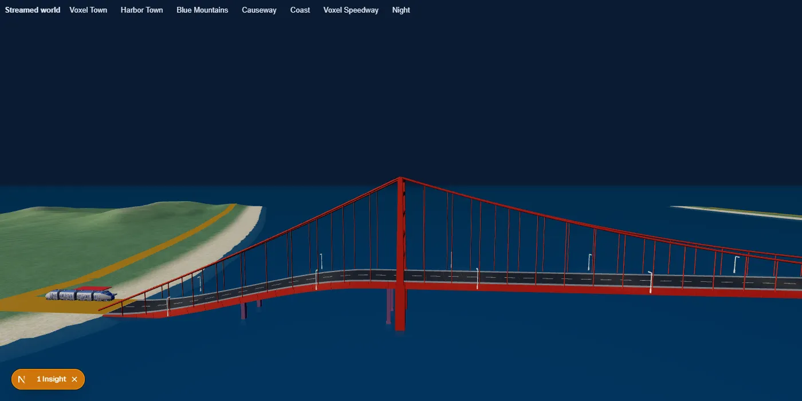

The clean girder deck: asphalt, kerbs and a lane line.

## sus_j

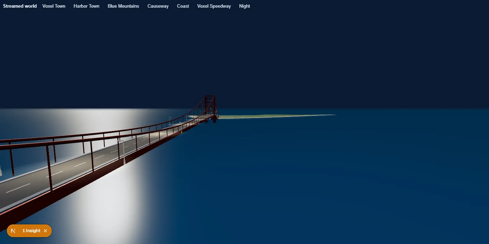

The clean deck along its length.

## sus_k

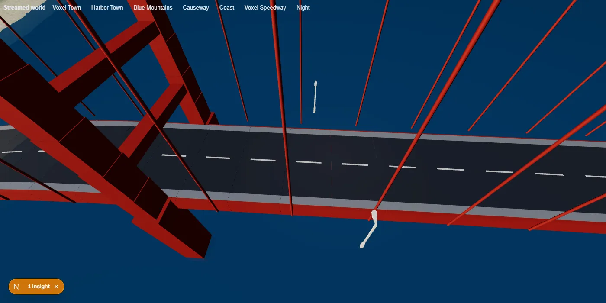

From directly above, with the lamps.

## sus_l

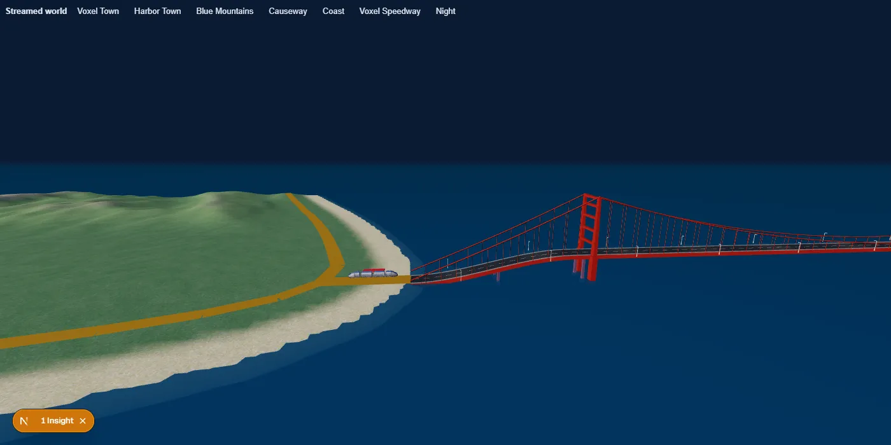

The tower and the station beside the bridge.

## sus_m

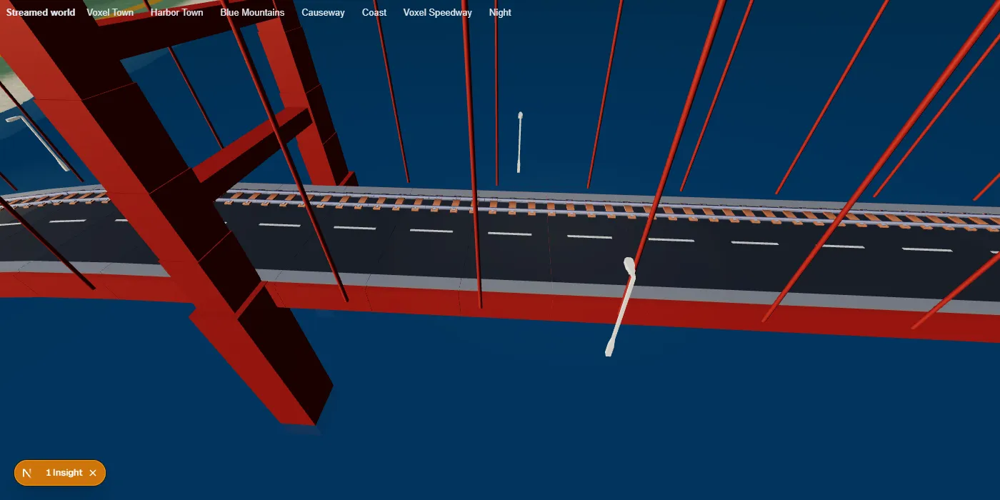

The rail laid right, on the deck in its own lane.

## sus_n

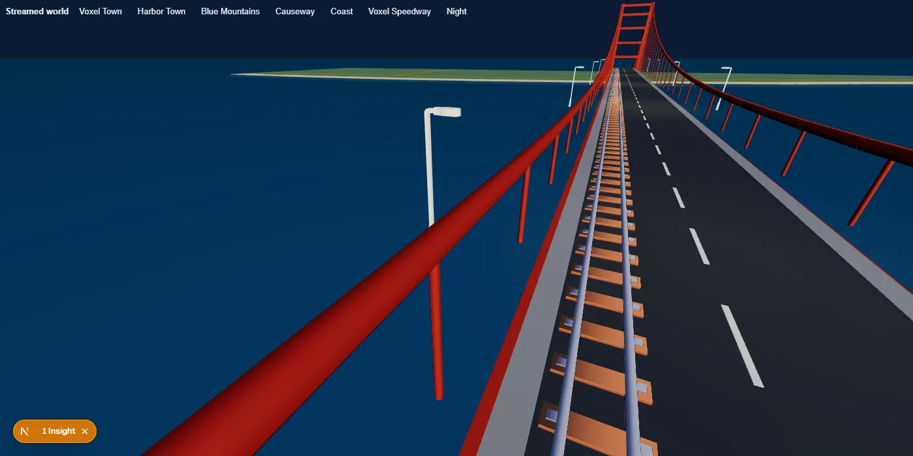

A lamp, before the lamp anchor fix.

## sus_o

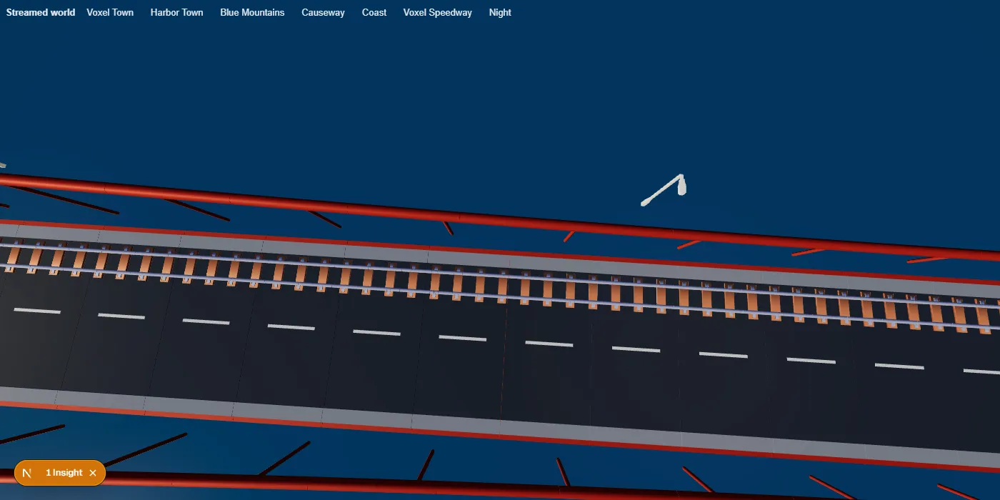

The deck from above.

## sus_p

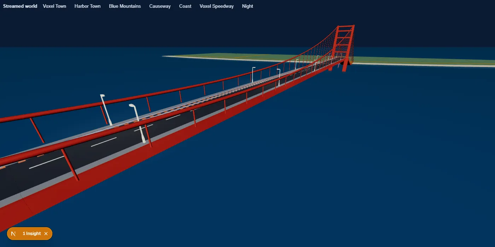

The lamps standing on the kerb after the fix.

## sus_q

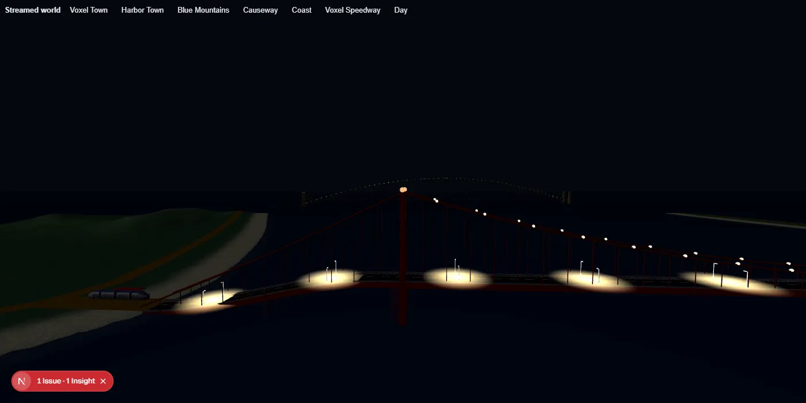

The suspension bridge at night: the tower beacons and the cable lights.

## arch_a

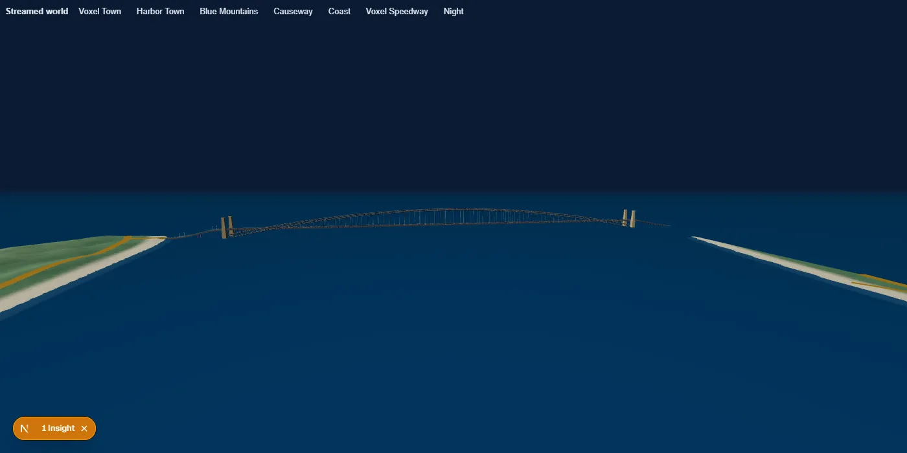

The arch bridge, first proportions (a flat arch).

## arch_b

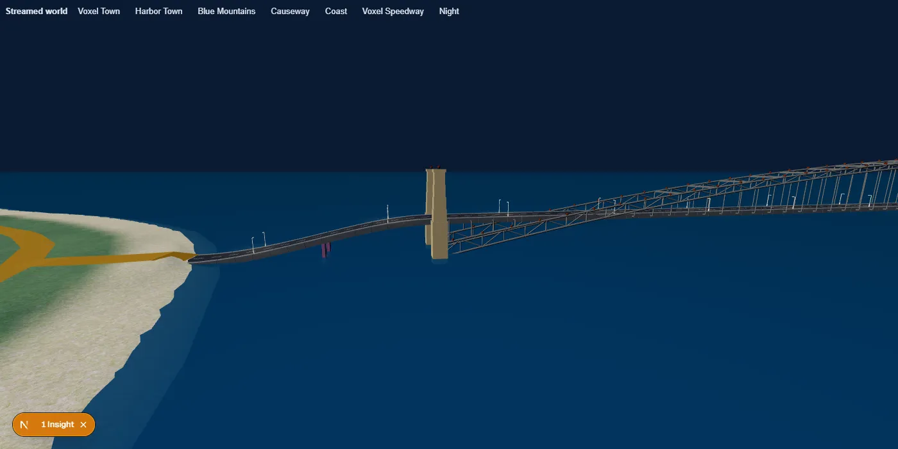

The arch's pylon and lattice from close.

## arch_c

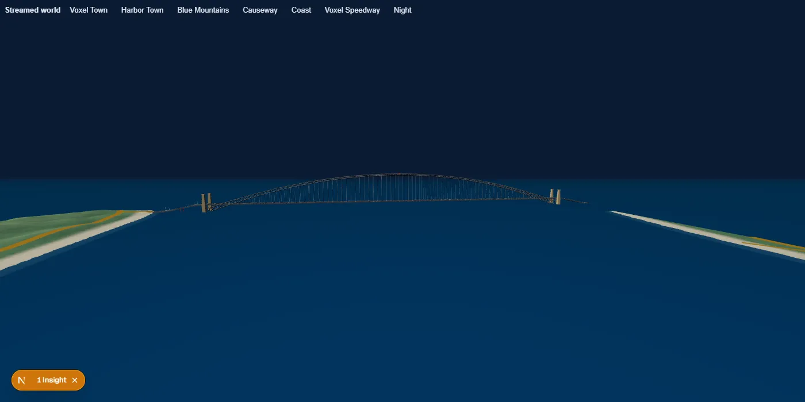

The arch bridge after the arch was made taller.

## arch_d

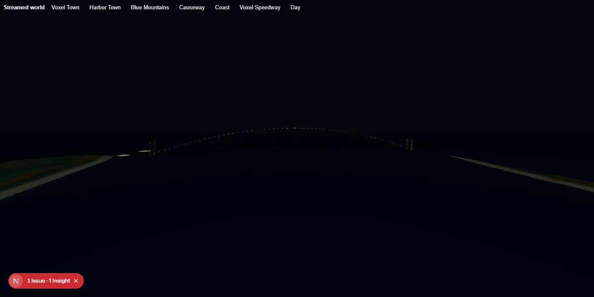

The arch bridge at night: the string of lights along the arch.
