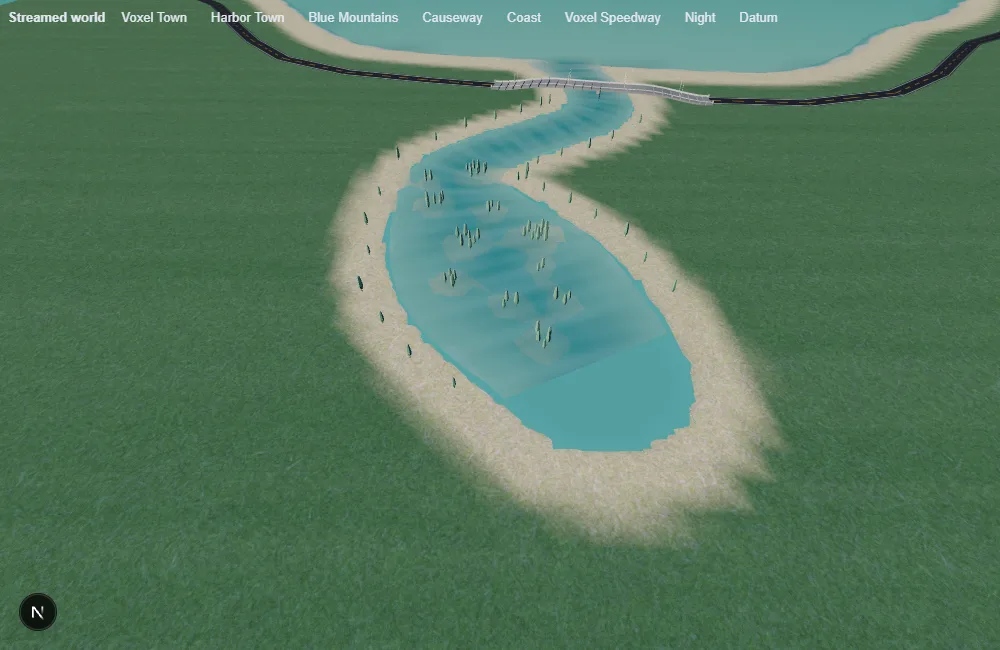
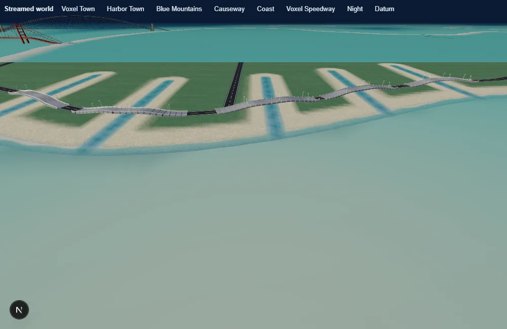
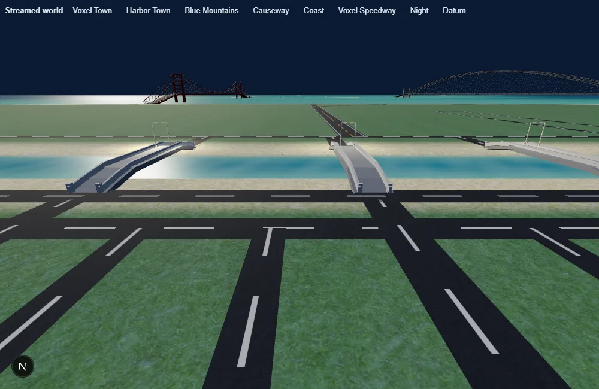
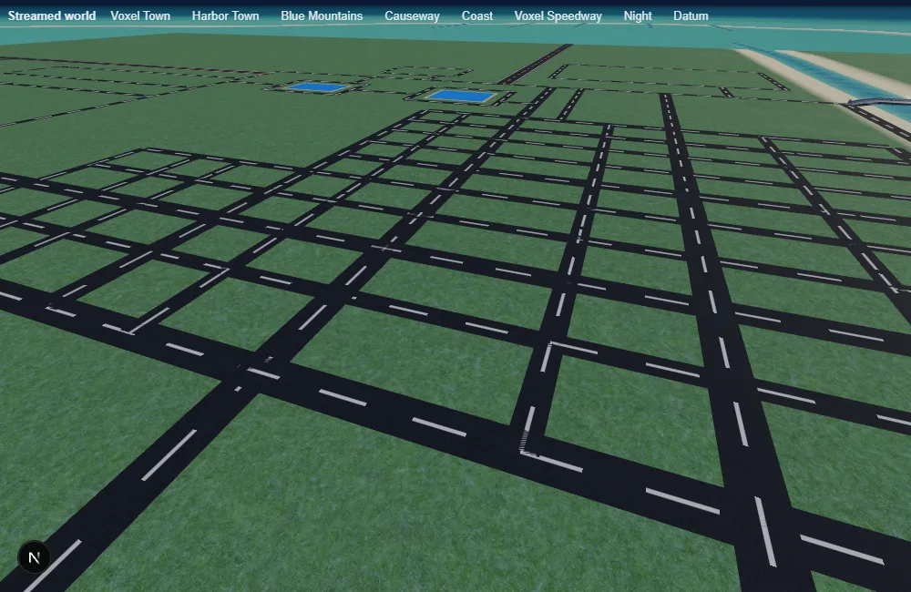
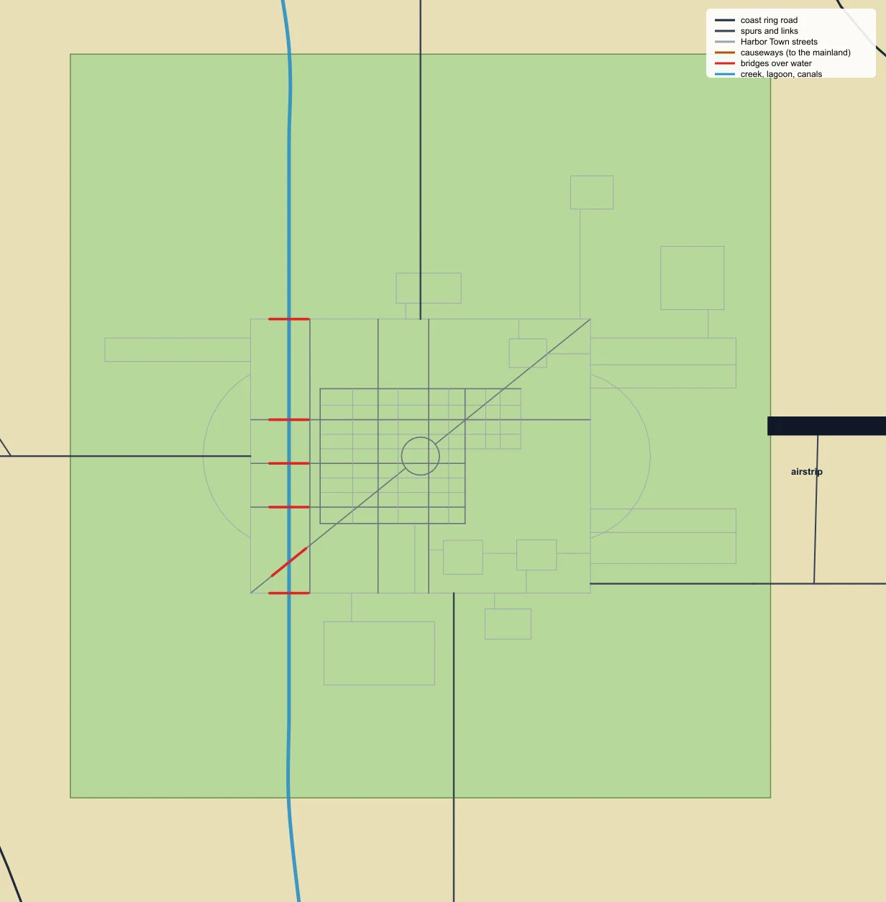
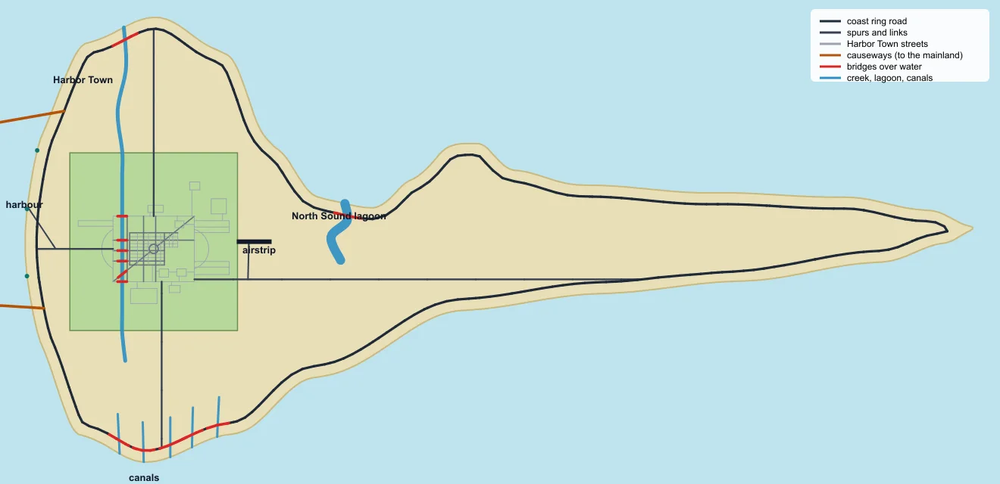

# Harbor Isle's water and Harbor Town

<!-- order: 230 -->

The lagoon, the canals and the mangroves of Harbor Isle ([isle_waters.md](../isle_waters.md)), and Harbor Town's creek, bridges, ponds and its own streets ([harbor_town.md](../harbor_town.md)).

## isle_waters_lagoon

The North Sound lagoon: a winding channel from the sound to a pool with mangrove islands, mangroves along the banks, the coast road crossing on a bridge at the sound.

## isle_waters_canals

The canal estate from the sea: five canals cut into the south shore, the coast road crossing each on a bridge.

## harbor_town_creek_bridges

Mill Creek through Harbor Town: low bridges with lamps where the avenues and the county road cross it, sand on its banks.

## harbor_town_ponds

Harbor Town's streets and two of its ponds, from the air.

## harbor_town_streets

Harbor Town's streets as drawn on the map: the grid, Harbor Boulevard through Harbor Circle, the two crescents, Mill Creek and its bridges in red.

## harbor_isle_roads

Harbor Isle's roads: the coast ring road, the spurs, the town, the airstrip, the causeways, the lagoon and the canals.
