# Owner tools: kit items, yards and the building designer

<!-- order: 110 -->

The furniture items from the Food and Industrial kits, the yards behind the buildings and the buildings assembled from kit pieces ([kit_items.md](../../product/kit_items.md), [yard_items.md](../../product/yard_items.md), [building_designer.md](../../product/building_designer.md)).

## kit_thumbs

A sample of the furniture thumbnails made from the Food Kit and the City Kit (Industrial).

## yards_all

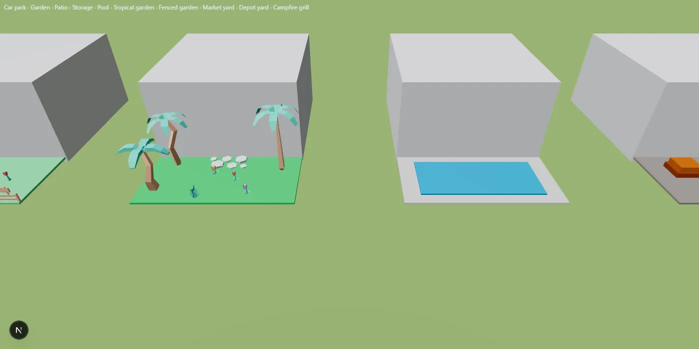

The first view of the yards, with the older ones.

## yards_sheet

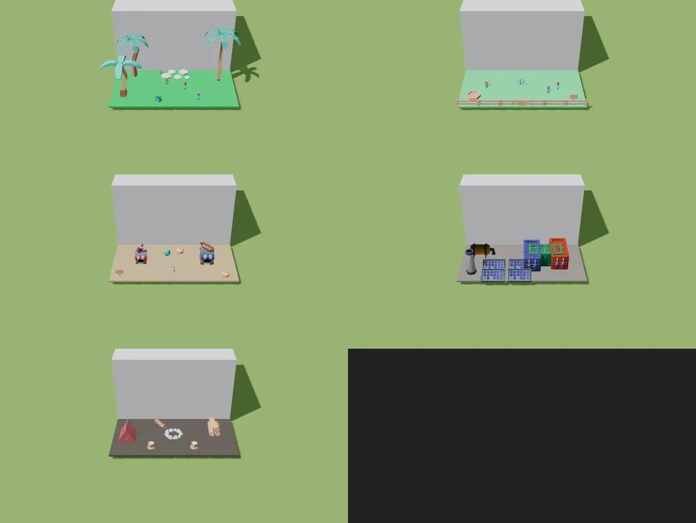

The five yards of models together.

## yard_tropical

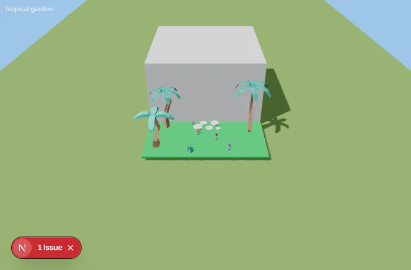

The tropical garden.

## yard_fenced

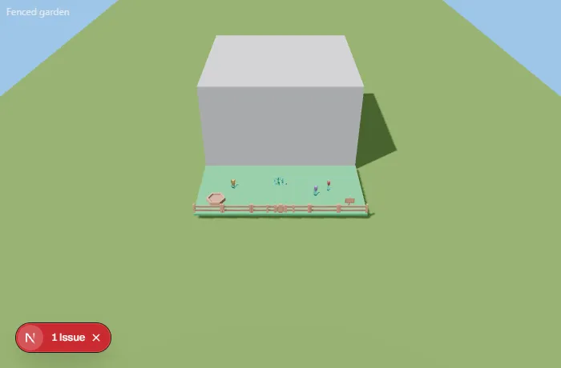

The fenced garden.

## yard_market-yard

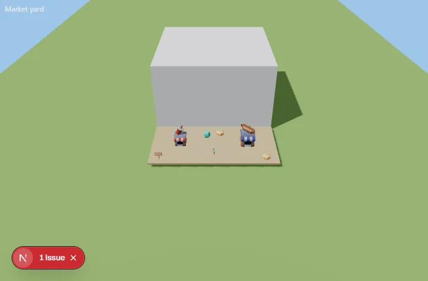

The market yard.

## yard_depot

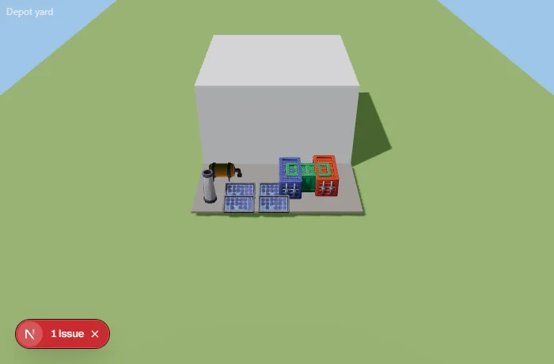

The depot yard.

## yard_campfire

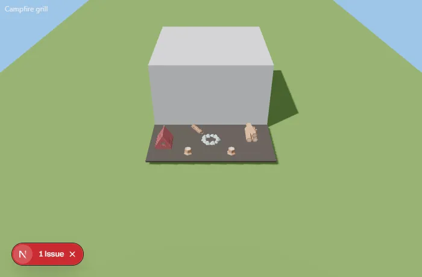

The campfire grill.

## bk_prev

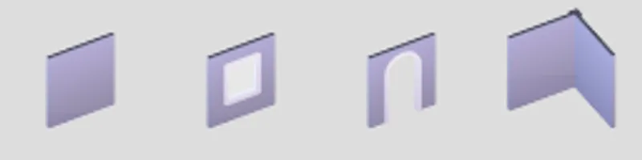

The Building Kit's own previews of a wall, a window, a doorway and a corner.

## bld_pieces_p

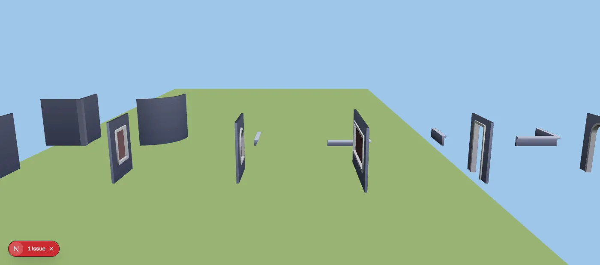

The kit pieces side by side, seen from the edge.

## bld_pieces_q

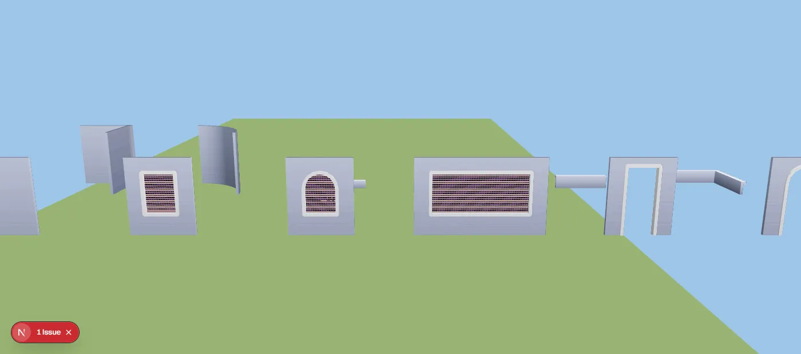

The kit pieces from the front, brightened.

## bld_starts

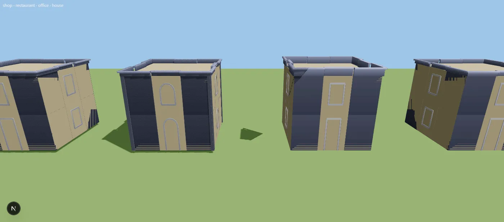

The first kit-built buildings: pieces inside the box and speckled by shadow.

## bld_starts_b

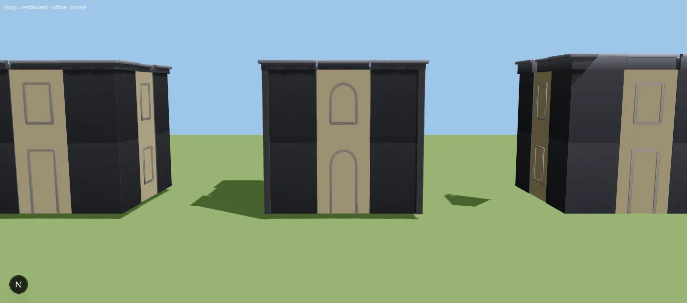

The four business starts, the pieces dark and the box showing through.

## bld_starts_c

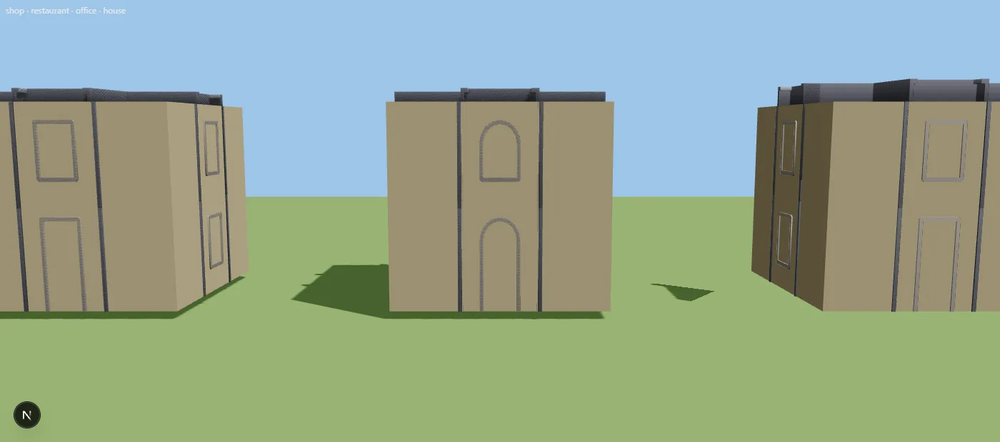

A test with the pieces turned round.

## bld_starts_close

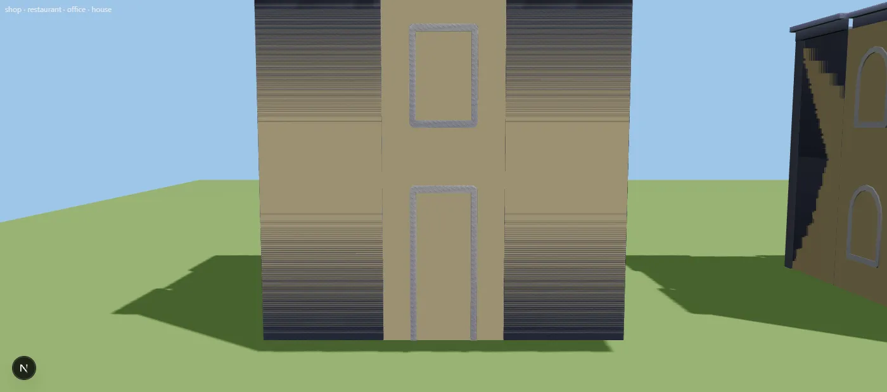

A close view of a front, the walls hidden inside the box.

## bld_starts_d

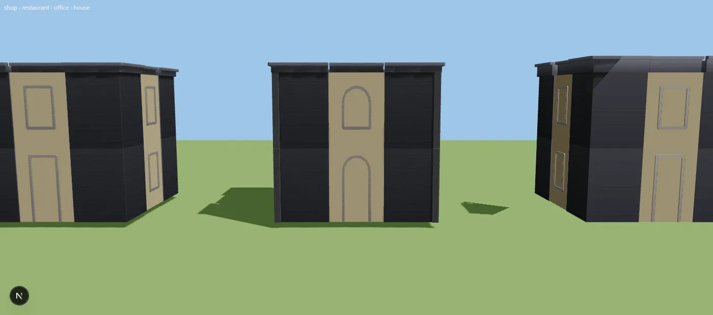

The same view after trying new normals (no change).

## bld_starts_e

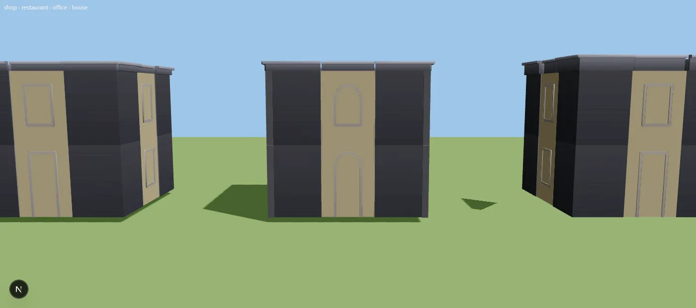

Without shadows: the speckle is gone.

## bld_fronts

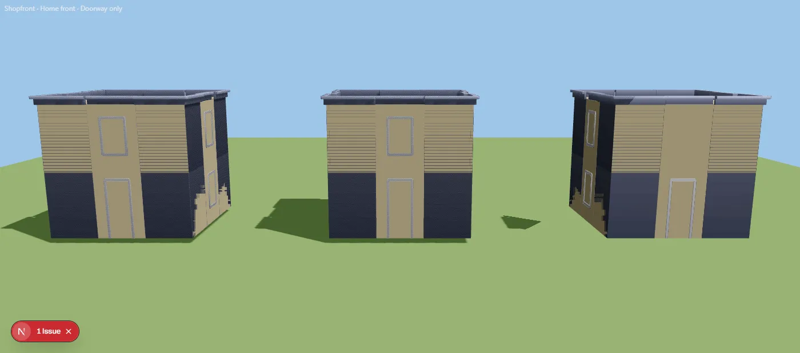

The three fronts: shopfront, home front, doorway only.

## bld_starts_f

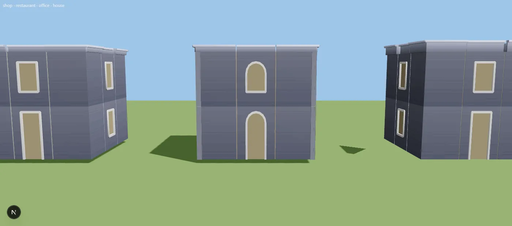

The buildings with their walls brightened.

## bld_starts_g

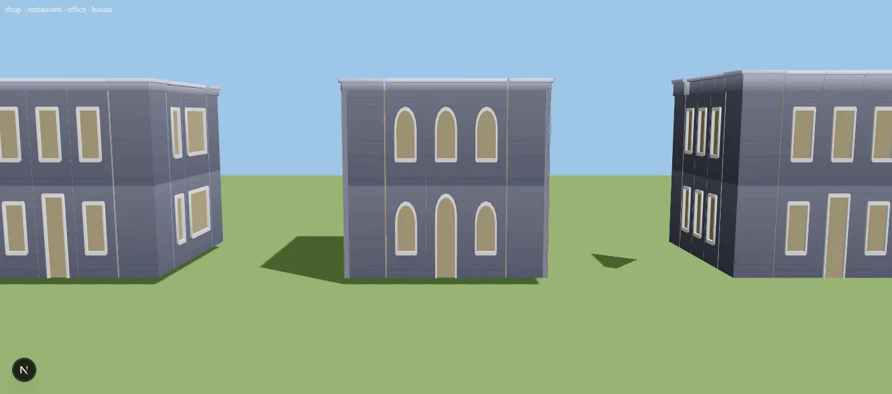

The four business starts as finally built: windows, doorways, corners and a roof edge.
