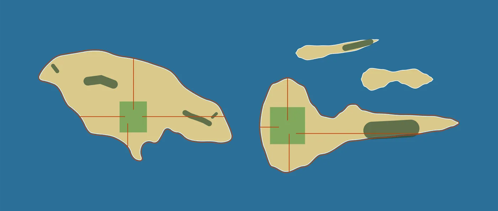
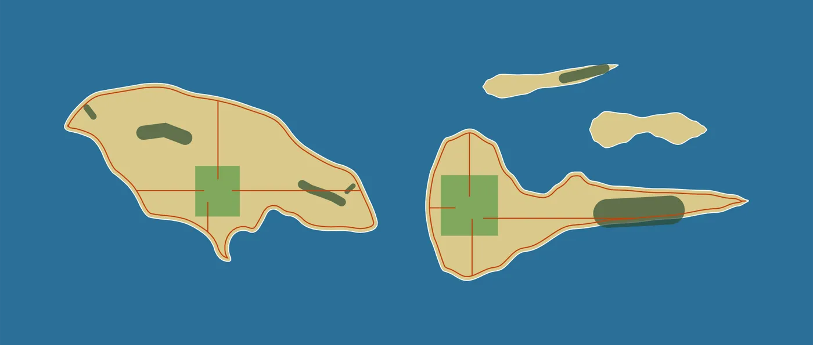
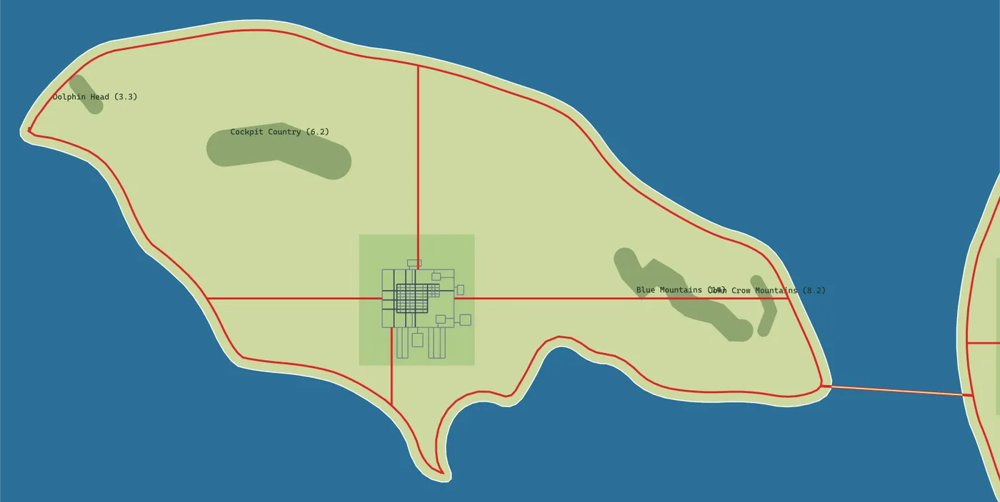
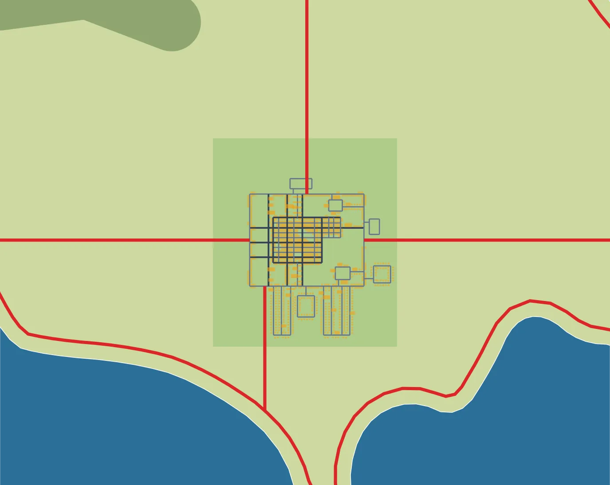
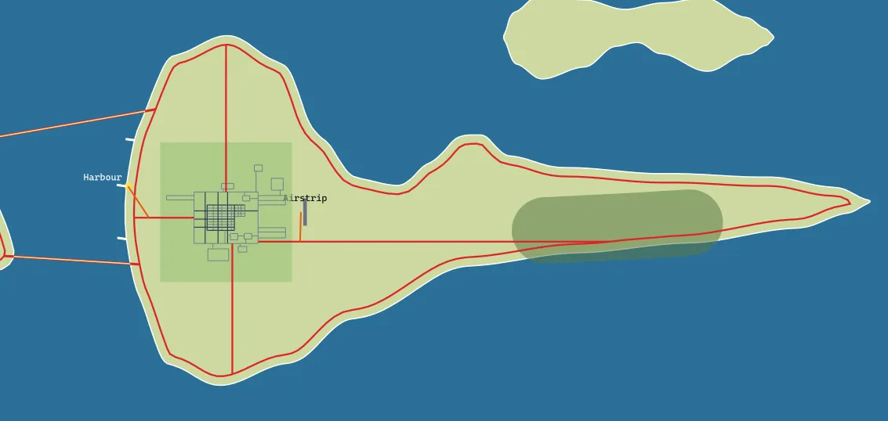
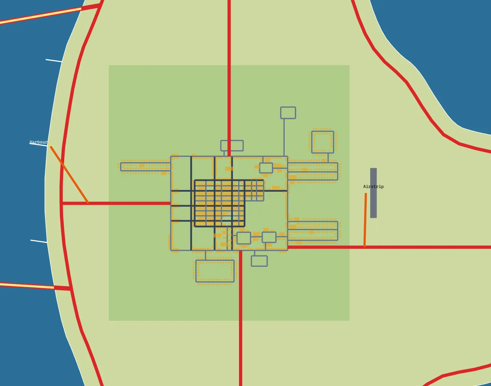

# Roads

<!-- order: 20 -->

The coastal rings, the spurs that bend round mountains and the link roads ([world_recipe.md](../world_recipe.md)).

## roads

The first coastal ring road on the mainland.

## roads2

The ring with its spurs to the town.

## roads3

The ring, spurs and links together.

## mainland_roads

The mainland's roads as built.

## town_roads

The roads at the first town's gates.

## isle_roads

Harbor Isle's ring road.

## isle_town_roads

Harbor Isle's roads at Harbor Town.
