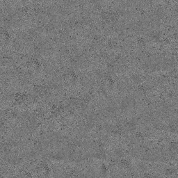
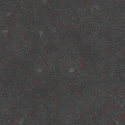
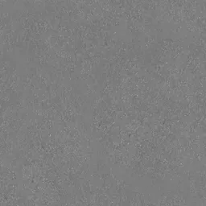

# The asphalt candidates

<!-- order: 180 -->

The three ambientCG asphalt colour maps tried for the roads ([road_texture.md](../road_texture.md)): Asphalt031 was chosen (the most visible grain); Asphalt004 is very plain and Asphalt012 is dark.

## asphalt_031

Asphalt031, the one used: a mid grey with a clear grain.

## asphalt_012

Asphalt012: darker, a finer grain.

## asphalt_004

Asphalt004: a plain grey with almost no grain.
