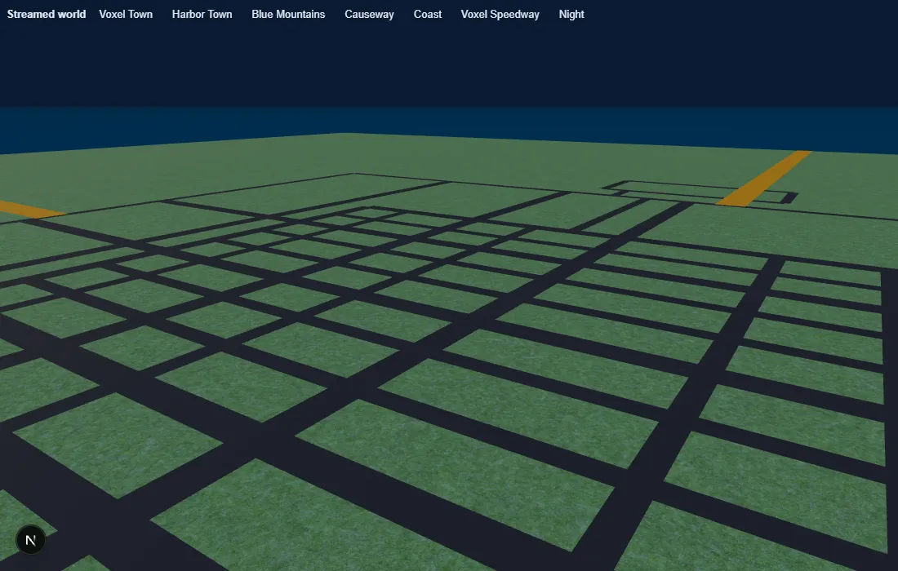
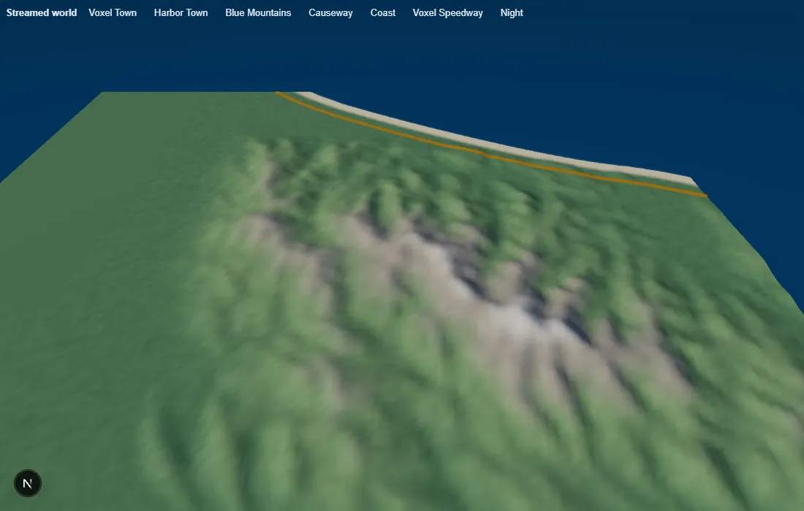

# The ground texture

<!-- order: 40 -->

ambientCG grass and dirt laid over the vertex colours of the baked ground as detail ([streaming_runtime.md](../streaming_runtime.md), "Ground texture").

## ground_meadow_plain

A meadow with the vertex colours only.

## ground_meadow_tex

The same meadow with the grain.

## ground_slope_plain

A mountain slope with the vertex colours only.

## ground_slope_tex

The same slope with the grain: grass on the flat, dirt on the steeper ground.
