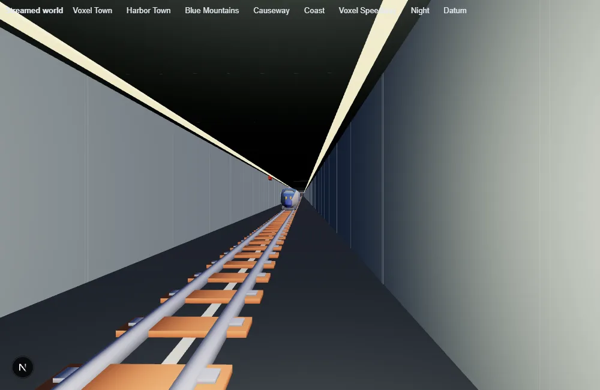
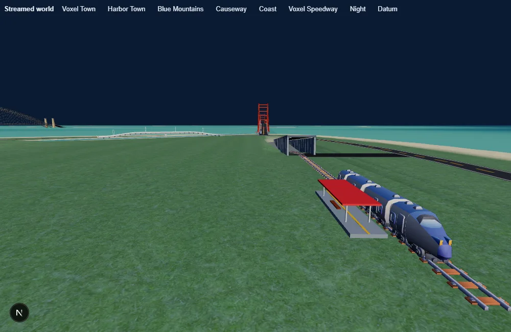

# The Harbor Tunnel, stage 1

<!-- order: 240 -->

The train through the tube under the sea, and the station outside its portal ([tunnel.md](../tunnel.md)).

## tunnel_inside

Inside the tube: the rail, the lit roof strips and the train ahead, at the bottom of the tunnel under the sea.

## tunnel_station_portal

The station outside the mainland portal: the train at the platform and the rail running into the tube.
