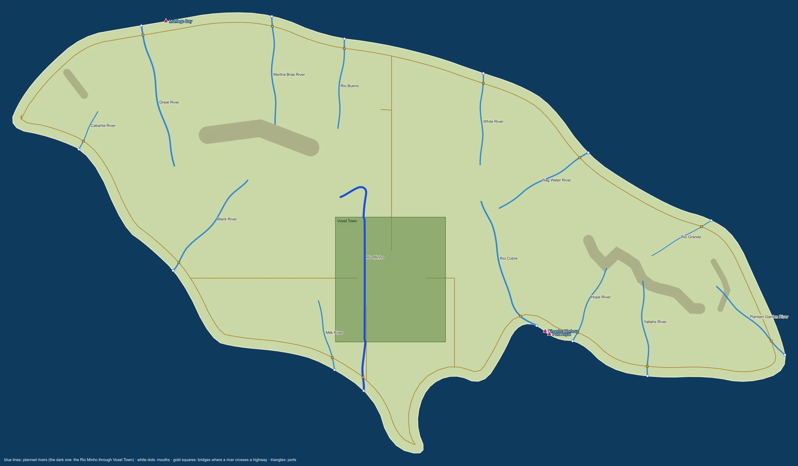

# The mainland's river plan

<!-- order: 130 -->

The planned rivers, ports and bridges on the mainland ([river_plan.md](../river_plan.md)).

## river_plan

The 14 planned rivers of the mainland, the ports and the bridges where the rivers cross the ring road.
