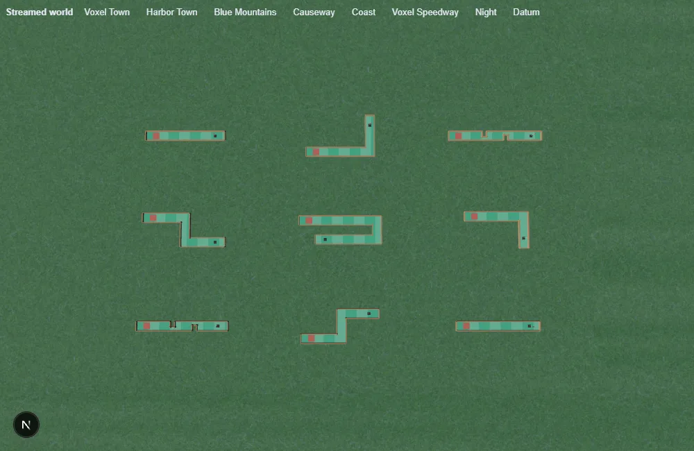
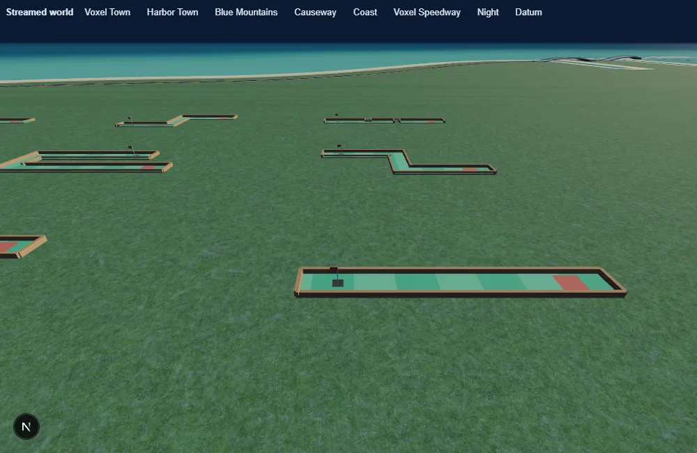
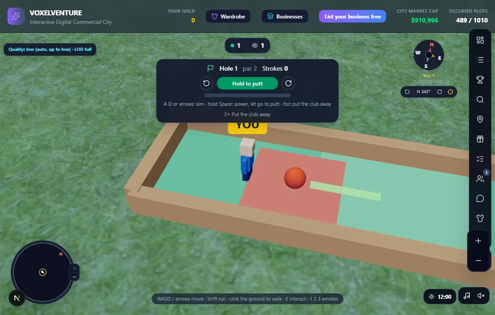
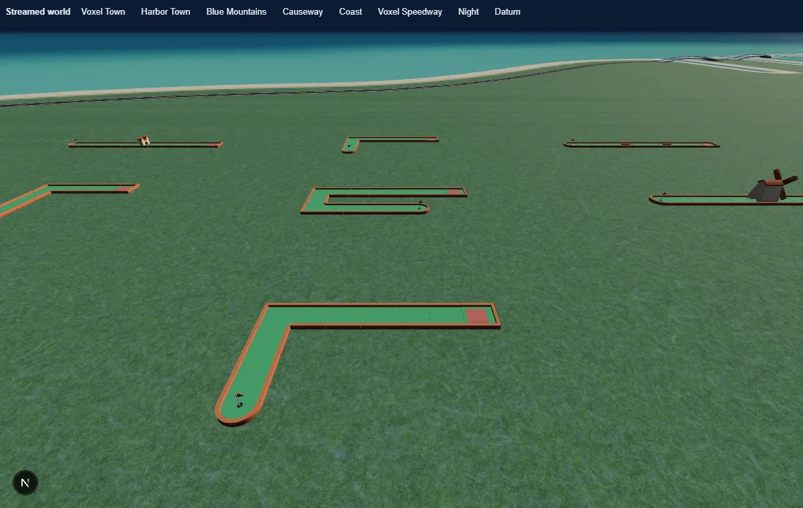
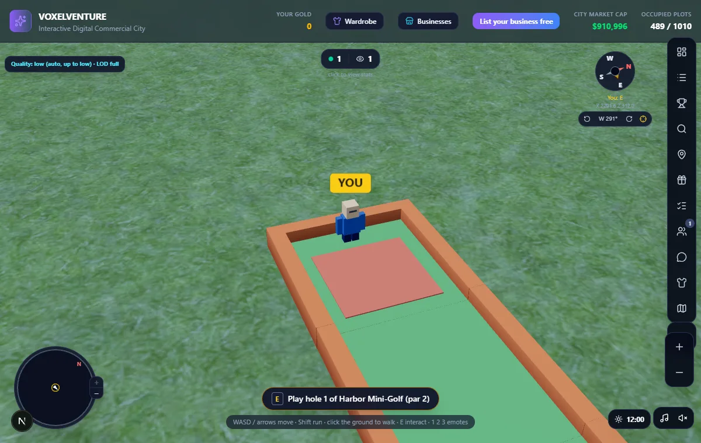
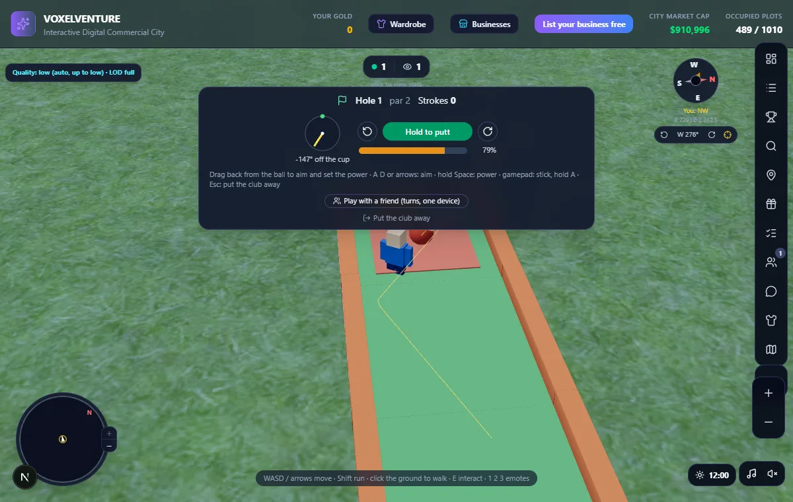
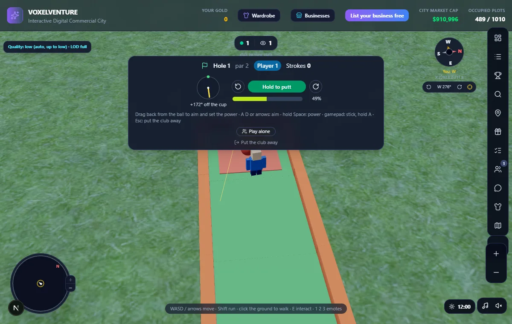
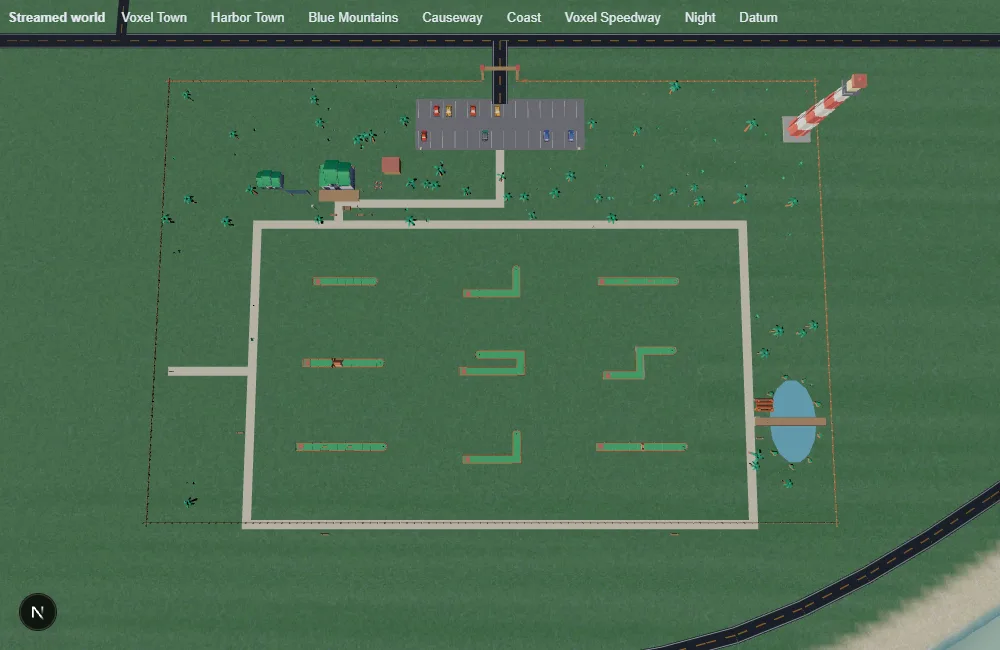
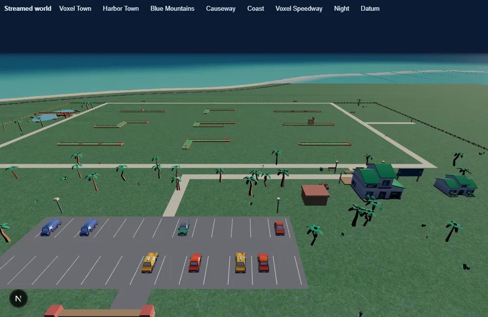

# The mini-golf course

<!-- order: 250 -->

Harbor Mini-Golf: nine holes on Harbor Isle's flat land, with felt lanes, wooden walls, red tee mats and cups with flags ([minigolf.md](../minigolf.md)).

## minigolf_course_top

The course from above: nine holes in a grid (straight, dogleg, blocks, zigzag and a doubled-back lane), each with its tee mat and cup.

## minigolf_course_holes

Holes seen along the lanes: striped felt, wooden walls and a flag at the cup.

## minigolf_putting

Playing hole 1 in the game: the panel with Hold to putt and the aim buttons, the red Kenney ball on the tee mat and the aim arrow along the lane.

## minigolf_kit_course

The course dressed with the Kenney Minigolf Kit: straights, corners and round cup ends, a bar in the lane, the windmill (right) and the castle (top left), red tee mats and flags.

## minigolf_tee_mat

Standing at the first tee in the game: the kit's end tile behind the red tee mat, the prompt to play the hole.

## minigolf_drag_aim

Aiming by dragging: the angle dial, the strength bar at 79 per cent, the degrees off the cup and the yellow path the putt would take, bouncing off the wall.

## minigolf_two_players

A two-player round: Player 1's turn on hole 1, the dial, the power bar and the Play alone button.

## minigolf_park_top

The park from above: the gate and the car park at the top, the clubhouse beside the first tee, the loop path round the nine holes, the pond with its footbridge, the lighthouse in the north-east corner.

## minigolf_park_entrance

The entrance at ground level: the gate posts and lintel, the drive in, the car park with its bay lines and cars, palms and the fence.

