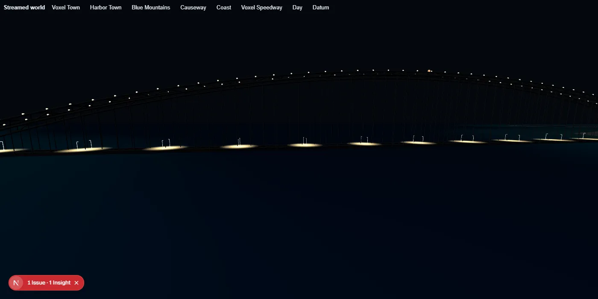
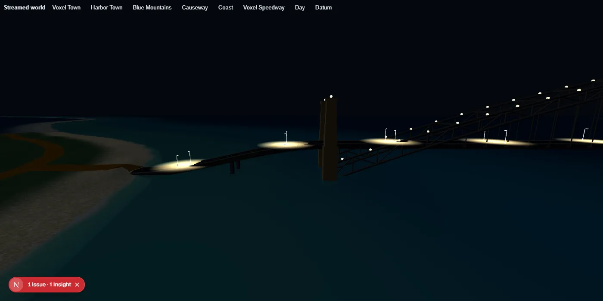
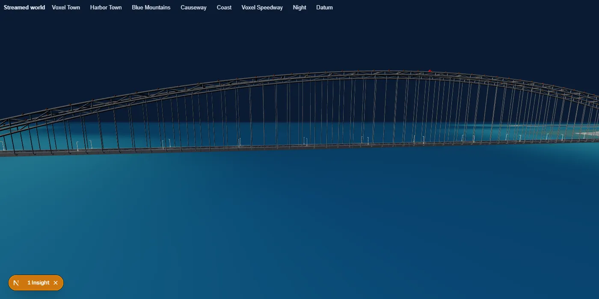
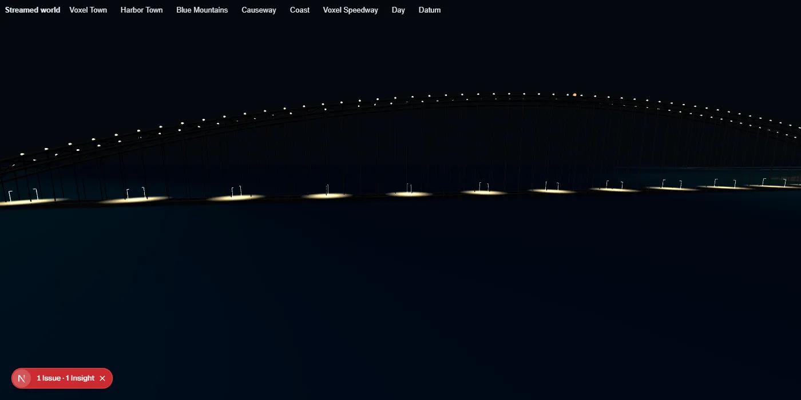

# The North Causeway's arch bridge: lights at night

<!-- order: 160 -->

The arch bridge with its lamps and lights in line with the structure: a street lamp, a hanger and an upright at the same joints, and a light on the top chord at every joint ([arch_bridge.md](../arch_bridge.md)).

## nca_a

The arch bridge at night: the street lamps with their pools of light along the deck, and the string of lights on the arch.

## nca_b

The arch bridge's land end at night: the lamps on the approach, the pylon and the arch rising from it.

## nca_c

The arch bridge by day, from the side: the hangers under the arch, the lamps on the deck edge.

## nca_d

The arch bridge at night, from a second place along the deck.
