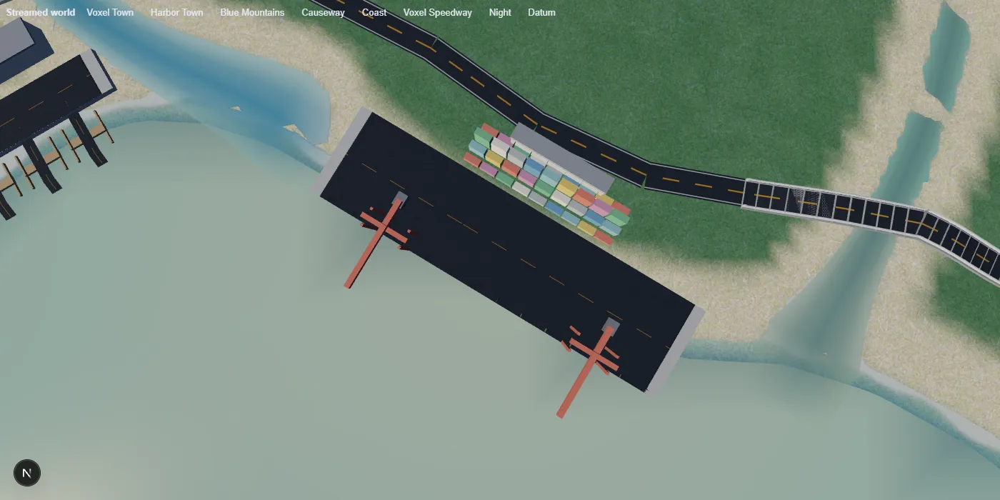
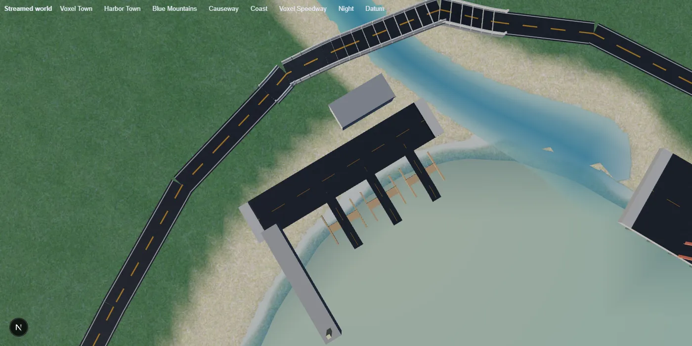
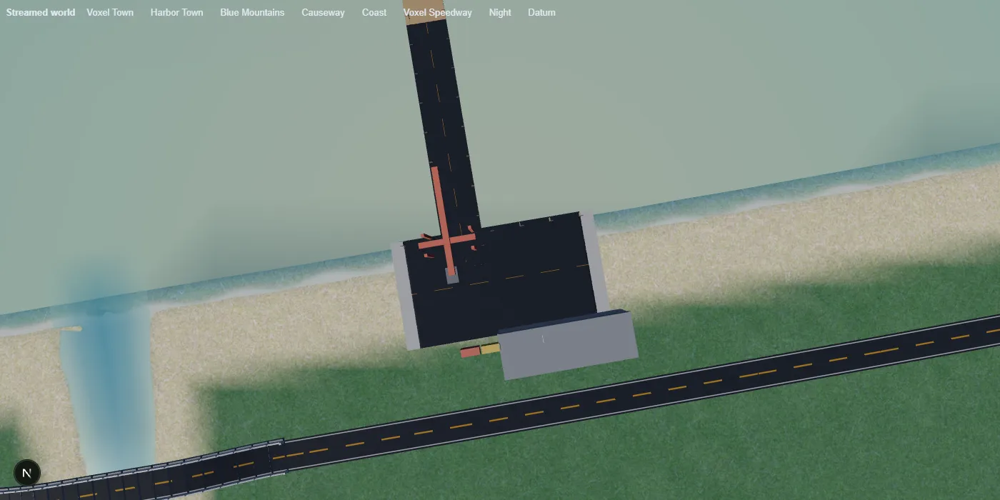

# The ports and harbours

<!-- order: 220 -->

A shipping port on each large landmass, a boat harbour and a cruise port ([river_plan.md](../river_plan.md)).

## port_kingston

The Kingston container port from above: the quay with its gantry cranes, the container yard, the ring road behind it and a river bridge beside it.

## port_royal_boats

Port Royal's boat harbour: the promenade, floating docks with finger piers, and the breakwater.

## port_montego_bay

Montego Bay's cruise port: a long pier out from a quay, the terminal building and a crane.
