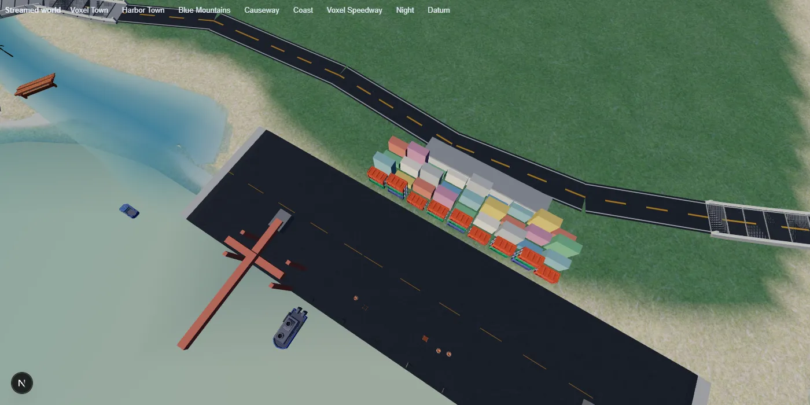
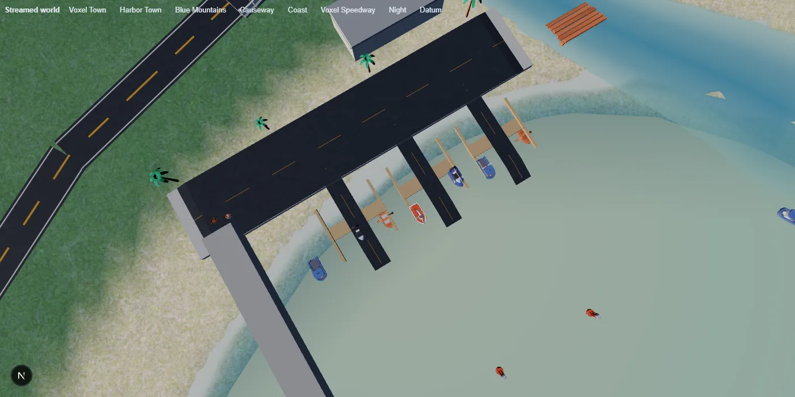
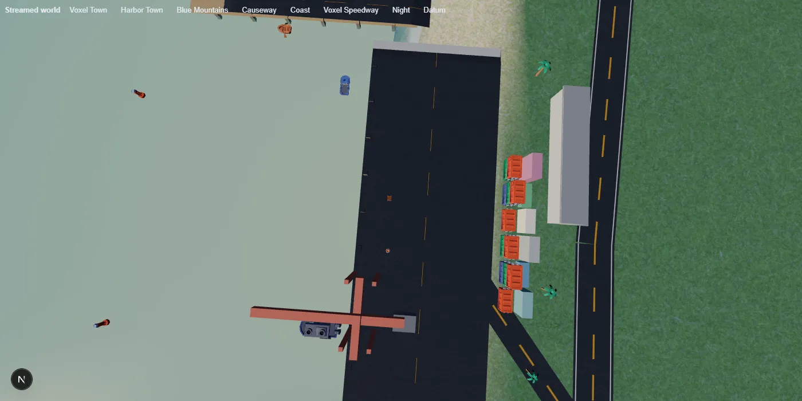

# The ports with the Kenney models

<!-- order: 230 -->

The container yards' front rows, the tugs, the boats at their moorings, the buoys and the palms are Kenney models; a phone draws the boxes alone ([ports_models.md](../ports_models.md)).

## port_models_kingston

The Kingston quay from above: Kenney containers in the front row of the yard, boxes behind them, a gantry crane and a tug alongside.

## port_models_boats

Port Royal boat harbour: row, fishing, sail and speed boats moored between the finger piers, palms behind the promenade.

## port_models_george_town

George Town on Harbor Isle: a quay with Kenney containers, a gantry crane and a tug, boats on the water and the end of a pier at the top.
