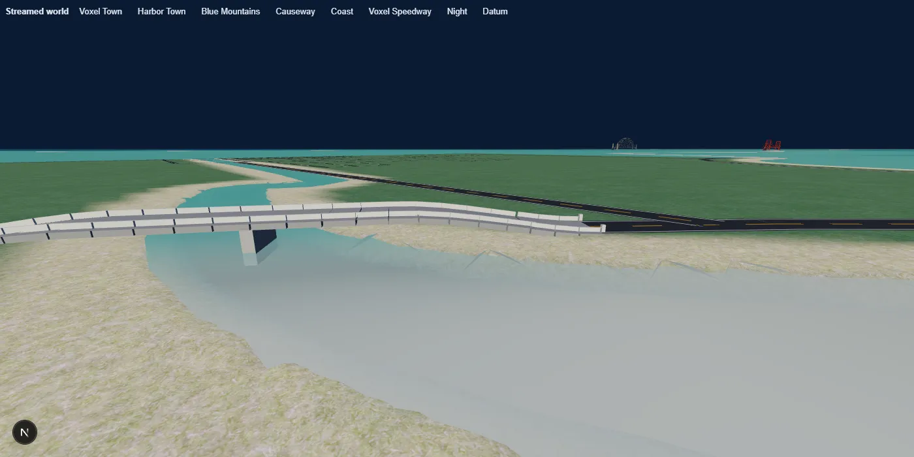
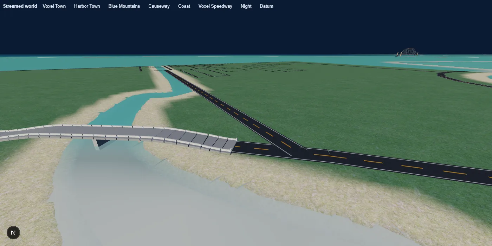

# The ring bridge over the Rio Minho

<!-- order: 200 -->

Where the coastal ring crosses the river: a deck that rises over the channel, with parapets, a girder and a pier in the water ([river_plan.md](../river_plan.md)).

## ring_bridge_a

The ring road's bridge over the Rio Minho seen from the south bank: the ramp rises from the road, the parapets run along the deck and a pier stands in the water.

## ring_bridge_b

The bridge from higher up, the river widening to the sea beyond it.
