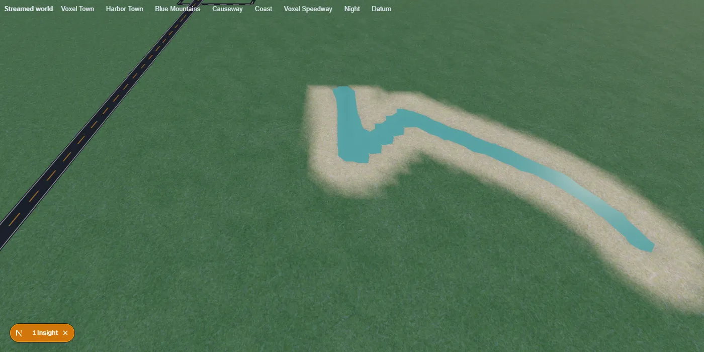
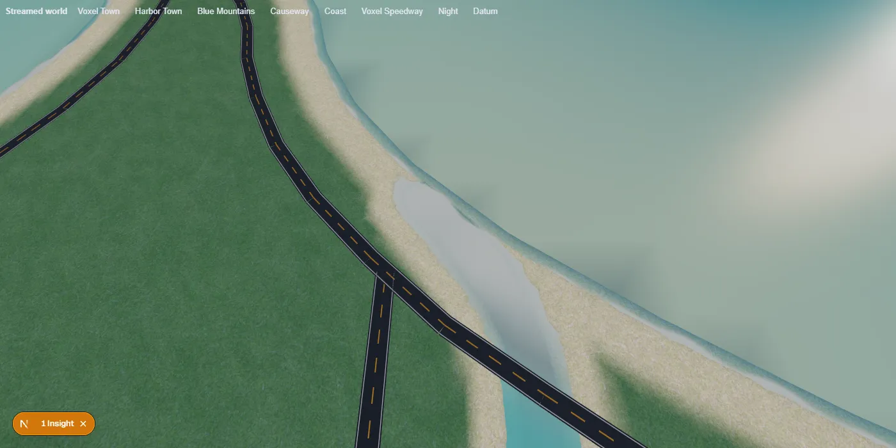

# The Rio Minho in the baked world

<!-- order: 150 -->

The first river cut into the baked ground as a second coast ([river_plan.md](../river_plan.md)).

## minho_a

The Rio Minho's north reach: a channel with sandy banks, bending to run down to the first town.

## minho_d

The Rio Minho's south reach reaching the sea: the ring road crosses it as a flat slab, the spur road ends at the ring, and the river widens to its mouth.
