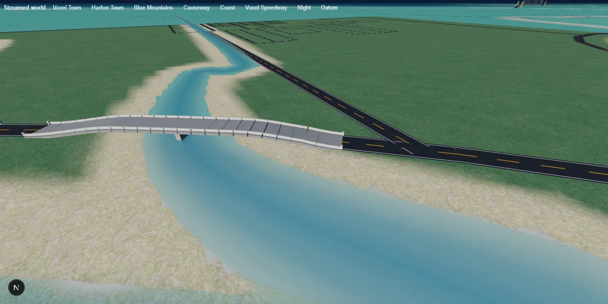
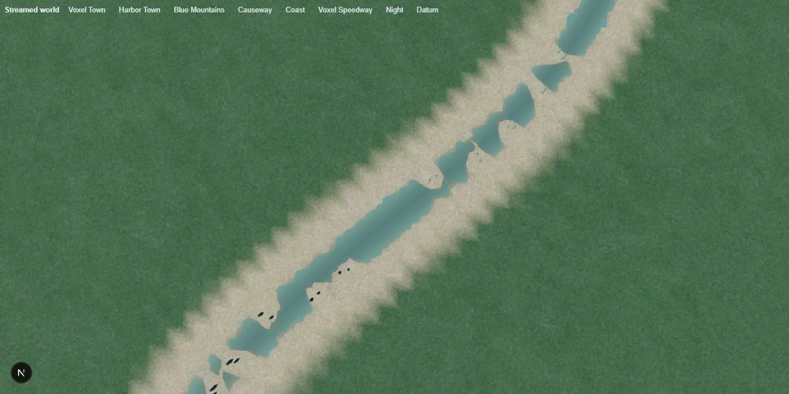
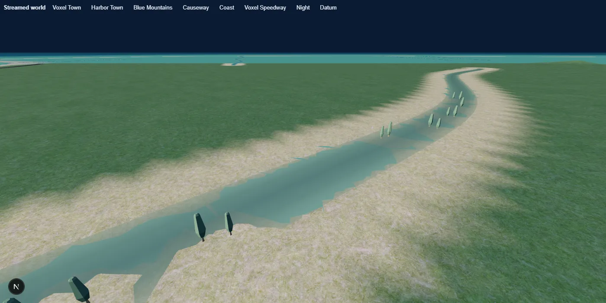

# The rivers' water and the Black River's morass

<!-- order: 210 -->

Each river has its own water ribbon; the delta rivers have islands, and the Black River's have mangroves ([river_plan.md](../river_plan.md)).

## river_mouth_water

The Rio Minho under its ring bridge, widening to the sea: blue in the middle, lighter over the shallow banks, fading out into the sea.

## delta_aerial

The Black River's morass from above: the channel broken into pools by islands, with sandy banks.

## delta_mangroves

The morass at ground level: tea-coloured water, islands, and mangroves standing on them.
