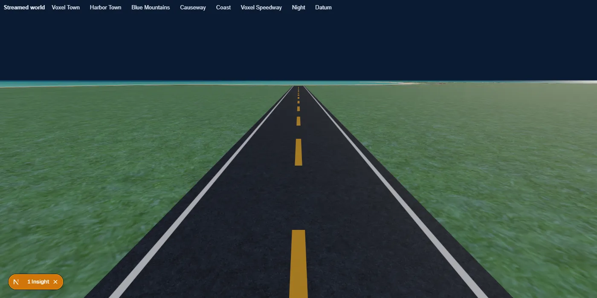

# The roads' asphalt and lines

<!-- order: 140 -->

The baked roads with ambientCG's asphalt grain, a dashed centre line and edge lines ([road_texture.md](../road_texture.md)).

## road_a

A highway with asphalt grain, an amber dashed centre line and white edge lines.

## road_b

The same highway with `?roadtex=0`: the old flat colour.
