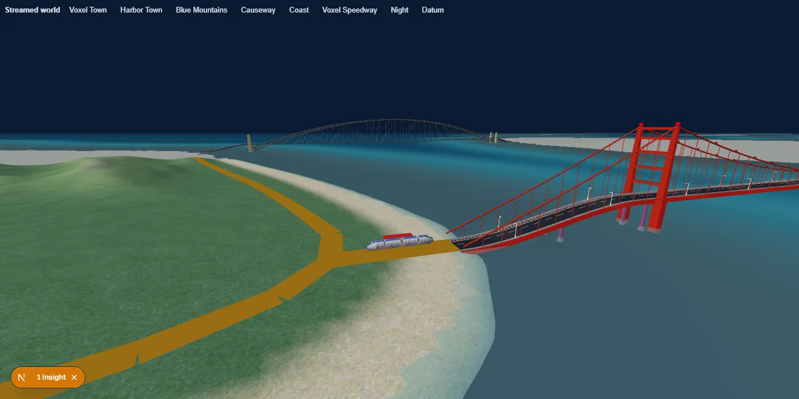
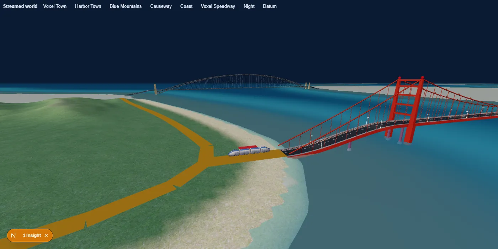
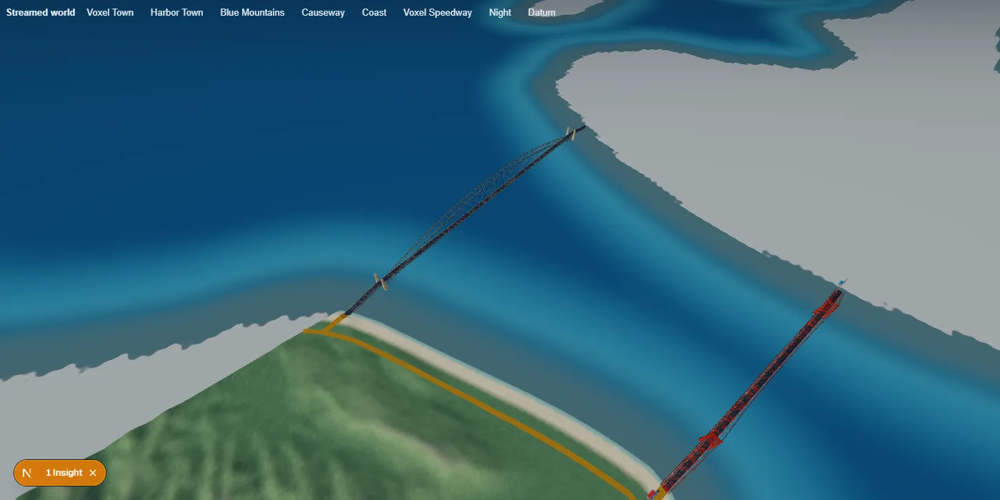
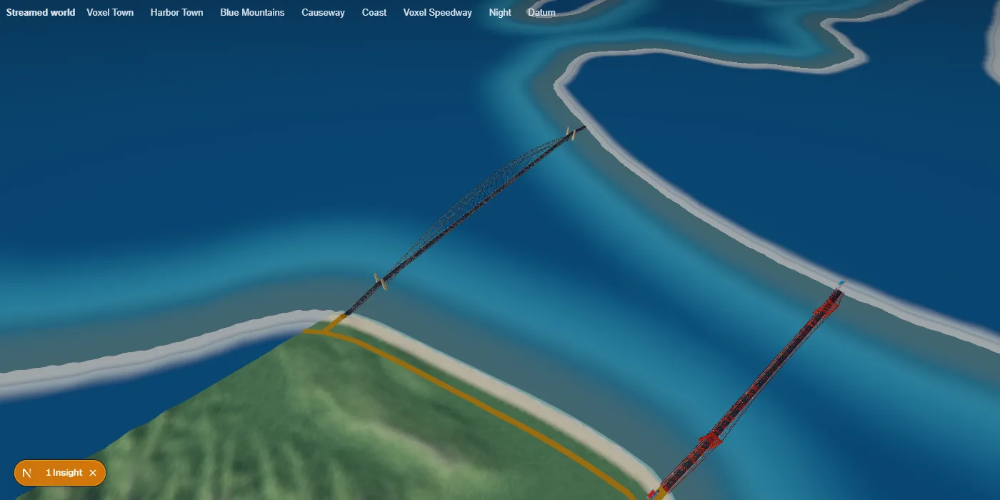
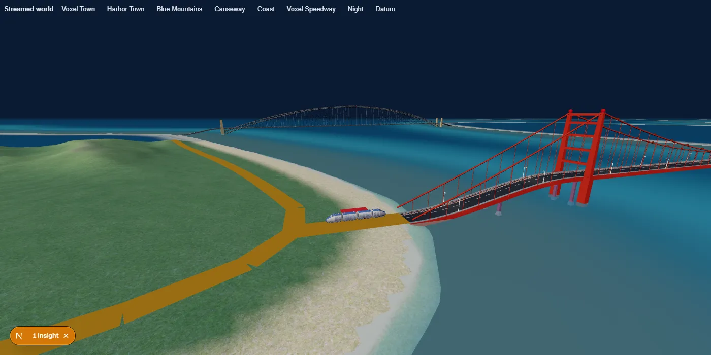
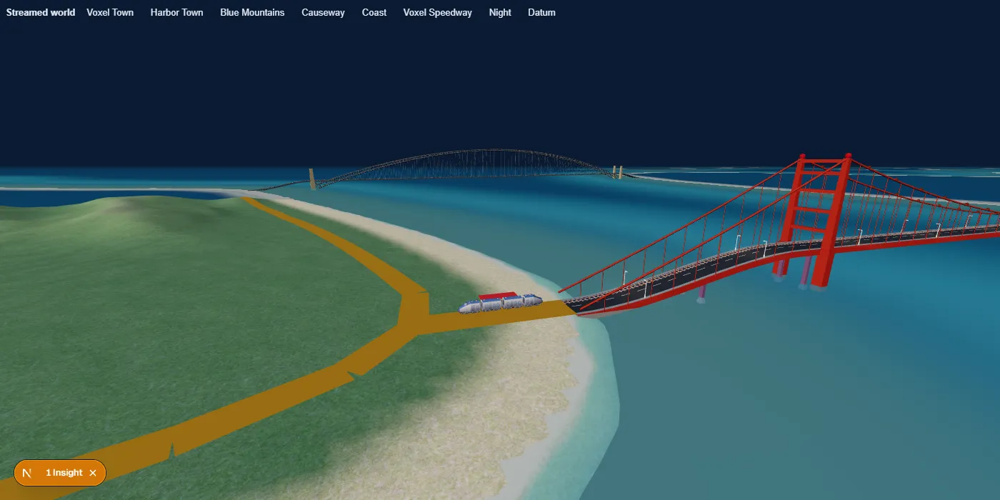
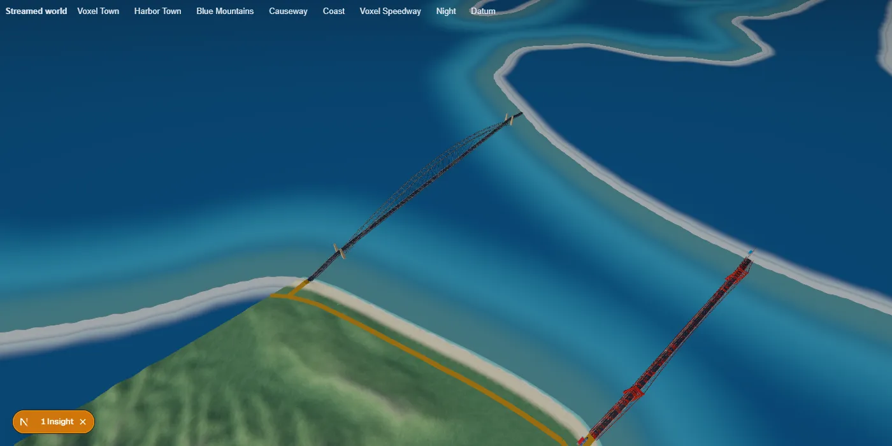
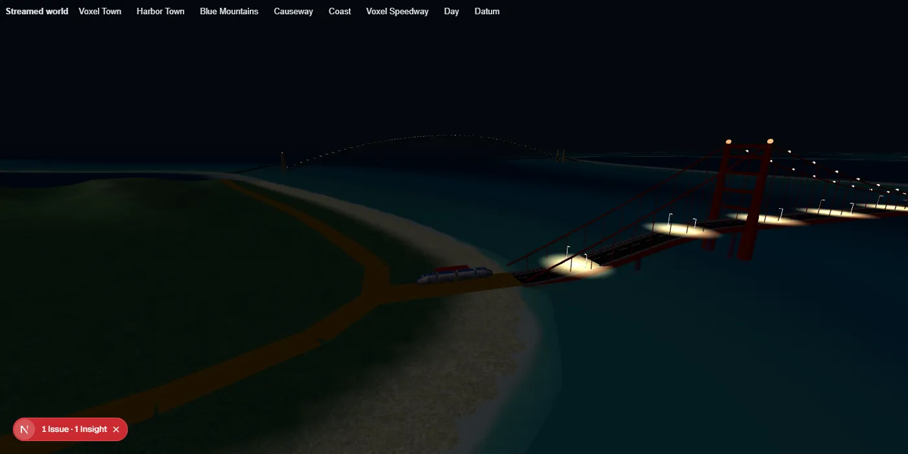

# The sea: depth shading

<!-- order: 90 -->

The sea coloured by its distance from the coast, with a foam line at the shore ([water.md](../water.md)).

## sea_b

The sea before: one flat navy plane (`?seashade=0` shows it).

## sea_a

The first depth shading: turquoise shallows, a muddy grey where the seabed shows through.

## sea_c

A second tuning: more opaque shallows.

## sea_d

From above: depth rings round the coasts, but land that no chunk draws yet showed as pale grey.

## sea_e

The same view with the signed distance: undrawn land is deep water as before, and a foam line follows every coast.

## sea_f

The near coast with the signed distance.

## sea_g

The final shading at the mainland end of the causeway: turquoise shallows, a foam line, deeper water out to sea.

## sea_h

The final shading from above: both causeways, the coasts and the depth rings.

## sea_i

The final shading at night.
