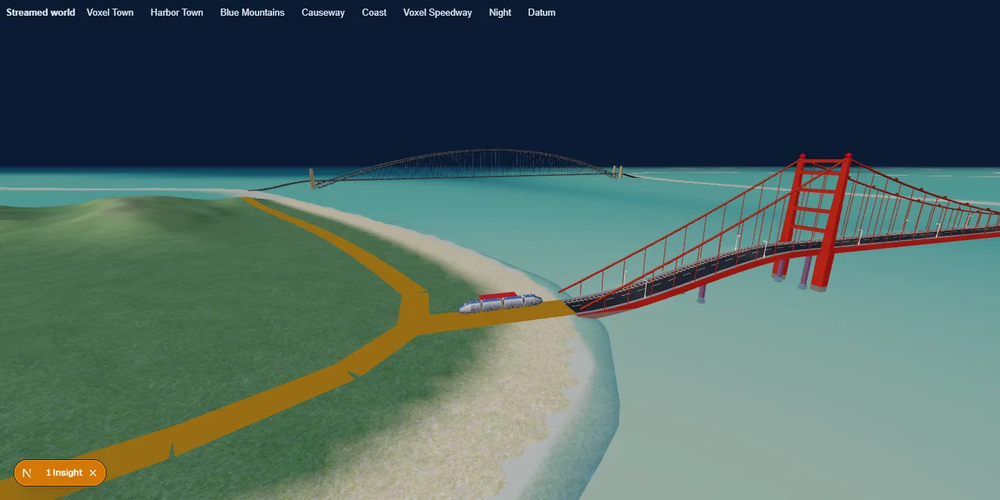
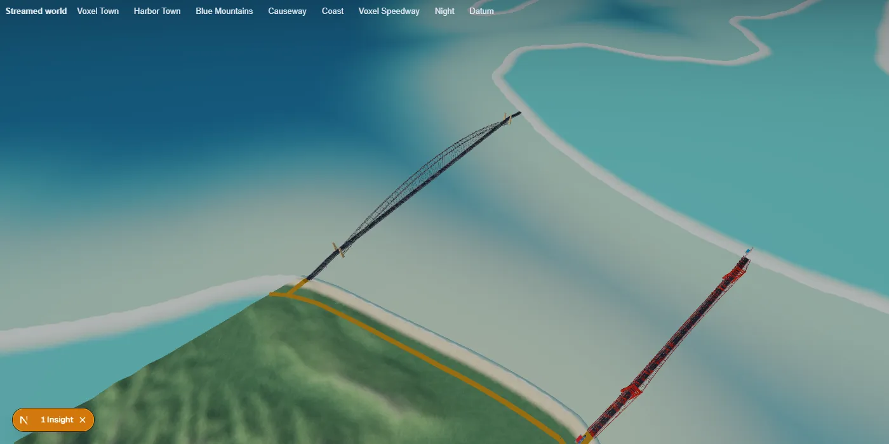
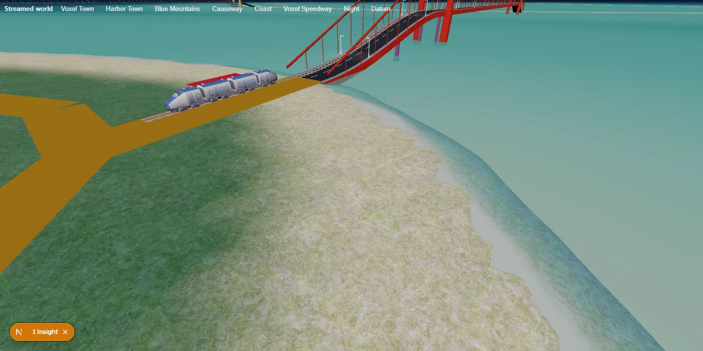

# The seabed and water column

<!-- order: 120 -->

The sea with a floor to see through it, and a water column that goes from clear turquoise to deep blue ([water.md](../water.md)).

## seabed_a

The shelf of the shallows seen through clear water at the first causeway.

## seabed_b

From above: the sand shelf round the coast, the seabed falling away and the water deepening to blue.

## seabed_c

The shore: foam, then clear shallows over sand.
