# The shape of the world

<!-- order: 10 -->

The first sketches of the land: the Jamaica-like mainland, Harbor Isle and the smaller islands, and the game's own world-map page ([world_recipe.md](../world_recipe.md)).

## world

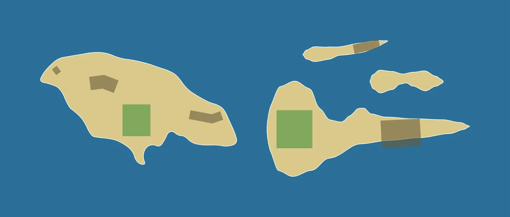

An early sketch of the two main landmasses and the small island in the sea.

## world-layout

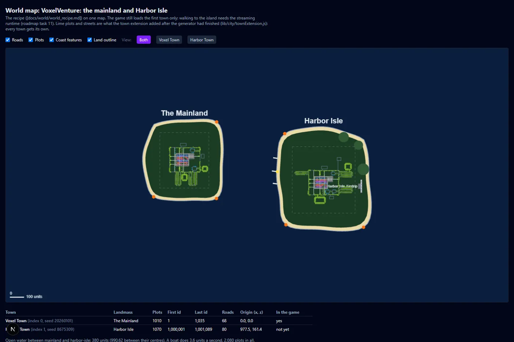

The layout sketch with the two towns and the airstrip marked.

## island-layout

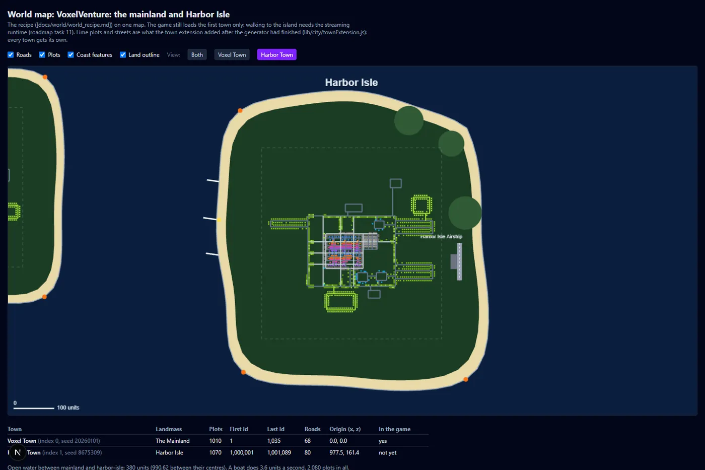

The island layout with the districts of Harbor Isle.

## jamaica-mainland

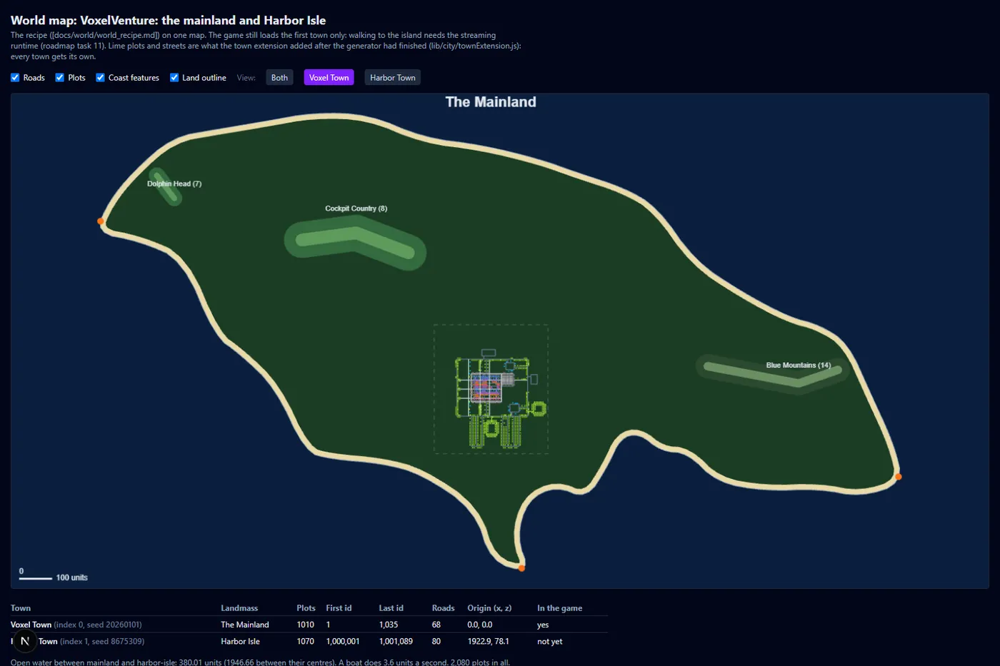

The mainland drawn after the outline of Jamaica.

## jamaica-both

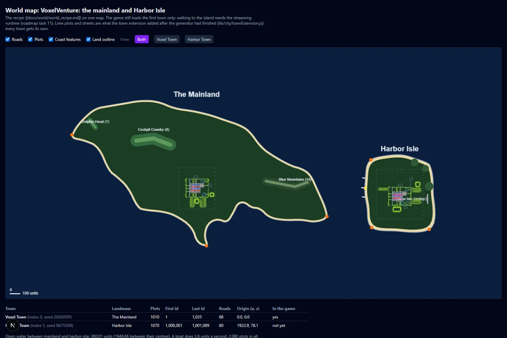

The mainland and Harbor Isle side by side.

## cayman-both

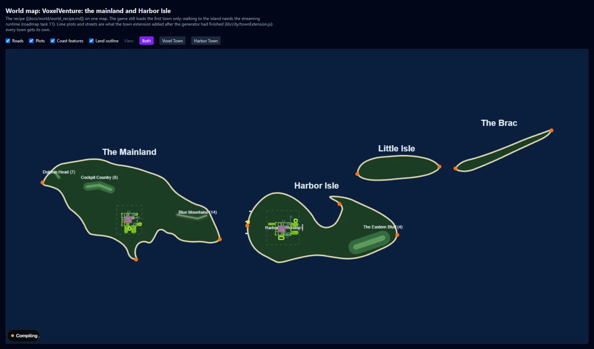

Harbor Isle and the Lesser Caymans, drawn after Grand Cayman.

## cayman-harbor

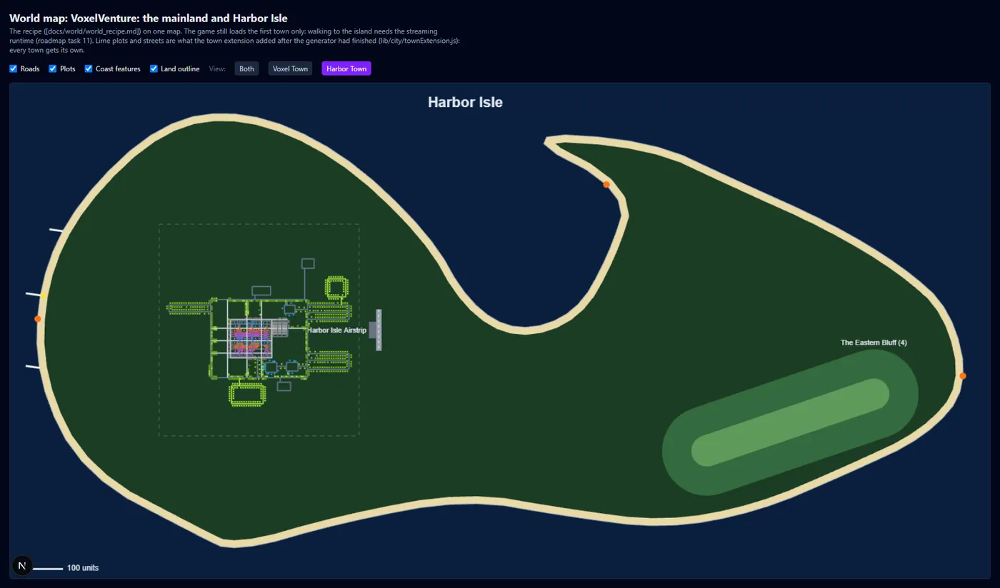

Harbor Isle with its town site.

## world-map

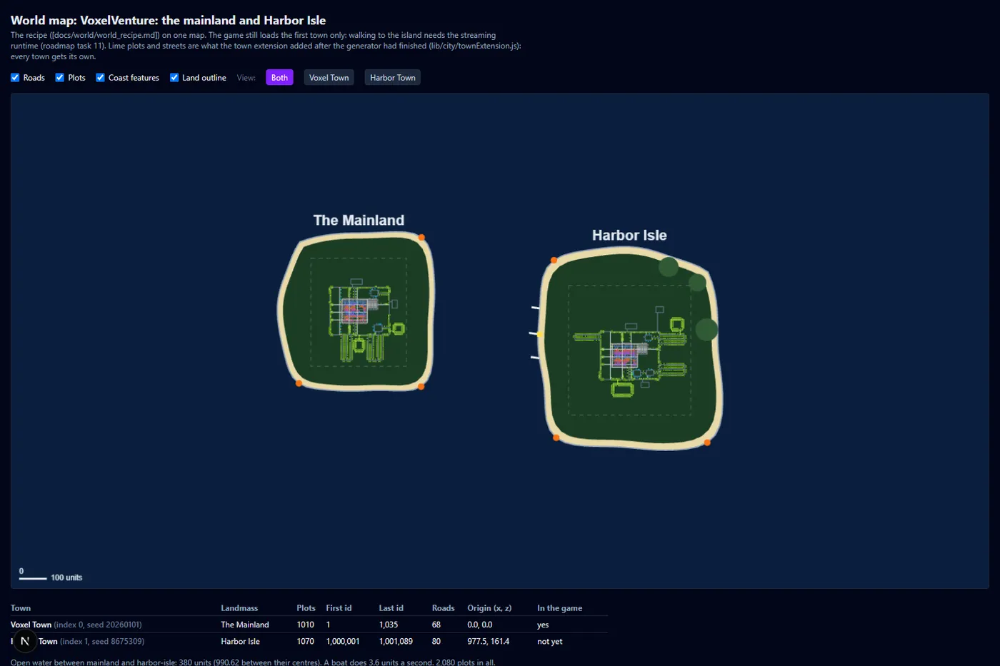

The game's world-map page: the mainland and Harbor Isle.

## world-voxel-town

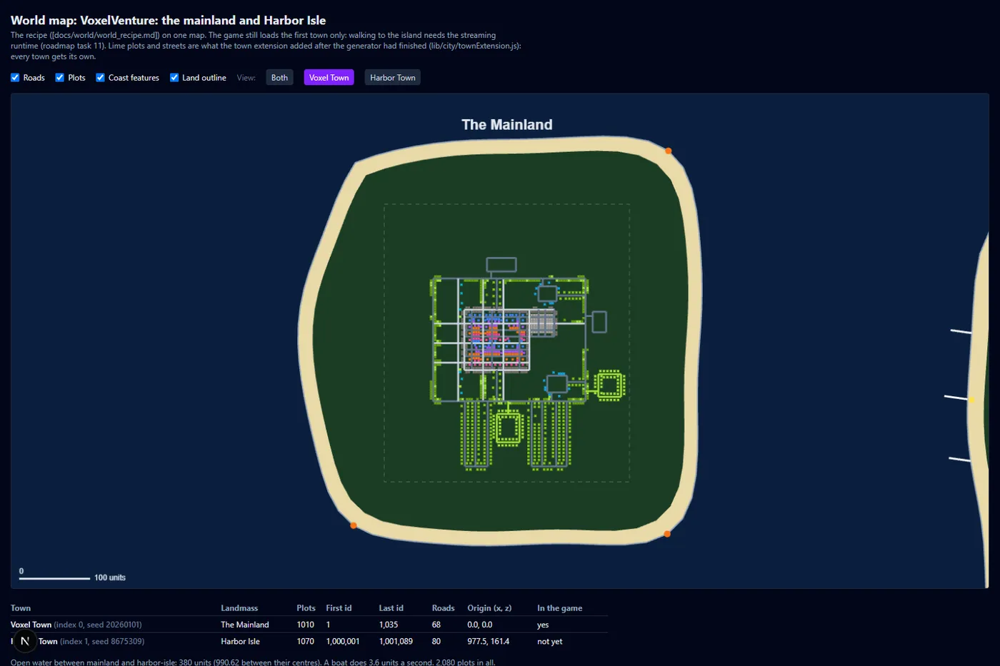

The world-map page zoomed to Voxel Town.

## world-harbor-town

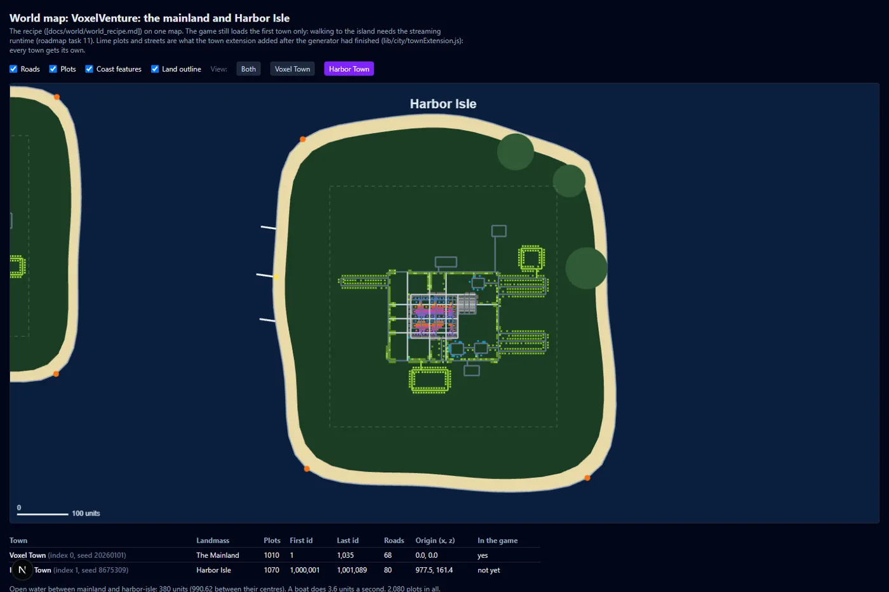

The world-map page zoomed to Harbor Town.

## world-harbor-airstrip

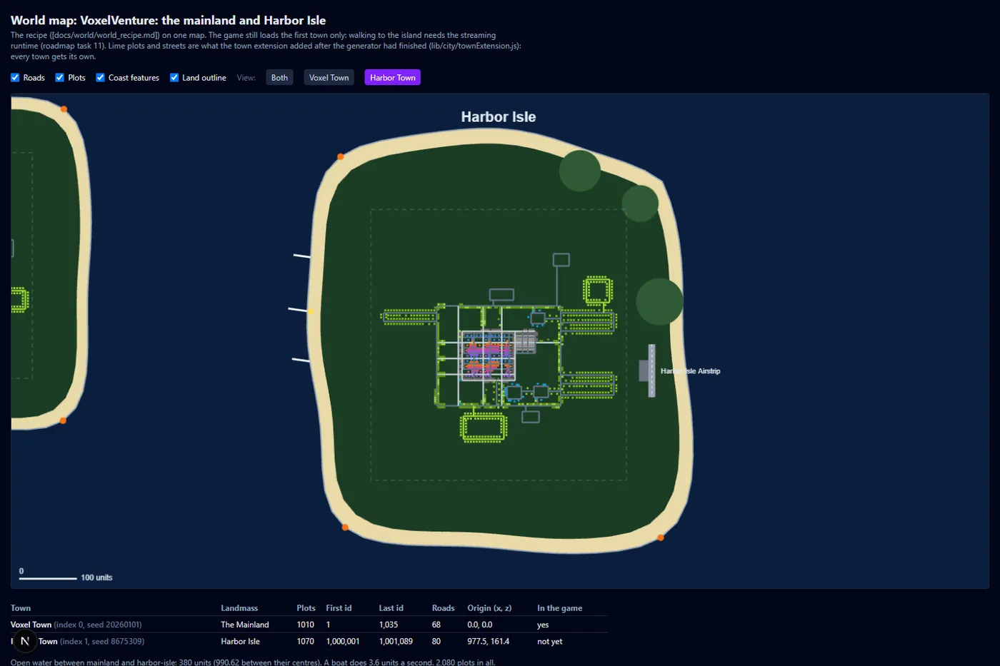

The world-map page at the Harbor Isle airstrip.
