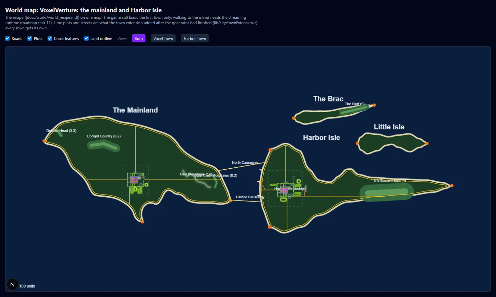
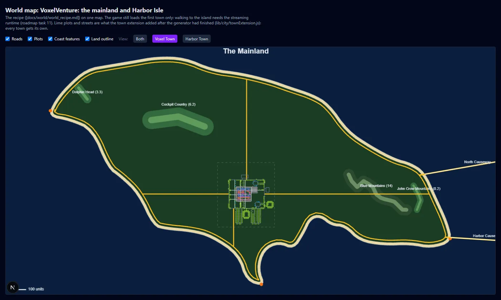
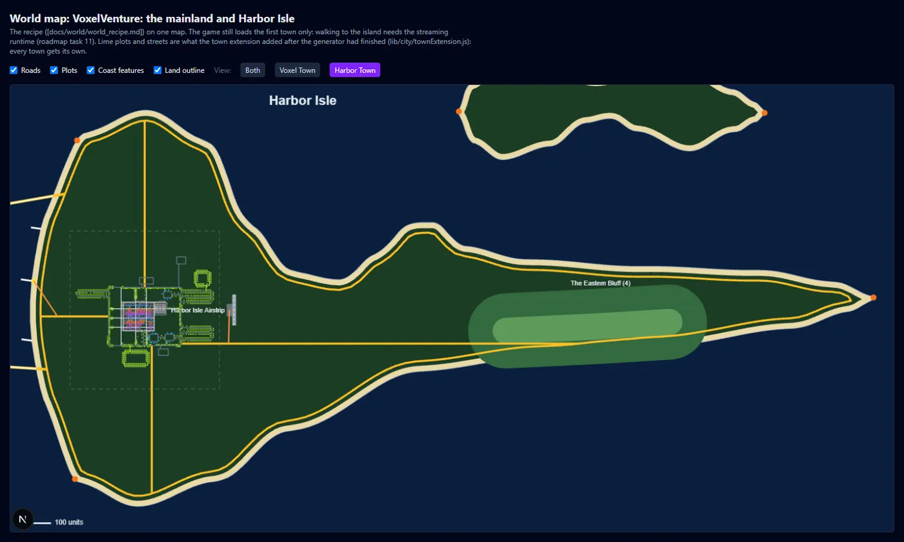
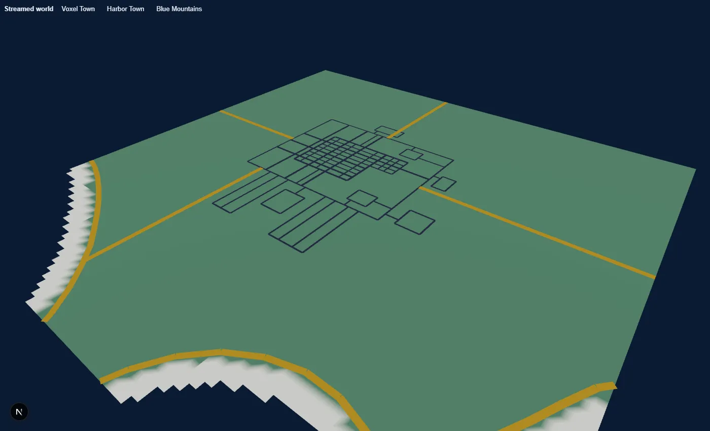
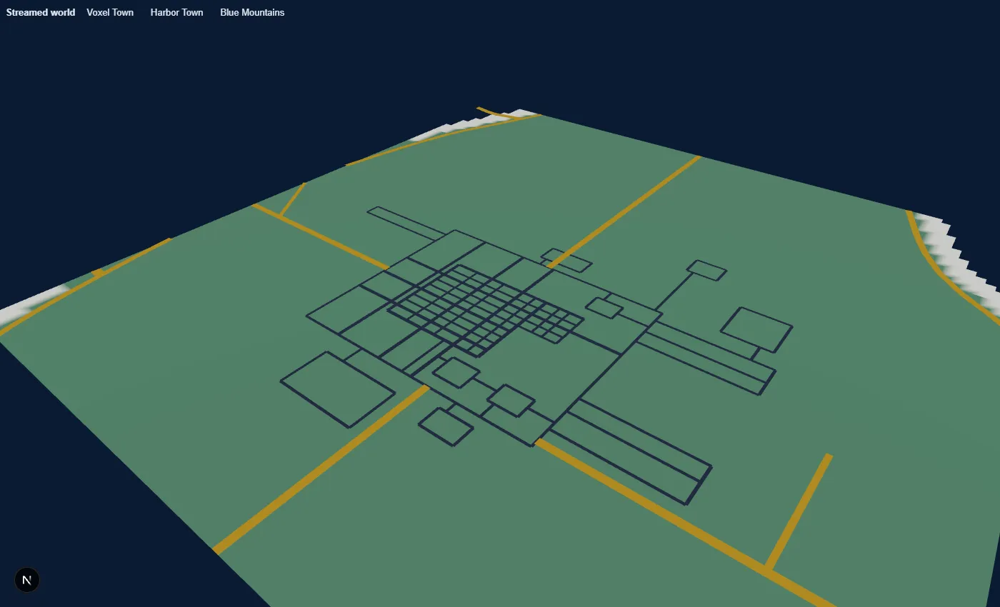
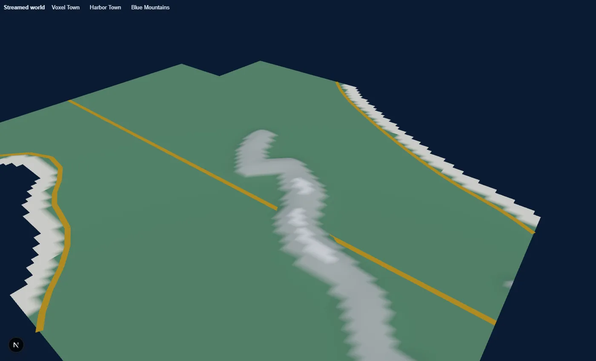
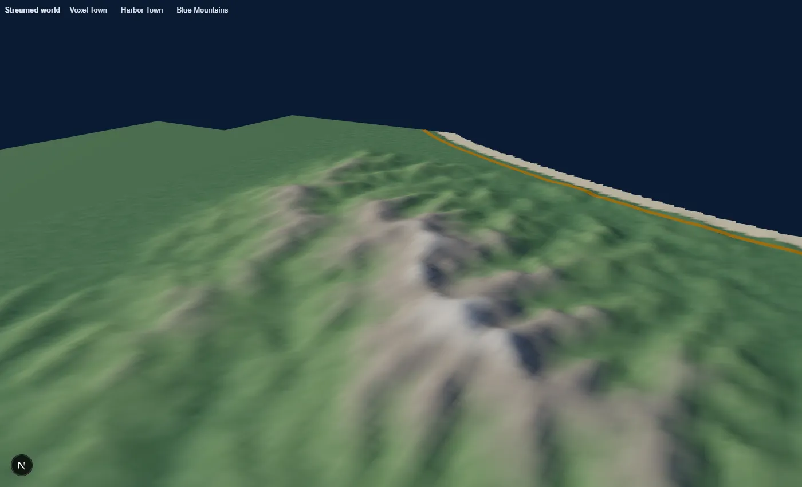
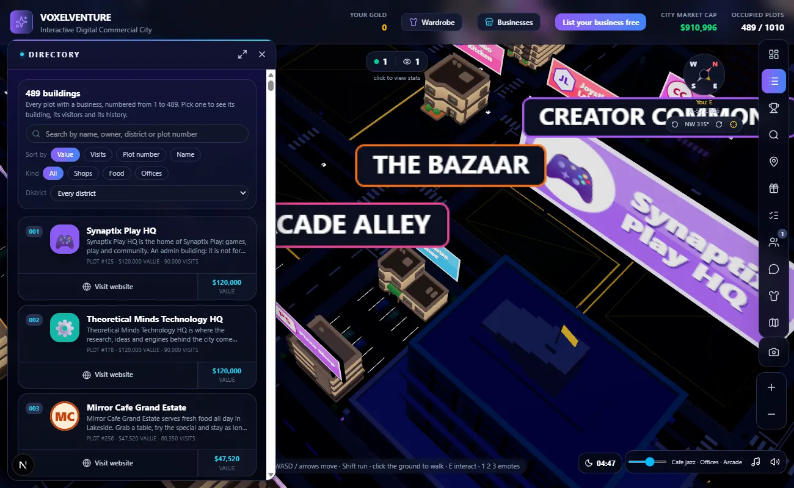
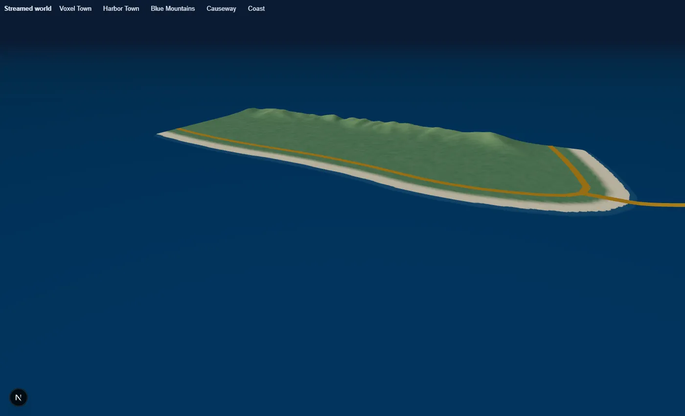
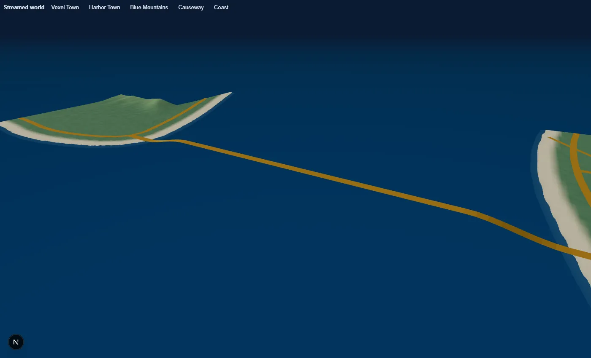

# The streamed world

<!-- order: 30 -->

The baked world drawn by the streaming runtime on the development page `/world/stream`, and in the game with `?world=baked` ([streaming_runtime.md](../streaming_runtime.md)).

## dev_world

The whole streamed world from the development page.

## dev_voxel

The first town as the development page draws it.

## dev_harbor

Harbor Isle on the development page.

## stream_town

A first look at the town's ground in the streamed world.

## stream_harbor

A first look at Harbor Isle in the streamed world.

## stream_blue

The Blue Mountains' first terrain mesh (the one that "didn't look so good").

## stream_blue2

The Blue Mountains after the real elevation data and the ridge correction.

## game_plain

The game as it was, without the baked world.

## game_baked

The game with `?world=baked`: the town inside the streamed world.

## shore_coast

The smooth coast and the sea plane.

## shore_causeway

A causeway leaving the shore.
