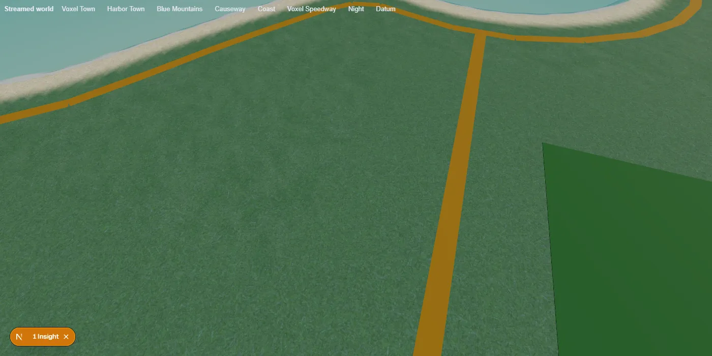
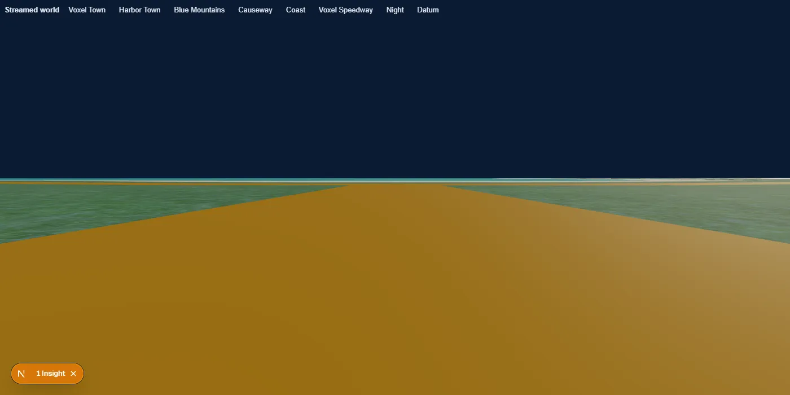
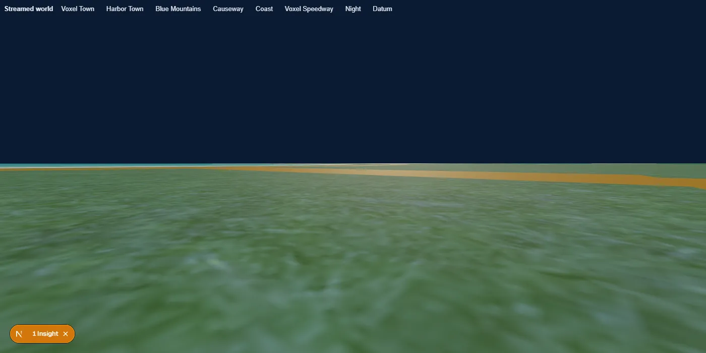
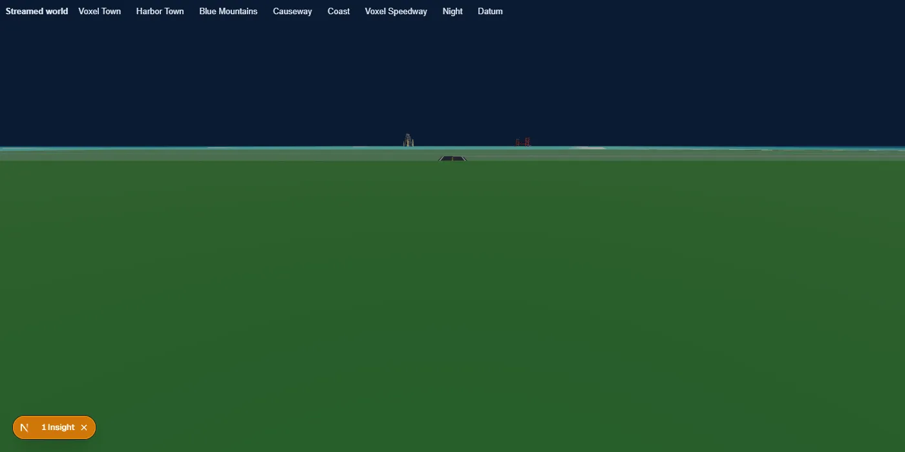

# The town join, after the underlay

<!-- order: 170 -->

The datum's step 5 ([datum.md](../datum.md)): the ground under a joined chunk is lowered under the town's slab only, easing out over 24 units.

## join5_a

From above, at the first town's south-east: the ground is continuous, the spur road runs up to the town's slab (the plain dark green square) and there is no frame or lip.

## lip_a

A spur road at ground level where it passes from a joined chunk into the next: no step can be seen at the chunk border.

## lip_b

The same border seen across the grass at a low angle.

## road_d

A far view along the spur east of the town with the underlay, from the road's end (a check picture: the road, the grass and the sea at the horizon).
