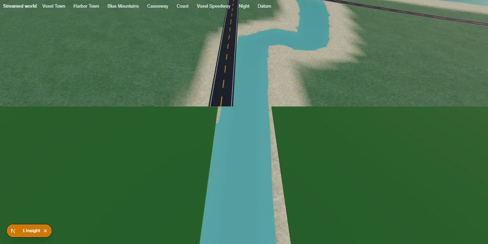
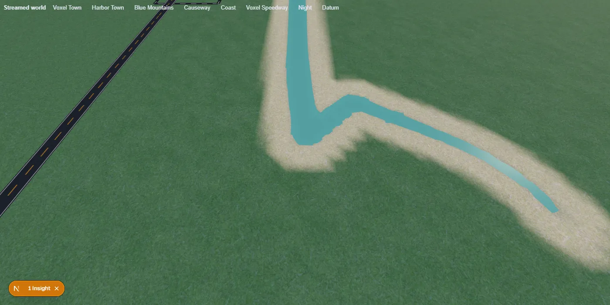

# The town's river and the natural river edge

<!-- order: 190 -->

The town's river sunk into a trench at the sea's level and joined to the baked river, and the smoother waterline ([river_plan.md](../river_plan.md)).

## town_river_a

The town's river where it meets the baked river at the town's south edge: one water, the plain slab cut round it (the development page's stand-in for the town).

## river_edge_b

The Rio Minho's north reach with the smooth waterline: the water's edge is a clean curve, not saw-teeth.
