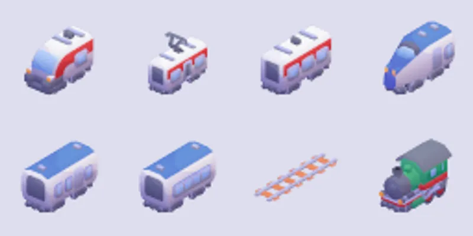
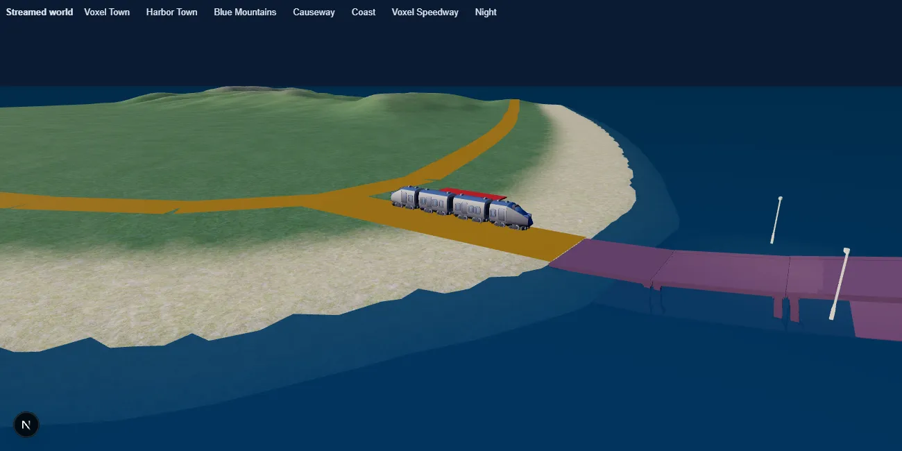
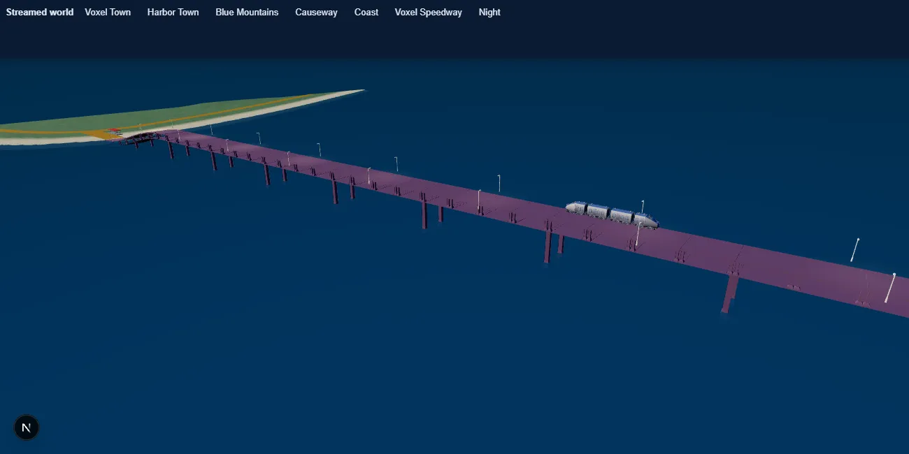

# The train

<!-- order: 70 -->

The rideable train on the first causeway ([train.md](../train.md)).

## train_prev

The Train Kit's electric bullet train cars and the straight rail.

## train_st

The mainland station on the first run, before the rail was laid right.

## train_st2

The train standing in the mainland station.

## train_mid

The train on the bridge deck.
