# The undersea tunnel

<!-- order: 80 -->

The evaluation and the spike ([tunnel_evaluation.md](../tunnel_evaluation.md)).

## train_tu1

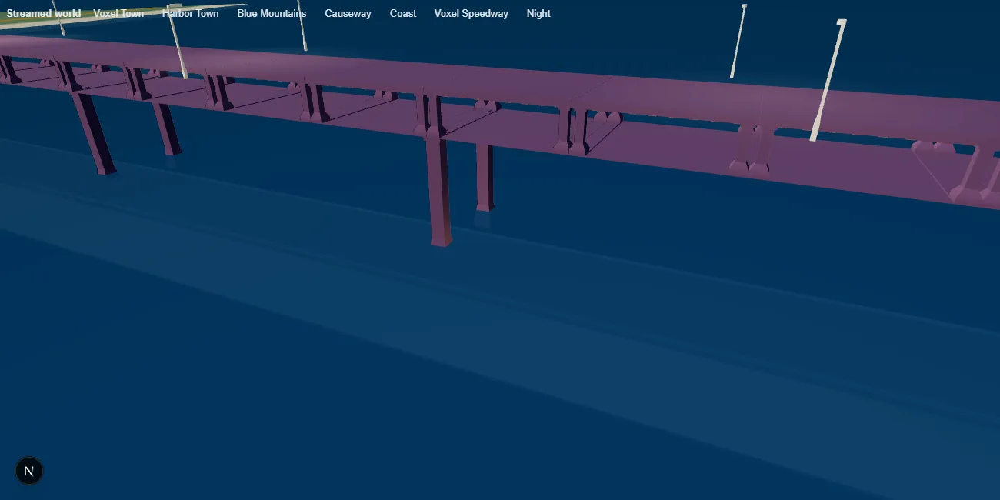

The tube seen through the sea from above, beside the bridge piers.

## train_tu2

A camera that could not leave the horizon (the orbit camera): the reason for the free camera.

## train_tu3

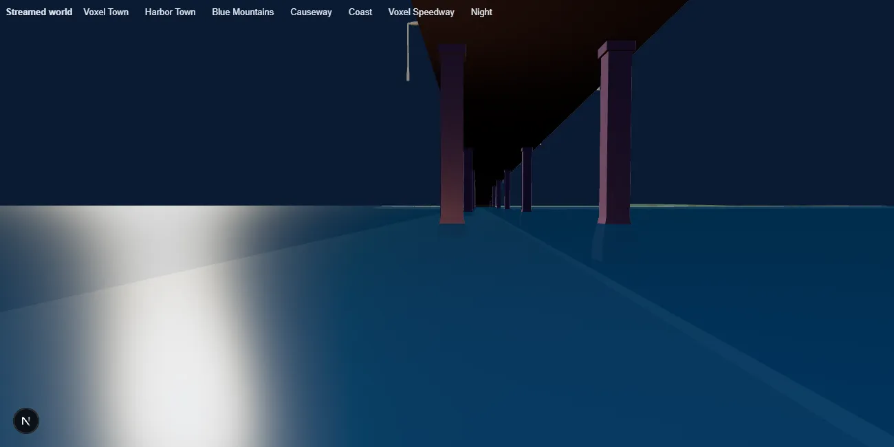

The same camera after the tube was made two-sided.

## tun_in

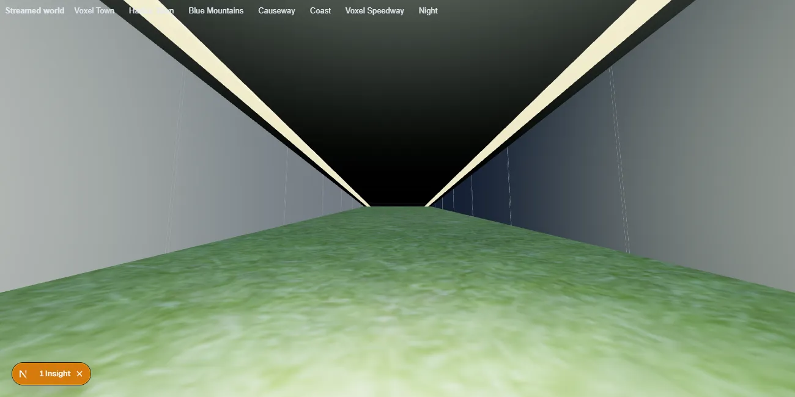

Inside the tube at the mainland portal, standing on the ramp: the ground covers the road.

## tun_mid

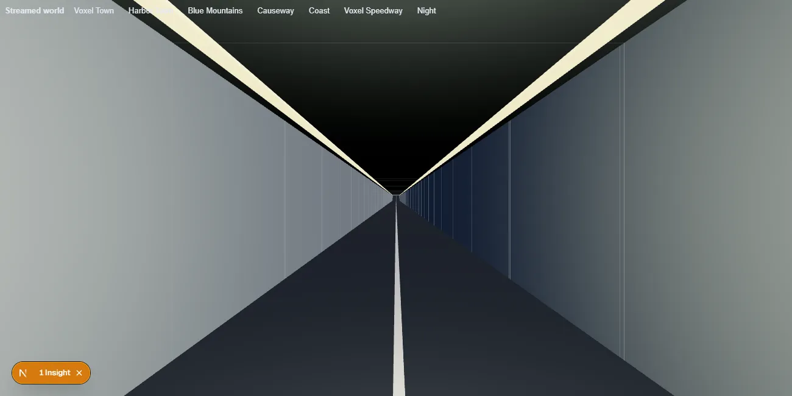

Inside the tube under the sea: walls, a lamp strip, the road and its lane line.

## tun_shore

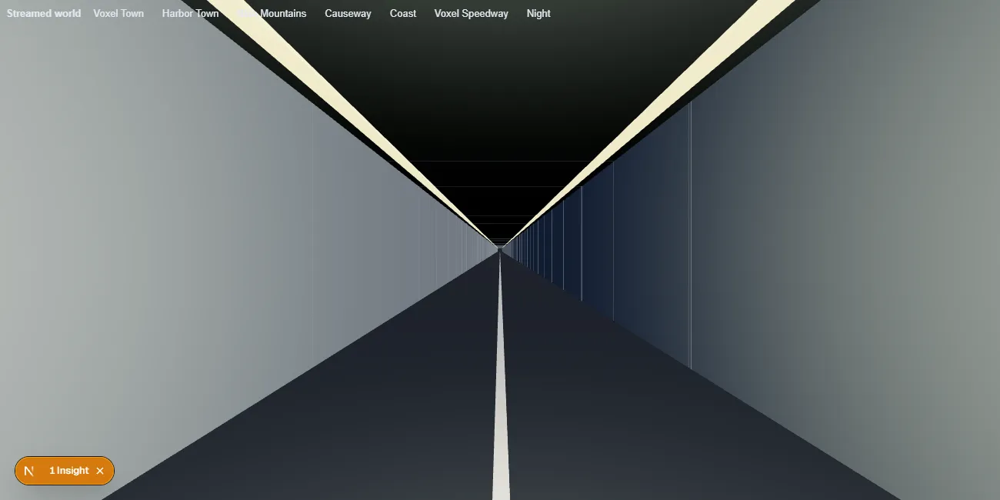

Inside the tube under the shore.

## tun_ramp

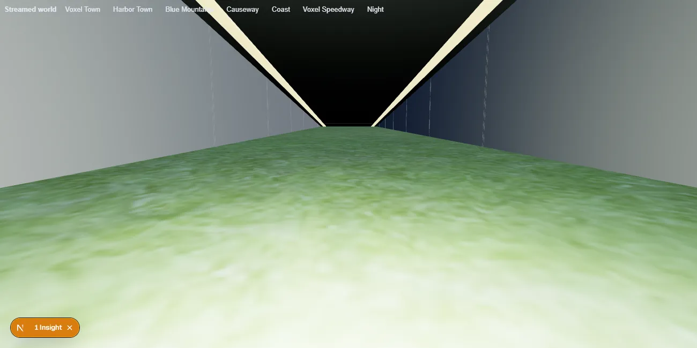

On the ramp: the grass is the ground's own surface, over the road.

## tun_portal

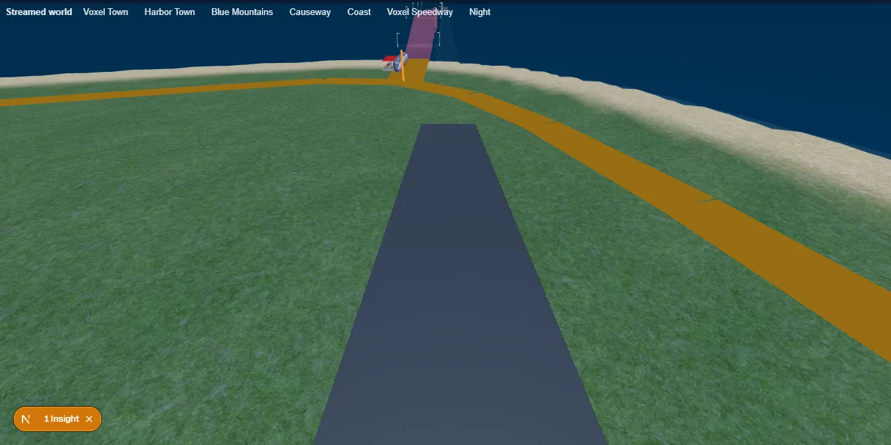

The approach road to the portal, from above.

## tun_out1

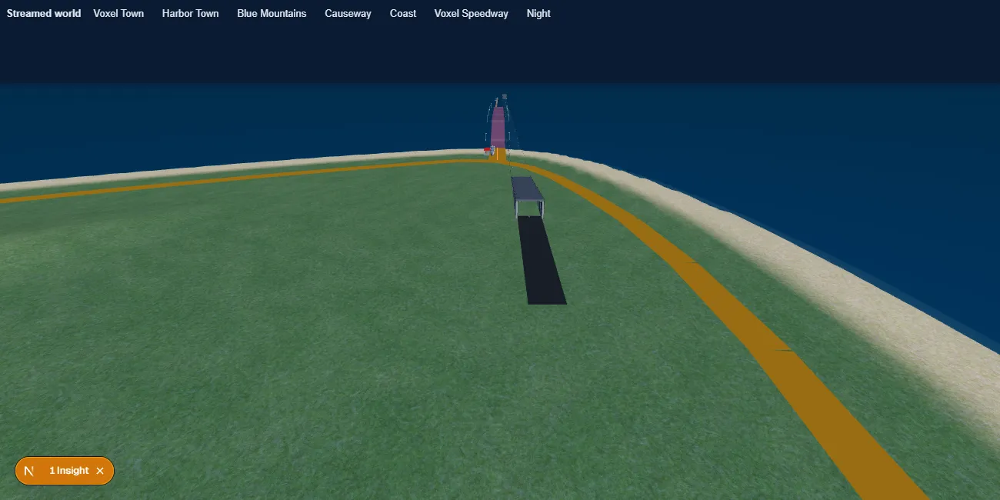

The portal and the approach road from the mainland side.

## tun_out2

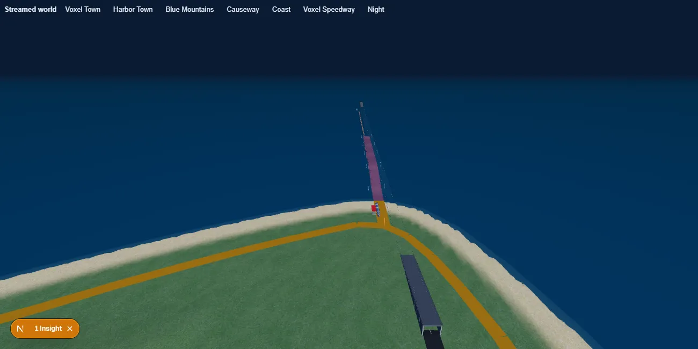

The tunnel's road from a higher camera.

## tun_o3

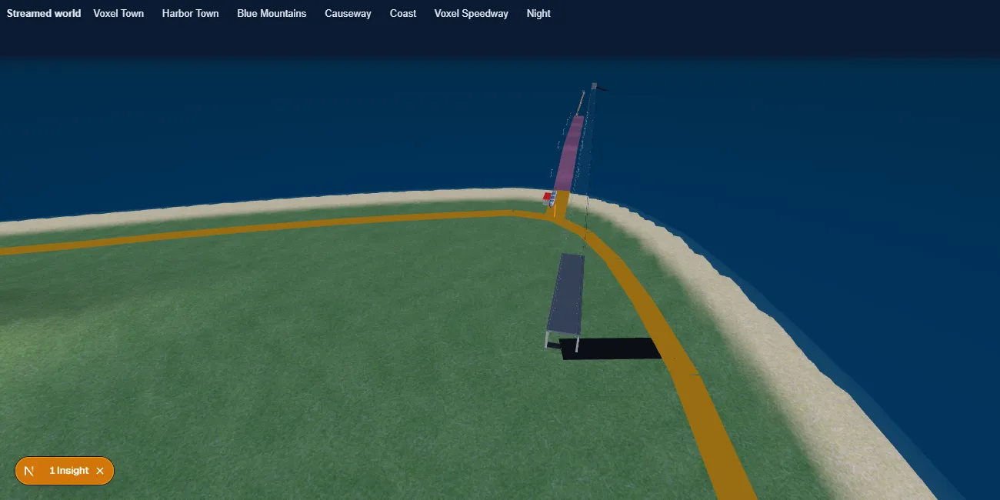

The tunnel's road joined to the mainland ring road.

## tun_o4

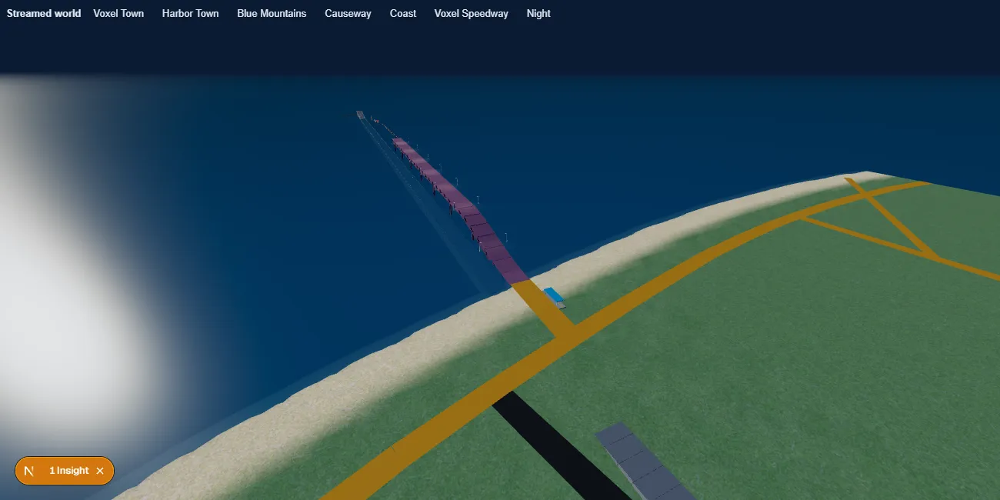

The tunnel's road joined to the Harbor ring road.

## tun_p3

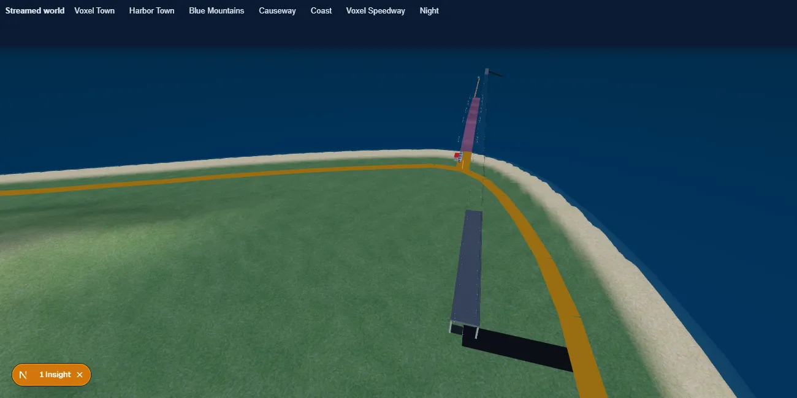

The longer entrance on the mainland (portal 110 units before the causeway).

## tun_p4

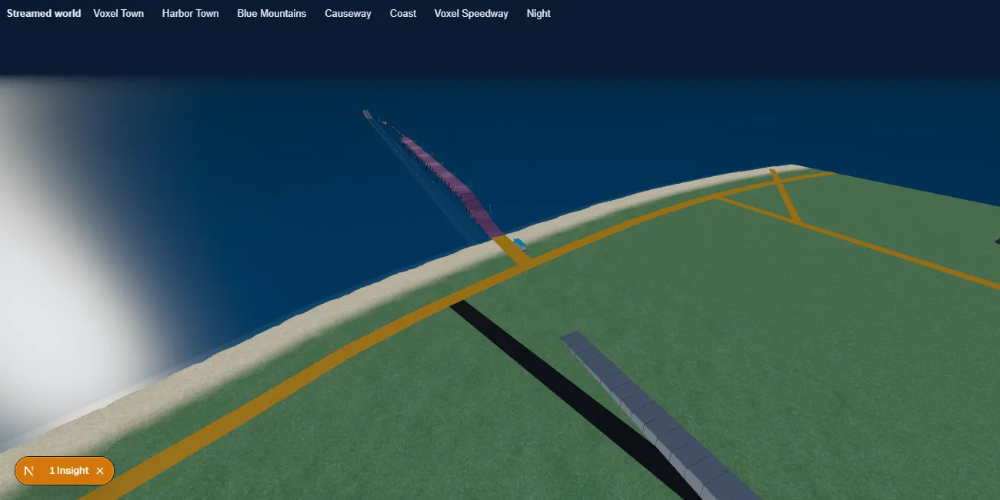

The longer exit on Harbor Isle.

## tunnel_diagram

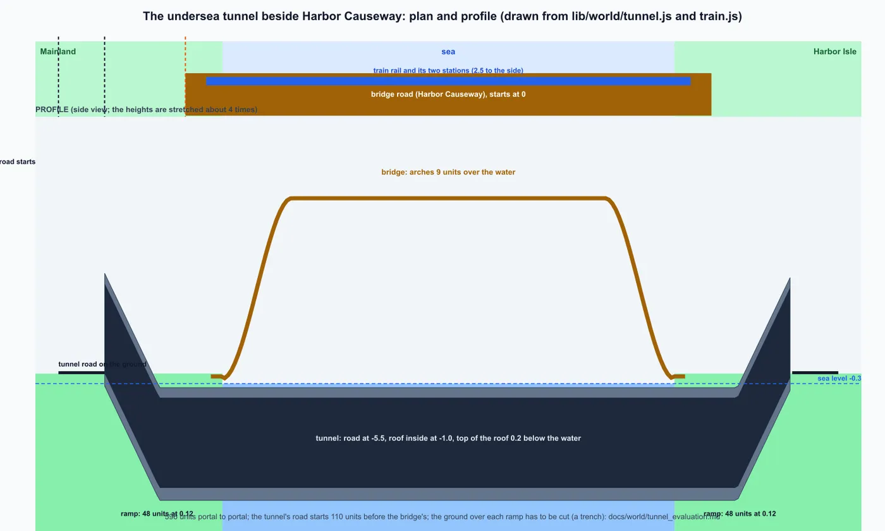

A plan and profile of the tunnel and the causeway. **Out of date:** drawn before the road links and the longer entrance.
