# The voxel speedway

<!-- order: 50 -->

The racing circuit on the mainland, built from the shape of the real Dover Raceway ([racing_track.md](../racing_track.md)).

## raceways

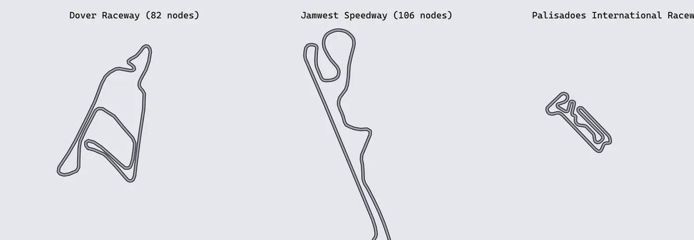

The circuit outlines taken from OpenStreetMap.

## track_sites

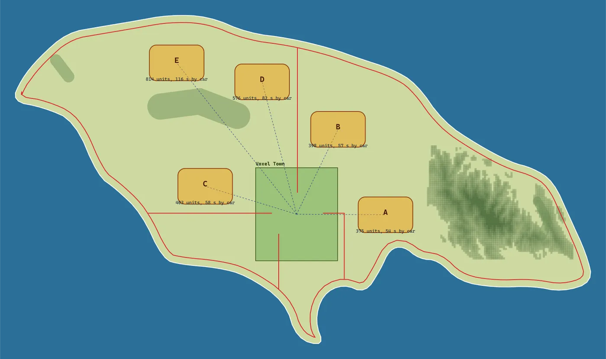

The candidate sites for the circuit; D was chosen.

## track_plan

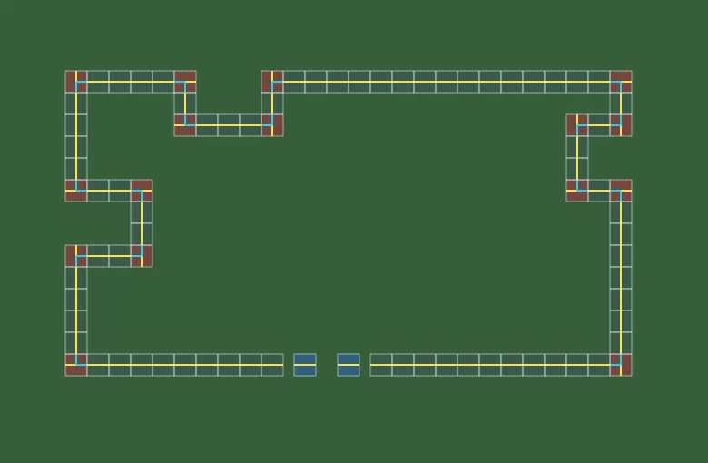

A plan of the first rectangular layout.

## track1

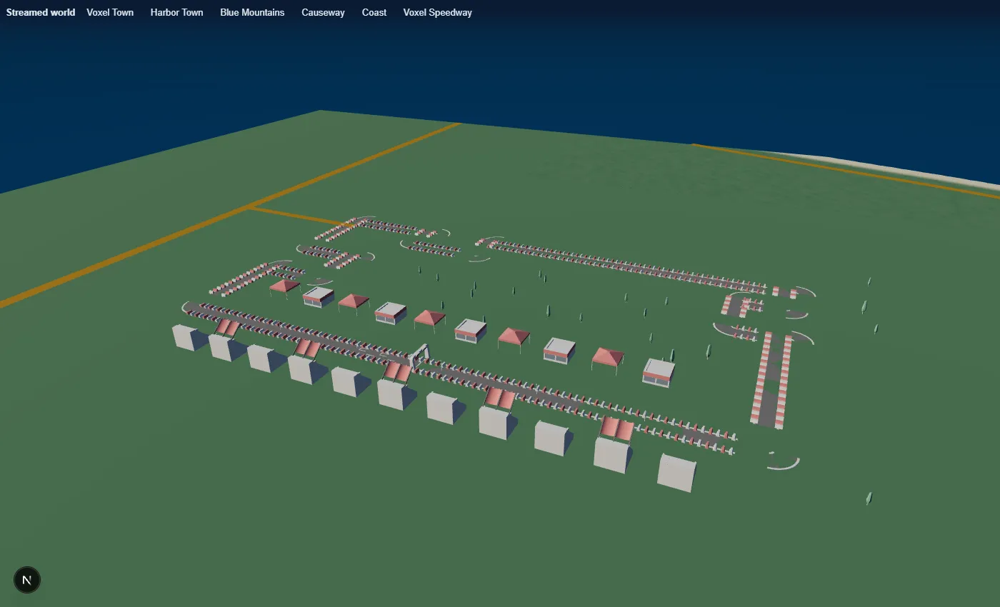

The first build: asphalt, kerbs and stands.

## track_top

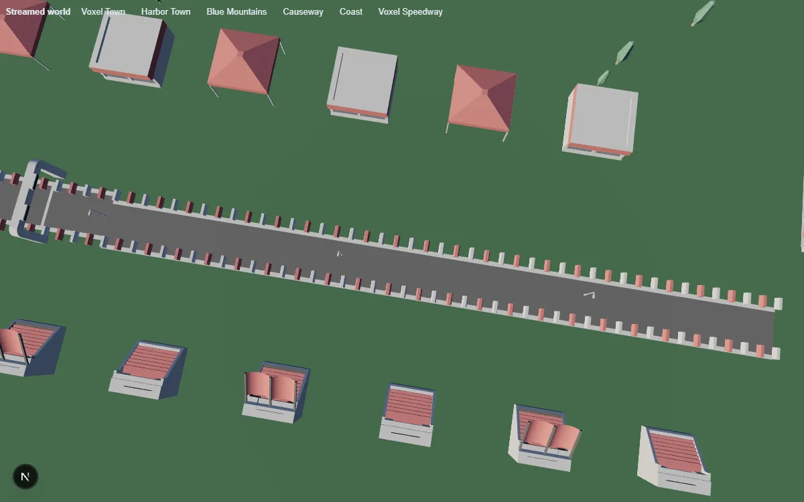

An early view from above.

## track_all

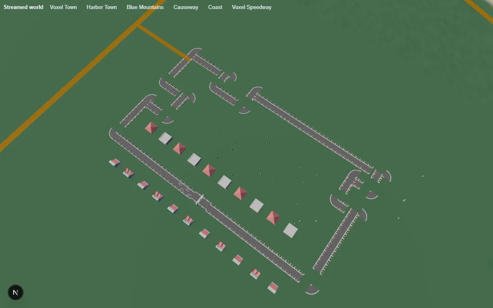

The whole circuit in the streamed world.

## track_start

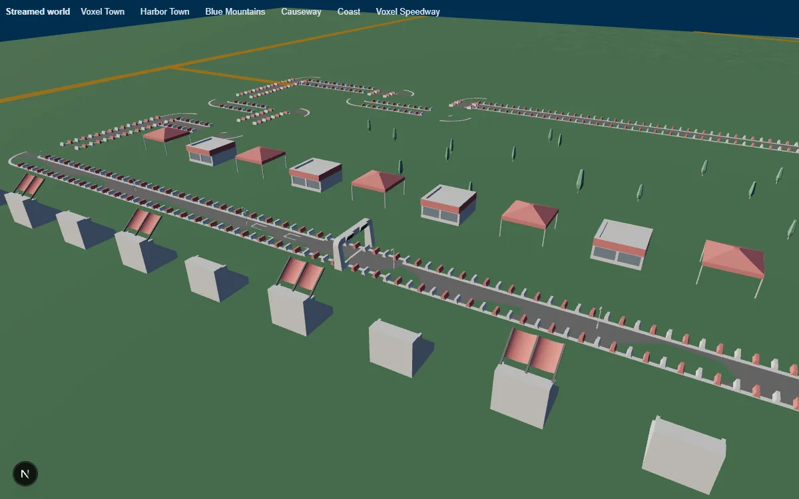

The start straight with its gantry.

## track_start2

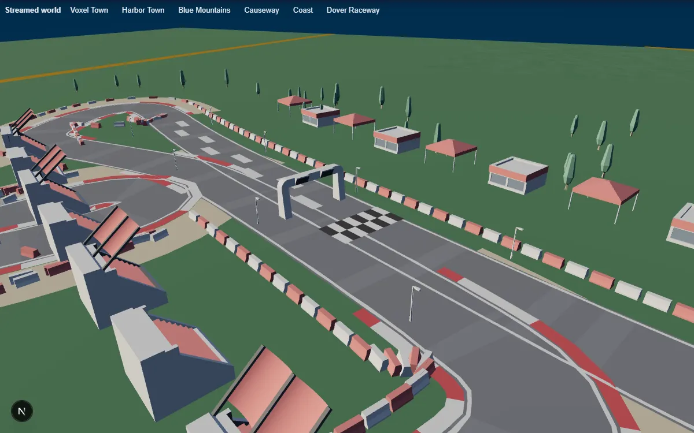

The start straight after the surface was redrawn from the real shape.

## track_new

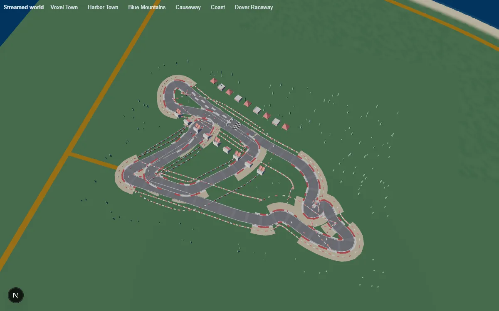

The redrawn circuit.

## track_final

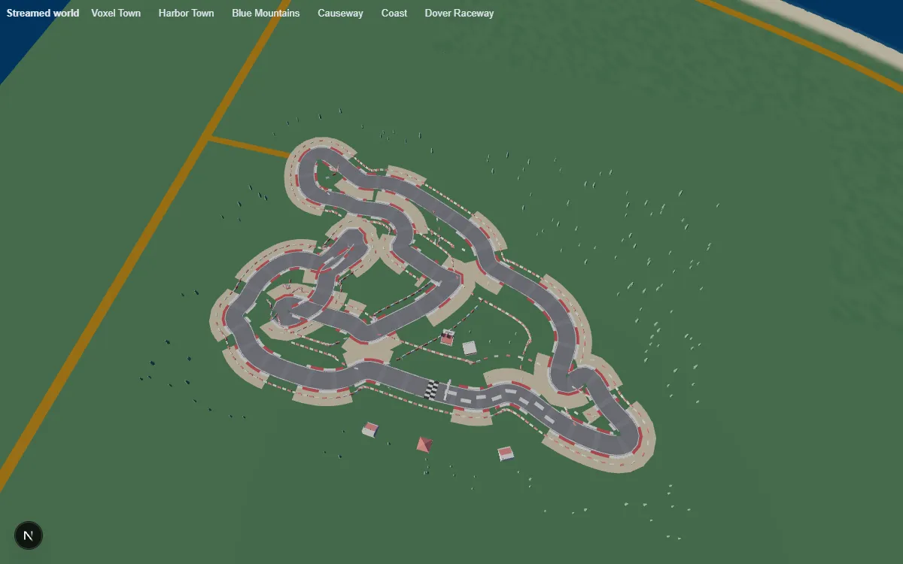

The circuit with the stands, pits, trees and lamps.

## corner

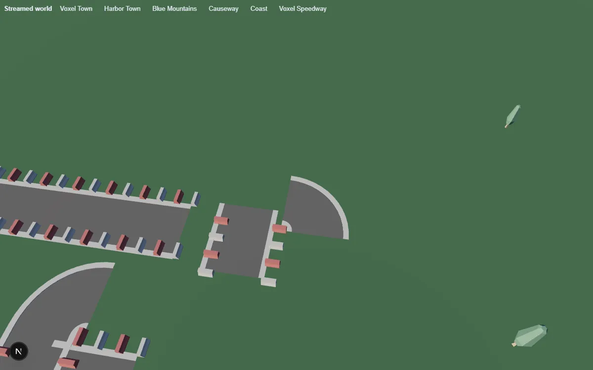

A corner of the first build, before the surface was drawn as quads along the shape.

## grid

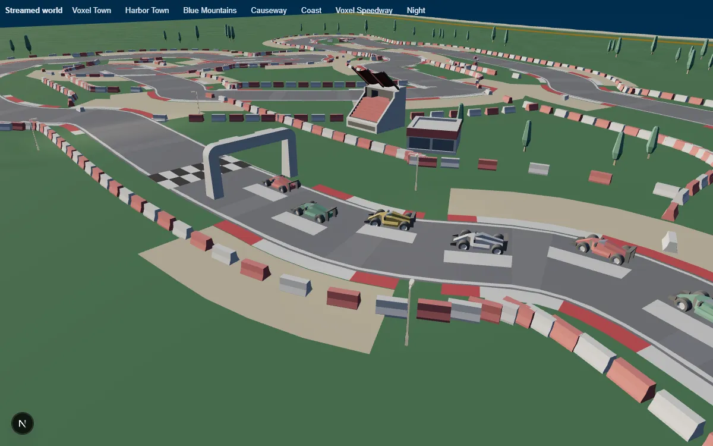

The grid with the race cars and the start gantry.

## night

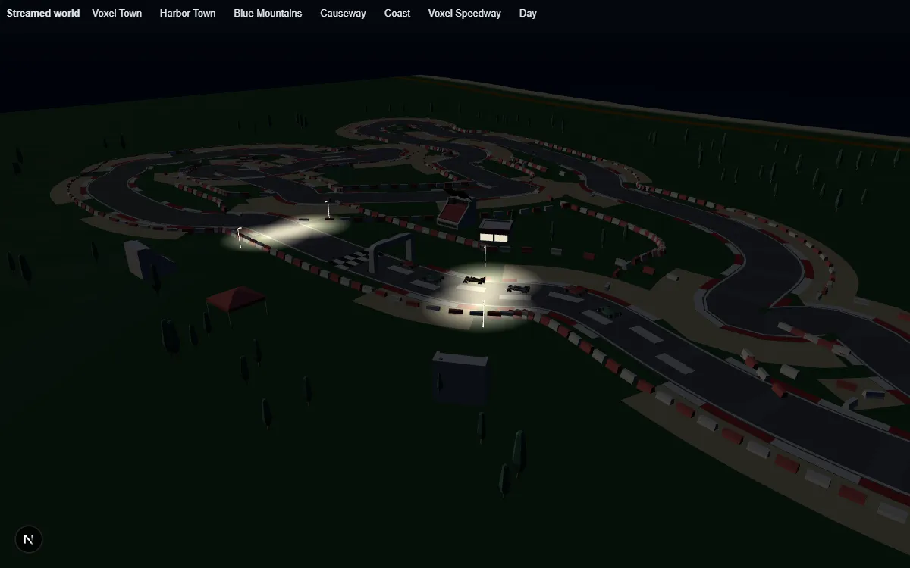

The circuit at night with the lamps lit.

## stadium

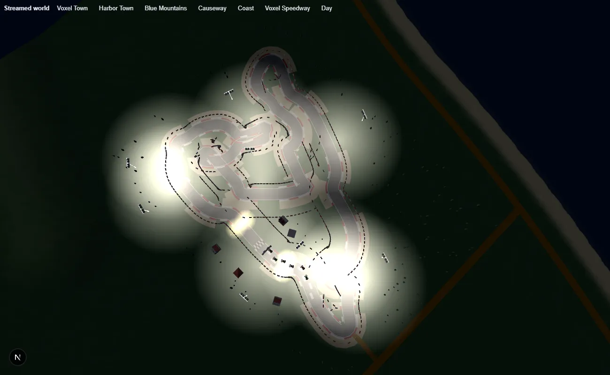

The stadium lights: a wide pool of light under each mast.

## trk_a

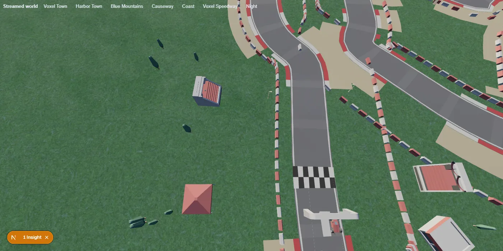

The props after the anchor fix: the barriers run the same distance from both edges and the gantry is centred.

## trk_b

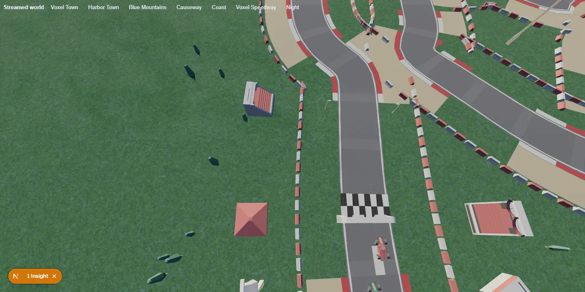

The same view a little later, the grid car centred on its lane.

## trk_c

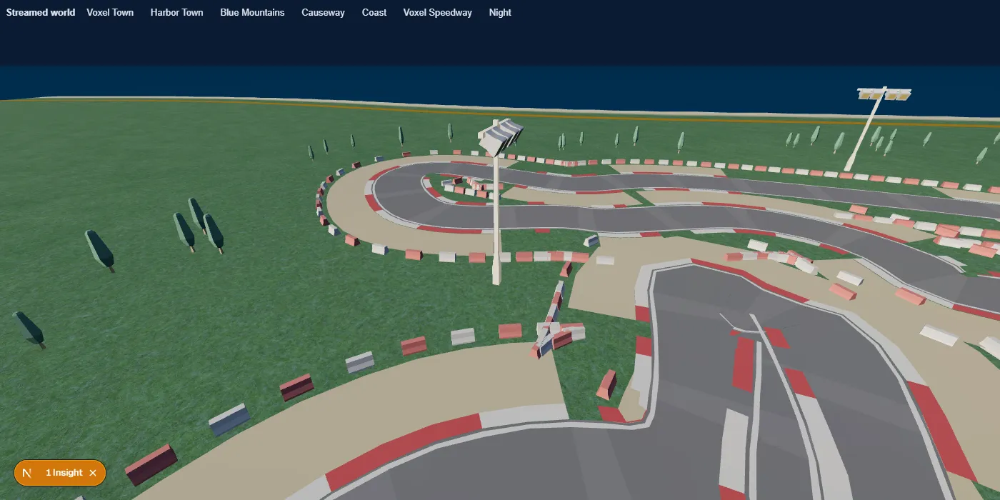

A stadium mast, the barriers and trees beside the road.

## trk_d

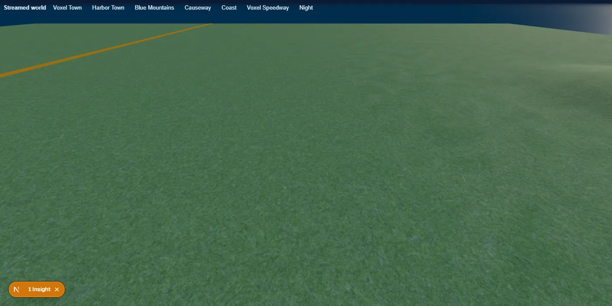

A view with nothing in it but grass (a wrong camera), kept for the record.
