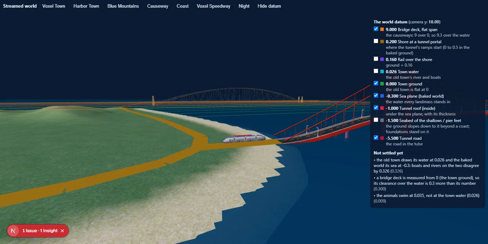
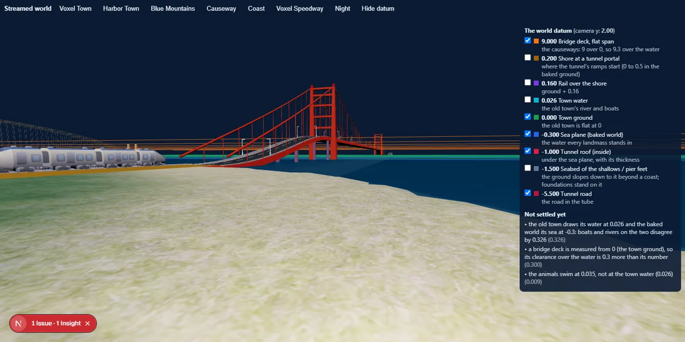
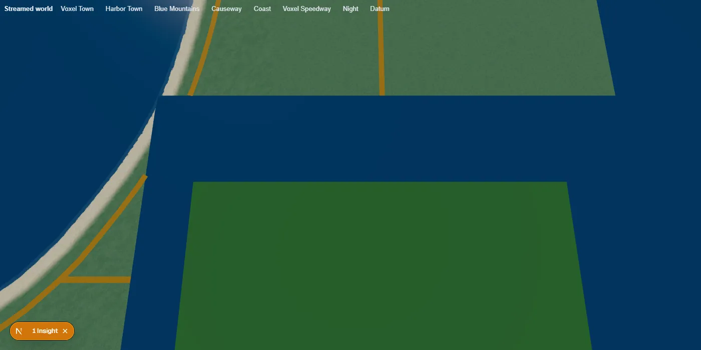
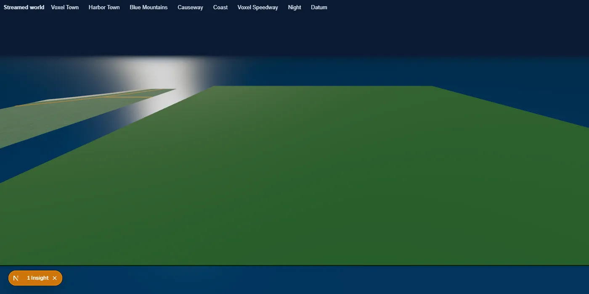
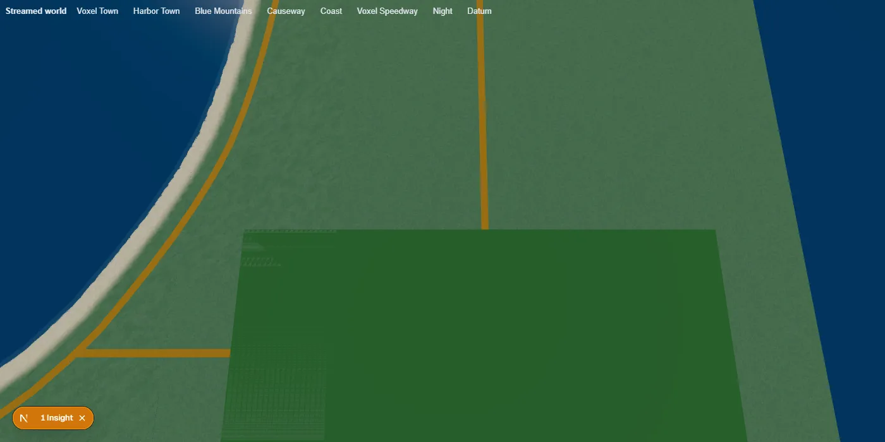
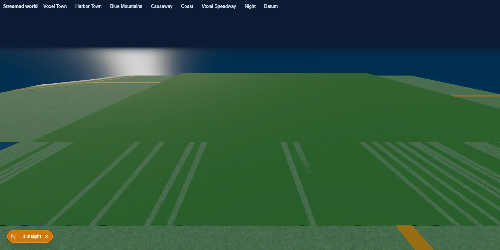
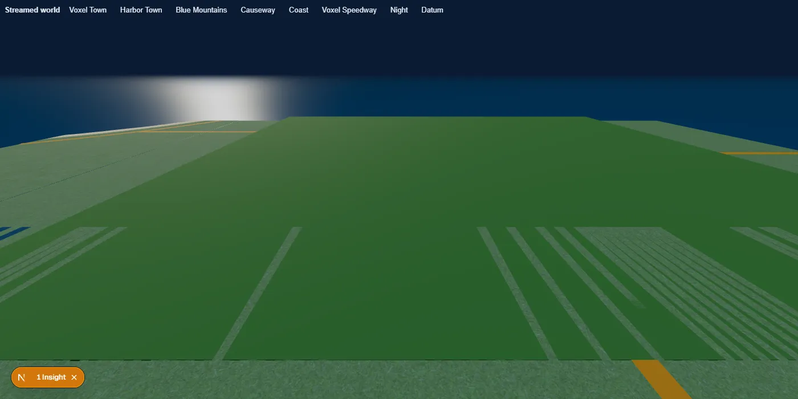
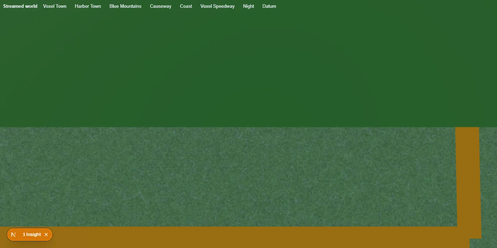

# The world datum

<!-- order: 100 -->

The named heights, the overlay and the town border ([datum.md](../datum.md)).

## datum_a

The datum overlay: a grid at every named height and the legend, at the mainland end of the causeway.

## datum_b

The overlay from a low camera, with the tunnel layers on.

## join_a

The town border as the game had it: a frame of open water round the town's land (the sea showing through).

## join_b

The same gap from the east: the roads end short of the town.

## join_c

After the join: ground all round the town, from above.

## join_d

The join from the east, at a grazing angle (stripes are the development page's depth precision).

## join_e

The join after the underlay was lowered to 0.08.

## join_f

From directly above: the slab, the joined ground and the spur road meeting the slab's edge.
