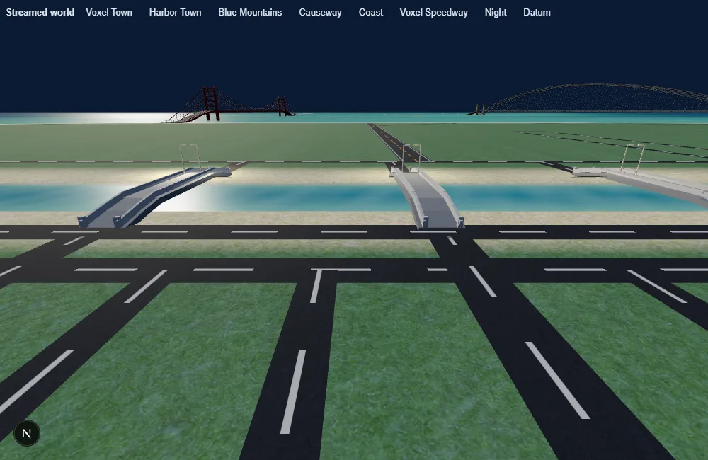
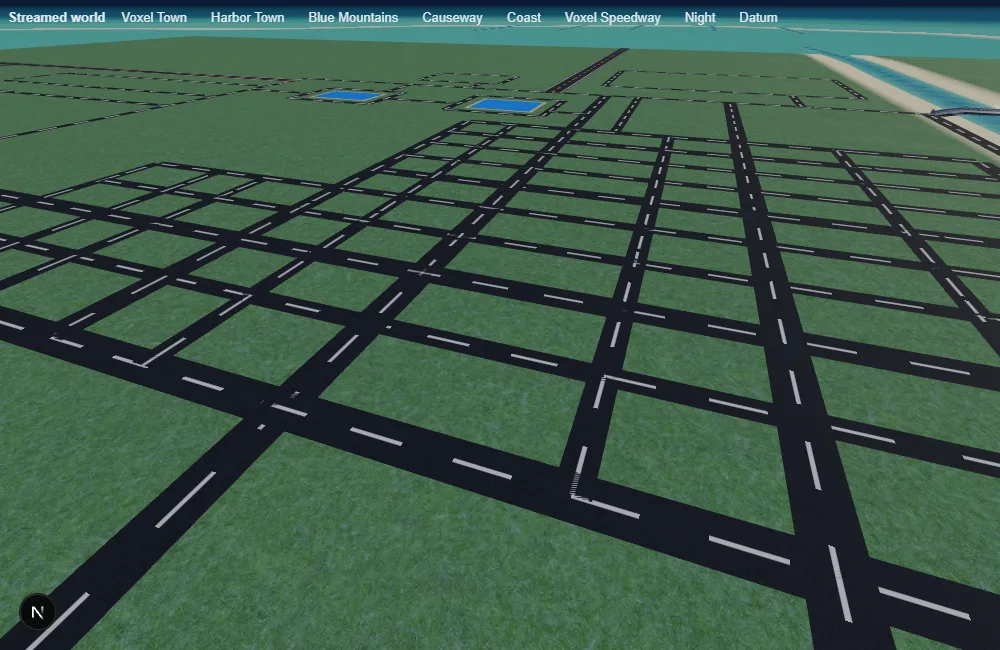
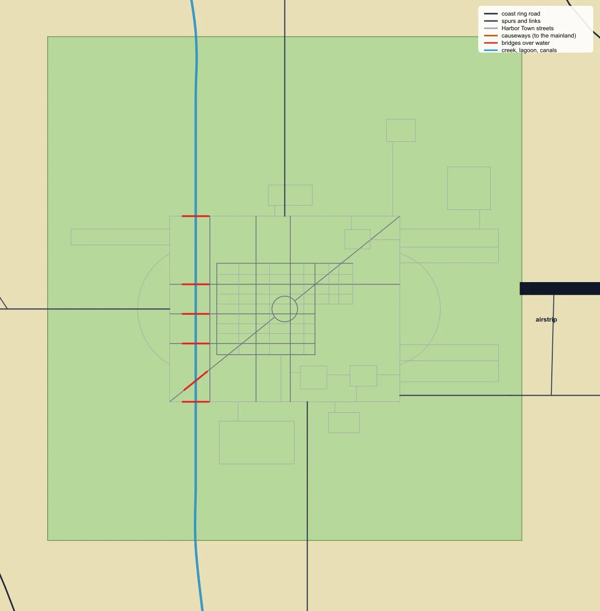
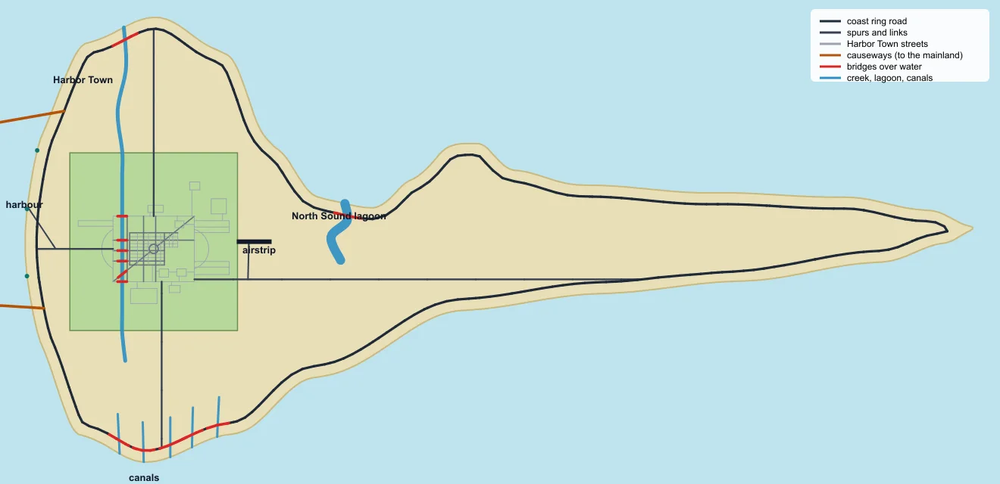

# Harbor Town in the baked world: its creek, its streets over it and its ponds, on the datum

Written for: the owner and developers. Made 2026-11-17. The owner asked for "Harbor Town live and on the datum"; asked what "live" meant, they chose **visible and on the datum**: nothing about the database or claims changes.

## What did not change, on purpose

Harbor Town is still **`live: false` and vacant** ([world_recipe.md](world_recipe.md) section 5, [world_bake.md](world_bake.md)): the game does not load it as a town, the server holds none of its lots (`WORLD_TOWNS`) and none is claimable (`WORLD_OPEN`). A recipe may not be live and vacant at once (the live town's businesses are in the database), and the town's buildings, people, traffic and interiors are the old town's components, which only know the first town. Those are the rest of roadmap tasks 11, 16 and 18. What this adds is what the **streamed world** draws on the island: the town's water.

## What the streamed world draws now

- **Mill Creek runs to the sea** (`lib/world/isleWaters.js`, `MILL_CREEK`). The generator gives the town a river across its land from north to south, 14 units wide and ending at the town's edge. It is now a river like the Rio Minho: a spring 80 units south of the town, **dead straight through the town on the generator's own axis** (within 0.9 of a unit) at the generator's width (`townWidth`, so `widthAt` eases to the creek's own width over 0.15 of its length), and north to the island's north coast about 340 units on (885 units in all, 27 wide at its mouth). It is a baked channel, a ribbon of water and a mouth with foam, like the mainland rivers, at the sea level.
- **The streets cross it on bridges.** In the baked world a town's streets were bare ribbons, so Mill Creek would have run over them. The bake now splits a street (of every town but the first, which draws its own bridges) where it meets a river's channel, as it does a highway: the street, a **low `river-bridge` piece** (1.1 over the ground, a 5-unit ramp, as wide as the street) and the street. Five streets (the three avenues and the two county roads) and the coast road cross it, 9 pieces, each with lamps ([river_plan.md](river_plan.md)). `tests/world-bake.test.mjs` counts a bridge as part of its street's length.
- **The three lakes are ponds.** Duck Pond, Mirror Lake and Reed Lake are in the manifest (`ponds`) and drawn as the first town draws its lakes ([`Lake.jsx`](../../apps/web/components/city/Lake.jsx)): a sandy rectangle 0.012 over the ground and a sheet of water at the datum's **`TOWN_WATER` (0.026)** over it (`lib/world/ponds.js`, mounted by `StreamedWorld.jsx`, `?ponds=0` turns them off). **Raised, not sunk, on purpose**: the datum keeps the town's ponds (0.026) apart from the sea and the rivers (-0.3, a channel cut into the ground) ([datum.md](datum.md)).

## Its own street shapes (2026-11-17)

The generator makes every town on the same plan, so Harbor Town's streets looked like the mainland's. Its baked streets now differ (`lib/world/harborStreets.js`, the recipe's `streetStyle: 'harbor'`): **Harbor Boulevard**, a diagonal arterial from the county ring's north-east corner to its south-west one through the core, with **Harbor Circle**, a roundabout at the middle; and an **East Crescent** and a **West Crescent**, arcs that bulge out of the county ring's sides. They are *added* to the generator's streets, which are untouched (`world.roads` is still 80 roads and every plot id and place is the same: they are a separate `town.streets`), and the first town has none. The bake splits any of them that meets a river, so the boulevard crosses Mill Creek on a bridge like the avenues and the county roads do; the coast road's, the causeways' and the canals' bridges are unchanged.

Not done: the lots (vacant, not drawn) still face the generator's streets, so they do not follow the crescents; when the town goes live its lots will have to be laid out along these streets.

## On the datum

`tests/harbor-datum.test.mjs` already held the ground, the street lifts and the level plots. `tests/harbor-town.test.mjs` adds: the creek is in the manifest at the generator's width and axis, reaches the coast, and has its spring on the island; the channel is cut under the town river; no street of the town is in the water and each crossing street is bridged; the pond sheets are at `waterLevel('pond')` and their sand a hair under; each pond is on land inside the town and away from the creek; the bake's street widths equal the mesh's; and the town is still not live.

## Not done

- The lakes' **piers**, trees and labels are the first town's components; the streamed world draws no pier on a pond.
- **No buildings, people or traffic** (vacant, and the components): see the top of this page.
- The town's old components are still not used for Harbor Town, so none of the first town's quirks (the slab, the underlay) apply: Harbor Town's ground is the baked ground, which the datum test already shows is level (0) over the town land.
