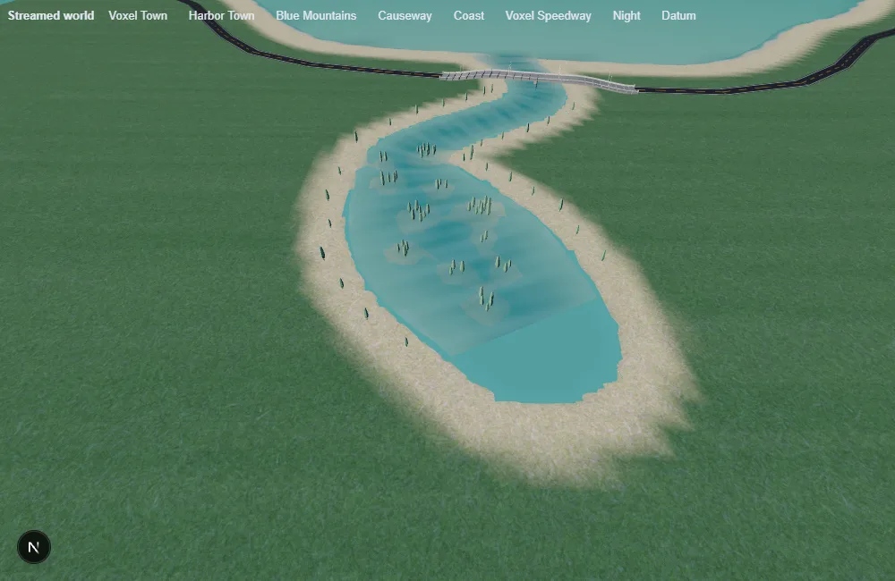
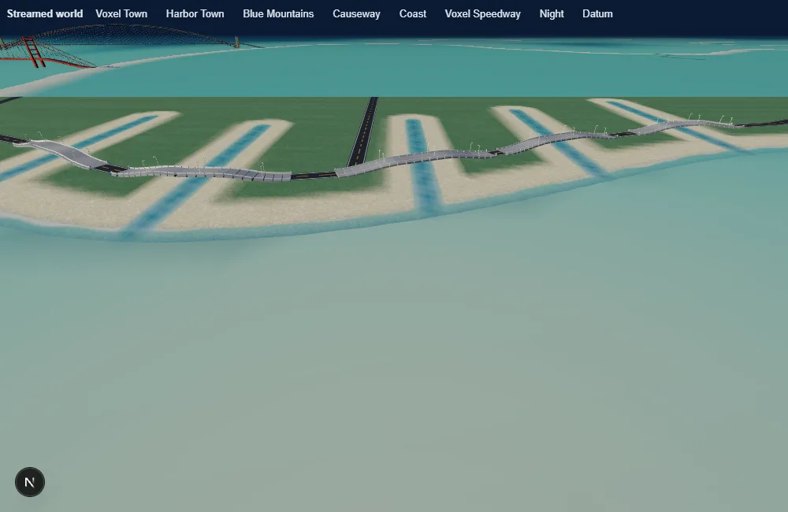

# Harbor Isle's water: the North Sound lagoon, the canals and the mangroves

Written for: the owner and developers. Made 2026-11-17, after the owner said the isle should get canals, a lagoon and mangroves ([river_plan.md](river_plan.md) section 6). Grand Cayman has no permanent rivers, so Harbor Isle's water is the kind the real island has.

## What was built

| | what | where |
|---|---|---|
| **The North Sound lagoon** (`harbor-lagoon`) | a channel from the head of the North Sound, 175 units long, winding south into the island and widening to a pool (about 44 wide, the channel 22); **11 mangrove islands** in the pool and a **fringe of 28 mangroves** along its banks; shallow green water | mouth (2470, 18), pool ends at z = 170, 50 units short of the east spur road |
| **The canal estate** (5 canals: Cutlass, Anchor, Pelican, Mariner, Heron) | straight dead-end fingers 105 units long and 9 wide cut inland from the south coast, 70 apart | the south shore below Harbor Town, x 1870 to 2140 |
| **Bridges** | the Harbor Coast Road crosses the lagoon's mouth and each canal on a river bridge, with the lamps ([river_plan.md](river_plan.md)) | automatic: the bake finds every place a road meets the channel |

## How it works

The island's water is **river-shaped**, so everything the mainland's rivers have works for it unchanged: [`lib/world/isleWaters.js`](../../lib/world/isleWaters.js) plans each as a course from its inland end (source) to the coast (mouth), a kind (`lagoon`, `canal`), a length and a width; `lib/world/rivers.js` adds them to the plan (`plan.isleWaters`) and `buildRivers` bakes them with the 14 mainland rivers (the recipe's `rivers` has their ids). So the channel is a second coast in the ground, the ribbon of water is drawn by `riverWater.js`, a boat can sail them and the ring road is bridged where it crosses.

- **Found, not typed.** The mouths are the nearest points of the coast to a chosen spot, and the courses are checked clear of the town's land, the airstrip and the harbour's piers (`planIsleWaters` reports a problem otherwise), so they follow the coast if it moves.
- **Widths** (`widthAt`): a canal is 9 all along with no flare; the lagoon is 22 with a pool of 44 near its inland end and a slight flare at the sound.
- **Mangroves.** The islands are `deltaIslands` for the `lagoon` kind (14 tried, 11 fit; radius 2.4 to 5.4); they have trees baked like the Black River's. The fringe (`lagoonFringe`) is a tree every 9 units on both banks, 2.6 to 4.8 past the water's edge, from the pool to 72 per cent of the way to the sound (not at the bridge). All are the Racing Kit's `treeSmall`.
- **Still water.** A canal or the lagoon has no surf at its mouth (the river foam is off for them: `fx` mouth factor 0) and a short 12-unit tail instead of 40, and its own palettes (green and clear for the lagoon).
- **The islands rise from further down** in the lagoon (`riverField`): its pool is wider and deeper than a river's channel, so an island needed a larger lift to stand above the water.

## Tests and checks

`tests/isle-waters.test.mjs`: the lagoon and five canals are in the manifest, clear of the town, airstrip and harbour; canals 9 wide and 50 or more apart; the lagoon widens to a pool; the islands are land and have trees; the fringe is the same every bake and baked; the ring crosses each on a bridge and no other road does. The rivers, river-bridge and river-water tests count the island waters.

## Not done

Harbor Town's own creek, Mill Creek, runs through the town to the north coast and its streets are bridged: [harbor_town.md](harbor_town.md).

Nothing is built on the canals' banks (no jetties or moored boats at the canal estate, no houses): Harbor Town is not live. Task 2 (Harbor Town live and on the datum) will decide what stands there.
