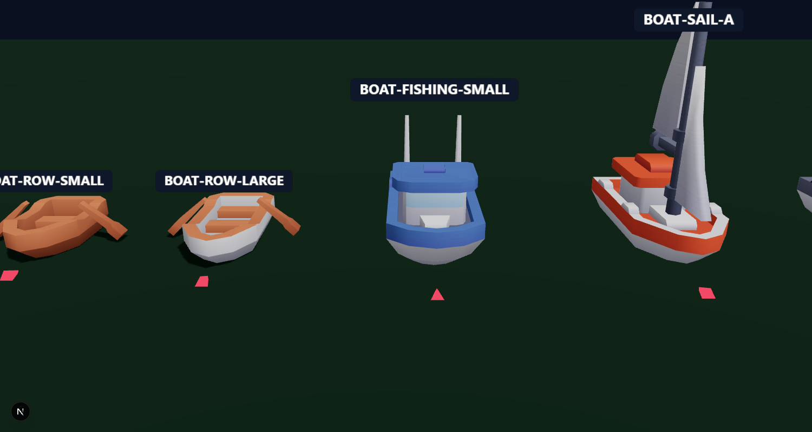
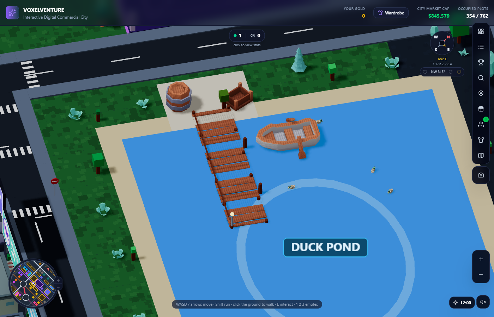
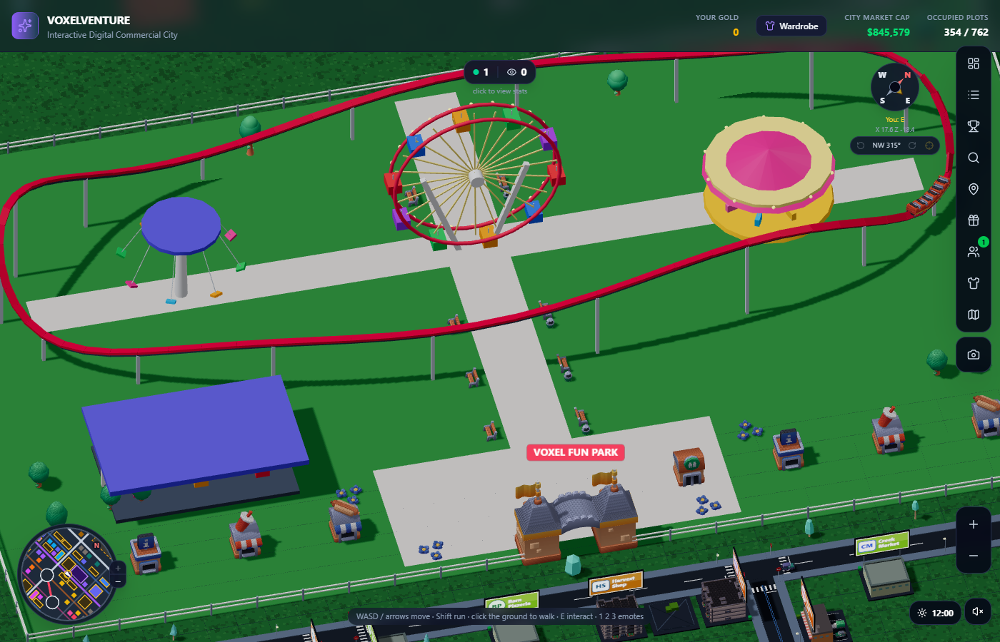
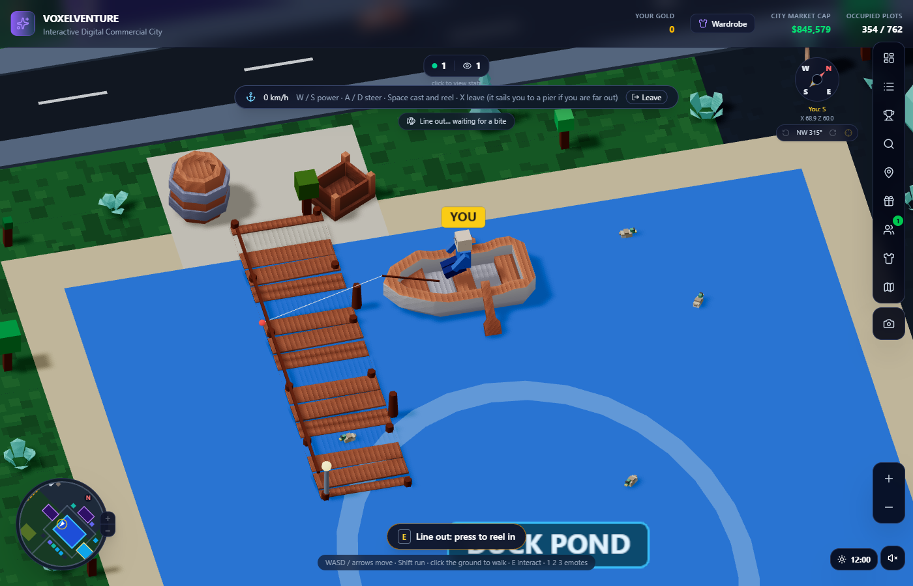

# Real models for the boats, piers and amusement park (Kenney, CC0)

Written for: you, asking whether boats, a pier and amusement-park pieces can come from MagicaVoxel or Kenney instead of boxes built in code. What exists, what was taken, what is still ours.

## What was found
| Need | Source | Licence | Verdict |
| :--- | :--- | :--- | :--- |
| **Boats** | Kenney **Watercraft Kit** (45 models: rowboats, a small fishing boat, sailboats, speedboats, tugs, ships, buoys, ramps) | CC0 | **Used.** Row boat (small and large) and the fishing boat. |
| **Pier / dock** | Kenney **Pirate Kit** (platforms and docks on legs, planks, barrels, crates, boats) | CC0 | **Used.** The platform slab is the pier deck; barrel and crate stand on the landing. |
| **Amusement park** | Kenney **Coaster Kit** (180 files: six kinds of coaster track, trains, supports, park entrance, stalls, station, queue and path tiles, benches, trees) | CC0 | **Used** for the gate, the stalls, the train, benches, trees, flowers and bins. The track is still ours (see below). |
| **Ferris wheel, carousel, swings, bumper cars** | no CC0 set found. A free ferris wheel exists on Poly Pizza (Poly by Google, **CC BY**: needs a credit, and a different look); no carousel found. MagicaVoxel packs found were paid or had no clear licence. | | **Still built in code.** |

MagicaVoxel: the searches found no free pier, boat or ride set with a clear licence (several paid packs). It remains the tool for **our own** landmarks (the plan in [scope_assets_and_wasm.md](../roadmap/scope_assets_and_wasm.md); the first, such as the mall and the monument, are in `apps/web/public/models/vox/`); a ferris wheel and carousel are the obvious first two to model, about a day each.

## How they are used
- **Import**: `node scripts/models/import-props.mjs <folder with the unzipped kits> --only watercraft,pirate,coaster` copies the chosen models into `apps/web/public/models/kenney/` (54 models, about 1.6 MB with their textures, all small: 50 to 1,000 triangles each) and updates `lib/content/propCatalog.js` and the credits (`apps/web/public/models/CREDITS.md`). The other kits in the catalog are kept.
- **Loading**: the same loader as the trees and cars (`apps/web/components/city/PropModels.jsx`); each model is loaded once and shares one colour texture per kit. A new `PropModel` draws one model; **until it has loaded (or with `?models=0`) the old box version is drawn**, so nothing is ever missing.
- **Boats** (`lib/content/boatModels.js`): each kind has a model, a scale, where the avatar sits, how far the rod reaches, and how deep the hull sits. The generator gives each moored boat a kind (rowboat, large rowboat, fishing boat). The server accepts those kinds for other players' boats.
- **Piers** (`apps/web/components/city/Piers.jsx`): slabs of the platform along the deck on a dark base, our posts, mooring posts and lantern, a barrel and a crate on the landing.
- **Amusement park** (`apps/web/components/city/AmusementPark.jsx`): the entrance with towers and flags at the gate, four kinds of stall, the three-car coaster train on our track, benches along the main path (facing it), trees, flower beds and bins. The solids (benches) are in `lib/city/amusement.js`.
- **Preview page** `/models` (development only; every model rests on the floor and is centred): every catalogued model at its real size with its name and an arrow showing which way it faces; `?kit=coaster` shows one kit and `?cam=x,y,z,tx,ty,tz` sets the camera.

## What is still ours, and why
- **The coaster track**: Kenney's track is made of grid pieces (straights, curves, hills) that need a layout designed piece by piece. (In the first preview they seemed to be missing: they are modelled with their origin at the top of the track, so they sit 1 unit *below* the floor, `y0` -1 in the catalog, and the preview did not lift them. The import now measures every model as it is drawn, the preview rests each one on the floor, and a test checks that every model the game places has `y0` 0.) Ours is one smooth loop with hills that fits the park; the Kenney train sits on it. A track built from Kenney pieces is a day's work if you want the exact look: lift each piece by 1.
- **Ferris wheel, carousel, swings, bumper cars**: no free set (above). They keep the Kenney palette's bright colours.

## Credits and size
All three kits are **CC0** (no credit required; they are credited anyway: per model in `apps/web/public/models/CREDITS.md`, and with the other Kenney kits in the root `CREDITS.md` and the in-game Credits panel, both from `lib/content/credits.js`, checked by `tests/credits.test.mjs`). The models add about 1.6 MB to the files the game can load (loaded only when needed, a few KB each).

Tests: `tests/kenney-models.test.mjs` (every model the code names is in the catalog and on disk with its texture, boat sizes and seats, the entrance and pier slab fit the layout, the credits) and the "Kenney models" checks in `tests/browser.test.mjs` (they load and are in the scene).

## Airports
### The terminal seam (fixed 2026-10-21)
The terminal is a row of Kenney building "wings" (`terminalWings` in `lib/content/models.js`, drawn by `TerminalModels` in `apps/web/components/city/Airports.jsx`). The owner saw a dotted, flickering seam along Voxel International's facade. Two causes, both z-fighting:
- **The box terminal stayed drawn round the models.** The airport is baked into merged meshes once, when it mounts (`StaticBatch`); the box terminal (the stand-in while the models load) was inside the batch, so its baked copy outlived it, its walls in the same planes as the models' walls. The terminal is now drawn beside the batch, and the batch is baked again when the parked planes' models arrive.
- **Wings edge to edge.** Neighbouring wings put their end walls and roof trims in one plane. They now stand `WING_GAP` (0.12) apart, the model shrunk a hair along the row (the same stock model the game chose before), with a slate joint in each gap: a plain box a little inside the wings' sides and top and 0.06 into each wing, so no faces coincide and nothing shows through. It reads as an expansion joint.
`tests/airport-models.test.mjs` checks the gaps and joints for every terminal of three cities. The hangars (one box and a wider roof slab) had no coinciding faces.

### Plane models
The planes are primitives until three CC BY 4.0 models are added: "Low Poly Passenger Aircraft" by Crimexix (the parked airliner), "Low-poly Stylized Aircraft" by mithgarden.studio (the banner planes) and "Cargo plane (voxel)" by StarlyRD (the second parked plane at the international airport). The table is `lib/content/planeModels.js` (`PLANE_MODELS`, `PLANE_ROLES`: which airport and role uses which model, its length, an optional span cap, a yaw that points the nose along +Z, an optional recolour). The parked planes (`ParkedPlane` in `Airports.jsx`) and banner planes (`Planes.jsx`) draw the model through `PlaneModel` (`PropModels.jsx`, the prop loader the boats use), fitted and centred; **while a model is not in the prop catalog, has not loaded, failed to load, or with `?models=0`, the primitive plane is drawn.** The banner planes keep their flight animation (the model sits in the same moving group); the spinning propeller is the primitive's only.

To add them:
1. Download the GLBs into `incoming-models/` (git-ignored).
2. **Convert** each into `incoming-models/airport/airliner.glb`, `small-plane.glb`, `cargo-plane.glb` (Blender or gltf-transform): one self-contained `.glb`; transforms applied; Y up; **no Draco, Meshopt or KTX2** (the loader has no decoders); under 3,000 triangles; size does not matter (the table fits it). Prefer plain material colours (no texture): they are baked into vertex colours, all parts merge into one mesh, and the table's recolour works. An embedded texture also works (the import marks it `ownMaterial`), but then the whole model must use that one material and recolour does nothing.
3. **Import**: `node scripts/models/import-props.mjs incoming-models --only airport` copies them to `apps/web/public/models/airport/`, adds `airport/airliner`, `airport/small-plane`, `airport/cargo-plane` to `lib/content/propCatalog.js` (size, centre, floor, triangles) and the CC BY line to `apps/web/public/models/CREDITS.md`. The import needs a World-freeze exception trailer (new files under `apps/web/public/models`).
4. **Orient and size**: open `/models?kit=airport`; set each row's `yaw` so the nose points along +Z (the preview's arrow), and `recolor` if wanted (`{ from: '#rrggbb', to: 'body' | 'trim' | 'tail' | '#rrggbb' }`).
5. **Credit** (CC BY needs title, author, source link and licence): an entry in `lib/content/credits.js` (3D models section) and the root `CREDITS.md` (`tests/credits.test.mjs` checks they agree), and a **licence snapshot** in `docs/licences/models/`: each model's source page saved as HTML on the download date, the CC BY 4.0 legal text, and a README with source URLs, the download date, file hashes and what was changed (converted, resized, recoloured), like `docs/licences/music/`.
6. Run `node tests/run.mjs airport-models kenney-models credits` and the browser tests.

