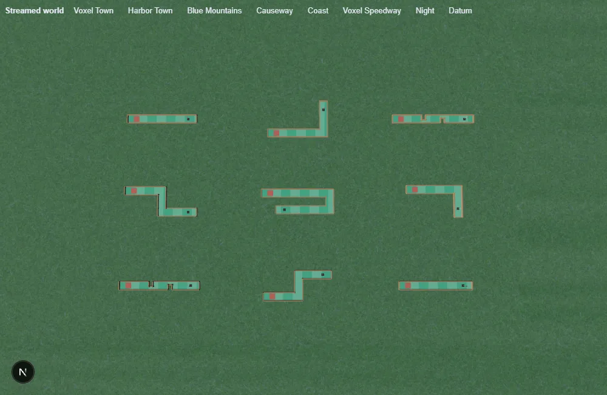

# Harbor Mini-Golf

Written for: the owner and developers. Started 2026-11-18, after the owner asked for the mini-golf course next. **What is built is the course, its place in the world and the ball's physics; putting in the game (aiming, power, scoring) and the Kenney Minigolf Kit's models are not.**

## What is built

- **The course** (`lib/world/minigolf.js`): nine holes on a grid, made from a seed (`COURSE`, `KINDS`): straight, dogleg, blocks (two 2 x 2 blocks in the lane, on alternate sides), zigzag and a lane that doubles back. A hole is **a set of cells** (0.8 units each; a lane is 3 cells, 2.4 units, wide): the felt is the cells, the walls are the edges between the felt and the rest merged into runs (`boundaryRuns`), the blocks are cells left out. Par is 2 to 4 (28 for the course). The tee is two cells in from the start (a red mat), the cup (0.42 radius, a black quad) two cells in from the end, with a pole and a red pennant.
- **Its place** (`recipe.courses`, `buildCourses`): `harbor-minigolf` on Harbor Isle at (2360, 345), 150 x 96 units, in the flat land south of the east spur road, east of the town and clear of the lagoon. Like the racing track, the recipe is refused if the site is not flat land, within 40 of the coast, 14 of a highway, 40 of a river or touches a town.
- **Baked** (`lib/world/bake.js`): the felt, mats and cups are painted quads in the chunks' `surface` (the circuit's palette, which gained `felt`, `felt-light` and `mat` at the end: the circuit's indices are unchanged), the walls and flags boxes in the chunks' `structures` (drawn with the bridges' boxes). The manifest's `courses` carries each hole's par, tee, cup, bounds and **walls** (`[ax, az, bx, bz, nx, nz]`) for the game to play. 318 quads, 86 boxes, about 4,200 triangles.
- **The ball** (`lib/world/golfPhysics.js`): pure and deterministic. A putt (`putt(ball, angle, power)`) up to 14 units a second; friction 2.4 plus a little drag slow it; it bounces off the walls (62 per cent of the speed) and is pushed out of them; the cup takes it when it is over it slower than 6 units a second (faster it skips over; it may rebound off the end wall and drop in); it stops below 0.12. Four physics steps of 1/240 s to a frame, so a fast ball cannot pass through a wall. A hole not finished counts par + 4.
- **Tests** (`tests/minigolf.test.mjs`): the same seed gives the same course; every hole's lane is one piece from tee to cup and every edge of it has a wall; holes do not touch; the quads face up; a soft putt rolls and stops, the same putt always rolls the same, some power along the lane sinks, the cup refuses a fast ball and takes a slow one, a putt at a side wall stays in the lane, **2,250 random putts never leave their hole**; and the baked course is in the manifest and the chunks, on flat ground, clear of the town.

## What is not built

1. **Playing it.** A person walks to a tee, aims, sets a power and putts: the input (keys, a drag, touch), the ball's drawing (a sphere on the felt), the stroke count, the scorecard and the finish. The physics is ready for it. Design to decide with the owner: a prompt at the tee mat (like boarding the train), A and D to aim and a held key for power (and a drag on touch), one player at a time on a hole, the score kept on the player's profile or not at all, and whether a hole's best score gives anything (it should not give Gold or income without the owner's say).
2. **The Kenney Minigolf Kit.** The kit (CC0, 125 files) is not in the repository and kenney.nl's download is behind a button that a script cannot press: **it needs downloading by hand** (kenney.nl/assets/minigolf-kit, "Continue without donating"), unpacking into `apps/web/public/models/kenney/minigolf/` and adding to the asset register (`lib/content/assetSources.js`: the Kenney entry, `budget: 'prop'`), with its licence file in `docs/licences/kenney/`. Then the boxes (walls, flags) can be replaced by the kit's models on the same layout (the cells make 0.8-unit pieces, which the kit's 1-unit pieces would be scaled to), as the ports' boxes were (the `replaced` tag), with the boxes kept for a phone.
3. **More courses, and the course's look in the world**: a car park, a clubhouse, a path from the east spur road, signs with the hole numbers (`Label3D`).

## Why a grid of cells

A set of cells makes a hole of any shape without geometry code: the felt, the walls and the ball's faces all come from the same edges, so they cannot disagree; a block is a cell left out; and a new kind of hole is a new list of legs. The cost: walls are axis-aligned (no curves), which the kit's pieces also are mostly.
