# Harbor Mini-Golf

Written for: the owner and developers. Started 2026-11-18, after the owner asked for the mini-golf course next. **The course (of the Kenney Minigolf Kit's tiles), its place in the world and the ball's physics, then putting, scoring, aiming by dragging, a gamepad and two players.**

## What is built

- **The course** (`lib/world/minigolf.js`): nine holes on a grid, made from a seed, **built of the Kenney Minigolf Kit's own tiles** (the 1-unit tile scaled by 3: a lane 2.4 wide between walls 0.3 thick, the felt 0.19 and the walls 0.44 over the ground). A hole is a path of tiles: an **end** tile behind the tee, **straights**, **corners** where it bends, and the rounded **hole-round** tile with the cup at the end; some holes have an **obstacle-block** (a bar in the lane), the **windmill** (hole 4, the centrepiece, with its arch to find) or the **castle** gate (hole 9). The nine kinds are `straight`, `dogleg`, `block`, `windmill`, `uturn`, `zigzag`, `block`, `dogleg`, `castle`; the seed varies the lengths and the turns. Par is 2 to 4 (28 for the course). A hole is at most 16 x 8 tiles (48 x 24 units); a hole of eight tiles is a long putt of about 21 units.
- **The ball sees what you see.** The walls the ball bounces off (`segments`) are the tiles' own inner faces, taken from the kit's measurements (a straight's walls at 0.4 of the tile from its middle, the corner's two, the round end's half circle, the bar, the arch's two blocks: 0.17 of the tile either side for the windmill, 0.2 for the castle), turned with each tile. So the windmill's body stops a ball and its arch lets one through (a test).
- **Its place** (`recipe.courses`, `buildCourses`): `harbor-minigolf` on Harbor Isle at (2360, 345), 150 x 96 units, in the flat land south of the east spur road, east of the town and clear of the lagoon. Like the racing track, the recipe is refused if the site is not flat land, within 40 of the coast, 14 of a highway, 40 of a river or touches a town.
- **Baked** (`lib/world/bake.js`): each tile and flag is a prop in its chunk (`golf-straight`, `golf-corner`, `golf-end`, `golf-hole-round`, `golf-obstacle-block`, `golf-structure-windmill`, `golf-castle`, `golf-flag-red`), instanced by the chunks' prop machinery and loaded by `StreamedWorld.jsx` (`GOLF_MODELS`: 8 small files, 108 models on the course, the tiles 12 to 148 triangles each). **The fallback**: the felt and walls as plain boxes tagged `2` in the chunks' `structures`, hidden once the models are loaded (`hideGolf`, like the ports' `replaced` tag), so a device that cannot load the kit still sees a course; the red tee mats are boxes always (the kit has none). The manifest's `courses` carries each hole's par, **first direction (`aim`)**, tee, cup, bounds and walls (`[ax, az, bx, bz, nx, nz]`) for the game to play.
- **The ball** (`lib/world/golfPhysics.js`): pure and deterministic. A putt up to 14 units a second; friction 1.5 plus a little drag (a full putt rolls about 35 units, more than the longest hole); it bounces off the walls (62 per cent of the speed) and is pushed out of them; the cup (0.3 radius) takes it when it is over it slower than 6 units a second (faster it skips over; it may rebound off the end wall and drop in); it stops below 0.12. Four physics steps of 1/240 s to a frame, so a fast ball cannot pass through a wall. A hole not finished counts par + 4. `previewPath` runs the same physics for the aim indicator.
- **Tests** (`tests/minigolf.test.mjs`): the same seed gives the same course; each hole is a connected, non-crossing path of tiles from the end tile to the round cup tile, with its obstacle where its kind says and its turns valid; holes fit and do not touch; walls have lengths and unit normals and lie inside their hole; every model is in the kit's list and its file is in the repository; a flag at every cup; a soft putt rolls and stops, the same putt always rolls the same, some power along the lane sinks, the cup refuses a fast ball and takes a slow one, **a putt along the lane goes through the windmill's arch to the cup and one that is not lined up is stopped**, **2,430 random putts never leave their hole**; and the baked course (tiles as props, boxes as structures) is in the manifest and the chunks, on flat ground, clear of the town.

## Playing it

- **Starting.** Walk to a tee mat (within 3.2 units): the interaction prompt says "Play hole N of Harbor Mini-Golf (par P)" (E, or tap it, like boarding the train). Refused in a vehicle. You stand a step behind the ball, facing along the lane; the panel appears (`components/ui/GolfHud.jsx`). `?golf=0` leaves the whole thing out.
- **Three ways to aim and putt** (`components/world/MiniGolf.jsx`):
  - **Drag** (a mouse or a finger): press anywhere on the world and **pull back from the ball, as on a slingshot**; the aim is the other way (turned by the camera's heading), the pull is the power (170 pixels is full); the aim arrow, the yellow **path preview** and the panel's indicators follow while you pull; let go to putt (a short pull, a tap, putts nothing).
  - **Keys:** A and D or the arrows turn the aim (1.6 radians a second), **hold Space** to charge the power (a second from nothing to full) and let go to putt.
  - **Gamepad** (the Gamepad API: the first controller found): the left stick or the pad's left and right turn the aim, **hold A or the right trigger** to charge and let go to putt, B puts the club away, A or Start goes on after a hole.
  - On a phone or with a mouse the panel also has aim-left and aim-right buttons and a **Hold to putt** button. Esc, or "Put the club away", ends it.
- **The indicators**: an **angle dial** (the way to the cup straight up as a green dot, your aim as the yellow line) with the degrees off the cup (`+12° off the cup`), a **strength bar with its percentage**, and in the world the arrow (it grows and goes from green to red with the power) and the **preview of the path the putt would take**, bounces included (the real physics, `previewPath`).
- **The ball**: the kit's red ball, scaled to the physics ball. Every frame the store steps the physics; when the ball stops short you aim again from where it lies, looking at the cup; when it drops, or after **8 strokes** it is picked up, the hole is done. While you play A and D do not walk the avatar and the avatar is kept at the ball (`hold`).
- **Two players on one device**: before the first putt of hole 1 the panel offers "Play with a friend (turns, one device)". The two take turns on each hole (the first plays it out, then the second from the tee: the panel names whose turn it is), there is a card each, and at the end the lower total **wins** (or a tie). A one-player round keeps this device's best; a two-player round does not.
- **Scoring** (`lib/world/golfScore.js`): the hole's score is its strokes (a pick-up counts at least par + 4); its name against par (Hole in one!, Albatross, Eagle, Birdie, Par, Bogey, Double bogey...); the card is nine holes with the total against par. The one-player best is kept in `localStorage` (`voxelventure-golf-best`): nothing is sent to the server, **no Gold or income is given**.
- **Tests** (`tests/golf-play.test.mjs`): the scoring words and totals, the best kept only when beaten, a tee found within its range, no golf from a car, the player behind the ball, aiming at a speed, power charging over a second, no putt without charging, no second putt while it rolls, a ball putted to the cup with the card kept, a ball picked up at the limit, a nine-hole round to the card and the best; **the drag** (a pull aims the other way, its length is the power, it follows the camera's heading, letting go putts, a tap does not), **the preview** (it does not move the ball and ends where the real putt ends) and **two players** (the turns, the cards, the winner, a tie, no best for two).

## The Kenney Minigolf Kit

Downloaded on 2026-11-18 from kenney.nl/assets/minigolf-kit (3.1, CC0, 125 files) through the page's own "Continue without donating" button (driven in a real browser: a plain script is refused). **In the repository so far**: three balls, three clubs, three flags and the colour map in `apps/web/public/models/kenney/minigolf/`, registered in `lib/content/assetSources.js`, credited in `CREDITS.md` and `apps/web/public/models/CREDITS.md`, with the licence in `docs/licences/kenney/License-minigolf-kit.txt`. The other 117 pieces (straights, corners, ramps, windmill, tunnels, gates, castle, hills, supports) are not committed: they are what the course will be dressed with next (below).

## What is not built

1. **The park**: built (below).
2. **Shared scores**: built (below). Over a golfer's head, under their name, a small green tag with the hole and how they stand ("Hole 4 · +1"; `RemotePlayers.jsx`).
3. **The rest of the kit**: ramps, hills, bumps, tunnels and the other 100 pieces are not in the repository; the cell grid of the first version was replaced by the kit's tile grid (a tile = 3 units), so a hole is now made of whole tiles.
4. **A mobile pass** (the triangle count; the controls are done, see On a phone): the tiles are 12 to 148 triangles (about 6,000 for the course), drawn only where the chunks are mounted; the fallback boxes (427) are only drawn without the models. Not measured on a phone.

## On a phone (built 2026-11-18)

Designed for thumbs: the controls sit in the bottom corners, where the thumbs rest, and every one is at least 56 px. **Left**: a turn each way (held to keep turning) with the angle dial and the degrees off the cup between them. **Right**: one 112 px round button, **held to charge and let go to hit**, the power filling a ring round it and shown as a number. A **drag back from the ball** anywhere on the world still aims and sets the power in one move, as on a desktop. Behind the dock the game's own touch controls get out of the way while you play: the walking joystick and its buttons are hidden (the walk is held at the tee anyway), as is the clock and sound corner; the top panel keeps the hole, the strokes and the card. The desktop panel's own controls are hidden on a phone (`max-sm`); the dock is `sm:hidden`. The dock is `PhoneDock` in `apps/web/components/ui/GolfHud.jsx`.

## The web version (built 2026-11-18)

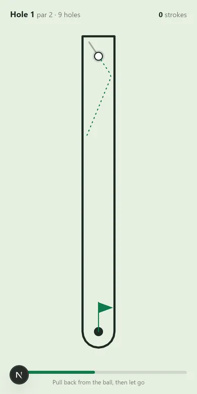

`/golf` is the same course, physics, scoring and saved leaderboard on a page of its own with nothing else on it (`apps/web/app/golf/page.jsx`): a plain light page, each hole drawn from above in line art (the walls, the tee, the cup with a flag, the ball), the hole's name, par and strokes in a thin header, the power as a thin bar. **One input**: pull back from the ball and let go (a slingshot: the dotted line is where the putt goes, bounces included, and how far it rolls); A and D turn the aim and Space putts, for a keyboard. A long hole on a tall screen is **turned a quarter** so it runs down the phone. After a hole, one button; after the ninth, the card, the rank if you are signed in, and the top five. It reads the baked manifest's course and uses the same store (`lib/state/golfStore.js`), so a round there is saved to the leaderboard exactly as one in the world is. Nothing is rendered in 3D, so it works on any device that can draw a canvas.

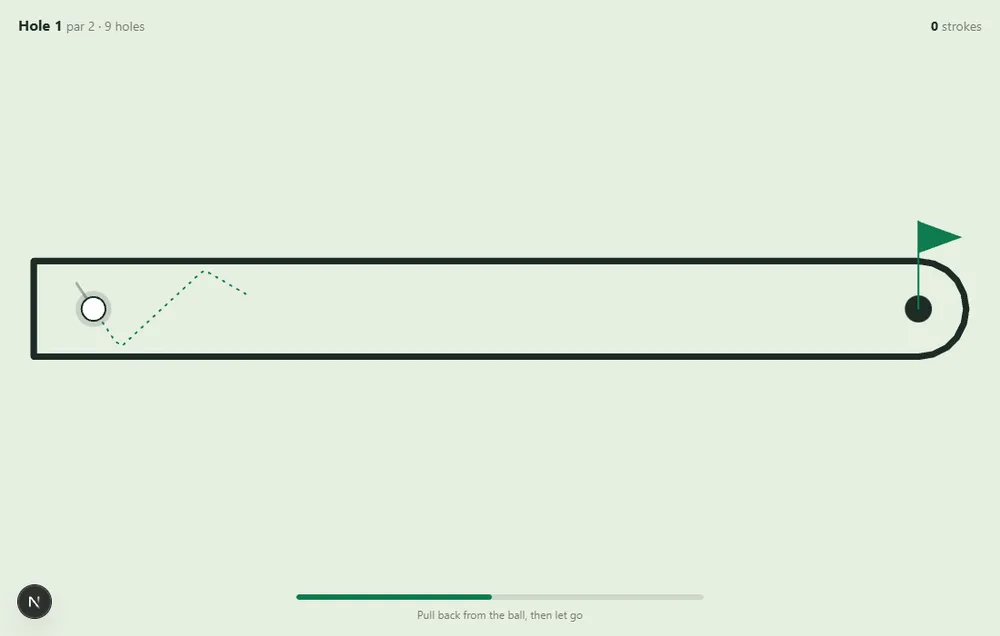

## Shared scores (built 2026-11-18)

- **Nearby, live**: a golfer's progress, `[hole, strokes on the hole, strokes on the card, against par]`, rides on the presence message (`golf`, the ninth item of a player's short array; `cleanGolf` in `services/multiplayer/server.mjs` keeps only four whole numbers in range and drops the rest; it stops when they stop playing). The HUD lists the people near who are playing ("Playing here now", `golfersNearby()` in `lib/net/multiplayer.js`). Nothing is saved: it is gone when they leave.
- **Saved leaderboard** (`services/api/golf.mjs`, table `golf_rounds`; the same rule as the racing track: the server decides). A signed-in player's finished **one-player** round goes to `POST /golf/round` as the **putts** (for each hole, each putt's angle and power in whole thousandths), never a score. The server plays them again on its own copy of the course with the same physics and keeps the strokes that come out; a round that does not replay (a putt after the ball dropped, a hole not finished, a power or count out of range, a ball that never stops) is `422`, and a second round within 20 seconds of the last is `429`. `GET /golf/leaderboard?course=&limit=` (public) is each account's best round, fewest strokes first; `GET /golf/me` is the player's best, rank and last ten rounds. The card shows the rank ("New best on the leaderboard: rank 2"). Two-player rounds are not saved; guests and games without a server keep only the device's own best.
- **The clubhouse board**: the LEADERS board in front of the clubhouse shows the top three (rank, name, strokes, against par), read from `GET /golf/leaderboard` when the course loads and again after you save a round (`MiniGolf.jsx`); "NO ROUNDS YET" when it is empty. Without a game server (no `NEXT_PUBLIC_LIVE_API_URL`) it stays a plain sign.

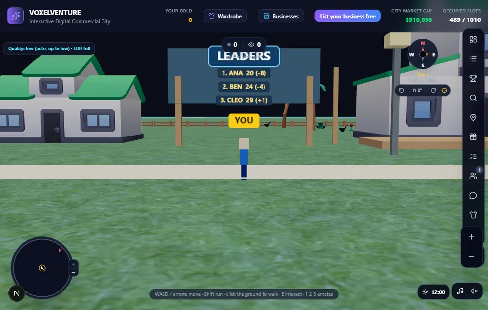
- **Why it can be trusted**: the physics only takes whole steps of 1/240 s whatever the frame time (`ball.acc` in `stepBall`), and the page quantises each putt before it hits, so the page and the server roll the same ball (`tests/golf-api.test.mjs` plays a round in 60 frames a second and in the server's replay and compares the cards). The putts, not a score, are what the page may say, so the board cannot be written to except by putting.
- **Privacy**: nothing new is stored on the device; the server keeps the account's rounds (strokes, par, card, time) as it does lap times, and the board shows the username.

## The second nine: The Adventure Loop (built 2026-11-19)

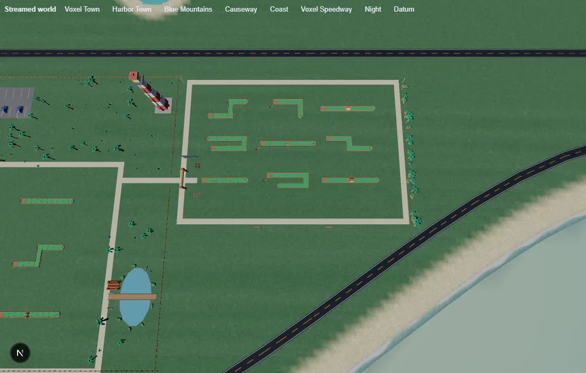

The park's second course, **`harbor-adventure`, "The Adventure Loop"**: nine more holes, on their own scorecard and their **own leaderboard** (each course has its own board; the server needs no change: `courseOf(id)` knows it, and a round replays against it). It is what the first park's design called for: a second, **harder** nine, themed (a pirate's yard), joined to the first.

- **Where**: the flat land **east of the park** (the strip kept west of the first nine was 36 x 60, too small for nine holes, and the land west is Harbor Town's), centred at (2550, 281), 120 x 78 units, found by mapping what is clear of the coast, the highways, the rivers and the town (`buildCourses` still refuses it if it is not). **A path from the first park's loop runs through a gap in its east fence** to an **arch** with the name over the way in; the path goes on to a **loop round the nine holes**.
- **The holes** (`LOOP` in `lib/world/minigolf.js`; the same kit, tiles, walls and physics): a tighter layout (holes 36 apart across and 22 down, so nine fit) and harder holes in this order: zigzag, dogleg, windmill, U-turn, **castle**, zigzag, block, U-turn, windmill. **Par 31** to the first nine's 28, with more turns and more things in the way (two zigzags, two U-turns, two windmills and a castle). 116 tiles.
- **The grounds** (`generateLoopGrounds` in `lib/world/golfPark.js`, the same shape as a park so the bake and the game treat it alike): the arch (posts, a lintel, "THE ADVENTURE LOOP"), a **LEADERS board of its own** (the top three of this nine, read from the server like the clubhouse's), a **pirate's yard** of barrels and crates at the entrance and a barrel and a crate by every third tee, benches, four lamps that glow at night, palms, rocks and bushes round the edge. Nothing stands on the holes or the loop.

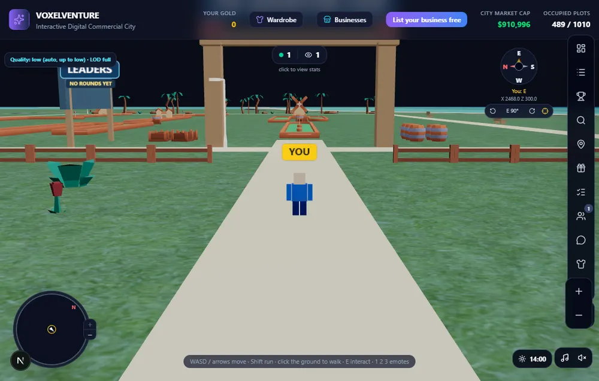

- **Playing it**: at a tee the prompt names the course ("Play hole 1 of The Adventure Loop (par 4)"); the store (`lib/state/golfStore.js`) now holds every course (`courses`, `setCourses`, `teeNear` looks across them, `start(n, { course })`), so the HUD, the card, the live scores and the saved round all follow the course being played. `/golf` plays the first nine, or `/golf?course=harbor-adventure`; after a round the card offers the other nine.

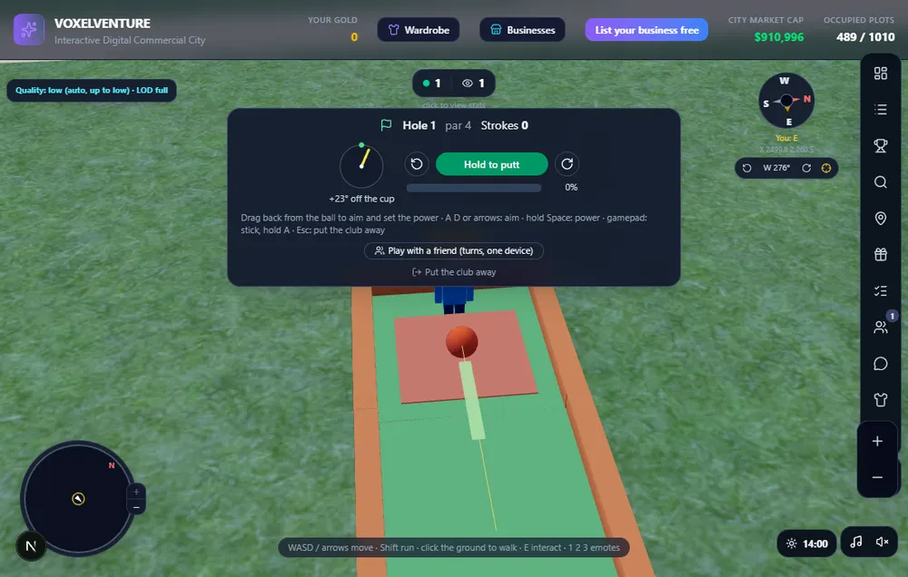

- **Tests** (`tests/golf-loop.test.mjs`): the second nine is harder (par, turns), its grounds stand clear of the first park but for the way in, the paths meet through the gap in the fence and loop round the holes, the arch and the board are there, **every hole can be holed** (a search that aims down the lane), a round of it **replays on the server and has its own board** (and the first nine's stays empty), and it is baked, every tile.
- **Not done**: the cars and the clubhouse are the first park's (no shop or rest spot at the second); a round's card does not say which course on the live-scores list; two-player rounds are still not saved.

## The park (built 2026-11-18)

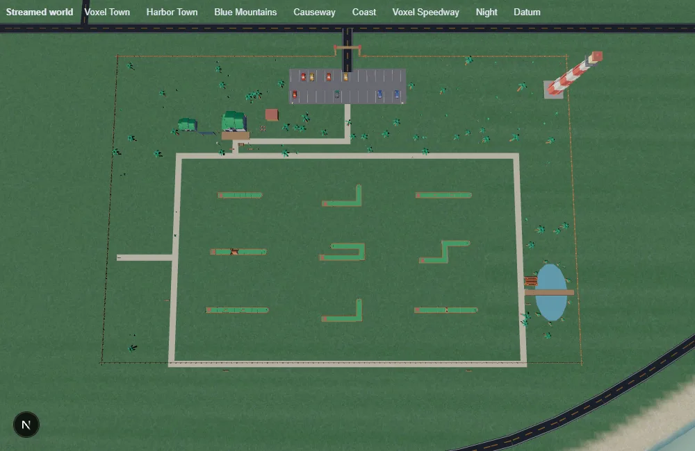

Agreed with the owner: **"Golf park: course + clubhouse + landscaping", a Caribbean-harbour theme, nine holes laid out so a second nine can be added** (now built: below). The design came from the research (golf and theme-park practice: circulation first, a landmark seen from far away, the car park near the clubhouse and the first tee, a rest and let-through spot, service areas out of sight, and Disney's two courses where the harder mirrors the easier). It is made by `lib/world/golfPark.js` from the course and the highways, baked by `lib/world/bake.js`, and tested by `tests/golf-park.test.mjs`.

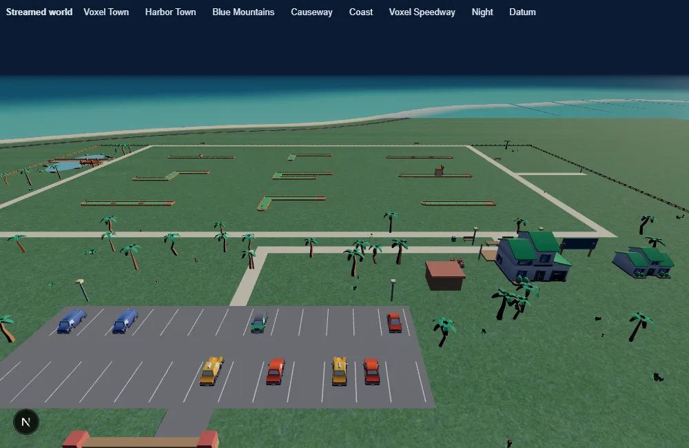

- **Arrival**: the **access road** (6 wide, a link road baked as `harbor-minigolf-road`) leaves the nearest highway (the east spur road, 18 units north) for the **gate** (two posts, a lintel and a "HARBOR MINI-GOLF" sign), and a **car park** (64 x 20, bay lines, eight cars of the Car Kit parked at random in about a third of the bays: a quiet course).
- **The clubhouse** (the Suburban Kit's house, scaled 9.5, with a porch, a CLUBHOUSE sign and a **LEADERS board** in front of it that will show the saved leaderboard) stands beside the first tee, a small shop beside it and a service shed with barrels behind its side; a path runs from the car park along its front and to the loop at the first tee.
- **The loop**: a path 3.2 wide round the nine holes, 5 units out from their walls, in the order of play; benches along it; the **rest and let-through spot** by the windmill hole (hole 4: two benches, a picnic table, a bin).
- **Landmarks**: the **lighthouse** (red and white bands, a lantern room and roof, 32 high, the "HARBOR LIGHT" sign) in the north-east corner, the first thing seen from the spur road; the **pond** (14 painted triangles, rocks round it) with a **footbridge** from the loop's east side across it and the **wrecked jetty** (the Pirate Kit's dock) on its west shore; the windmill and the castle on the course.
- **Planting and edges**: a fence of the Nature Kit's pieces all round but at the gate (313 pieces), 46 palms, 60 bushes and flowers, five street lamps (the Racing Kit's `lightPostModern`, as along the track) along the car park and the clubhouse path: **their heads glow at night and each throws a pool of light** (the same night lights as the track's).

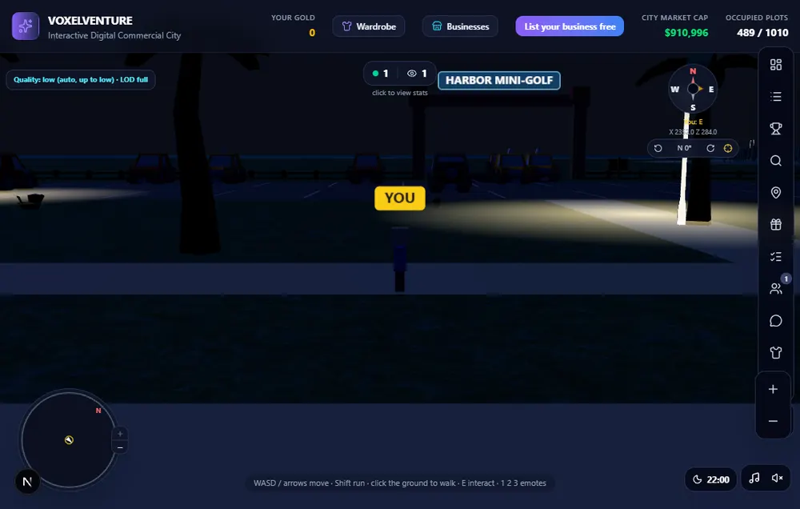
- **The way to the second nine**: a **gap in the fence** on the east side and a path from the loop's east leg through it to The Adventure Loop (below). `courses[].park.link` in the manifest says where. (The park keeps 16 units of lawn west of the first nine; the strip once kept there for a second nine was too small for nine holes, so the second nine is east.)
- **Cost**: 449 models (instanced by kind; the car park's ten Car Kit cars are 2,000 triangles each, the fence 64 for each of its 313 pieces, the palms about 190), 76 boxes and 53 painted quads in the course's chunks; drawn only where the chunks are mounted, and a device that cannot load the models still sees the boxes, the paths and the car park's lines. **Measured** (`scripts/world/measure-ports.mjs`'s method, at the park): before the phone work, a phone drew **103 draw calls and 66,143 triangles** there (about four times Kingston's 42 and 15,288), a desktop 136 and 80,839. A phone now draws **made copies** of the cars (a body, a cabin and four wheels, 60 triangles, in the kind's colour) and of the fence (a post and two rails, 36 triangles) (`lib/world/portMid.js`, picked in `chunkObject.js` for the mid tier), and the park has two kinds of plant fewer: **93 draw calls and 41,489 triangles** (the triangles 37 per cent fewer); a desktop 126 draw calls and 81,155 triangles (the Kenney cars stay). The park is about 180 x 160 units on the flat land south of the east spur road; the recipe is refused if any of it is off flat land or within 14 of a highway (but for the road in), 40 of a river or the coast, or touches a town.
- **The shop's stand**: a counter under a red awning in front of the shop, the coloured balls laid out on it and a rack of putters behind ("RENT A PUTTER"): a display; nothing is sold.

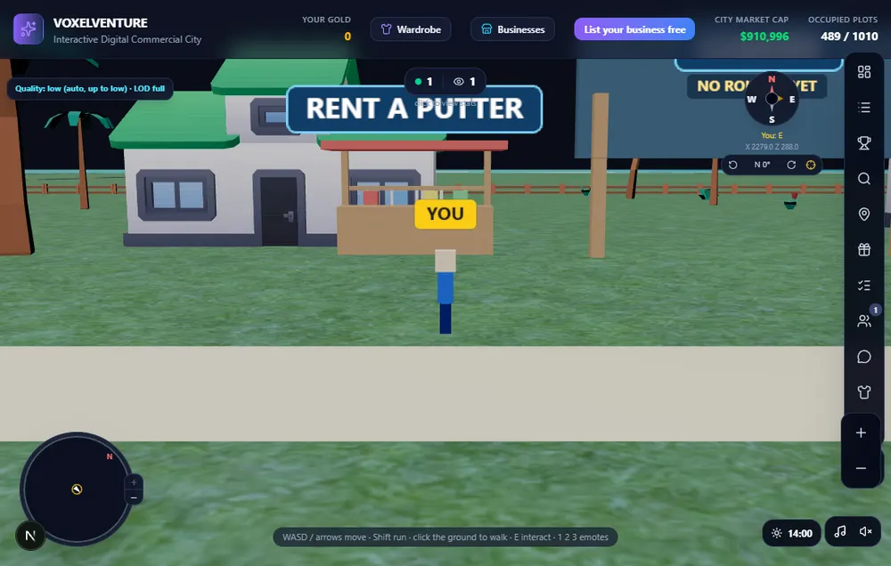

- **Cars on the access road**: two cars of the Car Kit drive in from the highway on one lane, park by the gate for five seconds and leave on the other, over and over (`ParkCars` in `MiniGolf.jsx`); scenery only: not solid, not sent to other players, drawn only within 260 units of the park.

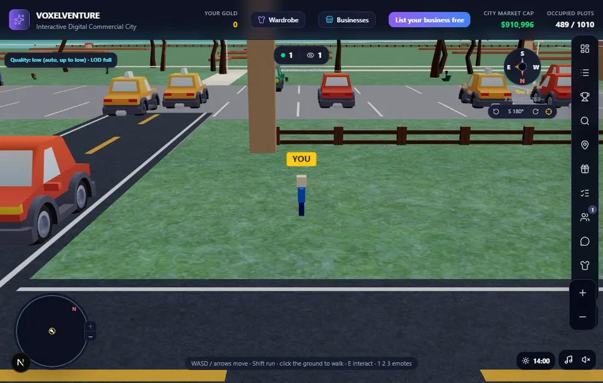

- **Not done in the park**: the cars park nowhere in the lot (they turn at the gate), and nothing is for sale.

## Why a grid of cells

A set of cells makes a hole of any shape without geometry code: the felt, the walls and the ball's faces all come from the same edges, so they cannot disagree; a block is a cell left out; and a new kind of hole is a new list of legs. The cost: walls are axis-aligned (no curves), which the kit's pieces also are mostly.
