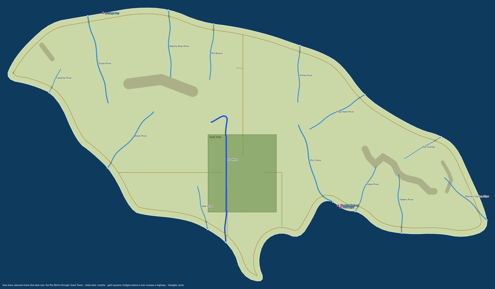

# The mainland's river plan

Written for: the owner and developers. Made 2026-11-17, before any river is built, as the owner asked ("plan all the mainland rivers first, then start with the Rio Minho: that makes the rest faster and has fewer mistakes"). The background (why the town's river is not joined to the sea, the owner's direction, the real data) is in [river_system.md](river_system.md).

*Blue: the planned rivers (the dark one is the Rio Minho through Voxel Town). White dots: mouths. Gold squares: where a river crosses a highway (a bridge). Triangles: ports. Grey: the mountain ranges. The brown lines are the baked highways.*

## How it was made

- **The real map on the game map.** The mainland is Jamaica's shape on its real longitude and latitude, so a real place can be put on it. The map from lon/lat to the game's x and z is a turn, a scale and a shift; it is fitted to the 22 mountain points that are known in both (the template's and the baked manifest's), with an error of **0.006 units**. May Pen (lon -77.28, lat 18.02) lands 14 units from the centre of Voxel Town, as it should (`projectionFor`, `lib/world/riverPlan.js`).
- **The data** (`RIVERS`, `PORTS`): the real rivers of Jamaica from Wikipedia (read 2026-11-17). Where a page gives a coordinate for a point it is used (`basis: 'page'`); where it gives one coordinate or none, the position is estimated from the described course (`'approx'`). One page coordinate is wrong and is not used: the Rio Cobre's source (17.590, -76.523) is out at sea.
- **The game's coast is not Jamaica's** (a few per cent of variation), so each mouth is **moved to the nearest point of the game's coast** and the plan says how far (the "moved" column). The course is a smooth curve from the source through the river's described turns to the mouth, with a small seeded meander (not in the town).
- **Checked** by `tests/river-plan.test.mjs`: the projection, the data, every river (on the land, ending on the coast, widening, a fall, a highway to bridge), the Rio Minho down Willow Run, no river through the town but the Rio Minho, no two rivers crossing, the ports. To see the picture again: `node scripts/world/river-plan.mjs --write`.

## The rivers

Lengths and widths are in game units (a unit is about 90 m across the map; the real Rio Minho, 92.8 km, would be about 1,000). The widths are at the source, the middle and the mouth. The fall is from the sea at the mouth to the source's height (the real height in metres, scaled so Blue Mountain Peak is 18). "Moved" is how far the real mouth was from the game's coast.

| River | Coast | Mouth is | Position | Real length | Length | Width (source / mid / mouth) | Fall | Moved | Bridge on |
|---|---|---|---|---|---|---|---|---|---|
| Rio Minho | south | mouth | page | 92.8 km | 709 | 6 / 12.8 / 26.7 | 4.3 | 26 | mainland-ring |
| Milk River | south | mouth | approx | - | 223 | 6 / 8.1 / 14.6 | 2.78 | 94 | mainland-ring |
| Black River | south | delta | page | 53.4 km | 372 | 6 / 9.6 / 26.8 | 2.78 | 32 | mainland-ring |
| Rio Cobre | south | harbour | approx | 51 km | 444 | 6 / 10.3 / 24.1 | 4.3 | 57 | mainland-ring |
| Hope River | south | delta | approx | - | 254 | 6 / 8.4 / 22.5 | 4.3 | 38 | mainland-ring |
| Yallahs River | south | delta | approx | - | 301 | 6 / 8.9 / 24.2 | 4.3 | 18 | mainland-ring |
| Plantain Garden River | east | mouth | approx | - | 305 | 6 / 8.9 / 16.6 | 4.3 | 4 | mainland-ring |
| Rio Grande | north | gorge | approx | - | 217 | 4.2 / 5.7 / 10.1 | 4.3 | 8 | mainland-ring |
| Wag Water River | north | mouth | approx | - | 331 | 6 / 9.2 / 17.3 | 4.3 | 16 | mainland-ring |
| White River | north | mouth | page | - | 288 | 6 / 8.8 / 16.2 | 4.3 | 14 | mainland-ring |
| Rio Bueno | north | mouth | approx | - | 284 | 6 / 8.7 / 16.1 | 3.61 | 7 | mainland-ring |
| Martha Brae River | north | mouth | approx | - | 340 | 6 / 9.3 / 17.5 | 4.3 | 7 | mainland-ring |
| Great River | north | mouth | page | 92 km | 455 | 6 / 10.4 / 20.4 | 3.86 | 33 | mainland-ring |
| Cabarita River | west | mouth | approx | - | 133 | 6 / 7.3 / 12.3 | 2.78 | 12 | mainland-ring |

**What each kind of mouth is** (it decides what is built at the sea): a **mouth** is an ordinary river mouth (a channel widening a little); a **delta** (the Black River's marsh, the Hope's and the Yallahs' gravel) spreads out and is shallow with islands of mangrove or gravel; the **harbour** (the Rio Cobre) enters the Kingston Harbour inlet at its head; a **gorge** (the Rio Grande) is narrow and steep with rock walls.

**The Rio Minho is the town's river.** Its middle course is Willow Run, down the west of Voxel Town, unchanged; it gains a northern course (up to the Mocho Mountains, 90 units north of the town) and a southern one (150 units to the south coast).

**Every river crosses the coastal ring road just before the sea**, so each needs a bridge on the ring (14 in all; the plan lists where: `crosses`). These are ordinary highway bridges over a narrow channel, in the style of the town's river bridges or the Kenney bridge kit, not the long causeway bridges.

## The ports

| Port | Role | Game position | Moved to the coast | Note |
|---|---|---|---|---|
| Kingston Harbour | shipping port (the mainland's) | (500, 172) | 47 | an almost landlocked natural harbour closed by the Palisadoes spit; the Rio Cobre enters at its head; the container terminal; in the game, at the head of the harbour inlet the coast already has |
| Port Royal | boat harbour | (513, 182) | 1 | at the harbour mouth: a fishing and small-boat harbour (and a marina) |
| Montego Bay | cruise and cargo port | (-691, -801) | 17 | the north-west, by the Great River's mouth (position approximate: that page was not read) |
| George Town (Harbor Isle) | shipping port and cruise anchorage (the island's) | (1637, 33) | - | the island's existing harbour (a quay and three piers on the west coast, facing the mainland): cargo at the quay, cruise ships at anchor |

A shipping port on each large landmass is the Kingston Harbour (the mainland) and George Town (Harbor Isle); the other two are the boat harbour and a second, smaller port.

## The rules the design follows

1. **Water levels.** The sea is -0.3 (the datum). A river's surface is the sea level at its mouth and rises upstream on a concave profile (steep near the source) to its source height, no more than 4 units (`surfaceAt`). On the plain, where the baked ground is flat at 0, the channel is **cut below the ground**: banks at the ground, water at or under -0.05 and a bed under it. The surface is a function of the distance along the river, so every consumer (the water mesh, the boats, the tests) asks the same function.
2. **The town's river is sunk, not raised.** Today Willow Run is a plate of water 0.026 over the town slab. To join the sea it must be at the river's level: the river's rectangle is cut out of the slab (the slab built round it) and the water at its own level, with the five town bridges unchanged (their decks are at the road's height). This closes the datum's 0.326 disagreement for the river; the town's three lakes can stay raised ponds (they are not connected to anything).
3. **One bridge per river on the ring road**, at the river's crossing with it, at the ring's own height (the road does not dip).
4. **Boats**: a river is navigable for boats from its mouth up to where its width falls under 6 units; the harbours and the Black River's lower reaches are the boating waters.
5. **Nothing runs through the town but the Rio Minho**, and rivers do not cross.
6. **The coast is cut a little at each mouth** (the mouth flares by up to 2 times its width over its last 12%), so the sea's foam and depth shading ([water.md](water.md)) meet the river, not a straight wall.

## Decisions taken by the owner (2026-11-17)

- **All 14 rivers are kept.** The Black River's morasses stay, **with their mangrove islands**. The mouths and the harbour entrances keep **the proportions in the table** (the flare and the widths); they can be adjusted once they are built. **Harbor Isle gets canals, a lagoon and mangroves** (no river: Grand Cayman has none). A shipping port on both large landmasses.

## Built so far

- **All fourteen rivers are in the baked world (2026-11-17).** The recipe turns on every river of the plan (`WORLD_RECIPE.rivers`); the bake cuts each as a second coast and bridges the ring over each (14 bridges, none on a spur or a link); `tests/rivers.test.mjs` and `tests/river-bridge.test.mjs` cover all of them. The re-bake changed the chunks along every river and the manifest.
- **The rivers' own water (`lib/world/riverWater.js`, `tests/river-water.test.mjs`).** The sea's plane lies under the whole world and shows through the channels, but its shader shades by the distance to the *coast*, so a river looked pale and washed out near its mouth (it read the narrow strip near the coast as foam). Each river now has a ribbon of water at the sea's level (a hair over it, pulled toward the camera in depth because the depth buffer is coarse at a few hundred units): light and clear over the banks, deeper in the middle, tinted by the kind of river (a marsh is tea and green, a gorge pale), and fading out past the mouth so it blends into the sea. `?riverwater=0` turns it off.
- **The deltas' islands (`deltaIslands`).** The Black River's morass has **11 islands with mangroves** (small trees from the Racing Kit's set on each), the Hope River 2 and the Yallahs 4 gravel bars (no trees). An island is land in the channel: the river's distance field flips positive inside it and the bank slopes up out of the water round it, so the ground, the water and the boats all see it. They are seeded by the river's id, so the world is the same bytes.
- **Cost.** More coast means more finely cut cells at the water's edge (now 2 x 2 where the slope meets the sea's level, and a narrower band): the 25-chunk ring round the town is 39,200 triangles of the 40,000 budget (it was 19,700 before the natural waterline), and a chunk can now have a fourth mesh (the river bridge's boxes).
- **The Rio Minho in the baked world (2026-11-17; `lib/world/rivers.js`, `tests/rivers.test.mjs`).** The recipe turns it on (`rivers: ['rio-minho']`; each of the others is one id away), the world builder plans it (`buildRivers`), and the bake cuts it into the ground **as a second coast**: the ground's signed distance to the shore becomes the smaller of the coast's and the river's (stretched: a deeper bed and narrower banks than a beach, `RIVER_SD`), so the channel, the sandy banks, the water cells and the water at the sea's level all come out of the code that cuts the coast, and the terrain already lets a boat sail where the sea is deep enough. Outside the town the river runs from its source (north-west of the town) to the sea (south, west of the south spur road): 709 units, 6 wide at the source and 27 at the mouth; 15 chunks changed in the bake. It is not cut inside the first town's land (the town draws its own river there). The ring road crosses it as a flat slab (a bridge in effect: its rails and piers are not drawn yet). Seen on the development page: `gallery/minho_a.webp` (the north reach) and `gallery/minho_d.webp` (the south reach, the ring road and the mouth).
- **The town's river sunk (2026-11-17; `lib/world/townWater.js`, `tests/town-water.test.mjs`).** The town's river (Willow Run) now runs in a **trench** through the slab at the **sea's level** (`RIVER_WATER`, the bed at the seabed `RIVER_BED`), so it is one water with the baked river and the sea: the slab, the built-up slate and the lawns are cut round it (`Land.jsx`), `River.jsx` draws the bed, the walls, the sandy banks and the water at the sea's level (the bridges are unchanged), and the baked river is cut through the town's land at the town river's width (the plan eases to its own width over 15% of its length). Boats and ducks float on the water they are on (`waterYFor`, `boatYFor`: the river is the sea level, a lake a pond), and with the baked world mounted the river rectangle runs on 4 units past the town edge so a boat sails out of the town and on down the river to the sea. The town's lakes stay ponds (`TOWN_WATER`). The datum's "town water against the sea" disagreement is closed.
- **Rivers and roads (2026-11-17).** No river meets a road but the coastal ring, and none comes within a road's width of a spur, a link or the speedway circuit (`tests/river-plan.test.mjs`): the Rio Bueno was moved 140 units west because it ran through the Voxel Speedway. **Every river has to cross the coastal ring once to reach the sea** (the ring runs 30 units inland of the whole coast), so those 14 crossings cannot be moved away: each is a bridge (see "The ring bridge" below).
- **Natural edges (2026-11-17).** The waterline of a river (and of a beach) was saw-toothed because the mesh's 4-unit triangles cut a kink in the bed profile. The bed is now a smooth curve (`shoreHeight`), the cells at the water's edge are cut finer (3 x 3) with their heights read from the interpolated distance, and the bank colour fades smoothly: the waterline is a clean contour. Cost: about 14,000 more triangles over the 25 chunks round the town (33,500 of the 40,000 budget). Pictures: `gallery/river_edge_b.webp`, `gallery/town_river_a.webp`.
- **The ring bridge (2026-11-17; `lib/world/riverBridge.js`, `tests/river-bridge.test.mjs`).** Where the coastal ring (or a spur) meets a river's channel, the bake splits the road: the road, a `river-bridge` piece, the road. The bridge is found along the whole road as one path (so a corner of the ring in the channel does not split it): the channel is where the ground is under the water (the signed distance under -1.1, so a road that only grazes a bank is not on a bridge), with 4 units of bank on each side and a **22-unit ramp** each way, rising to **2.4 units over the ground** (the water is 0.3 under it), so a boat passes under with more than two units to spare. Each baked piece records the span, the ramp and where the channel is along it. The deck is a ribbon on the one function the terrain, the mesh and the tests all read (`deckHeight`, now with the piece's own ramp), so a car drives up and over and a person walks over; a girder, two parapets, end posts and **piers in the water** (one every 12 units of channel, down to the bed) are boxes in the chunk's track mesh (vertex colours and normals, no grass grain). The Rio Minho's bridge is 70 units long with an 18-unit channel and one pier; every river that is turned on later gets its bridge from the same code. Pictures: `gallery/ring_bridge_a.webp`, `ring_bridge_b.webp`.
- **Not built yet for the Rio Minho:** a river water surface of its own (it uses the sea plane at -0.3: a lowland river with no fall), and the sea shader's foam and depth shading at the mouth.

## The work, in order (each is a pull request with tests)

1. **The river data in the bake.** A rivers list in the world recipe (the plan's courses), the manifest carrying each river (id, name, kind, course, width, fall), the chunks along each course with a heights grid (the channel carved: a bed, banks, a mouth), and the bridges on the ring. A new bake, with the freeze exception. Tests: every course is carved (the ground under it is below the surface), the join with the town slab, the checked hash.
2. **The water.** One mesh for all rivers from the plan (a ribbon following the course at `surfaceAt`, flaring at the mouth), the sea's shader reading the rivers' mouths (foam), the delta's shallows. Test: the surface meets the sea level at every mouth and the town water at the town.
3. **The Rio Minho first, as the proof:** the town's river sunk (the slab cut round it, the water at its level), the whole river from the Mocho Mountains to the sea, with its bridge on the ring road, and the boats of the town able to sail out (the hand-over from the town's boat rectangles to the river, in `lib/sim/vehicles.js` and `terrain.js`). This closes the datum's town-water disagreement.
4. **The other thirteen rivers**, each a data entry already: the channels, the water and a bridge are the same code. The delta and the gorge are the two special cases (shallows and islands; walls).
5. **The harbours and the ports:** the Kingston Harbour (the container quay, cranes, the pilots' channel from the sea), Port Royal (the boat harbour), Montego Bay, and Harbor Isle's George Town (the existing quay widened to a cargo quay and a cruise anchorage), with the boats' berths.
6. **Harbor Isle**: no river (Grand Cayman has no permanent surface rivers). Its water is the North Sound lagoon and mangrove channels, and perhaps canals: decided with the owner when the mainland is done.

## Risks

- **A re-bake changes the chunk data** (the hash, the sizes, the tests that pin them) and needs the freeze exception: it is one change, so it is done once, for all fourteen rivers, which is the reason to plan them all first.
- **A river under the ring road and the town's streets**: the five town bridges and the ring bridges are the places to look at after the carve (a road over a channel at the road's own height).
- **The positions are partly estimated** (nine rivers are `approx`): the plan is the place to move one (a line in `RIVERS`), and the picture and the tests show the result before anything is baked.
- **The Milk River's mouth is 94 units from where its real mouth would be** (the game's south coast is narrower there): it is kept west of the Rio Minho so the two do not meet.

## Decisions still to take with the owner

- The width of each mouth and of the harbours' entrances (after the design is in place: this plan gives the proportions).
- Whether the Black River's morasses are a big marsh (a wet area with mangrove islands) or just a wide delta.
- Whether to keep all fourteen, or start with the south coast's six (Rio Minho, Milk, Black, Cobre, Hope, Yallahs).
- Harbor Isle's water: lagoon and mangroves only, or canals too.
