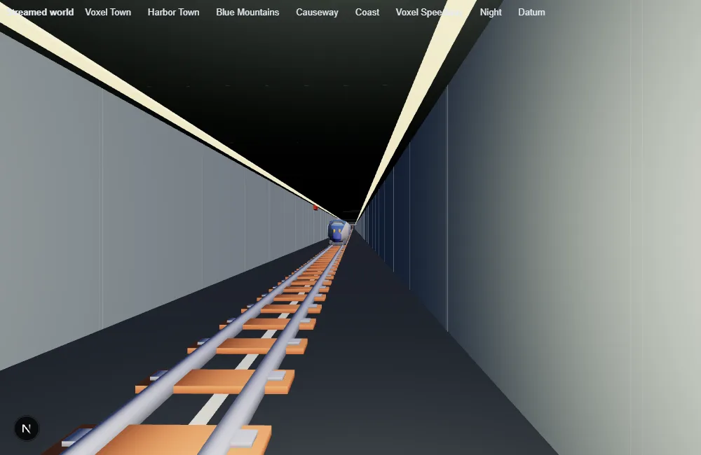
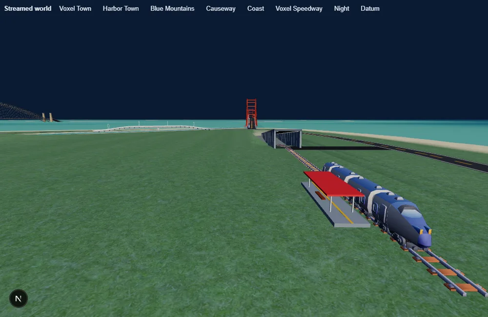

# The Harbor Tunnel, stage 1: a train you ride under the sea

Written for: the owner and developers. Made 2026-11-17. This is **stage 1** of [tunnel_evaluation.md](tunnel_evaluation.md): a rail tunnel you ride through. Stage 2 (walking and driving in the tube) is not built.

## What is in the game

- **The tunnel is part of the world.** The recipe's `tunnels` (`harbor-tunnel`, beside Harbor Causeway) is built by `buildTunnels` (`lib/world/tunnel.js`) and baked into the manifest (`tunnels`: the route along the causeway's line, the portals, the links to the ring roads). The development spike's route code became the world's; the spike (`/world/stream?tunnel=1`) now only adds the approach roads and a light.
- **A second train line, in the middle of the tube** (`tunnelTrainLine`): a station on the ground 40 units outside each portal (**Mainland Tunnel Station**, **Isle Tunnel Station**), the rail going down the 0.08 ramp, level at -5.5 under the sea, and up again. The same timetable code as the causeway train (a 131-second ride, 16 seconds in each station), the same cars. `lib/world/train.js` now takes a line with its own `lateral` and a `tunnel` ({ s0, s1 }): the rail lies on the tube's road between the portals and on the ground outside them, with the same lift, so there is no step at the portal.
- **Several lines.** `fleetRefs.trainLines` lists every line (`trainLine` is still the first causeway's); a rider's vehicle names its `lineId`; boarding, getting off, the rider's HUD ("Next stop: Isle Tunnel Station") and the platform prompts work per line (`fleetStore.js`, `Vehicles.jsx`, `Avatar.jsx`, `Train.jsx`).
- **The tube** (`apps/web/components/world/Tunnel.jsx`, mounted with the baked world and on the dev page; `?tunnel=0` leaves out the tube and its line): road, walls, a roof with two lamp strips and a slab under it, all double-sided so the sea never shows from inside, in 4-unit pieces (about 3 draw calls).
- **The portals are cut into the ground** (the bake): where the tube stands out of the ground (the first ~60 units of each ramp) the baked ground is cut down to the road inside it, 2.4 units beyond the tube's walls (`trenchAt` in `lib/world/tunnelSpec.js`): three chunks differ (`8_2`, `9_2`, `13_2`). The sea's plane is an infinite sheet at -0.3, so it would have shown as water inside the portal: its shader leaves out a patch over each trench (`portalHoles`, `uHole` in `lib/world/seaDepth.js`; `?seashade=0` turns the shading, and with it the holes, off).
- **The camera.** The follow camera ignored height (it looked at the ground at 0), which a rider on the causeway's deck or in the tube needs: for a rider of the train it now follows the rail's height, and **inside the tube it is pulled in** (2.4 behind, at most 1.2 over the head: `TUBE_CAMERA` in `FollowCamera.jsx`) so it stays under the roof and between the walls.
- **Presence.** A rider is checked as a car (6 units a second, under the car's 7); every position of the ride is accepted (tested). The tube lies inside the world's rectangle.

## Tests

`tests/tunnel.test.mjs` (the route and profile, the manifest's tunnel, the trench, the holes in the sea, a bad recipe), `tests/tunnel-train.test.mjs` (the line, the rail's heights and grade, the timetable, presence, boarding and riding by line, the rider at the bottom of the tube). The tests that said "the ground is flat" or "nothing is lower than the seabed" (`harbor-datum`, `world-chunk-mesh`) leave the three cut chunks out, on purpose; `world-bake`'s "only the highways differ" leaves out the cut ground.

## Not done (stage 2 and the rest)

- **Nobody can walk or drive in the tube**: no `tunnelAt` layer in the ground model, no corridor rule; the tube has a road slab with a lane line but no cars use it, and the approach roads are only the dev spike's.
- **The portal is a plain box with an open end** (no arch, no signs), and the cut ground is cell-sized (4 units).
- **Not seen on a phone**; the tube is about 3 draw calls and a few thousand triangles (not measured).
- The first causeway's train and this one share the train models; a second train on the clock is not yet staggered against the first.
